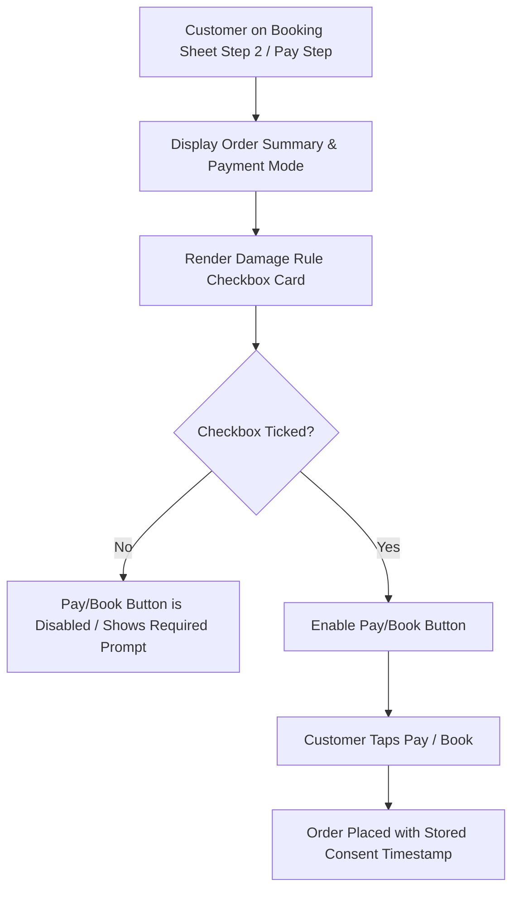
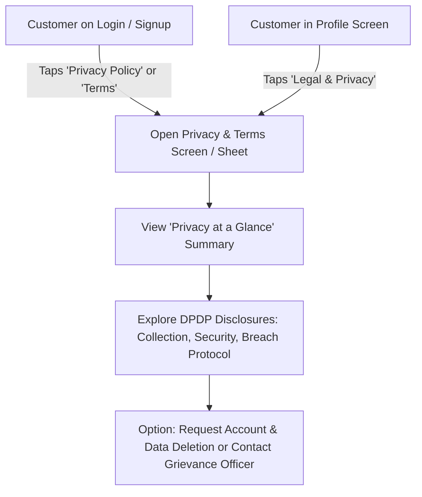

# Feature Spec: ₹650 Jar Damage Agreement & DPDP-Compliant Privacy Policy

> **Status:** Draft (Awaiting User Approval)  
> **Target Apps:** `apps/user_app_donor` (Flutter Android Customer App)  
> **Relevant Laws & Guidelines:** Digital Personal Data Protection Act 2023 (DPDP Act), IT SPDI Rules 2011, CERT-In Cyber Directions 2022, Google Play User Data & Privacy Policy Standards  
> **Design Principles:** `DESIGN-PSYCHOLOGY.md` ("Nobody Remembers Your UI", "Layout Speaks Before You Do", "Design the Last Moment First"), `.agents/design-basics/SKILL.md` (WCAG AA, 8px grid, 44px touch targets), `.agents/ssdlc/SKILL.md` (Data classification, Data minimization, Breach notification, Right to erasure).

---

## 1. Problem Statement & Background

### A. The ₹650 Jar Damage Dispute Problem
- **The Operational Challenge:** Shodasha delivers premium 20-liter water jars with ₹0 advance security deposit to keep onboarding and instant reordering frictionless.
- **The Friction Point:** When a customer damages, cracks, or loses a jar (or switches vendors and keeps the jar), asking for the standard ₹650 replacement cost after the fact leads to disputes, hostile arguments, refusal to pay, or customer number-blocking because "humko pehle bataya nahi gaya tha".
- **The Solution:** An active, prominent agreement checkbox directly on the booking checkout review screen:  
  `[ ] I agree to pay ₹650 if the jar is damaged or lost.`  
  The checkout button remains disabled until explicitly checked, establishing clear legal, financial, and psychological consent *before* water cans are dispatched.

### B. Modern Android Privacy Policy & Indian Data Protection (DPDP Act 2023)
- **The Legal Landscape:**
  1. **DPDP Act 2023 (Digital Personal Data Protection Act):** Requires explicit, unconditional, informed notice and consent prior to data collection, purpose limitation (only for water delivery and ledger accounting), right to access, right to correction, right to erasure ("Right to be Forgotten"), and mandatory incident reporting to the Data Protection Board of India and affected Data Principals.
  2. **IT SPDI Rules 2011 & CERT-In 2022:** Requires reasonable security practices, 6-hour cybersecurity incident reporting to CERT-In, and a publicly designated Grievance Officer with 30-day resolution timeline.
  3. **Android Standard & Google Play Store Policies:** Apps must present clear in-app disclosures, interactive Terms & Privacy Policy links at sign-up/login, a permanent Privacy Policy entry in Profile/Settings, and an in-app Account & Data Deletion request mechanism.
- **The Solution:** A dedicated, native, Material 3 `PrivacyPolicyScreen` in the Android app, accessible from:
  1. Profile Screen under "Legal & Privacy".
  2. Login & Registration Screen via interactive tappable text links.
  3. Comprehensive disclosures: Data collected, Storage & Encryption (AES-256 / TLS 1.3), Incident & Data Breach Response Protocol, Data Deletion Request Flow, and Grievance Officer contact details in Bhopal, MP.

---

## 2. Detailed User Flows

### Flow 1: Order Placement with ₹650 Damage Rule Agreement


### Flow 2: Privacy Policy & Terms Navigation


---

## 3. UI Component Architecture & Wireframes

### Screen 1: Booking Sheet Payment Step with Damage Checkbox (`booking_sheet.dart`)
```
+-------------------------------------------------------------+
| Delivery Schedule & Payment                                 |
|                                                             |
| [ Schedule Summary: Tomorrow, 7:00 AM – 12:00 PM ]          |
| [ Total: ₹60  (Water ₹60 • Zero Security Deposit) ]         |
| [ (•) Cash on delivery (COD)   ( ) UPI (Upcoming) ]         |
|                                                             |
| +-[ Damage & Loss Agreement Card: Amber/Teal Border ]-----+ |
| | [X] I agree to pay ₹650 if the jar is damaged or lost.    |
| |                                                           |
| | Shodasha 20L jars are reusable company assets delivered   |
| | without advance deposit. Jars must be returned intact on  |
| | the next delivery.                                        |
| +-----------------------------------------------------------+ |
|                                                             |
| [ Back ]                      [ Pay ₹60 / Book Delivery ]   |
+-------------------------------------------------------------+
```

### Screen 2: Profile Screen Menu Updates (`donor_profile_screen.dart`)
Under the "Support" or "Legal & About" section:
```
+-------------------------------------------------------------+
| Legal & About                                               |
|                                                             |
| [ Shield Icon ]  Privacy Policy & Terms                     |
|                  DPDP Act 2023 · Data security · Grievance  |
|                                                             |
| [ Trash Icon ]   Delete Account & Data                      |
|                  Request permanent data erasure             |
+-------------------------------------------------------------+
```

### Screen 3: Dedicated Native Android Privacy Policy Screen (`privacy_policy_screen.dart`)
Structured into 7 clear, expandable/readable cards:
1. **Privacy at a Glance (Quick Summary)**:
   - What we collect (Phone, Name, Delivery Address, Jar Return Ledger)
   - What we NEVER do (Never sell data, no third-party ad trackers)
   - How we store it (Encrypted cloud infrastructure, TLS 1.3, AES-256)
2. **Data We Collect & Purpose Limitation (DPDP Act Sec 5 & 6)**:
   - Account info for OTP verification & account security
   - Delivery address & GPS coordinates solely for route delivery by riders
   - Jar count & transaction logs for deposit and return accountability
3. **Data Storage & Reasonable Security Safeguards (Sec 8(5))**:
   - Stored in Indian data centers / Cloudflare edge with strict role-based access
   - Zero plain-text storage of sensitive data
4. **Data Breach & Incident Response Protocol (Sec 8(6) & CERT-In)**:
   - If any data breach or security incident occurs, Shodasha is committed to reporting to CERT-In and the Data Protection Board of India within statutory deadlines (6 hours for CERT-In).
   - Affected users will be notified immediately via in-app notification / SMS with details of affected information, mitigation steps taken, and recommendations.
5. **Data Retention & Your Right to Erasure / Erasure Request (Sec 12)**:
   - Data retained only as long as an active account exists or as required by Indian tax/GST laws.
   - 1-tap in-app request to erase personal data and close account.
6. **₹650 Jar Asset Protection Terms**:
   - Transparent terms regarding jar ownership, maintenance of clean jars, and replacement fee.
7. **Grievance Redressal Officer (DPDP Act Sec 13 & IT Rules 2011)**:
   - Name: Grievance Officer, Shodasha Mineral Waters
   - Address: Bhopal, Madhya Pradesh, India
   - Email: `support@shodashawater.com`
   - Redressal timeline: Acknowledgement within 48 hours, resolution within 30 days.

---

## 4. SSDLC & Threat Modeling (STRIDE)

| Threat | Risk | Mitigation |
|---|---|---|
| **Repudiation** | Customer denies agreeing to ₹650 jar damage charge | Record timestamp of user consent and agreement version during order creation |
| **Information Disclosure** | Leak of customer delivery address / phone number | Role-based data access (riders only see assigned active stops); TLS 1.3 in transit; AES-256 at rest |
| **Data Breach Cover-up** | Failure to disclose incident, violating DPDP Act & CERT-In | Codified Breach Notification Protocol in Privacy Policy committed to CERT-In & customer notification within statutory guidelines |
| **Tampering** | Customer data modified without authorization | Idempotent API calls, authenticated JWT/session bearer tokens, strict input validation |

---

## 5. Technical Deliverables Plan

1. **`apps/user_app_donor/lib/features/booking/booking_sheet.dart`**:
   - Add `bool _agreedToDamagePolicy = false;`
   - Render high-contrast `_DamageAgreementCard` on Step 2 (`_payStep`).
   - Gate `_canPay(busy)` so payment/booking requires `_agreedToDamagePolicy == true`.
2. **`apps/user_app_donor/lib/features/legal/privacy_policy_screen.dart`**:
   - Create new legal feature module with complete, legally accurate DPDP Act 2023 disclosures, breach protocols, security measures, and grievance officer info.
3. **`apps/user_app_donor/lib/features/profile/donor_profile_screen.dart`**:
   - Add "Privacy Policy & Terms" and "Account Deletion" menu options navigating to the privacy screen.
4. **`apps/user_app_donor/lib/features/auth/login_screen.dart`**:
   - Make the "Terms & Privacy Policy" text clickable so users can open the policy sheet before logging in or creating an account.
5. **Context Synchronization**:
   - Update `context/progress-tracker.md`, `context/flow.md`, and `context/decision.md`.
