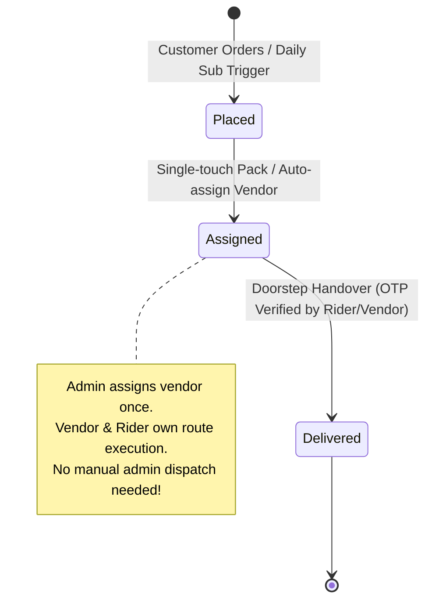
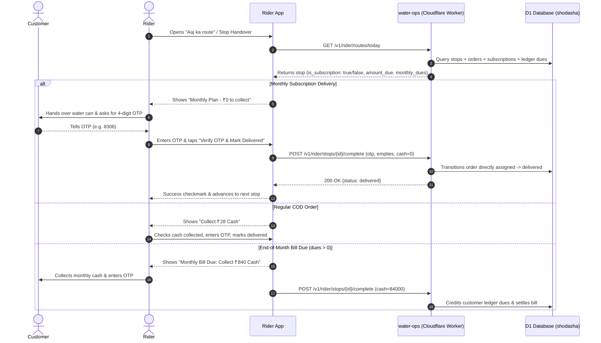

# Feature Spec: Delivery Lifecycle Overhaul & Subscription Cash Hisaab

## 1. Context & Business Intent
In the Indian water jar distribution market:
- Admin only assigns the vendor to a zone/customer. Admin never micromanages daily route "dispatch". Once an order is assigned, the vendor and their riders own the doorstep delivery.
- Customer identity (phone number & verified name) cannot be modified freely in profile settings.
- Subscription customers on monthly postpaid plans ("Mahina Hisaab") do **not** pay ₹28 cash every morning to the delivery boy. They receive jars daily without doorstep cash transactions, and pay their consolidated monthly bill at the end of the month (or when dues are billed).
- One-off / instant COD orders collect cash per delivery.
- If a customer has end-of-month pending dues, the delivery stop alerts the rider to collect the monthly bill in cash.

---

## 2. Problem Statement & Root Causes

### A. Profile "Nom" (Name & Phone) Changing
- **Problem**: `EditProfileSheet` allows users to edit their Name, Phone number, and Email freely.
- **Root Cause**: Missing read-only constraints on immutable identity fields in `edit_profile_sheet.dart` and `auth_service.py:update_me`.
- **Solution**: Lock Name and Phone as read-only with a lock badge. Enforce backend rejection if a user attempts to mutate phone or name.

### B. Rider & Vendor Cannot Verify OTP ("PoD needs a dispatched order (now assigned)")
- **Problem**: When a rider or vendor enters the correct 4-digit OTP, the app fails with 409 Conflict: `PoD needs a dispatched order (now assigned)`. In vendor app, "Complete Delivery" appears to do nothing.
- **Root Cause**: `OrderRepo` and `VendorService.pod_complete` strictly require `order.state == "dispatched"`. But only admin had a route dispatch endpoint. Admin never manually dispatches routes in daily water agency operations.
- **Solution**: 
  - Update `OrderRepo.LEGAL_TRANSITIONS` so `assigned` can transition directly to `delivered` (or record the dispatch in the event trail).
  - Update `vendor_service.py:pod_complete` to accept orders in both `"assigned"` and `"dispatched"` states.
  - Update `handover_sheet.dart` to show prominent inline feedback and dismiss cleanly upon completion.

### C. Cash on Delivery (COD) Disconnect on Daily Subscriptions
- **Problem**: The rider app demands `Collect ₹28 Cash` and blocks delivery if the checkbox is unchecked (`Please confirm cash collection before completing delivery`), even when the customer has a monthly subscription.
- **Root Cause**: `rider_service.py:routes_today` queries `orders.total` and if `payment_mode == 'cod'` and `payment_status == 'unpaid'`, sets `amount_due = total` (₹28) for all orders without checking if it is a monthly subscription delivery.
- **Solution**:
  - Check whether the stop is a subscription order (`idempotency_key LIKE 'sub:%'`) or monthly postpaid.
  - For monthly subscription deliveries: `amount_due = 0`. Display badge: `मंथली प्लान (Monthly Plan) — Do not collect daily cash`.
  - Check customer ledger dues: If customer has accumulated monthly dues at month-end (`dues > 0`), display: `Monthly Bill Pending: ₹X (Collect Cash)`.
  - In `pod_sheet.dart`: Only show the cash collection box when `amount_due > 0`. If `amount_due == 0`, show zero-collection confirmation.

---

## 3. Data Flow & State Machine



---

## 4. User Journey & Screens (Mermaid)



---

## 5. UI Layout & Wireframe

### A. Customer Profile Edit Sheet (`apps/user_app_donor`)
```
+------------------------------------------------+
| Edit Profile                             [✕]   |
+------------------------------------------------+
| Full Name                                      |
| [ Aaditya Thakur                        🔒 ]   |
| "Name is verified and cannot be changed"       |
|                                                |
| Phone Number                                   |
| [ +91 91992 60555                       🔒 ]   |
| "Phone number is your account ID and is locked"|
|                                                |
| Email Address                                  |
| [ aditya@example.com                         ] |
|                                                |
| [              Save Changes                  ] |
+------------------------------------------------+
```

### B. Rider Handover Modal (`apps/rider_app`) — Monthly Subscription
```
+------------------------------------------------+
| DOORSTEP HANDOVER                 1 × 20L Cane |
| Aaditya                                        |
| +91 91*** **555                         [Call] |
| 📍 Flat 201, Shanti Heights                    |
|                                                |
| +--------------------------------------------+ |
| | 📅 MONTHLY SUBSCRIPTION (मंथली ग्राहक)     | |
| | Do NOT collect daily cash — ₹0 due today   | |
| +--------------------------------------------+ |
|                                                |
| Customer Delivery OTP                          |
| [  8  3  0  6  ]                               |
|                                                |
| Empty Canes Collected:  [-]  1  [+]            |
|                                                |
| [        Verify OTP & Mark Delivered         ] |
| [                  Cancel                    ] |
+------------------------------------------------+
```

### C. Rider Handover Modal — End-of-Month Dues Due
```
+------------------------------------------------+
| +--------------------------------------------+ |
| | 💰 MONTHLY BILL COLLECTION (महीने का बिल)  | |
| | [✓] Collect ₹840 Cash from customer        | |
| +--------------------------------------------+ |
|                                                |
| Customer Delivery OTP: [ 8 3 0 6 ]             |
| [        Verify OTP & Mark Delivered         ] |
+------------------------------------------------+
```

---

## 6. Implementation Scope & Files Affected

1. **Backend (`workers/api`)**:
   - `src/app/repositories/order_repo.py`: Add `assigned -> {"dispatched", "delivered", "cancelled"}` so orders can be completed directly from assigned status.
   - `src/app/services/vendor_service.py`: In `pod_complete()`, permit transition to `delivered` when `order["state"] in ("assigned", "dispatched")`.
   - `src/app/services/rider_service.py`: 
     - Expose `is_subscription`, `billing_mode`, and `monthly_dues_paise` in `routes_today()`.
     - Set `amount_due = 0` for daily `monthly_postpaid` subscription stops.
     - If ledger dues exist at month-end, pass `monthly_dues_paise` so the rider can collect month-end cash.
   - `src/app/services/auth_service.py`: Reject changes to `phone` or `name` in `update_me()` when called by standard users.

2. **Donor User App (`apps/user_app_donor`)**:
   - `lib/features/profile/edit_profile_sheet.dart`: Make `_nameCtrl` and `_phoneCtrl` read-only (`enabled: false`) with a locked visual indicator.

3. **Rider App (`apps/rider_app`)**:
   - `lib/features/delivery/widgets/pod_sheet.dart`:
     - Show distinct Monthly Plan banner when `stop['is_subscription'] == true && stop['amount_due'] == 0`.
     - Only require cash checkbox when `amount_due > 0` or when end-of-month dues are being collected.
     - Remove blocking cash alert on zero-cash subscription stops.

4. **Vendor App (`apps/vendor_app`)**:
   - `lib/features/stops/handover_sheet.dart`:
     - For subscription stops, auto-fill cash as ₹0 and allow 1-tap OTP verification without requiring cash inputs.
     - Show clear inline error banner if network or OTP fails.
