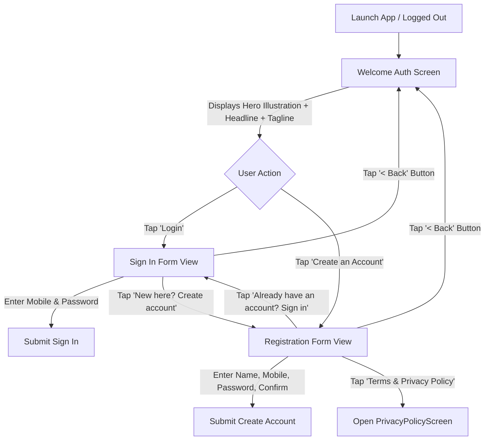

# Feature Spec: Login & Welcome Screen Redesign (Image-to-Code)

> **Status:** Draft (Awaiting User Approval)  
> **Target Apps:** `apps/user_app_donor` (`lib/features/auth/login_screen.dart`, `assets/`)  
> **Visual Reference:** User-uploaded reference image (`media_1795098346484_8151be9c.jpg`)  
> **Design Principles:** `image-to-code` (Extract composition, typography, palette, signature visual), `design-basics` (Color harmony, 8px grid, min 44px touch targets), `DESIGN-PSYCHOLOGY.md` ("Layout Speaks Before You Do", "Zero Clutter").

---

## 1. Visual Extraction from Reference Image

### A. Composition & Structure
1. **Top Hero Container**:
   - Vibrant emerald water-green curved background (`#2EAA54` / `#229954` / `ShodashaTheme.teal`).
   - Circular Back Button (`<`) at top-left.
   - Central 3D Illustration: Shodasha delivery partner in green uniform beside a 3-wheeled delivery vehicle carrying 20L water cans on the bed, with visible "SHODASHA MINERAL WATERS" branding.
   - Smooth curved transition into the lower card surface.
2. **Bottom Content Card**:
   - Pristine white card surface with soft ambient water-droplet accents.
   - Title: **"Doorstep Water Delivery"** (Replacing the placeholder "Food Service" template copy).
   - Tagline: **"Pure 20L RO + UV water jars delivered fresh to your doorstep every morning across Bhopal"** (Replacing the typo-filled food placeholder).
   - Dual Primary Action Buttons:
     - **Login** (Vibrant filled green stadium button).
     - **Create an Account** (Clean white stadium button with crisp green border).

---

## 2. Interaction & User Flows



---

## 3. Screen Wireframes & States

### State 1: Welcome Overview (Exact match to reference mockup)
```
+-------------------------------------------------------------+
|  (<)                                                        |
|                                                             |
|           [ 3D Shodasha Delivery Partner & Vehicle ]        |
|             (Green Auto Carrying 20L Water Cans)            |
|                                                             |
| ~ ~ ~ ~ ~ ~ ~ ~ ~ ~ ~ ~ ~ ~ ~ ~ ~ ~ ~ ~ ~ ~ ~ ~ ~ ~ ~ ~ ~ ~ |
| (•)                     [ White Card ]                  (•) |
|                                                             |
|                   Doorstep Water Delivery                   |
|                                                             |
|         Pure 20L RO + UV water jars delivered fresh         |
|             to your doorstep every morning                  |
|                                                             |
|             +---------------------------------+             |
|             |              Login              |             |
|             +---------------------------------+             |
|                                                             |
|             +---------------------------------+             |
|             |        Create an Account        |             |
|             +---------------------------------+             |
| (•)                                                     (•) |
+-------------------------------------------------------------+
```

### State 2: Interactive Sign In Form View
```
+-------------------------------------------------------------+
|  (< Back to Welcome)                                        |
|                                                             |
|           [ Compact Shodasha Delivery Hero Header ]         |
|                                                             |
| ~ ~ ~ ~ ~ ~ ~ ~ ~ ~ ~ ~ ~ ~ ~ ~ ~ ~ ~ ~ ~ ~ ~ ~ ~ ~ ~ ~ ~ ~ |
|                         Sign In                             |
|          Enter your mobile number and password              |
|                                                             |
| [ +91 | Mobile number field                           ]     |
| [ Password field                                  (👁) ]    |
|                                        [Forgot password?]   |
|                                                             |
| [==================== Sign In =====================]        |
|                                                             |
|               New here? Create account                      |
+-------------------------------------------------------------+
```

### State 3: Interactive Registration Form View
```
+-------------------------------------------------------------+
|  (< Back to Welcome)                                        |
|                                                             |
|           [ Compact Shodasha Delivery Hero Header ]         |
|                                                             |
| ~ ~ ~ ~ ~ ~ ~ ~ ~ ~ ~ ~ ~ ~ ~ ~ ~ ~ ~ ~ ~ ~ ~ ~ ~ ~ ~ ~ ~ ~ |
|                   Create your account                       |
|                One account for every delivery               |
|                                                             |
| [ Name field                                          ]     |
| [ +91 | Mobile number field                           ]     |
| [ Email field (optional)                              ]     |
| [ Password field                                  (👁) ]    |
| [ Confirm password field                          (👁) ]    |
|                                                             |
| [================ Create Account ==================]        |
|                                                             |
|   By creating an account, you agree to                      |
|           Terms & Privacy Policy                            |
|                                                             |
|              Already have an account? Sign in               |
+-------------------------------------------------------------+
```

---

## 4. Asset Integration & Technical Plan

1. **Asset Extraction**:
   - Extract the 3D delivery hero illustration from the uploaded image into `apps/user_app_donor/assets/delivery_hero.png` (high-res crop of the vehicle, cans, and delivery partner).
   - Register `assets/delivery_hero.png` in `apps/user_app_donor/pubspec.yaml`.
2. **Component Updates in `login_screen.dart`**:
   - Add `_AuthMode.welcome` state to `_AuthMode` (`welcome`, `signIn`, `create`).
   - When in `_AuthMode.welcome`, render the exact visual layout from the uploaded screenshot (Top green banner, 3D hero, "Doorstep Water Delivery", subtitle, filled "Login" button, outlined "Create an Account" button).
   - Tapping "Login" transitions to `_AuthMode.signIn`; tapping "Create an Account" transitions to `_AuthMode.create`.
   - In form modes, render the back arrow button to return to the welcome overview.
3. **Verification**:
   - Update tests in `login_screen_test.dart` and `damage_agreement_test.dart` to verify welcome state, navigation to Login, navigation to Create Account, and form submissions.
