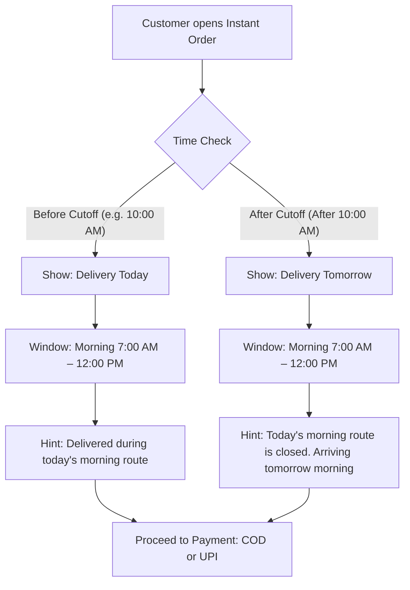
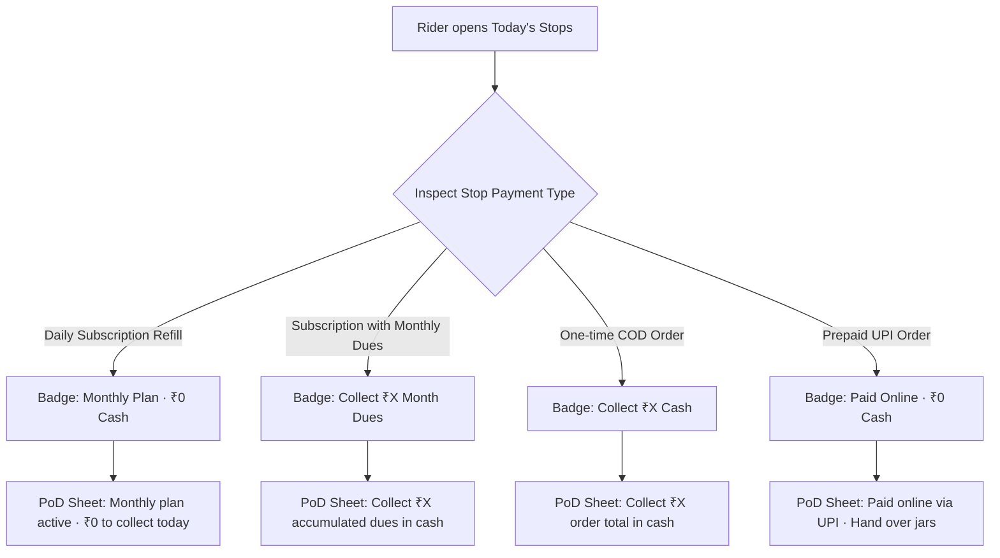

# Feature Spec: Operational Calm Delivery & Payment Clarity

> **Status:** Draft (Awaiting User Approval)  
> **Target Apps:** `apps/rider_app`, `apps/vendor_app`, `apps/user_app_donor`, `workers/api`  
> **Design Principles:** `DESIGN-PSYCHOLOGY.md` (Anti-overload, "More Options Make Users Quit", "Nobody Remembers Your UI"), `.agents/design-basics/SKILL.md` (Color guardrails, WCAG AA, Visual Hierarchy).

---

## 1. Problem Statement & Root Cause

1. **Rider & Vendor Payment Confusion (False "Paid Online" Tag)**
   - In `apps/rider_app/lib/features/delivery/delivery_screen.dart`, any stop with `!(isCod && amountDue > 0)` defaulted to rendering `Paid Online`.
   - Consequently, all subscription refills (which have `amountDue = 0` per day) and monthly postpaid cash accounts showed `Paid Online`.
   - Riders mistakenly believed the customer already paid online, causing disputes over cash collection or confusion on whether to collect cash now, collect at month end, or collect nothing.

2. **Customer App Unrealistic Micro-Slots & Confusing Cut-off Messaging**
   - The customer app offered granular 30-minute time slots (`08:00–08:30`, `10:30–11:00`), which real-world water delivery trucks (carrying 200+ cans on a route) cannot guarantee.
   - When an order was placed in the afternoon (after the morning delivery route had closed), the app jumped to tomorrow's date without explaining *why* today was unavailable, confusing users.
   - Users were presented with unnecessary choices (24 time chips), causing decision fatigue without improving service reliability.

---

## 2. Core Design Objectives

1. **Zero Guesswork for Rider & Vendor**:
   - Provide an exact, glanceable status badge on every stop card that answers: *"Do I collect cash today? How much? Or is this covered by a monthly plan?"*
   - Never show `Paid Online` unless an order was genuinely prepaid digitally via UPI or verified online payment.
   - For monthly subscription plans: clearly label `Monthly Plan (₹0 Cash)`.
   - For month-end dues: clearly label `Collect Month-End Dues: ₹X Cash`.
   - For standard COD: clearly label `Collect ₹X Cash`.

2. **Calm, Human Delivery Windows for Customers (Anti-Overload)**:
   - Retire artificial 30-minute time slots.
   - Introduce a realistic, reliable morning window: **Morning (7:00 AM – 12:00 PM)**.
   - Provide a single, calm, context-aware explanation when ordering after daily cutoff:
     - Before cutoff: *"Delivery Today • Morning (7:00 AM – 12:00 PM)"*
     - After cutoff: *"Delivery Tomorrow • Morning (7:00 AM – 12:00 PM)"* with subtle helper hint: *"Today's morning delivery cutoff has passed. Arriving tomorrow morning."*
   - No cognitive clutter: strictly 1 clean card with 1 subtle helper line. No alarming banners or popup dialogues.

---

## 3. Detailed User & Actor Flows

### Flow A: Customer Ordering Experience


### Flow B: Rider / Vendor Doorstep Delivery & Cash Flow


---

## 4. Screen-by-Screen Visual Wireframes & Microcopy

### Screen 1: Customer Booking Sheet (`apps/user_app_donor`)
```
+-------------------------------------------------------------+
| (x) Delivery Schedule                                       |
|                                                             |
| +-[ Container: ShodashaTheme.surface, subtle border ]-----+ |
| | [Sun Icon]  Tomorrow, 19 Nov · Morning (7 AM – 12 PM)   | |
| |                                                         | |
| | ℹ Today's morning delivery cutoff is closed.             | |
| |   Your order will arrive tomorrow morning.              | |
| +---------------------------------------------------------+ |
|                                                             |
| Total ₹30                                                   |
| [ Cash on Delivery (COD) ]   [ UPI (Upcoming) ]             |
| [ Back ]                      [ Place Order ₹30 ]           |
+-------------------------------------------------------------+
```
*(No 30-minute chips. Clean, predictable, restful).*

### Screen 2: Rider Delivery List Card (`apps/rider_app`)
```
+-------------------------------------------------------------+
| #4  P  ·  +91 93*** **067                           [Call]  |
| cn-3, Hanuman nagar nai basti...                            |
|                                                             |
| [💧 1 x 20L Can]  [🪜 No Lift]  [📅 Monthly Plan (₹0 Cash)] |
|                                                             |
| [ Navigate ]               [ Mark Delivered (Enter OTP) ]   |
+-------------------------------------------------------------+
```
*(If Month-End Dues: `[💰 Collect ₹450 Month Dues]`).*  
*(If Standard COD: `[💵 Collect ₹30 Cash]`).*  
*(If UPI Prepaid: `[✅ Paid Online (₹0 Cash)]`).*

### Screen 3: Rider PoD Handover Sheet (`apps/rider_app/widgets/pod_sheet.dart`)
```
+-------------------------------------------------------------+
| Doorstep Delivery Confirmation                              |
|                                                             |
| +-[ Mode Banner: Monthly Plan ]---------------------------+ |
| | Monthly Subscription Customer                           | |
| | Refill covered by monthly plan — do NOT collect cash.   | |
| +---------------------------------------------------------+ |
|                                                             |
| Empties Collected:  [ - ]  1  [ + ]                         |
| Customer Delivery OTP:  [ _ _ _ _ ]                         |
|                                                             |
| [ Confirm Delivery ]                                        |
+-------------------------------------------------------------+
```

---

## 5. Invariants & Guardrails

1. **Never Show False Payment State**: An order can only have `Paid Online` if `payment_status == 'paid_upi'` or verified digital payment. Subscription refills must display `Monthly Plan (₹0 Cash)`.
2. **Predictable Cutoff Boundary**: Delivery cutoff is explicitly configured (e.g. 10:00 AM local time). After 10:00 AM, dates default to tomorrow with a gentle, non-technical explanation.
3. **No 30-Minute Slot Fragmentation**: Orders are aggregated into standard route batches (`morning_7_12`), eliminating fragile 30-minute promises to customers.
4. **Cognitive Calm**: Max 1 notification line per card. No red warning banners for standard operational cutoffs.
