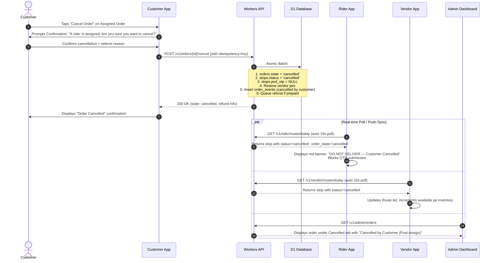
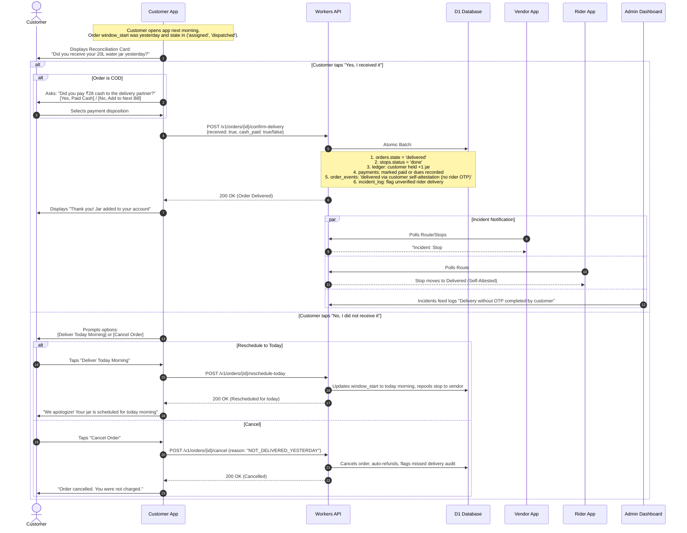
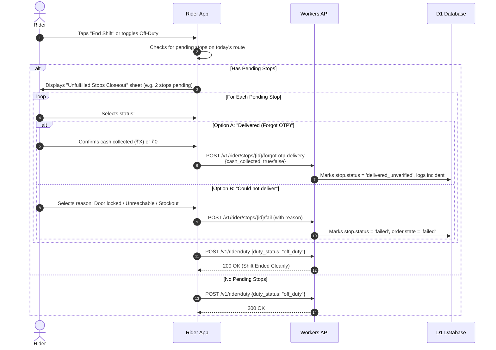

# Feature Spec: Customer Cancellation Override & Stale Order Delivery Reconciliation

**Status**: PROPOSED (Design-First Gate — Pending User Approval)  
**Date**: 2026-11-22  
**Target Systems**: `workers/api`, `apps/user_app_donor`, `apps/vendor_app`, `apps/rider_app`, `apps/admin_app`  
**Applicable Skills**: `design-patterns`, `user-flows`, `ssdlc`

---

## 1. Executive Summary & Problem Definition

In water delivery logistics (20L reusable jars), two critical operational failures create customer churn, inventory leakage, and driver confusion:

1. **Assigned Order Cancellation Blocker & Silent Failures**:
   - Currently, if a customer taps "Cancel" on an order in state `assigned` or `dispatched`, the backend rejects it with `NeedDispatchOverrideError` (HTTP 409).
   - The user mobile app catches the exception, swallows the message, and displays a frustrating, generic toast: `"Could not cancel this order — try again"`.
   - **Resolution (Option B Approved)**: Allow the customer to cancel even if assigned/dispatched. The system must immediately:
     - Mark the order and associated stop as `cancelled`.
     - Alert the assigned rider with a high-contrast `"❌ DO NOT DELIVER — Order Cancelled by Customer"` banner and sound/haptic alert, disabling delivery completion.
     - Alert the vendor that the customer cancelled, releasing the reserved jar(s) back into the vendor's available inventory.
     - Issue a refund if prepaid (₹0 for COD).
     - Log full traceability in `order_events` with `actor_role = 'user'`, `reason = 'customer_cancelled_post_assign'`.

2. **Stale Orders & Forgotten OTP Deliveries (>24 Hours Old)**:
   - When 24 hours have passed or next day begins, old unfulfilled orders linger in the UI in `assigned` or `dispatched` state with stale OTPs.
   - **Case A (Forgotten OTP)**: Rider delivered the water can to the customer's house, but forgot to collect/enter the 4-digit OTP. The customer has the can, but the system shows the order as pending.
   - **Case B (Missed Delivery)**: Rider never arrived (door locked, vehicle breakdown, ran out of stock).
   - **Resolution**:
     - **Customer App (Next-Morning Reconciliation Card)**: Next day or $>24$h, instead of showing a stale tracking card with an old OTP, the customer home screen presents a calm reconciliation sheet:
       *"Did you receive your 20L water jar scheduled for yesterday?"*
       - If **"Yes, I received it"**:
         - Ask COD payment verification: *"Did you pay ₹X cash to the delivery partner? [Yes, Paid Cash] / [No, Add to Bill]"*.
         - Order transitions to `delivered` (`delivered_by: customer_self_attestation`).
         - Customer jar custody increments (+1 jar).
         - **Incident Alert**: Vendor, Admin, and Rider receive an incident notification: *"Order #xyz delivered without rider OTP verification (Customer self-confirmed)"*.
       - If **"No, I did not receive it"**:
         - Customer chooses: *"Deliver today morning"* (auto-reschedule to today's route) or *"Cancel order"* (voids dues, auto-refunds).
         - Vendor and Admin get an alert: *"Missed delivery flagged for Order #xyz"*.
     - **Rider App (End-of-Shift Closeout)**:
       - When rider taps "End Shift" or at shift cutoff (12 PM / evening), any pending stops require explicit disposition:
         - *"Delivered (Forgot OTP)"* $\rightarrow$ Flags stop as `delivered_unverified`, queues customer prompt.
         - *"Could not deliver"* $\rightarrow$ Prompts reason (`DOOR_LOCKED`, `UNREACHABLE`, `STOCKOUT`). Marks stop `failed`.
     - **Vendor App (Stale Route Reconciliation Hub)**:
       - Shows unfulfilled stops from yesterday with 1-tap actions: "Carry forward to today", "Confirm delivered", or "Cancel".
     - **Backend Auto-Stale Reaper**:
       - Auto-fails orders stranded $>48$ hours with `failure_reason = "EXPIRED_UNFULFILLED"`.

---

## 2. User Flows & State Machine Specifications

### Flow 1: Customer Cancellation of Assigned/Dispatched Order



---

### Flow 2: Forgotten OTP — Next-Morning Customer Delivery Self-Confirmation



---

### Flow 3: Rider End-of-Shift Closeout



---

## 3. Detailed Edge Case Analysis (Multiple Versions & Invariants)

| # | Edge Case | Version / Scenario | Resolution & System Invariant |
|---|---|---|---|
| **E1** | **Customer cancels while rider is already outside doorstep** | Rider is walking to door with 20L can | Rider app polls every 15s. When rider opens `PodSheet`, `PodSheet` checks `stop.status`. If cancelled, `PodSheet` immediately locks with red alert: *"Customer cancelled this order. Do NOT hand over the jar. Return jar to vehicle."* Prevents rider from delivering and losing the asset. |
| **E2** | **Customer cancels after paying online (UPI)** | Prepaid ₹28 or ₹56 | Atomic batch in `cancel_settle` inserts a row into `refunds` table with `status = 'pending'`, `amount = total_paise`. Reverses any ledger charge. Customer sees: *"Order cancelled · Refund of ₹X on the way to original payment method"*. |
| **E3** | **Rider forgets OTP, Customer taps "Yes, received", but claims "Did NOT pay cash"** | COD order, customer says can received but cash wasn't paid | Order moves to `delivered`, customer custody gets `+1 jar`, BUT unpaid cash amount is added to `ledger.dues` for the customer. Rider's cash collection custody remains ₹0. Admin incident report flags discrepancy for supervisor review. |
| **E4** | **Customer is dishonest: Claims "Didn't receive", but actually took the can** | Customer took can, rider forgot OTP, customer clicks "Didn't receive" and cancels | GPS proof-of-presence: Rider app records GPS coordinate timestamp when rider was within 50m of stop. Admin dashboard flags: *"Customer dispute: GPS indicates rider arrived at location at 09:15 AM"*. Supervisor can call customer or vendor before issuing refund. |
| **E5** | **Both Customer and Rider do nothing for 48 hours** | Order was never delivered and neither customer nor rider opened app | Automated Reaper Cron runs every 15 minutes. Any order with `window_start < now - 48h` and state $\in$ `{"assigned", "dispatched"}` is auto-transitioned to `failed` with reason `EXPIRED_UNFULFILLED`. Releases vendor inventory, closes open stops. Old orders never get stuck in UI. |
| **E6** | **Vendor already packed/dispatched 10 jars on vehicle, 1 customer cancels** | Vehicle inventory vs warehouse inventory | Stop is cancelled. Vendor app updates route stop count. Vendor's available vehicle stock shows 1 extra undelivered full jar. When vendor finishes route, undelivered jar is reconciled back into warehouse inventory at shift close. |

---

## 4. Architectural Structure & Data Model Changes

### 4.1 Backend (`workers/api`)

1. **State Machine (`workers/api/src/app/core/state_machines.py`)**:
   - Update `validate_order_transition`:
     - Allow `"user"` role to transition from `"assigned"` and `"dispatched"` to `"cancelled"`.
     - In `OVERRIDE_ROLES`, `"user"` is permitted, but triggers downstream stop cancellation and vendor inventory release.
2. **Order Settlement (`workers/api/src/app/repositories/order_repo.py`)**:
   - In `cancel_settle`:
     - Update `stops`: `UPDATE stops SET status = 'cancelled', pod_otp = NULL WHERE order_id = ?`.
     - Insert `order_events`: `actor_role = 'user'`, `reason = reason`.
3. **New Customer Self-Confirmation Endpoint**:
   - `POST /v1/orders/{order_id}/confirm-delivery`:
     - Payload: `{"received": bool, "cash_paid": bool, "notes": str}`
     - Validates order is past `window_start` and in `assigned` / `dispatched`.
     - If `received == true`: Transitions order to `delivered`, updates jar ledger, records payment or dues, logs incident audit.
     - If `received == false`: Supports 1-tap reschedule to today or cancel.
4. **New Rider End-of-Shift Stale Closeout Endpoint**:
   - `POST /v1/rider/stops/{stop_id}/forgot-otp-delivery`:
     - Sets `stops.status = 'delivered_unverified'`.
     - Emits alert to vendor and customer app.
5. **Rider Service Serialization (`rider_service.py`)**:
   - Add `order_state: d["order_state"]` to `stops.append` dict.

### 4.2 Customer App (`apps/user_app_donor`)

1. **`tracking_screen.dart` & `order_card.dart`**:
   - Cancel button is active for `assigned` and `dispatched` orders with clear confirmation dialog.
   - If cancel API returns an error, display the *actual* error message from backend instead of generic failure toast.
2. **`customer_home_screen.dart`**:
   - Add `_StaleDeliveryReconciliationCard`: Displayed when user has an order whose delivery window has expired ($>12\text{--}24$h) and is still in `assigned` or `dispatched`.
   - Includes:
     - Question: *"Did you receive your 20L water jar scheduled for yesterday?"*
     - Button 1: *"Yes, I received it"* $\rightarrow$ Opens quick cash confirmation sheet $\rightarrow$ calls `confirmDelivery()`.
     - Button 2: *"No, did not receive"* $\rightarrow$ Shows "Deliver today" or "Cancel order".

### 4.3 Vendor App (`apps/vendor_app`)

1. **`route_screen.dart` & `stop_detail_screen.dart`**:
   - Cancelled orders appear with a prominent `[CANCELLED BY CUSTOMER]` red badge.
   - Stop action buttons (`Handover`, `OTP`) are completely hidden.
   - Vendor inventory counter increments available jars when an assigned order is cancelled.
   - Incident Banner: *"Stop #N was self-confirmed by customer (Rider missed OTP)"*.

### 4.4 Rider App (`apps/rider_app`)

1. **`delivery_screen.dart`**:
   - Stop card immediately displays `[❌ DO NOT DELIVER — Order Cancelled by Customer]` banner.
   - Mark Delivered / PodSheet button is completely disabled.
   - Shift End Dialog checks for pending stops and prompts the rider to account for uncompleted stops.

### 4.5 Admin Dashboard (`apps/admin_app`)

1. **`orders.tsx` & `order-detail.tsx`**:
   - Displays cancellation actor: `"Cancelled by Customer (Post-Assign)"`.
   - Displays delivery verification method: `"Verified via Doorstep OTP"` vs `"Self-Confirmed by Customer (No OTP Incident)"`.
   - Incidents feed highlights deliveries completed without rider OTP for auditing.

---

## 5. Visual Wireframes

### Customer App: Next-Morning Reconciliation Card
```
┌────────────────────────────────────────────────────────┐
│ ❓ YESTERDAY'S DELIVERY                                │
│ Scheduled: Yesterday, 22 Nov (Morning Route)           │
│                                                        │
│ Did you receive your 20L water jar?                    │
│                                                        │
│ ┌──────────────────────────┐ ┌──────────────────────┐ │
│ │  ✓ Yes, I received it   │ │  ✗ No, didn't get it │ │
│ └──────────────────────────┘ └──────────────────────┘ │
└────────────────────────────────────────────────────────┘
```

### Customer App: Cash Confirmation (If COD & "Yes" Selected)
```
┌────────────────────────────────────────────────────────┐
│ Payment Confirmation (COD)                             │
│ Total bill: ₹28                                        │
│                                                        │
│ Did you pay ₹28 cash to the delivery partner?          │
│                                                        │
│ [🔘 Yes, I paid ₹28 cash to delivery partner]         │
│ [⚪ No, add ₹28 to my next water bill]                │
│                                                        │
│ ┌────────────────────────────────────────────────────┐ │
│ │                 Confirm & Complete                 │ │
│ └────────────────────────────────────────────────────┘ │
└────────────────────────────────────────────────────────┘
```

### Rider App: Cancelled Stop Card
```
┌────────────────────────────────────────────────────────┐
│ STOP #4 · 20L RO Water Refill                          │
│ Aaditya Thakur · +91 97*** **316                       │
│ HIG-14, Near City Hospital, Satna                      │
│                                                        │
│ 🛑 ORDER CANCELLED BY CUSTOMER                         │
│ Customer cancelled this order. DO NOT DELIVER the jar. │
│ Keep jar in vehicle inventory.                         │
└────────────────────────────────────────────────────────┘
```

---

## 6. Verification & Test Plan

1. **Pytest (`workers/api`)**:
   - Test customer self-cancelling an `assigned` order: verifies order is `cancelled`, stop is `cancelled`, vendor jars restored, and `order_events` logged.
   - Test customer self-cancelling a `dispatched` order: verifies rider stop displays cancelled and delivery completion is blocked.
   - Test `POST /v1/orders/{order_id}/confirm-delivery` with `cash_paid=True` and `cash_paid=False`.
   - Test auto-stale reaper cron for orders $>48$ hours.
   - Target: All 560+ tests passing.
2. **Flutter Widget & Unit Tests**:
   - `apps/user_app_donor`: Test `_StaleDeliveryReconciliationCard`, cancel prompt, error message presentation.
   - `apps/vendor_app`: Test cancelled stop badge, stock restoration.
   - `apps/rider_app`: Test cancelled stop banner, disabled PodSheet.
   - Target: 100% Flutter tests pass and `flutter analyze` 0 warnings.
3. **End-to-End Simulation**:
   - Place order $\rightarrow$ Assign vendor/rider $\rightarrow$ Customer cancels $\rightarrow$ Verify Rider app sees "DO NOT DELIVER" within 15s.
   - Place order $\rightarrow$ Assign $\rightarrow$ Advance mock time past delivery window $\rightarrow$ Customer opens app $\rightarrow$ Confirms "Yes, received" with cash $\rightarrow$ Verify ledger +1 jar, payment reconciled, incident logged.
