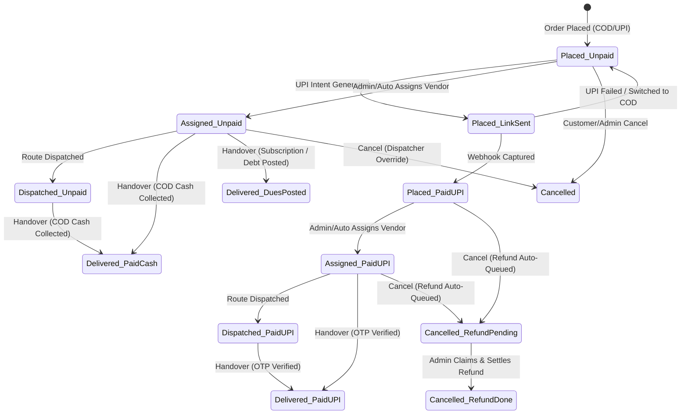

# Feature Spec: Phase 1 State Machine Hardening (Fulfillment & Money Flow)

## 1. Context & Objective
In the Shodasha water distribution platform, core revenue and jar assets flow through three tightly interconnected subsystems:
1. **Order Lifecycle & Payment State Integration**: Managing the physical progression (`placed` $\rightarrow$ `assigned` $\rightarrow$ `dispatched` $\rightarrow$ `delivered`) and financial status (`unpaid`, `link_sent`, `paid_upi`, `paid_cash`, `partial_dues`).
2. **Delivery Code / Proof-of-Delivery (PoD OTP) Lifecycle**: Managing short-lived handoff secrets (`none`, `active`, `expired`, `locked`, `unavailable`, `used`).
3. **Doorstep Handover & Cash Collection State**: Ensuring accurate cash collection and OTP verification across daily subscriptions, month-end dues, and one-off orders.

Currently, these subsystems rely on scattered flags, implicit combinations of string fields, and uncoordinated branch logic. This specification defines **lightweight, typed transition tables and explicit transition validators** (zero external dependencies, Ponytail-compliant) to eliminate illegal intermediate states, race conditions, and doorstep discrepancies.

---

## 2. Subsystems & Formal State Machines

### A. Dual Order & Payment State Machine
* **Current State**: `orders.state` and `orders.payment_status` are decoupled fields. While intentional (allowing physical delivery tracking independently of payment gateways), the lack of cross-field invariants creates potential edge cases:
  - An order reaching `delivered` without a resolved payment or ledger debt.
  - A late UPI payment capture arriving for an order already in `cancelled` or `rejected`.
  - Switching to COD when a capture intent is actively in-flight.

* **Formal State Transition Matrix**:

* **Transition Invariants**:
  1. `CANNOT_DELIVER_UNRESOLVED`: An order transitioning to `delivered` MUST satisfy:
     - `payment_status IN ('paid_upi', 'paid_cash')`, OR
     - `payment_mode == 'cod'` where cash was received at doorstep, OR
     - `idempotency_key LIKE 'sub:%'` where `amount_due == 0` (daily plan) or dues are recorded in `ledger`.
  2. `LATE_CAPTURE_REFUND_GUARD`: If a UPI webhook confirms payment for an order where `state IN ('cancelled', 'rejected')`, the payment MUST NOT transition the order to `paid_upi`; it MUST immediately mint a `refunds` entry with status `pending`.
  3. `SWITCH_TO_COD_GUARD`: `switch_to_cod` is only legal when `payment_mode == 'upi'` and `payment_status IN ('unpaid', 'link_sent')`, and never after funds have settled.

---

### B. Proof-of-Delivery (PoD OTP) State Machine
* **Current State**: Resolved dynamically via `delivery_code.py:state()`. The state is not stored directly, leading to possible edge cases during clock drifts, stop reassignments, or direct `assigned -> delivered` transitions.
* **Formal State Definition**:
  - `NONE`: Order is pre-assignment or in a terminal state (`rejected`, `cancelled`, `failed`).
  - `ACTIVE`: Assigned or Dispatched, valid 4-digit code present, `attempts < 5`, and current time $<$ `pod_otp_expires_at`.
  - `EXPIRED`: Dispatched, TTL timestamp passed (`now >= pod_otp_expires_at`). Reissue allowed.
  - `LOCKED`: Dispatched or Assigned, `attempts >= 5`. Reissue required.
  - `UNAVAILABLE`: Dispatched order with no code set. Reissue allowed.
  - `USED`: Order transitioned to `delivered`. Code wiped from active secrets.

* **Transition Table**:

| Current State | Event / Trigger | Next State | Action / Side Effect |
|---|---|---|---|
| `NONE` | Assign Vendor to Stop | `ACTIVE` | Mint 4-digit secret, set attempts = 0 |
| `ACTIVE` | Route Dispatched | `ACTIVE` | Arm 24h TTL (`pod_otp_expires_at = now + 24h`) |
| `ACTIVE` | Failed OTP Attempt ($< 5$) | `ACTIVE` | Increment `attempts` |
| `ACTIVE` | Failed OTP Attempt ($\ge 5$) | `LOCKED` | Lock code, reject further verification |
| `ACTIVE` | Clock past TTL | `EXPIRED` | Invalidate verification; enable reissue |
| `ACTIVE` / `EXPIRED` / `LOCKED` | Reissue Requested (Limit $\le 3$) | `ACTIVE` | Mint fresh OTP, reset TTL to 24h, attempts = 0 |
| `ACTIVE` | Valid OTP at Doorstep | `USED` | Mark stop `done`, clear secret, order $\rightarrow$ `delivered` |
| Any | Order Cancelled / Reassigned | `NONE` | Clear secret, reset counters |

---

### C. Doorstep Handover & Cash Collection State Machine (Rider App)
* **Current State**: Evaluated via conditional statements in `pod_sheet.dart` and `rider_service.py`.
* **Explicit Handover Modes**:
  1. `DailySubscriptionDelivery`:
     - Condition: `is_subscription == true && is_monthly_dues == false`
     - Expected Dues: ₹0.
     - Cash Checkbox: Hidden.
     - Handover Requirement: 4-digit OTP only. Empties returned recorded.
  2. `MonthEndDuesSettlement`:
     - Condition: `is_monthly_dues == true && amount_due > 0`
     - Expected Dues: `amount_due` (in paise).
     - Cash Checkbox: Required (`Collect ₹X Monthly Bill`).
     - Handover Requirement: OTP + Cash Receipt Checked.
  3. `StandardCodDelivery`:
     - Condition: `is_subscription == false && payment_mode == 'cod'`
     - Expected Dues: `order.total`.
     - Cash Checkbox: Required.
     - Handover Requirement: OTP + Cash Receipt Checked.
  4. `PrepaidDelivery`:
     - Condition: `is_subscription == false && payment_status == 'paid_upi'`
     - Expected Dues: ₹0.
     - Cash Checkbox: Hidden.
     - Handover Requirement: OTP only.

---

## 3. Implementation Blueprint (Ponytail Compliance)

### 1. `workers/api/src/app/core/state_machines.py` (New - Lightweight Module)
- Define immutable transition maps:
  - `LEGAL_ORDER_TRANSITIONS`
  - `LEGAL_PAYMENT_TRANSITIONS`
  - `VALID_ORDER_PAYMENT_COMBINATIONS`
- Add pure validator functions:
  - `validate_order_transition(from_state, to_state, actor_role)`
  - `validate_delivery_resolution(order_state, payment_mode, payment_status, is_subscription, cash_received)`
  - `validate_late_capture_action(order_state) -> Literal["credit", "refund"]`

### 2. Integration with Repositories & Services
- Wire validators into `OrderRepo.transition()` and `OrderRepo.insert()`.
- Wire `PaymentService.webhook_ingest()` to use `validate_late_capture_action()`.
- Ensure `delivery_code.py` handles both `assigned` and `dispatched` cleanly under ADR-201 rules.

### 3. Rider Doorstep Handover Typed Mode (`pod_sheet.dart`)
- Introduce `enum HandoverMode { dailySubscription, monthEndDues, standardCod, prepaid }` in `pod_sheet.dart`.
- Replace unstructured booleans with a single derived `HandoverMode mode = resolveHandoverMode(widget.stop)`.

---

## 4. Verification & Testing Plan
1. **Pytest Invariant Tests**:
   - Matrix test verifying every valid and invalid pair in `VALID_ORDER_PAYMENT_COMBINATIONS`.
   - Late webhook capture test asserting refund generation when order is cancelled.
   - PoD OTP expiry, lockout, and autonomous delivery verification.
2. **Flutter Widget & Unit Tests**:
   - `pod_sheet_test.dart`: Test each of the 4 `HandoverMode` cases ensuring correct UI rendering, validation, and submission behavior.
3. **Pre-Exit Checks**:
   - `uv run pytest -q` (515+ tests pass).
   - `flutter analyze` in all 3 apps clean (0 warnings).
