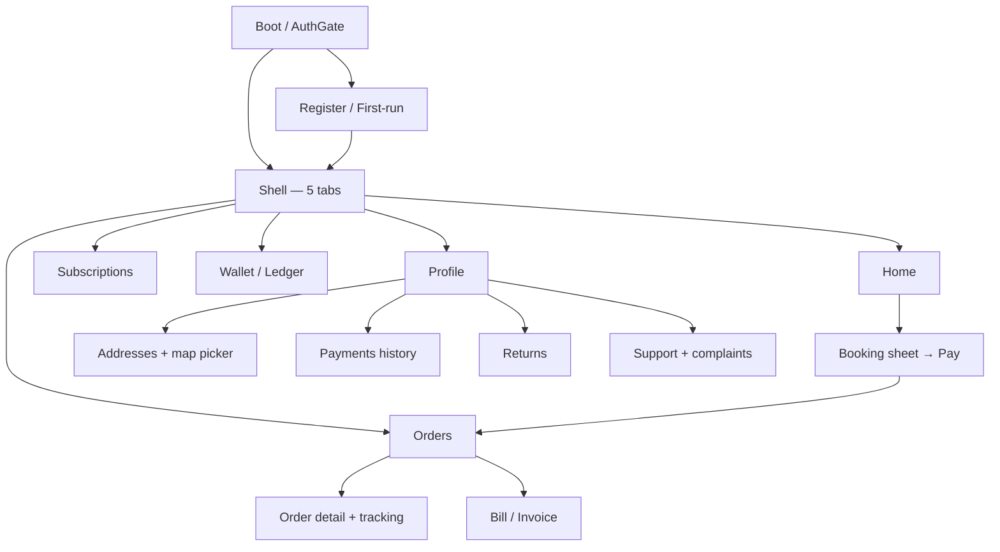

# Spec — User-App Replacement (donor UI × Shodasha backend)

> **Status: DRAFT — DESIGN GATE. No code is written until the owner answers §11 and gives explicit approval.**
> Branch: `032-user-app-replacement` (created from main `a836fe8`; no commits yet)
> Sources: `handoff-prompt.md` (mission), audit `01–06` (donor truth), legacy app `apps/user_app` @ `a836fe8` (backend contract + 138-test behavioral spec), `workers/api` (route tables in audit 03 §1).
> Definitions: **donor** = `github.com/ayushsingh930/Shodasha-Mineral-water` (clone @ `76e0eba`); **legacy** = today's `apps/user_app`, to be renamed `apps/user_app_legacy_flutter`.

---

## 1. What we are building

`apps/user_app` becomes a **donor-skinned customer app wired to `workers/api`**, with 100% of its data layer rebuilt:

- **UI shell**: donor's premium design language — teal brand, dense order-card grammar, sheets, pills, w800/w900 type rhythm — centralized in ONE theme file.
- **Data layer**: ONE `ApiClient` ported from legacy (`core/api_client.dart` pattern: Bearer + `X-Device-Id`, GET single-flight, replay-safe retry, `Idempotency-Key` on money POSTs), plus legacy's proven controllers (`AuthController`, `BookingController`/`CheckoutService`, `OrdersController`) and behavior.
- **Everything the donor faked is deleted** (no OTP theater, no client-minted PINs, no role screens, no Firebase, no hardcoded money/status/catalog).
- **Legacy folder survives** as `apps/user_app_legacy_flutter` — permanent reference for contract + tests; never built by CI again.
- **HARD LAW**: no fake/hardcoded money amounts or statuses anywhere. Every number is server-returned or an honest `States.md` loading/error/empty state.

---

## 2. Non-negotiable laws (the 5 contract doors + trust rules)

1. **Identity door** — session exists only via `POST /v1/auth/user/register {name, email(@gmail.com), phone(10-digit), device}`; `role == "user"` asserted; Bearer on every authed call; `role != user` → wipe + honest error; 401 → refresh-once → retry → re-login. No OTP UI. No staff doors.
2. **Money door** — nothing on screen computes money. Display always from `POST /v1/quotes` / `POST /v1/subscriptions/estimate` / `GET /v1/ledger/me` (integer paise on the wire; ÷100 display only). Deposit ₹150/jar + cap ₹3 come from `GET /v1/catalog`.
3. **Order door** — orders only after a quote: echo `quote_hash`, `quote_total`, `quote_rate_version`, `quote_expires_at`, server `address_id`, ISO `window_start`, `payment_mode` + **required** `Idempotency-Key` header (fresh key per checkout session; refreshed on payment-mode switch and payment retry).
4. **Payment door** — UPI = `POST /v1/payments/upi-intent` → launch `intent['link']` → **poll `GET /v1/orders/{id}` ≤5× every 2s until `payment_status == 'paid_upi'`** (webhook is the only verifier; returning from the gateway proves nothing). COD = first-class mode + best-effort `POST /v1/orders/{id}/cod-confirm`. Failures show Retry / switch-to-COD, never a pre-success toast.
5. **Data-truth door** — catalog/slots/serviceability/tracking/ledger are fetched, never invented. Delivery OTP is **server-owned**, revealed owner-only from `GET /v1/orders/{id}` in states {assigned, dispatched} — never client-minted, never shown as a hint outside those states. No client ETAs, agent names, order ids, or statuses.

Booking rules ported from legacy unchanged: COD cap ₹2,000; COD blocked when >3 held jars; ≤10 jars/household (over → tanker path); 6–10 jars need bulk confirm; quote TTL 15 min with `STALE_QUOTE` (409) → re-quote once → retry; `PAYLOAD_MISMATCH` (422) → fresh idempotency key.

---

## 3. Site map (target)

Navigation: donor's 5-tab shell (Home / Orders / Subscriptions / Wallet / Profile). Legacy's Support tab folds into Profile (+ contextual entry points on order surfaces). Guest browsing allowed — prices are never walled; auth gates sit at money/identity actions only (lazy tab mounting ported from legacy).

```
Shodasha (customer) — target map                                 [access] — data dependencies
├─ Boot / splash (AuthGate)                                      public — secure-storage restore → GET /auth/me (best-effort)
├─ Register (donor login skeleton: name + gmail + phone)          public — POST /auth/user/register; demo door (config-gated) POST /auth/demo
├─ First-run locate → confirm address                             public→auth — geolocator/geocoding → GET /serviceability (miss → POST /leads) → POST /addresses
└─ Shell (5 tabs)
   ├─ Home                                                        public — GET /catalog, GET /auth/me, GET /addresses, GET /windows, GET /orders (repeat card)
   │   ├─ Booking sheet: qty/empties → address+slot → quote → pay  public until submit — POST /quotes, GET /windows, GET /addresses
   │   ├─ Address picker (sheet) ────────► Addresses
   │   └─ Window picker (sheet)                                   public — GET /windows?date=&pincode=
   ├─ Orders                                                      auth — GET /orders (cursor paging)
   │   ├─ Order detail + tracking                                 auth — GET /orders/{id}, GET /orders/{id}/tracking
   │   ├─ cancel / reschedule / rate / COD-confirm                auth — POST /orders/{id}/cancel | /reschedule | /rating | /cod-confirm
   │   └─ Bill / invoice                                          auth — GET /invoices/{order_id}
   ├─ Subscriptions                                               auth — GET /subscriptions; POST /subscriptions/estimate|create|{id}/pause|resume|skips|cancel
   ├─ Wallet (money trust)                                        auth — GET /ledger/me; GET /payments/me; POST /payments/dues-intent; POST /returns
   └─ Profile                                                     auth — GET/PATCH /auth/me
       ├─ Edit profile sheet                                      auth — PATCH /auth/me
       ├─ Addresses (CRUD + OSM map pin)                          auth — GET/POST/PATCH/DELETE /addresses (409 edit-lock at dispatch)
       ├─ Payments history                                        auth — GET /payments/me?limit=
       ├─ Returns (jar pickup + UPI refund target)                auth — POST /returns, GET /returns
       ├─ Support (WhatsApp + complaints)                         auth — wa.me kSupportPhone; POST/GET /complaints
       └─ Logout                                                  auth — POST /auth/logout
```



**Per-screen states (see `States.md`, applied verbatim):** every screen/sheet defines loading (skeleton/spinner), empty (honest copy + next action), error (message + retry), and success. No screen shows a number it did not fetch. Offline → transport retry policy, then honest error with retry.

---

## 4. Donor → target mapping (adopt / rewire / drop)

Verdicts: **ADOPT-REWIRE** = keep layout, replace data+brand; **REPLACE** = visual reference only; **DROP** = never imported.

### 4.1 Screens & widgets

| # | Donor file | Verdict | Target in `apps/user_app` | Wired to (controller / endpoints) |
|---|---|---|---|---|
| 1 | `lib/main.dart` | REPLACE | `lib/main.dart` composition root (legacy pattern: deviceId → ApiClient → AuthController → shell) | device UUID, session restore |
| 2 | `core/constants/app_constants.dart` + `core/theme/app_theme.dart` | ADOPT (fold) | `lib/core/theme.dart` — **ONE theme file** (§6) | — |
| 3 | `auth/presentation/login_screen.dart` | REPLACE logic, keep visuals | `features/auth/register_screen.dart` (donor hero/form skeleton; OTP boxes, portal switcher, resend timer deleted) | `AuthController.register` → `POST /auth/user/register`; demo door → `POST /auth/demo` |
| 4 | `home/presentation/customer_home_screen.dart` | ADOPT-REWIRE | `features/shell/user_shell.dart` (5 tabs, lazy mount ported from legacy) | composes feature screens; `GET /auth/me` greeting |
| 5 | `home/.../widgets/top_bar.dart` | ADOPT-REWIRE | `features/home/top_bar.dart` — keep header/GPS/slot visuals; seed addresses + fake cart badge removed | `GET /addresses`, `GET /windows`, `GET /serviceability`, geolocator/geocoding |
| 6 | `home/.../widgets/mode_selection_cards.dart` | ADOPT-REWIRE | Home CTA cards → BOOK NOW + slot/window entry | `GET /windows`; booking sheet |
| 7 | `home/.../widgets/featured_products.dart` | ADOPT-REWIRE | Home catalog rail — real 2 SKUs + deposit line (₹28 refill / ₹30 container / ₹150-jar / ₹3 cap) | `GET /catalog`; BOOK NOW |
| 8 | `orders/presentation/my_orders_screen.dart` | REPLACE (43-line stub) | Orders hub: active/history, cursor paging | `OrdersController` → `GET /orders` |
| 9 | `orders/presentation/order_card.dart` | ADOPT-REWIRE | Order card anatomy (status pill, qty badge, slot, totals); PIN chip only in {assigned, dispatched} from server detail | `GET /orders`, `GET /orders/{id}` |
| 10 | `orders/presentation/cart_checkout_sheet.dart` | REPLACE internals, keep chrome | Booking sheet (stepper, address card, totals, 52px CTA) | quote → order → pay (§5 F2) |
| 11 | `subscriptions/presentation/subscription_screen.dart` | ADOPT-REWIRE | Subscriptions screen (pause banner, calendar = pause range + skips) | estimate/create/pause/resume/skips/cancel + `GET /subscriptions` |
| 12 | `orders/presentation/subscription_screen.dart` (duplicate) | DROP | — | — |
| 13 | `profile/presentation/wallet_screen.dart` | ADOPT-REWIRE | Wallet: ledger card (held/deposit/dues) + payments history + returns entry | `GET /ledger/me`, `GET /payments/me`, `POST /dues-intent`, `POST /returns` |
| 14 | `profile/presentation/customer_profile_screen.dart` | ADOPT-REWIRE | Profile: identity + service tiles; **owner-console door removed** | `GET/PATCH /auth/me`, logout |
| 15 | `profile/presentation/saved_addresses_screen.dart` | ADOPT-REWIRE | Addresses list/cards + server CRUD + OSM map picker (legacy `map_picker.dart`) | `GET/POST/PATCH/DELETE /addresses`, `GET /serviceability` |
| 16 | `profile/presentation/support_help_screen.dart` | ADOPT-REWIRE | Support: helpline banner (real `wa.me` `kSupportPhone`) + complaint form/list + static FAQ | `POST/GET /complaints`, `url_launcher` |
| 17 | `home/presentation/notifications_screen.dart` | DROP (decided §11) | — | no inbox contract exists; a phantom inbox is worse than none |
| 18 | `home/.../widgets/live_purity_card.dart` + `orders/data/plant_service.dart` | DROP | — | no customer telemetry endpoint; no fake TDS numbers |
| 19 | `home/.../widgets/bottom_nav_bar.dart` | ADOPT | shell nav (styled 5-tab bar) | — |
| 20 | `orders/presentation/rider_dashboard_screen.dart` | DROP (decided §11) | — | role boundary; candidate seed for vendor_app later |
| 21 | `orders/presentation/rider_delivery_screen.dart` | DROP (decided §11) | — | trust inversion (client PIN); vendor-side PoD already exists in vendor_app |
| 22 | `orders/presentation/plant_hub_screen.dart` | DROP (decided §11) | — | vendor/admin territory |
| 23 | `admin/presentation/owner_control_center_screen.dart` | DROP (decided §11) | — | admin territory |

### 4.2 Donor data layer & dead weight (all DROP / never import)

| Donor artifact | Why it must not cross over |
|---|---|
| `orders/data/order_service.dart`, `subscription_service.dart`, `plant_service.dart` | in-memory singletons with fake money/ids/statuses; replaced by ApiClient + controllers |
| `shared/providers/app_providers.dart`, `home_data_provider.dart`, `shared/models/*`, `shared/models.dart` | dead providers, rupee doubles, wrong catalog; replaced by server models |
| Root `main.dart` (353-line demo), `build_backups/*.apk` (14.5 MB), `test/widget_test.dart` (red stub) | dead weight |
| `android/app/google-services.json` | contains a real Firebase API key — never import |
| Donor `pubspec.yaml` deps: `cloud_firestore`, `firebase_core`, `provider`, `equatable` (+ `firebase_core` init in main) | zero imports in donor code; Firebase never initializes in v1 |
| Donor `android/` (Groovy gradle, machine-locked JDK path in `gradle.properties`, `com.example.shodasha`, debug-signed release) | legacy Kotlin-DSL packaging wins wholesale (§8) |

### 4.3 Donor assets

| Asset | Verdict |
|---|---|
| `assets/images/login_hero.png` | ADOPT (register screen hero) |
| `assets/images/img_*.png.jpg` (4 screenshots) | DROP |
| Legacy `assets/logo.png` (837 KB) | KEEP — launcher-icon source + brand mark |
| Legacy `assets/20l.jpg` | KEEP initially; prune at final packaging pass if no screen uses it |

### 4.4 Legacy code ported into the new app (source of truth)

| Legacy file | Target | Notes |
|---|---|---|
| `core/api_client.dart` | `lib/core/api_client.dart` | port verbatim (transport + all typed methods); https/loopback guard kept |
| `core/session_store.dart`, `core/auth_impls.dart`, `core/location_service.dart` | `lib/core/` | port |
| `features/auth/*` (controller, gate, demo, first-run) | `features/auth/` | controller + flow; screens re-skinned on donor visuals |
| `features/booking/*` (controller, checkout_service, stepper, quote_confirm, product_catalog, booking_sheet) | `features/booking/` | logic + money rules; sheets re-skinned on donor checkout chrome |
| `features/orders/*` (controller, screens, rating) | `features/orders/` | controller verbatim; screens re-skinned on donor card grammar |
| `features/addresses/*` (screen logic, map_picker, selected_address_store) | `features/addresses/` | logic + OSM picker as-is; cards on donor look |
| `features/subscriptions/subscription_screen.dart` logic | `features/subscriptions/` | extract the inline API logic into a small controller (ChangeNotifier) while re-skinning |
| `features/profile/*` (ledger/me, patchMe, returns, payments history) | `features/wallet/`, `features/profile/` | same, extract minimal controllers |
| `features/support/support_screen.dart` logic | `features/support/` | complaints + wa.me; donor help layout |
| `test/*` (20 files = behavioral spec) | `test/` | ported per feature slice (§10) |

---

## 5. User flows (new app)

### F1 — Boot → register → first order (identity)

```
[App launch] → AuthGate splash
   ├─ session in secure storage? → GET /auth/me (best-effort)
   │     ├─ 200 role=user → Shell (Home tab)
   │     ├─ 401 → refresh-once → retry; fail → wipe → guest Home
   │     └─ offline → guest Home (honest banner), restore retried later
   └─ no session → guest Home (prices visible — never walled)
Money/identity action tapped (order submit, addresses, subscriptions, wallet, profile)
   └─ Register screen (donor hero + form: naam + gmail + 10-digit phone)
        ├─ demo door (config-gated) → POST /auth/demo
        ├─ submit → POST /auth/user/register (+ X-Device-Id)
        │    ├─ 200 role=user → save tokens → continue to intended action
        │    ├─ 422 ROLE_RESERVED → "This number belongs to a staff account"
        │    ├─ 409 → "Too many accounts on this device"
        │    └─ 429 → rate-limit copy; validation → inline field errors (gmail-only, 10-digit)
        └─ first-run → locate me (GPS) → serviceability(pincode)
              ├─ serviceable → confirm address → POST /addresses → Home
              └─ not serviceable → honest note + lead capture → POST /leads
```

### F2 — Book → quote → order → pay (the money path)

```mermaid
sequenceDiagram
    autonumber
    participant U as Customer
    participant A as App (new user_app)
    participant W as Workers /v1
    U->>A: Home → BOOK NOW → qty + empties (e) stepper
    A->>W: GET /windows?date=&pincode=  (slot picker)
    A->>W: GET /addresses  (address picker; pick address_id)
    A->>W: POST /quotes {items, e, address_id, window_start}
    W-->>A: {water_bill, deposit_due, cap_note, total, quote_hash, expires_at(+15m)}
    Note over A: show server total only (paise ÷ 100); no client math
    U->>A: choose payment mode (UPI | COD)
    A->>W: POST /orders (quote echo + payment_mode) + Idempotency-Key: uuid
    alt 409 STALE_QUOTE
        A->>W: POST /quotes again (fresh quote) → retry order once
    end
    alt payment_mode = upi
        A->>W: POST /payments/upi-intent {order_id} + Idempotency-Key
        W-->>A: 201 {intent.link}
        A->>U: launch UPI app (deep link)
        loop ≤ 5 × every 2s
            A->>W: GET /orders/{id}
        end
        Note over A: success ONLY on payment_status == paid_upi (webhook truth)
        A-->>U: unpaid → honest retry (fresh key) | "COD chunein" (fresh key)
    else payment_mode = cod
        Note over A: ₹2,000 cap; >3 held jars blocks COD (legacy rules from booking_controller)
        A->>W: POST /orders/{id}/cod-confirm (best-effort)
    end
    A-->>U: order placed → Orders tab (server status)
```

**Branches covered:** 422 `PAYLOAD_MISMATCH` on mode switch → fresh key (legacy `paymentMode` setter behavior); `HOLD_BLOCKED` → COD-blocked messaging; `OVER_LIMIT` (>10 jars) → tanker path copy; 6–10 jars → bulk confirm; network/5xx → transport retry (3×, backoff jitter, Retry-After), then honest error; quote expiry → auto re-quote once.

### F3 — Orders: list → detail → tracking → exit paths

```
[Orders tab] → GET /orders (cursor paging; active + history sections)
   └─ tap card → GET /orders/{id} + GET /orders/{id}/tracking
        ├─ timeline: 4-step status matrix (server states, donor pill grammar)
        ├─ stops_ahead live + rider {name, phone} → call button
        ├─ delivery OTP reveal — ONLY states {assigned, dispatched} (owner-only field)
        ├─ cancel (confirm sheet; Idempotency-Key; idempotent server-side) → status updates
        ├─ reschedule (window picker) → status updates
        ├─ rate (once per delivered order) → POST /rating
        ├─ COD-confirm (when applicable)
        ├─ bill → GET /invoices/{order_id}
        └─ RTO / failed-delivery banners (server states — honest copy, support CTA)
```

### F4 — Subscriptions (pause / resume / skip / cancel — server rules, not toggles)

```
[Subscriptions tab] → GET /subscriptions (due_today badges, real plan data)
   ├─ create: address + qty + schedule → POST /subscriptions/estimate (Pay label)
   │          → POST /subscriptions (Idempotency-Key) → active plan
   ├─ pause: {hold_from, hold_to} → POST /{id}/pause (FCM confirm queued) → banner with range
   ├─ resume: ≥24h pre-check locally → POST /{id}/resume → 422 → show next-valid-date from server
   ├─ skip a day: before cutoff → POST /{id}/skips; after cutoff → `late_skip` → vendor-call CTA
   └─ cancel: prorated + pickup schedule + refund target upi_id → POST /{id}/cancel
Auto-resume at hold_to (server), calendar shows pause range + skipped days from server data.
```

### F5 — Wallet / ledger / payments / returns (money trust)

```
[Wallet tab] → GET /ledger/me → held jars / deposit paid / deposit refunded / wallet-held / dues
               (loading/error/empty per States.md — never a fake ₹0)
   ├─ dues > 0 → "Pay dues" → POST /payments/dues-intent + Idempotency-Key
   │              → launch link → poll GET /orders/{id} discipline (same as F2)
   ├─ payments history → GET /payments/me?limit= (refund vs payment rows; real empty state)
   └─ Return jars → POST /returns {qty, address_id, upi_id} → request id + 10-working-day SLA
                    → GET /returns list (status from server)
```

### F6 — Support & complaints

```
[Profile → Support] → helpline banner: WhatsApp wa.me + call (kSupportPhone single constant)
   ├─ new complaint → POST /complaints (≤500 chars) → success + reference
   └─ my complaints → GET /complaints (status from server)
Static FAQ cards allowed (copy only, no fake ticket promises).
```

### F7 — Profile edit

```
[Profile → Edit] → name / phone (10-digit) / email (@gmail.com) → PATCH /auth/me
   ├─ 200 → refresh local identity (GET /auth/me echo)
   └─ validation 422 → inline field errors
```

**Flow rules applied (user-flows skill):** every gesture continues; every API call has 4xx/5xx/offline branches; idempotency on order/payment/cancel/dues/subs-create; auth implied on gated calls; pessimistic updates (server state shown after 200; no optimistic money).

---

## 6. Theme & design tokens (ONE file)

`lib/core/theme.dart` — the only place `Color(0x…)`/radius constants may live (review-enforced). Donor design language as base, legacy money-safety laws kept:

| Token group | Values | Use |
|---|---|---|
| Brand teal | `#0D9488` (500), `#0F766E` (700), `#115E59` (800) | AppBars, top bar, navigation, structure/accents |
| Money green | `#16A34A` (600), `#15803D` (700); tints `#DCFCE7`, `#F0FDF4`, `#BBF7D0` | money CTAs (BOOK NOW / Pay / Confirm), delivered pills, address card |
| Solar accent | `#FACC15`, text-on-yellow `#854D0E`, slot tint `#FEF9C3`/`#FDE047` | badges, pending pills, slot chips |
| Slate ground | bg `#F8FAFC`, card `#FFFFFF`, border `#E2E8F0`, ink `#0F172A`, secondary `#64748B` | surfaces + type |
| Info | `#0369A1` on `#E0F2FE` | ETA/QTY badges only |
| Error | `#DC2626` (dialogs/delete), `#EF4444` | errors |
| Radii | 5/8/10/12/14/16 · sheets 28 · hero 36 | per donor ladder (§01 §7) |
| Spacing | 8 / 16 / 24; tap targets ≥ 48 | every screen |
| Type | eyebrow ALL-CAPS w800/w900 + w900 hero numerals; Material 3 `useMaterial3: true` | donor rhythm |
| Shadows | `black ≤ 10% opacity`, blur 4–10, offset y2–4 | cards/pills |

Legacy teal-v2 vs donor: identical brand hex; the delta is donor's yellow/sky accents and wallet gradient — **locked (owner, 2026-10-19): donor design language as base with v2 money-safety laws** (green reserved for money CTAs; blue links/info-badges only).

---

## 7. Architecture (feature-first, no flat folders)

```
apps/user_app/
├─ lib/
│  ├─ main.dart                  # composition root: loadOrCreateDeviceId → ApiClient → AuthController → AuthGate/Shell
│  ├─ core/                      # api_client.dart · session_store.dart · auth_impls.dart · location_service.dart
│  │                             # constants.dart (kSupportPhone + booking constants, single source) · theme.dart
│  └─ features/
│     ├─ auth/                   # auth_gate · register_screen · demo_sheet · first_run_screen · auth_controller
│     ├─ shell/                  # user_shell (5 tabs, lazy mount)
│     ├─ home/                   # home_screen · top_bar · mode_cards · featured_rail · repeat_card · booking_sheet · quote_confirm · product_detail_sheet
│     ├─ booking/                # booking_controller · checkout_service · stepper · product_catalog
│     ├─ addresses/              # address_screen · address_cards · map_picker · selected_address_store
│     ├─ orders/                 # orders_controller · orders_screen · order_card · tracking_screen · bill_screen · rating_sheet
│     ├─ subscriptions/          # subscription_screen · subscription_controller
│     ├─ wallet/                 # wallet_screen · payment_history_screen · returns_sheet
│     ├─ profile/                # profile_screen · edit_profile_sheet
│     └─ support/                # support_screen
├─ test/                         # ported behavioral spec (legacy) + new slice tests
├─ assets/                       # logo.png, 20l.jpg, images/login_hero.png
└─ android/ ios/ …               # legacy platform folders kept (see §8)
```

Data flow stays single-truth: `main.dart` mints ONE `ApiClient` (device UUID, token hooks, `onUnauthorized` wiring) and injects it into controllers/screens (legacy ADR-112 pattern — no detached `ApiClient()` instances).

---

## 8. Android packaging

- **Keep the legacy platform scaffolding wholesale** (all 6 platform folders + their configs). The donor's `android/` is never imported.
- `applicationId`/namespace: **locked (owner, 2026-10-19): `com.shodasha.shodasha_app`** — in-place upgrade for installed users; CI release docs already reference it; donor `com.example.shodasha` is rejected either way. No `release.yml` edit needed.
- Dart package name: keep `shodasha_app` (legacy test imports stay valid; donor has no package-named imports in surviving files).
- Manifest: label **"Shodasha"**; INTERNET + fine/coarse location permissions (already present); adaptive brand icon (legacy vectors + `flutter_launcher_icons` config kept); `allowBackup=false` + backup rules kept.
- Release: Kotlin DSL, AGP 9 config, JDK 17, minify+shrink, keystore via `key.properties` with debug fallback (owner-provisioned keystore still pending, unchanged).
- `pubspec.yaml`: keep legacy dependency set (http, flutter_secure_storage, uuid, url_launcher, flutter_map, latlong2, geolocator ^14, geocoding ^4, permission_handler, razorpay_flutter, table_calendar, flutter_animate, shared_preferences) — **do NOT import** `cloud_firestore`/`firebase_core`/`provider`/`equatable`; friend's geolocator/geocoding versions are older and superseded by legacy's.
- No `google-services.json`, no Firebase plugin.

---

## 9. Repo surgery & CI

1. `git mv apps/user_app apps/user_app_legacy_flutter` (tracked tree moves; legacy keeps its tests — the behavioral spec).
2. Donor content lands in `apps/user_app` (surviving files only, per §4) + legacy platform folders/libs ported back per slice; donor `.git` never enters the repo (temp clone stays the reference).
3. **CI (`ci.yml`)**: matrix paths are explicit (`apps/user_app`, `apps/vendor_app`) → the renamed legacy folder is automatically excluded. One comment added noting the exclusion; labels unchanged.
4. **Release (`release.yml`)**: user leg already builds `apps/user_app` with the exact prod defines (`SHODASHA_API_BASE=https://water.adityathakur452007.workers.dev/v1`, `RAZORPAY_KEY_ID=rzp_test_Thq4I47cEMIjbF`). Only touch if Q3 changes the applicationId (body table row).
5. Legacy folder is **never deleted, never edited** after the move (reference + rollback path). Nothing else in the repo references `apps/user_app` outside `.github/workflows` (verified: docs only).

---

## 10. Implementation slices (each ends: `flutter analyze` 0 issues · `flutter test` green · context files updated · conventional commits)

| # | Slice | Contents | Ported tests (legacy → new) |
|---|---|---|---|
| S1 | Repo surgery + skeleton + theme + transport — **SHIPPED 2026-10-19 (`26f71dc`)** | `git mv` legacy → `apps/user_app_legacy_flutter` (`2f2d47c`); platform folders reconstructed from tracked files (`git archive` export); pubspec rebuilt; ONE theme file (donor tokens + `ShodashaTheme` superset); verbatim ports of `api_client` / `session_store` / `auth_impls` / `location_service` / `auth_controller`; composition root `main.dart`; 5-tab shell with honest "Coming soon" placeholders; CI comment. Deltas logged in ADR-121: AuthGate → S2 (needs the register screen); no `constants.dart` (single-source constants stay co-located). | `api_client_test`, `api_parity_test`, `auth_validation_test`, `demo_login_test`, `location_service_test`, `shell_test`, `widget_test` — 41/41 green |
| S2 | Auth & onboarding — **SHIPPED 2026-10-19 (`80cee31`)** | Donor auth gate + register screen (name, @gmail.com email, 10-digit phone), demo sheet, logout, auth validation copy in English v1. Delta: first-run locate→address moved to the S4 address flow (the donor app opens address entry from Home/checkout instead of a blocking first-run screen). | `auth_gate_test`, `register_screen_test` — 13/13 green |
| S3 | Home — **SHIPPED 2026-10-19 (`a8a1335`)** | Address bar (gated), schedule cards, mode/qty/empties steppers, server-priced product grid from `/catalog`, live estimate, BOOK NOW → checkout. Legacy `CachingCatalogApi` offline fallback deliberately dropped — prices are server-owned; partial payload → `CatalogUnavailable` and honest loading/error. | `catalog_live_test` (8), `grocery_lift_test` (3) — green |
| S4 | Booking & payment + addresses — **SHIPPED 2026-10-19 (`a8a1335` booking, `b27f503` addresses)** | Booking sheet (qty/empties → address → quote → order → pay), quote TTL, bulk/tanker/hold gates, COD + cod-confirm, UPI intent + poll (`GET /orders/{id}` ≤5×2s until `paid_upi`), idempotency per payload. Delta: address book CRUD + OSM pin + `SelectedAddressStore` + 409 lock shipped here (not S8) because checkout needs the resolved address; `openAddressesGated` re-checks live auth. | `booking_rules_test` (30), `checkout_payload_test` (8), `address_payload_test` (3), `address_entry_test` (5), `selected_address_store_test` (1) — 47/47 green |
| S5 | Orders & tracking — **SHIPPED 2026-10-19 (`7c06ae2`)** | Orders hub (paging/search, donor card grammar), detail + tracking (steps/rider/support), cancel/reschedule/rating/COD-confirm, bill rows (dues/payment). Reorder → shell checkout. | `live_orders_mapping_test`, `order_states_test`, `orders_polish_test` — 28/28 green |
| S6 | Subscriptions — **SHIPPED 2026-10-19 (`63c91db`)** | List/create/estimate/pause/resume/skip/cancel on the donor cards; `canceled_at` beats D1 `paused`; dues strip posts `/payments/dues-intent` via `ApiClient.send` with a stable key and never auto-launches the returned link; guest-gated in the shell. | `subscription_flow_test` — 18/18 green |
| S7 | Wallet & returns — **SHIPPED 2026-10-19 (`3a58ea1`)** | Ledger card from `/ledger/me`, payment history, dues payment path, returns sheet + UPI id; the shell injects `ReturnAddressPicker` so returns has no address import. | `wallet_ledger_test` (11), `payment_history_test` (5) — 16/16 green |
| S8 | Profile & support — **SHIPPED 2026-10-19 (`cf2dcac`)** | Profile identity + edit sheet (`PATCH /auth/me`), addresses/payments rows, support (wa.me + complaints via the authenticated client), logout. Delta: addresses shipped in S4; this slice keeps the entry rows. | `profile_edit_test`, `help_paths_test` — 14/14 green |
| S9 | Polish + packaging + release verify — **SHIPPED 2026-10-19 (`8217a46`)** | English v1 copy unification (auth/orders/bill/tracking/location; map keys kept for a later Hinglish pass), dependency audit (all declared deps in use), assets 3.8MB → 0.31MB (`login_hero.jpg` 156KB, `logo.png` 138KB), release APK 55.7MB with both defines; per-ABI binary scan: prod URL present, `http://localhost:8787` absent; backend untouched. | full suite **188/188 green** · `flutter analyze` clean |

Gates per slice: no partial states shipped (States.md); no fake numbers (HARD LAW review); backend untested changes = zero; vendor/admin untouched.

---

## 11. Decisions locked at the design gate (owner answers, 2026-10-19)

All six questions were answered before any code was written:

1. **Palette** — donor design language as base **+ legacy v2 money-safety laws**: teal brand + solar-yellow accents; green reserved for money CTAs; blue links/info-badges only; ONE theme file.
2. **Donor-only screens** — **dropped from the customer app** (partner/portal path, rider dashboard, rider delivery, plant hub, owner control center). The donor GitHub repo + audit docs remain the reference for a future vendor/admin port mission.
3. **applicationId** — **keep `com.shodasha.shodasha_app`** (in-place upgrade; no release.yml changes).
4. **Copy language** — **donor English for v1**, Hinglish pass as a follow-up phase (prior decision upheld).
5. **Legacy folder / CI** — **confirmed**: `git mv apps/user_app apps/user_app_legacy_flutter`, parked forever, zero edits after the move, excluded from CI by omission (+ ci.yml comment).
6. **Notifications screen** — **dropped in v1** (no inbox contract; no fake list).

**Hard gate closed 2026-10-19:** owner gave the go-ahead; implementation runs on branch `032-user-app-replacement`. Slice S1 shipped (`26f71dc`, gates: analyze clean + 41/41 tests). Next slice: S2 (§10).

---

## 12. Verification & definition of done (mission level)

- `flutter analyze` zero issues; `flutter test` green in `apps/user_app` (ported suite covers every re-wired behavior).
- Release APK built with both dart-defines; **prod URL present / `http://localhost:8787` absent** in the binary; installs as "Shodasha" with brand icon.
- All money/status/tracking values traceable to a server fetch; zero `₹` literals with data semantics; States.md compliance on every screen.
- Legacy folder untouched after the move; CI builds new `apps/user_app` + `apps/vendor_app`; `workers/api`, `apps/vendor_app`, `apps/admin_app` unmodified (additive changes would need separate owner approval).
- `context/progress-tracker.md`, `context/flow.md`, `context/decision.md` updated per slice; ADR(s) recorded on approval + key decisions.
