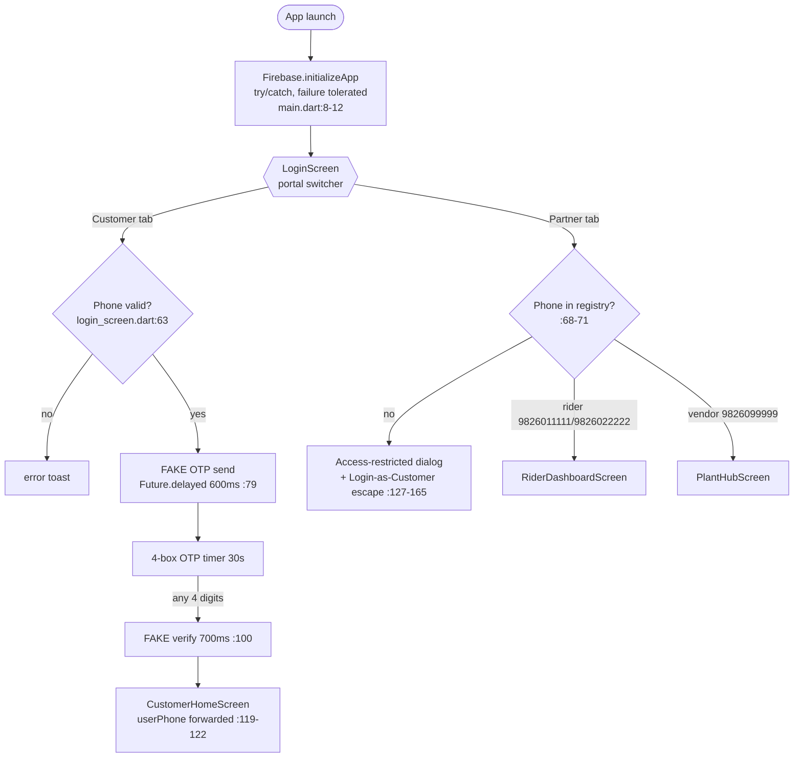
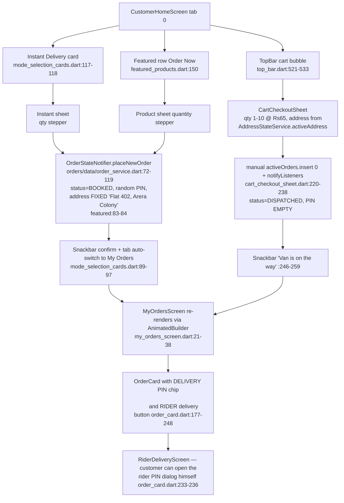
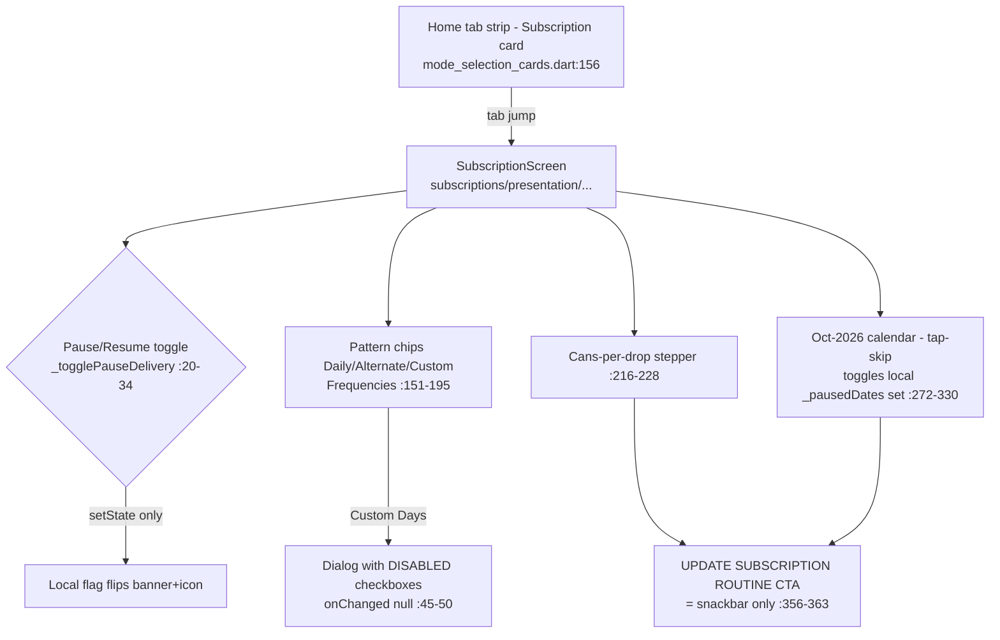
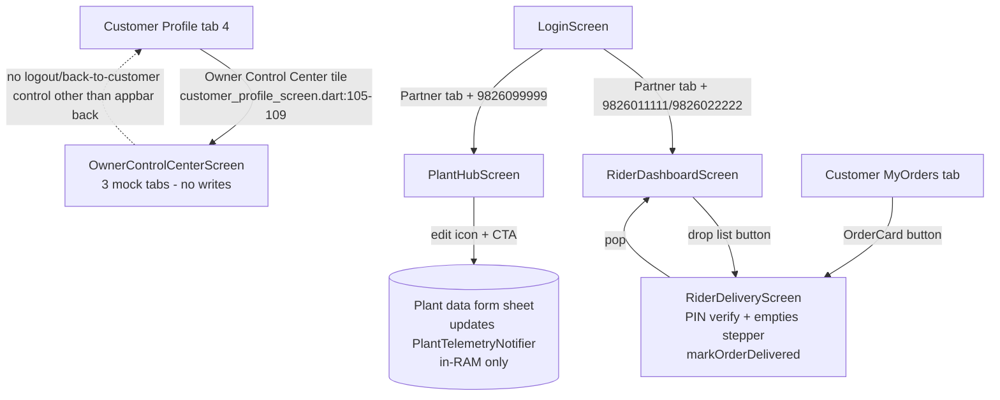

# 01 — Friend's Shodasha Flutter UI: Inventory & Map (as-found)

> Read-only audit of the friend's app clone at `C:\Users\Hp\AppData\Local\Temp\opencode\shodasha-friend-ui` (~4,573 lines in `lib/`, plus a stray 370-line prototype at repo root `main.dart`). All statements below are facts with `file:line` citations from that clone. Nothing here describes our `apps/user_app`.
> Audit date: 2026-10-17.

---

## 1. App identity snapshot

| Attribute | Value | Source |
|---|---|---|
| Dart package name | `shodasha_mineral_water` | `pubspec.yaml:1` |
| Version | `1.0.0+1` | `pubspec.yaml:3` |
| Android package | `com.example.shodasha` (default Flutter debug signing-era name) | `android/app/src/main/AndroidManifest.xml:11`, `android/app/google-services.json:12` |
| Android app label | "Shodasha Mineral Water" | `AndroidManifest.xml:7` |
| Permissions | `INTERNET`, `ACCESS_FINE_LOCATION`, `ACCESS_COARSE_LOCATION` | `AndroidManifest.xml:2-4` |
| Firebase project | `shodasha-mineral-water` (real project id + API key present) | `android/app/google-services.json:4-19` |
| Kotlin activity dirs | Two parallel activities exist: `com/example/shodasha/MainActivity.kt` and `com/example/shodasha_mineral_water/MainActivity.kt` — manifest points at the `com.example.shodasha` one | `AndroidManifest.xml:11` |
| Stray prototype | Repo-root `main.dart` (not under `lib/`, not the Flutter entry) defines a `MasterHubScreen` wireframe with its own duplicate palette | `main.dart:23-39` |
| README | Untouched Flutter template | `README.md:1-16` |

### Entry point & bootstrap
- `lib/main.dart:6-14` — `main()` calls `Firebase.initializeApp()` inside try/catch (failure is swallowed with a debugPrint), then `runApp(ShodashaWaterApp())`.
- `lib/main.dart:34` — `home: const LoginScreen()`. **There is no splash, no session restore, no named routes anywhere in the app.** Every navigation is `Navigator.push` / `pushReplacement` with `MaterialPageRoute` (the "push graph" is documented in §5).

### Theme setup (important discrepancy)
- The **effective theme is built inline** in `lib/main.dart:24-33` with **`useMaterial3: false` (Material 2)**, seed color `AppColors.primary`, scaffold background `AppColors.background`.
- `lib/core/theme/app_theme.dart` defines `AppTheme.lightTheme` with **`useMaterial3: true`**, a full Flipkart-inspired `TextTheme`, and an `AppBarTheme` — but `AppTheme` is **never imported or used anywhere** (only matches are its own definition, `app_theme.dart:4-5`). It is dead code that predates (or postdates) the inline theme.
- Consequence for the import: the look-and-feel in the running app is driven mostly by **hardcoded `TextStyle`/`Color` literals inside each widget**, not by theme tokens.

### Dependencies declared vs actually used
Declared in `pubspec.yaml:8-17`: `cloud_firestore`, `equatable`, `firebase_core`, `geocoding`, `geolocator`, `provider`, `shared_preferences`.

Actually imported in `lib/` (grep over all files):
- `firebase_core` — `lib/main.dart:3` (init only; **no Firestore/Auth calls exist anywhere**).
- `geolocator` + `geocoding` — `lib/features/home/presentation/widgets/top_bar.dart:4-5` (real GPS + reverse geocoding).
- **`cloud_firestore`, `provider`, `shared_preferences`, `equatable` are never imported.** The `provider` package's `Provider`/`Consumer`/`watch`/`read` appear 0 times in the codebase.

So despite the pubspec, **no network, database, or persisted storage is touched at runtime**; all state is in-memory singletons (§4).

---

## 2. Screen inventory table

Status legend: **COMPLETE-UI** = full polished layout with interactions; **HARDCODED** = layout complete but data is a local constant; **STUB** = scaffold only / placeholder actions. "Reach" = who can open it (see §5 push graph).

| # | Screen (public class) | File (paths relative to clone root) | Lines | Purpose | Data source | Status | Reachability |
|---|---|---|---|---|---|---|---|
| 1 | `LoginScreen` | `lib/features/auth/presentation/login_screen.dart` | 516 | Dual-portal phone+OTP login (Customer vs Partner/Staff), role-detect card, 4-box OTP, 30s resend timer | Fake: `_partnerRegistry` hardcodes 3 partner phone numbers (`login_screen.dart:30-34`); OTP send/verify are `Future.delayed` (`:79`, `:100`); **any 4-digit OTP passes** (`:91-92`) | COMPLETE-UI / **HARDCODED AUTH** | Entry (`main.dart:34`); logout pushes it |
| 2 | `CustomerHomeScreen` | `lib/features/home/presentation/customer_home_screen.dart` | 104 | 5-tab shell: Home, My Orders, Subscriptions, Wallet, Profile via `BottomNavigationBar` + `IndexedStack` (`:63-108`) | Composes widgets; passes `userPhone` through | COMPLETE-UI | Login pushReplacement (`login_screen.dart:119-122`) |
| 3 | `TopBar` (widget) | `lib/features/home/presentation/widgets/top_bar.dart` | 555 | Teal header: brand row, notification bubble, cart bubble, delivery-address strip, static search pill; opens address-sheet with **real GPS fetch + reverse geocode** (`_fetchRealWorldwideGps`, `:35-123`), slot picker (Morning/Evening/custom time, `:389-453`) | 3 seed addresses in memory (`top_bar.dart:22-26`); GPS results appended in-RAM only; cart badge hardcoded `'2'` (`:542`); search pill is `Text`, not editable (`:573-578`) | COMPLETE-UI (GPS is the one live hardware feature) | Home tab 0 (`customer_home_screen.dart:33`) |
| 4 | `ModeSelectionCards` (widget) | `lib/features/home/presentation/widgets/mode_selection_cards.dart` | 184 | Two CTA cards: Instant Delivery card → quantity sheet → `placeNewOrder`; Subscription card → jumps tab 2 | Calls `OrderStateNotifier.instance.placeNewOrder` (`:79-85`) | COMPLETE-UI (in-memory write) | Home tab (`customer_home_screen.dart:39`) |
| 5 | `FeaturedProductsShowcase` (widget) | `lib/features/home/presentation/widgets/featured_products.dart` | 153 | "FEATURED WATER CANS" list: 3 hardcoded products at Rs 65/60/249 with per-row Order Now → quantity sheet → order | Product list literal (`:95-99`); orders via `placeNewOrder` (`:63-69`) | COMPLETE-UI / **HARDCODED CATALOG** | Home tab (`customer_home_screen.dart:43`) |
| 6 | `MyOrdersScreen` | `lib/features/orders/presentation/my_orders_screen.dart` | 41 | "MY WATER ORDERS" — only a "LIVE DELIVERIES" list rendering `OrderCard`s from the singleton | `OrderStateNotifier.instance.activeOrders` via `AnimatedBuilder` (`:21-24`) | COMPLETE-UI (live-updates from singleton); **41-line screen, no history section** | Tab 1; also auto-switched after instant order (`mode_selection_cards.dart:97`) |
| 7 | `OrderCard` (widget) | `lib/features/orders/presentation/order_card.dart` | 243 | Blinkit-style order row: status pill, qty badge, price, slot, address, **delivery-PIN chip**, ETA; button labeled "RIDER: ENTER PIN & DELIVER CANS" | Reads `OrderItem`; pushes `RiderDeliveryScreen` (`:232-237`) | COMPLETE-UI / **cross-role leak** | MyOrdersScreen (`my_orders_screen.dart:36`) |
| 8 | `CartCheckoutSheet` | `lib/features/orders/presentation/cart_checkout_sheet.dart` | 267 | Modal bottom sheet: address card (from `AddressStateService` delivery-to strip `:104-116`), can stepper (1-10), total, "PLACE ORDER NOW" | Writes a new `OrderItem` straight into `notifier.activeOrders` + manual `notifyListeners()` (`:220-238`); order id from `DateTime.now().millisecond*7` (`:222`) | COMPLETE-UI / **no payment step at all** | TopBar cart bubble (`top_bar.dart:522`) |
| 9 | `SubscriptionScreen` (live one) | `lib/features/subscriptions/presentation/subscription_screen.dart` | 371 | Pause/resume toggle banner, frequency switcher (Daily/Alternate/Custom), cans-per-drop stepper, **October 2026 delivery calendar** (31 cells, tap-to-skip, legend) | All `setState` locals (`:12-16`); delivered/paused date sets hardcoded (`:15-16`); Custom-days dialog checkboxes are `onChanged: null` — **disabled** (`:45-50`); confirm CTA = snackbar only (`:356-363`) | COMPLETE-UI / HARDCODED + disabled controls | Tab 2 (`customer_home_screen.dart:58`) |
| 10 | `SubscriptionScreen` (duplicate, dead) | `lib/features/orders/presentation/subscription_screen.dart` | 248 | "7:00 AM milk-run" plan builder with `SubscriptionNotifier` writes | `subscription_service.dart` | DEAD — never imported (the home shell imports the `subscriptions/` one, `customer_home_screen.dart:4`). Duplicate class name would even collide if both were imported. | Unreachable |
| 11 | `WalletScreen` | `lib/features/profile/presentation/wallet_screen.dart` | 166 | Blue gradient balance card ₹450.00, can-security ledger card ("2 Cans Held", ₹150/can deposit note), 3 transactions | All hardcoded literals (`wallet_screen.dart:55`, `:89-122`); "Add Money" = snackbar (`:58-62`) | COMPLETE-UI / HARDCODED | Tab 3; Profile tile 1 (`customer_profile_screen.dart:93`) |
| 12 | `CustomerProfileScreen` | `lib/features/profile/presentation/customer_profile_screen.dart` | 201 | "ACCOUNT & PROFILE": identity card (name hardcoded `Ayush Singh` `:60-61`, phone dynamic), 5 quick-service tiles + Logout | Static; tiles 3-5 open **snackbars only**, incl. "Saved Addresses" which does NOT open the real address screen (`:114-124`); tile 2 opens the **Owner admin console** (`:99-111`) | COMPLETE-UI / HARDCODED | Tab 4 |
| 13 | `NotificationsScreen` | `lib/features/home/presentation/notifications_screen.dart` | 132 | "NOTIFICATIONS & ALERTS" list with unread styling | 4 hardcoded map literal rows (`:9-42`); not stateful, unread badges never clear | COMPLETE-UI / HARDCODED | TopBar bell (`top_bar.dart:510-513`) |
| 14 | `RiderDashboardScreen` | `lib/features/orders/presentation/rider_dashboard_screen.dart` | 255 | "RIDER COCKPIT": metrics strip (loaded cans/empties/pending), pending drop list, completed list, logout dialog | `OrderStateNotifier` reads (`:56-68`); **shares the same singleton as customer orders** | COMPLETE-UI / out-of-scope role screen | Partner login with rider-registered phone (`login_screen.dart:106-110`) |
| 15 | `RiderDeliveryScreen` | `lib/features/orders/presentation/rider_delivery_screen.dart` | 170 | "VERIFY DELIVERY HANDSHAKE": empties-collected stepper, 4-digit PIN entry, confirm → `markOrderDelivered` | PIN check vs `order.deliveryPin` (`:25-48`); **shows the correct PIN as a hint to the rider** (`:141`) | COMPLETE-UI / mock flow | Rider dashboard (`rider_dashboard_screen.dart:203-206`) **and customer OrderCard** (`order_card.dart:233-236`) |
| 16 | `PlantHubScreen` (vendor) | `lib/features/orders/presentation/plant_hub_screen.dart` | 403 | "BHOPAL PLANT HUB / FACTORY CONSOLE": purity telemetry card (TDS/pH/ozonation), editable "feed data" sheet, warehouse inventory, cash reconciliation, day-end audit button | `PlantTelemetryNotifier` + `OrderStateNotifier` (`:185-198`); revenue formula hardcoded `delivered*130 + dispatch*65` (`:198`); audit = snackbar (`:364-371`) | COMPLETE-UI / out-of-scope role screen | Partner login with vendor phone (`login_screen.dart:111-115`) |
| 17 | `OwnerControlCenterScreen` (admin) | `lib/features/admin/presentation/owner_control_center_screen.dart` | 377 | "SHODASHA OWNER CONSOLE", navy `TabBar` with 3 tabs: Riders fleet, Customers base, Plant Hub asset reconciliation | 3 riders, 3 customers, 1 plant map — all hardcoded in State fields (`:17-80`); `UserRole` enum declared but unused (`:4`) | COMPLETE-UI / HARDCODED / out-of-scope | **Hidden door inside customer Profile tile 2** (`customer_profile_screen.dart:105-109`) |
| 18 | `SavedAddressesScreen` | `lib/features/profile/presentation/saved_addresses_screen.dart` | 162 | "SAVED ADDRESSES" list from `AddressStateService`, default-address picker | Service singleton defined in the **same file** (`:26-88`), seeded with 2 Bhopal addresses (`:30-51`) | COMPLETE-UI but **screen itself unreachable** (Profile's "Saved Addresses" tile only fires a snackbar, `customer_profile_screen.dart:120-123`) | Unreachable as a screen; its service IS used by checkout |
| 19 | `SupportHelpScreen` | `lib/features/profile/presentation/support_help_screen.dart` | 183 | "PLANT HELP & SUPPORT": gradient helpline banner (WhatsApp + call buttons), 4 issue tiles | All taps open a hardcoded dialog "Ticket Raised… 15 min" (`:44-52`, `:110-134`); **no wa.me / tel: launch anywhere** | COMPLETE-UI / STUB actions | **Unreachable — never imported by anything** |
| 20 | `LivePurityCard` (widget) | `lib/features/home/presentation/widgets/live_purity_card.dart` | 131 | "BHOPAL PLANT PURITY REPORT" card reading `PlantTelemetryNotifier` | Live from singleton (would be reactive) | DEAD widget — not placed in any screen (home tab renders TopBar/ModeSelectionCards/FeaturedProducts only, `customer_home_screen.dart:33-43`) | Unreachable |
| 21 | `AppBottomNavBar` (widget) | `lib/features/home/presentation/widgets/bottom_nav_bar.dart` | 58 | Styled re-wrap of `BottomNavigationBar` with top shadow | — | DEAD — the shell builds its own stock `BottomNavigationBar` inline (`customer_home_screen.dart:71-108`) | Unreachable |

Structural notes:
- `lib/shared/models.dart` is a 1-line file (essentially empty); the real models live in `lib/shared/models/product.dart` (87 lines) — `Product`, `CartItem`, `DeliveryLocation`, `SubscriptionPlan` — all used only by the dead provider files (`app_providers.dart`, `home_data_provider.dart`).
- Line-count sanity: the audit brief said ~5,500 lines; measured `lib/` total is 4,573 plus the ~370-line stray root `main.dart` → ≈4,950 measured Dart. The prompt's estimate includes platform boilerplate (tests, gradle, platform runners) not part of the app UI; no hidden factory of screens exists.

---

## 3. Widget / modular component library

The app has no bespoke design-system widget file (no shared buttons/cards/chips module). Reuse is limited to:

| Component | Where | Design notes (what makes it feel "premium") |
|---|---|---|
| `TopBar` | `top_bar.dart:8-13` | Teal `#0D9488` header block, white water-drop glyph + `w900` brand wordmark `letterSpacing 1.2` (`:497`); 36px translucent-white circular icon bubbles `white.withOpacity(0.2)` (`:505`, `:518`, `:537`); red-dot-less cart badge in solar yellow `#FACC15` (`:542`); white search pill radius 10 (`:570-571`); tiny-caps "DELIVERY:" strip in `w800` 11px with mixed casing trick (`:479-481`, `:560`). The most expensive-looking element of the app. |
| `ModeSelectionCards` | `mode_selection_cards.dart:112-190` | Two gradient-less solid cards (teal / yellow) with `boxShadow` tinted to the card color (`primary.withOpacity(0.25)`, blur 8, offset y3 `:124-130`), rounded 16, icon-first column layout. Decent but flat. |
| `FeaturedProductsShowcase` rows | `featured_products.dart:112-155` | White rows, border `#E2E8F0`, tinted icon tile (`primary.withOpacity(0.08)`, radius 8), mini price in teal w800, filled teal "Order Now" button radius 8 (`:142-152`). |
| Quantity stepper | repeated in `mode_selection_cards.dart:52-64`, `featured_products.dart:36-50`, `cart_checkout_sheet.dart:160-191`, `subscription_screen.dart:216-228`, `rider_delivery_screen.dart:108-120`, `order_service.dart` none | **Copy-pasted 6 times**: −/+ `IconButton` (`remove_circle_outline` / `add_circle_outline`), bold centered count between them. This stepper is the app's signature interaction. |
| `CartCheckoutSheet` | `cart_checkout_sheet.dart:34-276` | Drag-handle bar 44×5 (`:45-52`), `Radius.circular(28)` sheet corners (`:37`), green-tinted "DELIVERY TO" address card on `#F0FDF4` + border `#BBF7D0` (`:84-87`), emoji icon tiles (`💧`, `🧊`), total in `#15803D` 20px w900 (`:204`), full-width 52px green CTA radius 16 (`:210-218`). Arguably the strongest single screen visually. |
| `OrderCard` | `order_card.dart:16-253` | "Blinkit style pill" status chip (yellow pending / green delivered) (`:50-65`), sky-blue qty badge `#E0F2FE`/`#0369A1` (`:100-115`), security-PIN chip with mono-ish letter-spaced digits `letterSpacing 2.5` (`:198-206`), soft `black.withOpacity(0.03)` shadow (`:26-32`), full-width green "rider handshake" button (`:222-247`). |
| Bottom nav | `customer_home_screen.dart:71-108` | Stock `BottomNavigationBar` (`type: fixed`), labels 11px bold when selected, `elevation: 8`. No custom styling beyond colors — the fancier `AppBottomNavBar` was left unwired. |
| AppBar pattern | e.g. `my_orders_screen.dart:13-20`, `wallet_screen.dart:11-21`, `rider_dashboard_screen.dart:14-20` | Teal AppBar, `elevation: 0`, ALL-CAPS `w900` white title `letterSpacing 1.1`, 16px. Uniform across all role screens — a good, importable convention. |
| Login hero + portal switcher | `login_screen.dart:188-239`, `:243-323` | Rounded-bottom (36px) hero panel with pale-green gradient (`#E8F5E9→#DCFCE7`) that flips to slate-grey in partner mode; segmented-portal switcher (white active chip with shadow inside a `#F1F5F9` track, `:246-267`); 58px OTP boxes radius 14 (`:476-491`). |
| Owner console chrome | `owner_control_center_screen.dart:98-135` | Only dark screen: navy `#0F172A` AppBar + `TabBar` with 3 role tabs, 22px w900 metric numbers (`:386`) — visually distinct "executive" style. |

Absences in the "library": no reusable Card/Chip/PrimaryButton/SectionHeader abstractions; every screen re-inlines its own `Container` decorations. The design language (teal + slate borders + soft tints + pill badges) is consistent but implemented by hand everywhere.

---

## 4. State management & data touches

**Actual pattern used at runtime: hand-rolled ChangeNotifier singletons + `AnimatedBuilder`.** `provider`, `MultiProvider`, `Consumer`, `context.watch/read` — zero occurrences in the codebase (grep). `main.dart` registers no providers.

| Notifier (all in-memory singletons) | File | Seeded with | Mutators | Read by |
|---|---|---|---|---|
| `OrderStateNotifier` | `orders/data/order_service.dart:34-139` | 1 ACTIVE order (`#SHD-8492`, "ON ROUTE", Rs 130) + 1 DELIVERED (`#SHD-7811`) (`:38-70`) | `placeNewOrder()` (`:72-119` — strips non-numeric price chars, unit price default Rs 65, random 4-digit delivery PIN, status `BOOKED`, eta "~25 mins"), `markOrderDelivered()` (`:121-126`), derived getters `totalVanStockRemaining` / `totalEmptyCansCollected` (`:128-138`) | MyOrdersScreen (`my_orders_screen.dart:22`), RiderDashboard (`rider_dashboard_screen.dart:57`), PlantHub (`plant_hub_screen.dart:186`), live_purity unused… |
| `PlantTelemetryNotifier` | `orders/data/plant_service.dart:3-26` | stock 450, batch `BHP-X4-2026`, TDS 85, pH 7.2 (`:8-12`) | `updatePlantData()` (`:14-25`) | PlantHub (`plant_hub_screen.dart:188`) and dead `LivePurityCard` |
| `SubscriptionNotifier` | `orders/data/subscription_service.dart:23-64` | 1 daily sub `#SUB-9021` (`:27-37`) | `togglePause`, `addNewSubscription` (`:39-63`) | Only the **dead** `orders/presentation/subscription_screen.dart` (`:3`) |
| `AddressStateService` | `profile/presentation/saved_addresses_screen.dart:26-88` | 2 Bhopal addresses (`:30-51`) | `setActiveAddress`, `addAddress` (`:60-87`) | CartCheckoutSheet (`cart_checkout_sheet.dart:26,31`) and unreachable SavedAddressesScreen |

**Dead / decorative provider layer** (never imported anywhere):
- `shared/providers/app_providers.dart` — `CartProvider` (97 lines of real cart logic), `LocationProvider`, `HomeProvider` (`:4-118`). This proves a cart abstraction was planned but never wired; the shipped checkout has its own local `_canCount` instead.
- `features/home/presentation/providers/home_data_provider.dart` — `HomeDataProvider` with 2 seed products jar_20l Rs 80 / bottle_1l Rs 25 (`:5-24`), which contradict the Rs 65/60 catalog actually displayed on home (see §7 note).

Where data touches **fail to happen**:
- The payment mode, UPI, wallet recharge, slot confirmation, subscription activation, notifications, GPS-saved addresses — none are written to any store; checkout success = snackbar ("Order Confirmed! Van is on the way 🚚", `cart_checkout_sheet.dart:246-259`).
- `CartCheckoutSheet` even bypasses its own service: it inserts a raw `OrderItem` with `status: 'DISPATCHED'` and lint-suppressed `notifyListeners()` calls (`cart_checkout_sheet.dart:220-238`) — a third write-path inconsistent with `placeNewOrder`.

---

## 5. Flow maps (actual push/pop graph)

Route inventory: **0 named routes** in `pubspec.yaml` or code. All transitions are anonymous `MaterialPageRoute`s. Condensed who-pushes-whom:

- `main.dart:34` → LoginScreen (home)
- LoginScreen →CustomerHomeScreen (customer, replace) / RiderDashboardScreen (rider phone, replace) / PlantHubScreen (vendor phone, replace) — `login_screen.dart:104-124`
- CustomerHomeScreen (IndexedStack tabs, no route stack): 0 Home / 1 MyOrders / 2 Subscription / 3 Wallet / 4 Profile — `customer_home_screen.dart:55-68`
- TopBar → NotificationsScreen push (`top_bar.dart:510-514`); TopBar cart → CartCheckoutSheet modal (`top_bar.dart:522`)
- TopBar address strip → address/slot modal sheet (`top_bar.dart:186-475`)
- ModeSelectionCards instant card → order sheet modal (`mode_selection_cards.dart:13-109`); subscription card → tab jump to index 2 (`mode_selection_cards.dart:156`)
- FeaturedProducts row → product order sheet modal (`featured_products.dart:8-91`)
- MyOrdersScreen → OrderCard → **RiderDeliveryScreen** push (`order_card.dart:232-237`)
- Profile → WalletScreen push (`customer_profile_screen.dart:91-94`); Profile → **OwnerControlCenterScreen** push (`:105-109`); Profile logout → LoginScreen `pushAndRemoveUntil` `:165-169`
- RiderDashboard → RiderDeliveryScreen push (`rider_dashboard_screen.dart:203-206`); rider logout dialog → LoginScreen (`:41-45`)
- PlantHub → LoginScreen (`plant_hub_screen.dart:170-176`); PlantHub edit → plant-data sheet (`:10-118`)

### (a) Launch → login → home

### (b) Home → product/checkout → success (order write path)

There is **no payment screen between the CTA and success** — the "Total Amount to Pay" (`cart_checkout_sheet.dart:196-207`) is displayed, then the order is instantly "confirmed". No UPI, no COD option, no wallet debit.

### (c) Subscription flow (the screen the customer actually gets)

**Nothing is persisted or written to any notifier** — the existing `SubscriptionNotifier` with `togglePause/addNewSubscription` is only exercised by the dead duplicate screen.

### (d) Rider / vendor / admin screens — who reaches them

Cross-role facts worth flagging for the import: (1) customer OrderCard and the rider dashboard open the **same delivery-verification screen**; (2) the customer profile exposes the owner console; (3) partner access control is a 3-phone hardcoded registry, not a backend role check.

---

## 6. What the friend deliberately built vs skipped

Deliberately built (attention paid = where the polished copy + matching tokens cluster):
- Dual-portal login with role-detection card, resend timer, access-denied dialog with customer fallback (`login_screen.dart:127-545`).
- Real device GPS + reverse-geocoding address detection inside the delivery sheet (`top_bar.dart:35-123`) — the only genuinely live hardware integration.
- Delivery-PIN handshake loop across customer card ↔ rider screen ↔ order status (`order_service.dart:98-99` → `order_card.dart:190-206` → `rider_delivery_screen.dart:25-48`) — mirrors the reference spec's PoD concept, but with PIN leak and no server.
- Can-security-deposit messaging ("₹300 (₹150/can) refundable", wallet ledger card `wallet_screen.dart:89-97`) matching the project's Rs-150 deposit rule (`context/project-overview.md`).
- Pause/resume subscription banner + delivery calendar tap-to-skip (`subscription_screen.dart:20-34`, `:272-330`).
- Plant purity/telemetry storytelling (TDS/pH/batch badge) — repeated on notifications, home card, plant console.
- Notifications screen with unread styling and contextual Bhopal copy (`notifications_screen.dart:9-42`).
- Empty-can return accounting embedded in every surface: checkout declares empties (`cart_checkout_sheet.dart:229`), rider logs actual empties (`rider_delivery_screen.dart:102-120`), plant hub counts returns (`plant_hub_screen.dart:308`).

Skipped / absent — every gap a real Bhopal water customer would hit:
1. **No onboarding / first-run flow**: no name capture, no address-entry wizard at signup, no serviceability check by pincode, no intro carousel (`main.dart` goes straight to login; `customer_profile_screen.dart` keeps a static name "Ayush Singh").
2. **No address persistence or management UI reachability**: `SavedAddressesScreen` is unreachable from profile (`customer_profile_screen.dart:120-123` snackbar only); TopBar addresses live only in a `StatefulWidget` list, wiped on app restart; no pincode/zone validation; no map-pin picker (GPS gives coordinates + reverse geocode but there is no map).
3. **No order-tracking screen**: no status timeline, no map/ETA page, no live stops-ahead, no cancel / reschedule / repeat-order actions. OrderCard shows a raw string status ("ON ROUTE", "BOOKED", "DISPATCHED" — inconsistent vocabulary across write-paths) and a PIN chip; there is no detail page beyond the rider screen leak.
4. **No payment screens at all**: no UPI intent, no COD toggle, no wallet payment, no receipt/bill, no order-amount breakdown (delivery/deposit), no transaction history beyond 3 hardcoded wallet rows.
5. **No order history**: `MyOrdersScreen` renders only `activeOrders` (`my_orders_screen.dart:24-36`); the seeded `completedOrders` list in the service (`order_service.dart:55-70`) is only consumed by PlantHub's math — the customer never sees past orders.
6. **No subscription data model in the live screen**: live Subscriptions tab does not read or write `SubscriptionNotifier`; upgrade/downgrade, price preview, "next delivery date" are copy-only.
7. **No feedback / complaint entry**: `SupportHelpScreen` (dialogs-only tickets) exists but is unreachable; profile tiles for support are snackbars (`customer_profile_screen.dart:142-153`); no WhatsApp deep link anywhere (grep: no `wa.me`, no `url_launcher` in pubspec).
8. **No vendor-app separation**: rider + plant + owner consoles ship inside this one customer APK, guarded only by a hardcoded 3-number registry (`login_screen.dart:30-34`), plus the profile-side owner door. There is no role-based shell split at all.
9. **No empty-jar exchange declaration at booking time** (the reference spec's core): the customer cannot choose how many empties to exchange — checkout auto-sets `emptyCansToReturn = _canCount` (`cart_checkout_sheet.dart:229`); only the *rider* can adjust actual collected counts.
10. **No live/verified data anywhere**: notifications, wallet balance, transactions, rider fleet, customer base, plant stock, catalog prices (Rs 65/60/249 vs provider-seed Rs 80/25 contradiction) are all literals; nothing survives an app restart.
11. Cart reality: the cart badge shows a hardcoded "2" (`top_bar.dart:542`) and there is no real multi-item cart; the not-in-use `CartProvider` would have provided one (`app_providers.dart:4-76`).

---

## 7. Design system tokens extracted (as actually used in code)

### Colors
`AppColors` (`core/constants/app_constants.dart:3-24`) + inline literals. The screens actually paint with **three overlapping green families** (Teal brand, Eco-green success/core CTA, plus slate/yellow accents):

| Token | Hex | Where used |
|---|---|---|
| `primary` | `#0D9488` (teal) | AppBars, TopBar bg, steppers, buttons everywhere (`app_constants.dart:5`) |
| `primaryDark` | `#115E59` | SnackBar bg (`top_bar.dart:462`), gradient end (`support_help_screen.dart:82`) |
| Extra teal seen | `#0F766E` | Support gradient end (`support_help_screen.dart:82`) |
| `accent` / solar yellow | `#FACC15` | Cart badge, subscription card (`app_constants.dart:7`) |
| `accentDark` | `#CA8A04`; `accentHover #EAB308` | Defined, barely used |
| Slot-pick yellow | `#FEF9C3` bg / `#FDE047` border / `#854D0E` icon+text | Morning/Evening tiles (`top_bar.dart:401-407,427-433`), pending status chip (`order_card.dart:53-62`) |
| Success green (CTA)** | `#16A34A` | Login buttons, pay CTA, rider confirm, snackbar green, focused-border (`login_screen.dart:150,371`, `cart_checkout_sheet.dart:215`) |
| Darker greens | `#15803D` (total/labels), `#166534`, `#14532D` (login title) | `cart_checkout_sheet.dart:205`, `login_screen.dart:224`, `subscription_screen.dart:104,116` |
| Green tints | `#DCFCE7` (delivered chip), `#BBF7D0` (banner border), `#F0FDF4` (address card bg), `#E8F5E9/#DCFCE7` login gradient | login/checkout/orders (`login_screen.dart:195`, `cart_checkout_sheet.dart:84-86`, `order_card.dart:53`) |
| `background` | `#F8FAFC` | All scaffolds (`app_constants.dart:11`) |
| `surface`/`cardBg` | white `#FFFFFF` | cards |
| `border`/`divider` | `#E2E8F0` | every card border |
| `textPrimary` | `#0F172A` (slate-900) | headings |
| `textSecondary` | `#64748B` (slate-500) | body/captions |
| Extra slate shades inline | `#475569`, `#94A3B8`, `#CBD5E1`, `#1E293B`, `#334155` | copy & borders (`login_screen.dart:141,347`, `order_card.dart:262`) |
| `error` | `#EF4444` token; inline reds `#DC2626` (dialog/delete/api), `#EF4444` rare | `login_screen.dart:134,171`, wallet debit |
| Sky blue | `#0284C7`, `#0369A1`, `#E0F2FE`, `#0369A1`; wallet gradient `#0284C7→#0369A1` | QTY badge, eta blue, wallet card (`order_card.dart:103-112`, `wallet_screen.dart:31`) |
| Owner navy | `#0F172A` AppBar | `owner_control_center_screen.dart:99` |
| `textOnAccent` | `#78350F` (amber-900 text on yellow) | `app_constants.dart:20`, sub card |

### Typography
- Global font: default Flutter (Roboto family). The unused `AppTheme` sets `fontFamily: 'Roboto'` (`app_theme.dart:7`); inline usage never sets family.
- Signature pattern = **extreme weight contrast**: ALL-CAPS section eyebrows at `fontSize 10-12, w800/w900, letterSpacing 0.5-1.1` vs big `w900` numerals 18-32px.
- Weight ladder in use: w400 (11px captions), w500 (13.5 secondary), w600 (12 details), w700 (15/18 titles), w800 (13-16 buttons/labels — the dominant "medium heading" weight), **w900 (the hero weight)**.
- Common sizes: 8.5, 9, 9.5, 10, 10.5, 11, 11.5, 12, 12.5, 13, 13.5, 14, 14.5, 15, 16, 17, 18, 20 (brand), 22 (OTP), 24 (PIN), 32 (wallet ₹), plus half-point one-offs (11.5/12.5/13.5/14.5) — a Flash-sale density feel rather than a fixed type scale; letterSpacings −0.5…+1.2 (negative on numerals `-0.2`-`-0.3`, wide on caps).
- Noted text style quirks for replication: sizes appear at fractional values (11.5, 12.5, 13.5, 14.5), OTP/PIN digits get `letterSpacing 2.5-10` (`order_card.dart:204`, `rider_delivery_screen.dart:148`), `height: 1.2-1.4` on multiline copy.

### Radii (as coded)
| Radius | Use |
|---|---|
| 2 | calendar legend dots (`subscription_screen.dart:379`) |
| 5-6 | tiny chips/badges (QTY, status pills `order_card.dart:104`, `:54`) |
| 8 | small buttons, OTP-ish tiles, icon tiles, purity chips, calendar cells |
| 10 | generic buttons, inset rows, plan chips, pin chip container, TopBar search pill (`top_bar.dart:571`), AppConstants.buttonBorderRadius (`app_constants.dart:32`) |
| 12 | search/purity containers, input fields border (`rider_delivery_screen.dart:153`), section cards, stepper shells, AppConstants.borderRadius (`app_constants.dart:35`) |
| 14 | inputs radius (`login_screen.dart:369`), portal switcher container (`login_screen.dart:250`), action tiles (`customer_profile_screen.dart:190`) |
| 16 | `cardBorderRadius` default card (`app_constants.dart:31`), CTA big radius (`cart_checkout_sheet.dart:218`) |
| 18 | checkout product container (`cart_checkout_sheet.dart:128`) |
| 24 | bottom-sheet top corners (`top_bar.dart:194`) |
| 28 | cart sheet top corners (`cart_checkout_sheet.dart:37`) |
| 36 | login hero bottom corners (`login_screen.dart:200-203`) |
| Circle/36-58 | icon bubbles, avatars, OTP boxes 58×58 |

### Spacing scale
- Constant tokens: `smallPadding 8`, `defaultPadding 16`, `largePadding 24`, `minTapTarget 48`, `iconSize 24` (`app_constants.dart:28-34`) — the *defaultPadding=16* is used on nearly every screen edge (`my_orders_screen.dart:26`, `wallet_screen.dart:24`, …).
- Actually reused rhythm: outer page padding **16**, card inner padding **12-16**, section gap **18-24**, micro-gap **2-8**, sheet vPadding 12-24, button heights **42/44/48/52**, tile heights 58 (OTP) / 44 (TopBar search) / 36 (icon bubbles).
- Shadows (premium feel): always subtle — `black.withOpacity(0.03-0.1)`, `blurRadius 4-10`, `offset(0,2..4)` or negative y for nav (`bottom_nav_bar.dart:19-25`, `order_card.dart:26-32`, tinted shadow on mode cards `mode_selection_cards.dart:124-130`, stronger blue tint on wallet gradient card `wallet_screen.dart:36-42`).
- The catalog/price mismatch to fix at import: home shows Rs 65/60 (`featured_products.dart:96-97`) while `HomeDataProvider` seed claims Rs 80/25 (`home_data_provider.dart:5-24`) and instant sheet hardcodes 65 (`mode_selection_cards.dart:78`).

---

## Verdict

- **For retail (customer) use, the usable core is: login UI, a 5-tab customer shell, a competent "instant order" micro-flow (stepper → confirm → in-memory list), subscription pause/calendar UI, wallet-as-static-wallpaper, profile with logout, notifications page.** That's roughly 6 solid customer-facing layouts worth importing; the 553-line TopBar + checkout sheet carry most of the visual capital.
- **The look is genuinely good for its level** — consistent teal/slate/green-tint language, Blinkit/Flipkart-style pills & badges, gentle shadows, strong w900-vs-eyebrow typography — but it is encoded as ~200 hardcoded inline `TextStyle/Color` sites, plus a **three-green-family inconsistency** (teal `#0D9488` brand vs eco-green `#16A34A` CTAs) that must be reconciled at import.
- **Everything is decorative at the data layer**: three ChangeNotifier singletons + two dead provider files + unused models; `provider`, `cloud_firestore`, `shared_preferences` declared but never imported; Firebase init is try/catch theater; **no screen would survive an app restart**.
- **Structurally contaminated for import**: four role surfaces (rider dashboard, rider PIN screen, plant vendor console, owner admin console) live inside the customer APK — one is pushed **from the customer's order card** (`order_card.dart:235`) and another **from the customer profile** (`customer_profile_screen.dart:108`). These must be stripped/rerouted, not ported.
- **Five dead files ship in the clone**: root `main.dart` prototype, `bottom_nav_bar.dart`, `live_purity_card.dart`, `support_help_screen.dart`, unreachable `SavedAddressesScreen` (screen half; its singleton is load-bearing), plus the whole `orders/presentation/subscription_screen.dart` duplicate with its service. Import plan should keep `AddressStateService`-gesture (address model shape) and drop the rest.
- **Critical customer-journey gaps confirmed**: no onboarding/address-add flow (pincode, landmark, GPS-map), no payment method step anywhere, no order detail/tracking/cancel/repeat, no order-history rendering (service even has a `completedOrders` list the UI ignores), no complaints/WhatsApp channel (support tiles are snackbar stubs), no persistence. These are the modules our `apps/user_app` must supply under the imported skin.
- **Blend of good bones and write-path hacks**: order id generation from `DateTime.now().millisecond` (`cart_checkout_sheet.dart:222`), rider sees the PIN as a hint (`rider_delivery_screen.dart:141`), checkout mutates the notifier directly with lint-ignore comments (`cart_checkout_sheet.dart:235-238`), cart badge is a literal "2" (`top_bar.dart:542`) — keep the UI shell, discard the write logic.
- **Best-fit import strategy**: reuse the visual vocabulary (tokens §7, TopBar/OrderCard/CheckoutSheet compositions) as the skin for `apps/user_app`'s live ApiClient-backed flows; treat this clone as a **UI reference, not a code donor** — nothing in its data layer should cross over.
