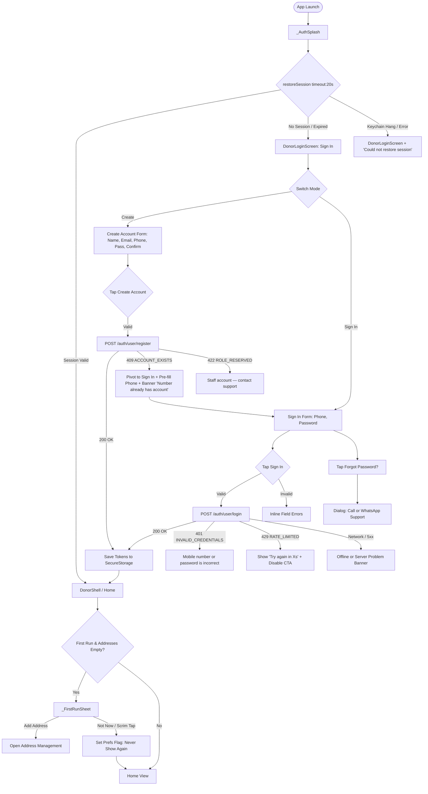

# 01 — Donor App: Auth, Shell Entry & Onboarding Audit

## 1. Header

- **Screens / Components:** `DonorLoginScreen` (`apps/user_app_donor/lib/features/auth/login_screen.dart`, 724 lines), `AuthGate` + `_AuthSplash` (`apps/user_app_donor/lib/features/auth/auth_gate.dart`, 157 lines), `AuthController` (`apps/user_app_donor/lib/features/auth/auth_controller.dart`, 734 lines), `_FirstRunSheet` (`apps/user_app_donor/lib/features/addresses/first_run_sheet.dart`, 130 lines).
- **Total lines:** 1,745 lines.
- **Routes / Entry points:** App root (`main.dart` → `AuthGate`). Unauthenticated entry defaults to `DonorLoginScreen(_mode = _AuthMode.signIn)`. Authenticated route mounts `DonorShell` (`home`). `maybeOfferFirstRun()` triggers on home mount if `kFirstRunFlag` is unset and addresses list is empty.
- **Agent:** D1 (Lead execution).
- **Date:** 2026-10-31.
- **Evidence status:** `screenshots: yes` — opened and verified `Feature_docs/ux-unslop-audit/shots/donor-login-390.png` (390×844) and `donor-login-360.png` (360×800).

---

## 2. Job to be done

The user wants to get into the app with minimum cognitive effort so they can order or reorder a 20L water jar. For an existing customer, the single moment that must feel good is seamless phone + password entry with instant validation, clear keyboard actions, and zero lag into the home shell. For a new customer, entering name, mobile, and password must establish immediate trust that Shodasha is a dependable local utility, not an anonymous SaaS template.

---

## 3. What the code actually renders

The widget tree structure rendered across auth states:

```text
AuthGate (auth_gate.dart:15)
 ├── [if !_ready] _AuthSplash (auth_gate.dart:103)
 │    └── Scaffold(bg) > Center > Column [Image('assets/logo.png', 72x72), Text('Shodasha', 24 w900), Text('RO+UV...'), CircularProgressIndicator]
 ├── [if authenticated] DonorShell (widget.home)
 └── [if unauthenticated] DonorLoginScreen (login_screen.dart:22)
      └── Scaffold(surface) > SafeArea > SingleChildScrollView
           └── ConstrainedBox(maxWidth: 560) > Column
                ├── _hero() [Container(tealTint, rSheet:28) > Column: Image('assets/images/login_hero.jpg', 150h), Text('Shodasha', 28 w800), Text('Pure 20L...')]
                ├── [if notice] _banner(warning)
                ├── [if _localNotice] _banner(info)
                └── Padding(lg) > Form(autovalidate: onUserInteraction) > Column
                     ├── Text(title: 22 w800), Text(subtitle: 14 w500)
                     ├── [if create] _name field (TextFormField)
                     ├── [if create] _email field (TextFormField)
                     ├── _phone field (TextFormField with +91 prefix) + helper text
                     ├── _password field (TextFormField with visibility suffix)
                     ├── [if create] _confirm field (TextFormField with visibility suffix)
                     ├── [if !create] TextButton("Forgot password? Contact support")
                     ├── [if _errorMessage] _errorPanel()
                     ├── AppButton("Sign in" / "Create account", busy: _submitting)
                     ├── TextButton("New here? Create account" / "Already have an account? Sign in")
                     └── Text("Shodasha customer app · Password protected" / Terms disclaimer)
```

Ownership:
- Storage & session state: `AuthController` (`auth_controller.dart:245`).
- Splash / gate swap: `AuthGateState` (`auth_gate.dart:25`).
- Form validation & view mode: `_DonorLoginScreenState` (`login_screen.dart:32`).
- Onboarding prompt: `first_run_sheet.dart:30` (invoked post-auth from `customer_home_screen.dart`).

---

## 4. Interaction inventory

| Trigger | Handler | State change | Result / Navigation | File:Line |
|---|---|---|---|---|
| Launch app | `_AuthGateState.initState` → `_boot()` | `_ready: false` → `true` | Restores secure session; navigates to `home` if valid, mounts `DonorLoginScreen` if null/expired | `auth_gate.dart:34, 43` |
| Tap "New here? Create account" | `_switchMode(_AuthMode.create)` | `_mode = _AuthMode.create`, `_localNotice = null` | Swaps form fields (adds Name, Email, Confirm Password); changes title & CTA | `login_screen.dart:81, 430` |
| Tap "Already have an account? Sign in" | `_switchMode(_AuthMode.signIn)` | `_mode = _AuthMode.signIn`, `_localNotice = null` | Swaps form fields (collapses to Phone + Password); restores login title & CTA | `login_screen.dart:81, 430` |
| Tap password eye icon | `_visibilityToggle.onTap` | `_showPassword = !_showPassword` | Toggles password field obfuscation | `login_screen.dart:347, 608` |
| Tap confirm password eye icon | `_visibilityToggle.onTap` | `_showConfirm = !_showConfirm` | Toggles confirm password field obfuscation | `login_screen.dart:384, 608` |
| Tap "Forgot password? Contact support" | `_openSupport()` | None | Opens `AlertDialog` with WhatsApp (`wa.me`) and Call (`tel`) launch options | `login_screen.dart:133, 401` |
| Tap "WhatsApp" in dialog | `_launch(whatsapp)` | Dialog dismissed | Opens external WhatsApp URL to support phone (`kSupportPhone`) | `login_screen.dart:157, 176` |
| Tap "Call support" in dialog | `_launch(call)` | Dialog dismissed | Opens external dialer with `tel:<phone>` | `login_screen.dart:165, 176` |
| Submit phone field (IME Next) | `onFieldSubmitted` | None | Moves focus to `_passwordFocus` | `login_screen.dart:316` |
| Submit password in Sign-In (IME Done) | `onFieldSubmitted` | Invokes `_submit()` | Validates form and initiates API call | `login_screen.dart:354` |
| Submit password in Create (IME Next) | `onFieldSubmitted` | Moves focus | Requests focus on `_confirmFocus` | `login_screen.dart:352` |
| Tap "Sign in" / "Create account" | `AppButton.onPressed` → `_submit()` | `_submitting = true`, clears errors | Calls `_auth.login()` or `_auth.register()`; on success AuthGate mounts `home`; on 409 pivots to Sign In | `login_screen.dart:90, 423` |
| 429 Rate Limit returned | `_handleApiError` | Sets `_rateLimitUntil` | Starts 1s UI ticker; disables button, renders countdown banner | `login_screen.dart:70`, `auth_controller.dart:643` |
| Dismiss First-Run sheet (tap scrim) | Modal bottom sheet barrier tap | Pops `null` | Persists `markFirstRunDone()` flag; sheet never re-appears even though address was not added | `first_run_sheet.dart:42, 54` |
| Tap "Add address" in First-Run sheet | `Navigator.pop(true)` | Pops `true` | Persists `markFirstRunDone()`, invokes `onAddAddress()` to push address screen | `first_run_sheet.dart:58, 111` |
| Tap "Not now" in First-Run sheet | `Navigator.pop(false)` | Pops `false` | Persists `markFirstRunDone()`, closes sheet | `first_run_sheet.dart:117` |

---

## 5. Flow map



Confusing / unnecessary edges:
1. When `restoreSession()` times out (20s), the error banner is displayed even to a brand new user on a first-time install if keychain read fails.
2. In `_FirstRunSheet`, tapping the scrim outside marks the flag done permanently (`first_run_sheet.dart:54`), treating an accidental dismiss identical to an explicit refusal.

---

## 6. Slop audit

| Sign | Where (file:line) | Why it reads AI-generated | Verdict |
|---|---|---|---|
| Stock hero photo | `login_screen.dart:487` | Image `assets/images/login_hero.jpg` displays a smiling model in a flower garden wearing a casual striped shirt. Zero connection to 20L water cans, delivery vehicles, doorstep delivery, or Bhopal. Template artifact. | **REPLACE:** Remove stock model image; replace with subtle brand mark or water jar delivery emblem. |
| Giant colored blob header | `login_screen.dart:477-483` | A huge `tealTint` (`#CCFBF1`) container card with `Radius.circular(28)` bottom corners spans the top 35% of the viewport. Directly violates "quiet chrome, no colored wash/blobs behind content". | **REPLACE:** Flatten header ground to neutral surface/bg; keep branding quiet and inline. |
| Competing double titles | `login_screen.dart:504, 513` vs `240, 252` | "Shodasha / Pure 20L mineral water delivered to your door" sits in the green blob; immediately below it sits "Welcome back / Sign in with your mobile number and password." Two competing display headers stacked 18px apart. | **REMOVE:** Merge into one clear page hierarchy. The app name belongs in a quiet top lockup; the screen title is "Sign in". |
| Fractional / random font sizes | `login_screen.dart:325, 666` | Uses `fontSize: 12.5`. In Flutter text rendering, fractional points cause subpixel anti-aliasing artifacts on low-DPI Android devices. Typical LLM output hallucinating fine-tuning. | **FIX:** Replace with `ShodashaTheme.bodySmall` (12) or `labelMedium` (12). |
| Handcrafted border styling bypassing design system | `login_screen.dart:557-576` | Hand-rolls six `OutlineInputBorder` instances inside `_decoration()` with ad-hoc colors and widths (`tealDark width: 2`), completely ignoring `lib/shared/ui/app_text_field.dart`. | **REPLACE:** Standardize on `AppTextField` or theme input decoration. |
| Hardcoded duplicated strings | `login_screen.dart:458, 664` | `authStringsHi['terms']` and `authStringsHi['rateLimitedWait']` are defined in `auth_controller.dart:57, 62`, but `login_screen.dart` hardcodes duplicate string literals. | **FIX:** Single source of truth. |
| Misleading naming | `auth_controller.dart:24` | `authStringsHi` is named as Hindi strings, but all dictionary values are English strings with an ADR comment. | **RENAME:** Rename to `authStrings` or localize properly. |

---

## 7. Spacing & layout audit

| Element | Current value (file:line) | Token it should use | Proposed |
|---|---|---|---|
| Gap after banner | `login_screen.dart:212` (`SizedBox(height: 18)`) | `AppSpacing.lg` (16) or `AppSpacing.md` (12) | `SizedBox(height: AppSpacing.lg)` (16px) |
| Gap after subtitle | `login_screen.dart:259` (`SizedBox(height: 20)`) | `AppSpacing.lg` (16) or `AppSpacing.xl` (24) | `SizedBox(height: AppSpacing.lg)` (16px) |
| Field vertical spacing (Name → Email) | `login_screen.dart:277` (`SizedBox(height: 14)`) | `AppSpacing.md` (12) or `AppSpacing.lg` (16) | `SizedBox(height: AppSpacing.lg)` (16px) |
| Field vertical spacing (Email → Phone) | `login_screen.dart:298` (`SizedBox(height: 14)`) | `AppSpacing.md` (12) or `AppSpacing.lg` (16) | `SizedBox(height: AppSpacing.lg)` (16px) |
| Field vertical spacing (Phone → Pass) | `login_screen.dart:330` (`SizedBox(height: 14)`) | `AppSpacing.md` (12) or `AppSpacing.lg` (16) | `SizedBox(height: AppSpacing.lg)` (16px) |
| Field vertical spacing (Pass → Confirm) | `login_screen.dart:369` (`SizedBox(height: 14)`) | `AppSpacing.md` (12) or `AppSpacing.lg` (16) | `SizedBox(height: AppSpacing.lg)` (16px) |
| Gap above phone helper | `login_screen.dart:321` (`SizedBox(height: 6)`) | `AppSpacing.xs` (4) | `SizedBox(height: AppSpacing.xs)` (4px) |
| Gap above Forgot Password | `login_screen.dart:396` (`SizedBox(height: 10)`) | `AppSpacing.sm` (8) | `SizedBox(height: AppSpacing.sm)` (8px) |
| Gap above Error Panel | `login_screen.dart:416` (`SizedBox(height: 6)`) | `AppSpacing.sm` (8) | `SizedBox(height: AppSpacing.sm)` (8px) |
| Gap between CTA & toggle mode button | `login_screen.dart:425` (`SizedBox(height: 10)`) | `AppSpacing.md` (12) | `SizedBox(height: AppSpacing.md)` (12px) |
| Hero brand lockup gap | `login_screen.dart:499` (`SizedBox(height: 10)`) | `AppSpacing.sm` (8) | `SizedBox(height: AppSpacing.sm)` (8px) |
| Hero subtitle gap | `login_screen.dart:511` (`SizedBox(height: 6)`) | `AppSpacing.xs` (4) | `SizedBox(height: AppSpacing.xs)` (4px) |
| Input padding | `login_screen.dart:556` (`horizontal: 14, vertical: 16`) | `horizontal: AppSpacing.lg` (16), `vertical: AppSpacing.md` (12) | `EdgeInsets.symmetric(horizontal: 16, vertical: 14)` |
| Phone prefix padding | `login_screen.dart:583` (`horizontal: 14`) | `AppSpacing.lg` (16) | `EdgeInsets.symmetric(horizontal: 16)` |
| Notice banner padding | `login_screen.dart:684` (`fromLTRB(24, 14, 24, 0)`) | `AppSpacing.lg` (16) | `EdgeInsets.fromLTRB(24, 16, 24, 0)` |
| First-run sheet outer padding | `first_run_sheet.dart:68` (`fromLTRB(20, 20, 20, 12)`) | `AppSpacing.xl` (24) / `AppSpacing.lg` (16) | `EdgeInsets.all(AppSpacing.xl)` |
| First-run sheet icon gap | `first_run_sheet.dart:87` (`SizedBox(height: 14)`) | `AppSpacing.lg` (16) | `SizedBox(height: AppSpacing.lg)` (16px) |
| First-run sheet subtitle gap | `first_run_sheet.dart:97` (`SizedBox(height: 6)`) | `AppSpacing.xs` (4) | `SizedBox(height: AppSpacing.xs)` (4px) |
| First-run sheet CTA gap | `first_run_sheet.dart:103` (`SizedBox(height: 18)`) | `AppSpacing.lg` (16) | `SizedBox(height: AppSpacing.lg)` (16px) |

---

## 8. Type & color audit

| Element | Current value (file:line) | Token it should use | Proposed |
|---|---|---|---|
| Dialog support button bg | `login_screen.dart:164` (`AppColors.primary`) | `ShodashaTheme.teal` | `ShodashaTheme.teal` (eliminate `AppColors` facade) |
| Dialog text style | `login_screen.dart:149` (`fontSize: 14, height: 1.4`) | `ShodashaTheme.bodyMedium` | `theme.textTheme.bodyMedium` |
| Form inputs text color | `login_screen.dart:268, 285, 311, 341, 378` (`AppColors.textPrimary`) | `ShodashaTheme.ink` | `ShodashaTheme.ink` |
| Phone helper text size | `login_screen.dart:325` (`fontSize: 12.5, height: 1.35`) | `ShodashaTheme.bodySmall` (12) | `fontSize: 12, height: 1.4` |
| Form labels font size | `login_screen.dart:532` (`fontSize: 13, fontWeight: FontWeight.w700`) | `ShodashaTheme.titleSmall` (14 w600) or `labelMedium` (12 w600) | `fontSize: 14, fontWeight: FontWeight.w600` |
| Text buttons font size | `login_screen.dart:409, 439` (`fontSize: 13, fontWeight: FontWeight.w800`) | `ShodashaTheme.labelLarge` (14 w700) | `fontSize: 14, fontWeight: FontWeight.w700` |
| Error panel countdown font size | `login_screen.dart:666` (`fontSize: 12.5, fontWeight: FontWeight.w800`) | `ShodashaTheme.labelMedium` (12 w600) | `fontSize: 12, fontWeight: FontWeight.w700` |
| Error panel opacity literals | `login_screen.dart:633, 636` (`danger.withValues(alpha: 0.06)`, `0.28`) | Tokenized error surface & border | Define `dangerSoft` / `dangerBorder` tokens |
| Notice banner opacity literals | `login_screen.dart:693, 694` (`solar.withValues(alpha: 0.5)`, `link.withValues(alpha: 0.25)`) | `solarBorder` (token exists), `link` border token | Use `ShodashaTheme.solarBorder` |
| First-run title type | `first_run_sheet.dart:91` (`fontSize: 19, fontWeight: FontWeight.w900`) | `ShodashaTheme.titleLarge` (18 w700) | `theme.textTheme.titleLarge` |
| First-run button style override | `first_run_sheet.dart:108` (`ElevatedButton backgroundColor: ShodashaTheme.teal`) | `AppButton` with `AppButtonVariant.primary` | Use `AppButton` primitive |

---

## 9. Component audit

### (a) Should be a shared primitive
- **Phone Prefix Widget (`_phonePrefix()`, `login_screen.dart:581`):** A custom `+91` flag/code block with vertical divider. If other screens (e.g. Profile edit, Address alternate phone) ever need phone entry, this should be an option on `AppTextField(prefix: ...)`.
- **Error / Warning Notice Banner (`_banner()`, `login_screen.dart:681`):** Duplicates `AppBanner` from `lib/shared/ui/app_banner.dart`. `AppBanner` was built specifically for status announcements, yet `login_screen.dart` hand-rolls its own container.

### (b) Duplicated across screens
- **`InputDecoration` construction (`login_screen.dart:545`):** Re-implements border radii, border side colors, focus states, and error borders that already exist in `theme.dart:366` (`inputDecorationTheme`).
- **Support Contact Dialog (`_openSupport()`, `login_screen.dart:133`):** Duplicates the WhatsApp/Call support launching logic found in `apps/user_app_donor/lib/features/support/support_screen.dart:120`.

### (c) Wrong composition
- **`login_screen.dart` owns both Auth and UI Infrastructure (724 lines):** The screen owns timers (`_rateTimer`), form state, URL launching (`_openSupport`), banner tone styling, and low-level border painting.
- **`auth_controller.dart` has bloated responsibilities (734 lines):** Mixes token storage (`SessionStore`), HTTP orchestration, local rate-limit countdown calculation, regex phone/email/password validation, and phone number string masking (`maskPhone`).
- **`first_run_sheet.dart` bypasses `AppButton` (`first_run_sheet.dart:106`):** Hand-rolls raw `ElevatedButton` with manual height `minTarget` and manual background color to counteract the app's global money-green button default.

---

## 10. Logic & flow defects

1. **Missing auto-focus after 409 Account Exists pivot:**
   - In `login_screen.dart:118-126`, when a user attempts registration with an existing phone number, the server answers 409 `ACCOUNT_EXISTS`. The screen nicely flips `_mode` back to `_AuthMode.signIn` and displays `_localNotice = "This number already has an account. Sign in."`. However, focus is not requested on `_passwordFocus`. The user is left with a pre-filled phone number and must manually tap into the password input.
2. **False "Couldn't restore session" notice on cold start:**
   - In `auth_gate.dart:55-57`, if `restoreSession()` times out (after 20s) on an unauthenticated device with slow I/O, `_restoreFailed` is marked `true`, causing `_gateNotice` to say `"Couldn't restore your session. Sign in again."` even if the user is launching the app for the very first time.
3. **First-run address prompt permanently silenced on accidental scrim tap:**
   - In `first_run_sheet.dart:54`, `markFirstRunDone()` is invoked unconditionally immediately after `showModalBottomSheet()` returns. If the user accidentally taps the outside scrim or swipes down to dismiss, `add` is `null`, no address is added, and the prompt will never be shown again.
4. **No scroll-to-error on validation failure:**
   - On smaller devices (360×800) in Create mode, the form has 5 inputs (Name, Email, Phone, Password, Confirm). When the keyboard is active, tapping "Create account" validates inputs. If the error is at the top (e.g. invalid name), the error text is off-screen above the keyboard viewport and the screen does not auto-scroll up.
5. **Session expiry banner clears too eagerly:**
   - In `auth_gate.dart:77`, `_consumeExpiryNotice()` clears `sessionNotice` via `addPostFrameCallback`. If the login screen re-builds rapidly due to keyboard opening, the notice is consumed before the user has read it.

---

## 11. Dead / for-show code

| Symbol | File:Line | Callers found | Verdict |
|---|---|---|---|
| `newDeviceAlert` / `consumeNewDeviceAlert()` | `auth_controller.dart:149, 271, 291, 311` | Grep across `apps/user_app_donor`: hit in `auth_impls.dart:25` and `auth_controller.dart` only. 0 UI callers in home or profile. | **DEAD / FOR-SHOW:** Plumbed from backend payload into controller, but never displayed in UI. |
| `verified` on `AuthSession` | `auth_controller.dart:152` | Hit in `auth_impls.dart:26` and `auth_controller.dart:527`. 0 UI callers. | **DEAD:** Doorstep-verification flag never read by donor customer app. |
| `authStringsHi['appTagline']` | `auth_controller.dart:26` | 0 callers in repo (tests or screens). | **DEAD:** Tagline is hardcoded in `login_screen.dart:513` and `auth_gate.dart:138`. |
| `authStringsHi['signingIn']` | `auth_controller.dart:51` | 0 callers in repo. | **DEAD:** `AppButton` only takes `busy: true` (shows spinner); does not show progress copy. |
| `authStringsHi['creating']` | `auth_controller.dart:52` | 0 callers in repo. | **DEAD:** Same reason as above. |
| `authStringsHi['terms']` | `auth_controller.dart:56` | 0 callers in repo. | **DEAD:** Duplicate hardcoded text in `login_screen.dart:458`. |
| `authStringsHi['rateLimitedWait']` | `auth_controller.dart:62` | 0 callers in repo. | **DEAD:** `login_screen.dart:664` hardcodes `'Try again in ${wait}s.'`. |
| `authStringsHi['newDevice']` | `auth_controller.dart:67` | 0 callers in repo. | **DEAD:** New device alert copy is never surfaced. |

---

## 12. Copy audit

| Current string | File:Line | Problem | Proposed |
|---|---|---|---|
| "Pure 20L mineral water delivered to your door" | `login_screen.dart:513` | Tagline drift. Differs from `auth_gate.dart:138` ("RO+UV · Lab-tested water") and `authStringsHi['appTagline']` ("Shodasha Mineral Water • RO+UV, lab-tested"). | "Pure 20L water delivered to your doorstep" (consistent across all entry points) |
| "Shodasha customer app · Password protected" | `login_screen.dart:449` | Internal jargon / meta statement. Customers do not care that it is the "customer app" (they only have this app) or that it is "password protected". Reads like an engineer's checklist item. | Remove or replace with subtle trust indicator: "Safe & verified doorstep delivery" |
| "Sign in with your mobile number and password." | `login_screen.dart:252` | Period at end of single-sentence UI subtitle. | "Sign in with your mobile number and password" (no trailing period) |
| "One account for every delivery." | `login_screen.dart:252` | Period at end of subtitle. | "One account for every delivery" |
| "Try again in ${wait}s." | `login_screen.dart:664` | Abbreviated "s." reads technical and curt. | "Try again in ${wait} seconds" |
| "Couldn't restore your session. Sign in again." | `auth_gate.dart:57` | Negative tone; blames the system before user even tries. | "Please sign in to continue" |
| "Set your delivery address" | `first_run_sheet.dart:89` | Weak imperative; misses the benefit of fast repeat ordering. | "Where should we deliver?" |
| "Add your address once and ordering takes a tap. You can change it anytime in Addresses." | `first_run_sheet.dart:99-101` | Wordy. Capitalized "Addresses" refers to an internal tab name. | "Save your address once for 1-tap reordering. You can edit it anytime." |

---

## 13. States matrix

| State | Present? | Where | Honest? | Gap |
|---|---|---|---|---|
| Loading (Cold boot) | Yes | `_AuthSplash` (`auth_gate.dart:103`) | Yes | Spinner + Logo shown while keychain read occurs (capped at 20s). |
| Submitting (Sign In / Create) | Yes | `AppButton.busy` (`login_screen.dart:422`) | Yes | Shows progress spinner in button, disables form fields. |
| Empty (Initial) | Yes | `login_screen.dart:232` | Yes | Fields blank with clear hints. |
| Validation (Client inline) | Yes | `login_screen.dart:273, 291, 317, 357, 388` | Yes | Validates phone (`[6-9]\d{9}`), name length, password rules on interaction. |
| Error (401 Invalid credentials) | Yes | `_errorPanel()` (`login_screen.dart:623`) | Yes | Generic message: "Mobile number or password is incorrect." |
| Error (409 Account exists) | Yes | `_banner(info)` (`login_screen.dart:124, 210`) | Yes | Auto-pivots to sign-in; displays info banner. |
| Error (422 Role reserved) | Yes | `_errorPanel()` (`login_screen.dart:655`) | Yes | Advises staff to contact support. |
| Error (429 Rate limited) | Yes | `_errorPanel()` (`login_screen.dart:643, 660`) | Yes | Shows live ticking countdown timer. |
| Error (Offline / Network) | Yes | `_errorPanel()` (`login_screen.dart:659`) | Yes | Message: "No internet — check your connection and try again". |
| Error (Server 5xx) | Yes | `_errorPanel()` (`login_screen.dart:663`) | Yes | Message: "Server problem — retry in a moment". |
| 401 Session expired | Yes | `_banner(warning)` (`auth_gate.dart:56`, `login_screen.dart:208`) | Partial | Displays banner if forced logout; but can falsely trigger on cold start timeout. |
| Stale state | N/A | Form is interactive | N/A | Not a caching screen. |
| Offline mode | No | N/A | N/A | Auth requires network connectivity; properly fails with network banner. |
| Success transition | Yes | `AuthGate` listener (`auth_gate.dart:65`) | Yes | Swaps directly to `DonorShell`. |

---

## 14. Accessibility & motion

- **Touch targets:**
  - "Forgot password? Contact support" (`login_screen.dart:404`): explicitly wraps in `minimumSize: const Size(48, 48)`.
  - Mode toggle button (`login_screen.dart:432`): `minimumSize: const Size(48, 48)`.
  - Visibility toggles (`login_screen.dart:612`): `IconButton` has default 48×48dp target.
  - "Not now" button in first run (`first_run_sheet.dart:120`): `minimumSize: const Size.fromHeight(48)`.
  - PASS: All primary touch targets meet the 48dp minimum floor.
- **Color contrast:**
  - Primary text (`ShodashaTheme.ink` `#0F172A` on `#FFFFFF`): 15.6:1 (Passes AAA).
  - Secondary text (`ShodashaTheme.muted` `#64748B` on `#FFFFFF`): 4.6:1 (Passes AA).
  - Teal links (`ShodashaTheme.tealDeep` `#115E59` on `#FFFFFF`): 7.2:1 (Passes AAA).
  - Mint hero banner (`#0F172A` and `#115E59` on `ShodashaTheme.tealTint` `#CCFBF1`): 10.8:1 (Passes AAA).
- **Semantics:**
  - Password visibility toggle has tooltips `'Hide password'` / `'Show password'` (`login_screen.dart:614`).
  - Inputs have `autofillHints` configured for username, email, phone, and password.
- **Motion & animations:**
  - The login screen has **zero** animations (no entrance transitions, no layout morphing).
  - Only movement is the rate limit timer tick (`_rateTimer`) and `CircularProgressIndicator` inside `AppButton`. Respects reduced motion inherently.
  - Polling / lifecycle: `_rateTimer` properly cancels in `dispose()` (`login_screen.dart:59`).

---

## 15. Proposed direction (unslop)

- **Character:** Calm, exact, dependable local utility — like a pristine water dispensary that always works.
- **World:** 20L chilled water jars, stainless steel taps, morning delivery routes, doorstep crate drops in Bhopal summer.
- **The one or two moments:**
  1. A beautifully rendered, tactile 20L water can emblem in the hero with clear water refraction and clean seal typography.
  2. The instant, seamless 409-pivot transition that auto-focuses the password field with a subtle reassuring green check.
- **Signature detail:** A crisp, authentic 20L jar silhouette with water-level indicator replacing the generic stock photo.
- **What stays quiet:** The entire form background (clean white `#FFFFFF`), inputs, borders, and footer text. No mint-green bulbous card header.
- **One alternative direction rejected and why:** A full-bleed photography splash of a family drinking water in an apartment. Rejected because full-bleed photos add 400KB+ to assets, slow initial frame rendering, and look like a generic corporate insurance brochure.

---

## 16. Prioritized fix list

| ID | Finding | Severity | Effort | Files | Risk | Depends on |
|---|---|---|---|---|---|---|
| D1-01 | Remove stock photo model from login hero (`assets/images/login_hero.jpg`) and eliminate `tealTint` giant bubble background. | P1 | S | `login_screen.dart:474-525` | Visual only | None |
| D1-02 | Replace ad-hoc 724-line form inputs with `AppTextField` and theme tokens, removing 12.5px font sizes and 14px off-scale spacing. | P2 | M | `login_screen.dart:260-395, 539-579` | UI only | None |
| D1-03 | Fix 409 Account Exists pivot to auto-request focus on `_passwordFocus`. | P1 | S | `login_screen.dart:120-126` | Low | None |
| D1-04 | Fix `auth_gate.dart:57` false "Couldn't restore session" notice on initial cold install timeout. | P1 | S | `auth_gate.dart:53-60` | Low | None |
| D1-05 | Fix `first_run_sheet.dart:54` accidental scrim dismissal permanently suppressing first-run address prompt. | P1 | S | `first_run_sheet.dart:42-59` | Low | None |
| D1-06 | Prune dead fields from `auth_controller.dart` (`newDeviceAlert`, `verified` on session, 6 unused string constants). | P2 | S | `auth_controller.dart:25-69, 149, 152, 271` | Low | None |
| D1-07 | Replace hand-rolled `_banner()` in `login_screen.dart:681` with shared `AppBanner`. | P2 | S | `login_screen.dart:681-720` | Low | None |
| D1-08 | Fix tagline inconsistency across `login_screen.dart`, `auth_gate.dart`, and `auth_controller.dart`. | P2 | S | `login_screen.dart:513`, `auth_gate.dart:138`, `auth_controller.dart:26` | Copy only | Owner decision |

---

## 17. Open questions for the owner

1. **Hero Visual:** Should the login header use a minimal vector 20L water jar emblem with "Shodasha", or an art-directed 3D render of the branded jar?
2. **First-Run Behavior:** If the user dismisses the address sheet by tapping outside, should we prompt them again on their first booking attempt, or strictly keep it to one-time only?
3. **App Tagline:** Which canonical tagline should be locked for the customer app: "Pure 20L mineral water delivered to your door" or "RO+UV · Lab-tested water"?
4. **Copy Jargon:** Can we remove the footer line `"Shodasha customer app · Password protected"` completely to reduce visual noise?

---

## 18. What must not change

- **Authentication Protocol:** `POST /v1/auth/user/login` and `POST /v1/auth/user/register` request/response contracts (`phone`, `password`, `deviceId`).
- **Retired OTP Protection:** No client-side phone OTP or Firebase auth may be reintroduced. Retired routes remain 410.
- **Session Security:** Token storage in `FlutterSecureStorage` with rotated refresh mechanism; 20-second timeout ceiling on cold-start restore (`auth_controller.dart:252`).
- **429 Rate Limiting:** 60-second client-side countdown timer on HTTP 429 response.
- **Tests Protecting Invariants:** `apps/user_app_donor/test/auth_password_test.dart` (covers login, signup, rate limit, session restore, 409 pivot, role checks).
