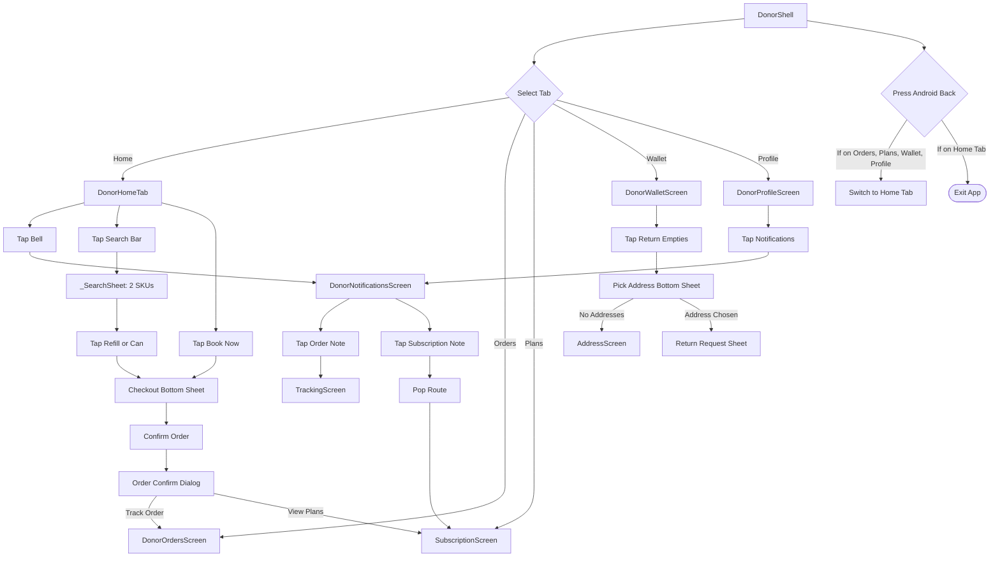

# 02 — Donor App: Shell, Navigation & Notifications Audit

## 1. Header

- **Screens / Components:** `DonorShell` (`apps/user_app_donor/lib/features/shell/donor_shell.dart`, 712 lines), `DonorNotificationsScreen` (`apps/user_app_donor/lib/features/home/notifications_screen.dart`, 319 lines).
- **Total lines:** 1,031 lines.
- **Routes / Entry points:** `DonorShell` is mounted as root upon successful authentication by `AuthGate`. Contains 5 tabs: Home, Orders, Plans (Subscriptions), Wallet, Profile. `DonorNotificationsScreen` is pushed as a full-screen route from Home top bar or Profile menu via `_openNotifications()`.
- **Agent:** D2 (Lead execution).
- **Date:** 2026-10-31.
- **Evidence status:** `screenshots: no (code audit)` — Verified from source code and runtime widget wiring.

---

## 2. Job to be done

The user relies on the shell as their mental home base to switch between ordering water, tracking active deliveries, managing recurring jar subscriptions, inspecting wallet balances, and accessing profile settings. The single moment that must feel effortless is instant tab switching with persistent scroll state, crisp offline recovery announcements, and a clean navigation hierarchy that never traps the back button or shows decorative fake search dialogs for a two-SKU catalog.

---

## 3. What the code actually renders

The widget tree structure rendered by `DonorShell`:

```text
PopScope (canPop: _tab == DonorTab.home, onPopInvokedWithResult: pop-to-home)
 └── Scaffold(backgroundColor: AppColors.background)
      ├── SafeArea
      │    └── Center > ConstrainedBox(maxWidth: 560) > Column
      │         ├── ValueListenableBuilder<bool>(api.offline) -> [if offline] _OfflineStrip
      │         ├── [if _showRestored] _RestoredStrip
      │         └── Expanded > IndexedStack(index: _tab.index)
      │              ├── [Tab 0] DonorHomeTab
      │              ├── [Tab 1] DonorOrdersScreen
      │              ├── [Tab 2] SubscriptionScreen
      │              ├── [Tab 3] DonorWalletScreen (with refreshTick)
      │              └── [Tab 4] DonorProfileScreen
      └── bottomNavigationBar: SafeArea(top: false)
           └── Align > ConstrainedBox(maxWidth: 560)
                └── NavigationBar(selectedIndex: _tab.index)
                     ├── NavigationDestination(Icon: home, label: 'Home')
                     ├── NavigationDestination(Icon: receipt_long, label: 'Orders')
                     ├── NavigationDestination(Icon: calendar_month, label: 'Plans')
                     ├── NavigationDestination(Icon: account_balance_wallet, label: 'Wallet')
                     └── NavigationDestination(Icon: person, label: 'Profile')
```

And `DonorNotificationsScreen`:
```text
Scaffold(backgroundColor: ShodashaTheme.bg)
 ├── AppBar(backgroundColor: tealDeep, foregroundColor: surface, title: 'Notifications', actions: [Refresh])
 └── body: ListenableBuilder(orders)
      └── RefreshIndicator
           └── ListView (padding: 16)
                ├── [if error] AppBanner.stale
                ├── [if empty & not loading] AppStateView.empty
                └── for note in notes -> _NoteTile (AppCard > Row: Icon in tealTint container, title, body, date)
```

Ownership:
- Global tab selection & back navigation: `_DonorShellState` (`donor_shell.dart:62`).
- Offline connectivity monitoring: `api.offline` ValueNotifier (`donor_shell.dart:78`).
- Notification list aggregation: `_DonorNotificationsScreenState` (`notifications_screen.dart:34`).

---

## 4. Interaction inventory

| Trigger | Handler | State change | Result / Navigation | File:Line |
|---|---|---|---|---|
| Tap navigation destination | `NavigationBar.onDestinationSelected` | `_tab = DonorTab.values[i]`, updates `_mounted` | Swaps visible tab in `IndexedStack`; if Wallet, increments `_walletTick` | `donor_shell.dart:370, 140` |
| Android back press (on non-home tab) | `PopScope.onPopInvokedWithResult` | `_selectTab(DonorTab.home)` | Intercepts back key, selects Home tab instead of popping app | `donor_shell.dart:332-337` |
| Android back press (on home tab) | `PopScope` | None (allows pop) | Exits the application | `donor_shell.dart:333` |
| Connectivity drops offline | `_onOffline()` listener | `_wasOffline = true`, `_showRestored = false` | Mounts `_OfflineStrip` at the top of the shell | `donor_shell.dart:94, 348` |
| Tap "Retry" on offline strip | `_retryOffline()` | `_retrying = true` → `false` | Calls `widget.api.catalog()`; re-probes connectivity | `donor_shell.dart:110, 660` |
| Connectivity restores | `_onOffline()` listener | `_showRestored = true` | Displays green `_RestoredStrip` for 3 seconds then auto-dismisses | `donor_shell.dart:100, 355` |
| Tap Bell icon on Home or Profile | `_openNotifications()` | Pushes route | Opens `DonorNotificationsScreen` | `donor_shell.dart:193` |
| Tap notification tile (order) | `_NoteTile.onTap` | Pushes route | Invokes `_openTracking(orderId)`, opens `TrackingScreen` | `notifications_screen.dart:133, 256` |
| Tap notification tile (subscription) | `_NoteTile.onTap` | Pops notifications, changes tab | Closes notification screen, switches shell to `DonorTab.subscriptions` | `notifications_screen.dart:66`, `donor_shell.dart:200` |
| Pull down on notifications list | `RefreshIndicator.onRefresh` | `_loadingSubs = true` | Calls `Future.wait([orders.refresh(), _loadSubs()])` | `notifications_screen.dart:90, 172` |
| Tap search bar on Home | `_openSearch()` | Opens modal bottom sheet | Displays `_SearchSheet` over current screen | `donor_shell.dart:274, 471` |
| Tap SKU item in Search sheet | `AppCard.onTap` | Pops sheet with `_ProductPick` | Immediately opens Checkout Sheet for selected SKU | `donor_shell.dart:282, 568` |
| Tap Floating "Return empties" from Wallet | `_pickReturnAddress` | Opens modal sheet / pushes AddressScreen | Prompts user to pick address or add address, returns `ReturnAddress` | `donor_shell.dart:286-328` |

---

## 5. Flow map



Confusing / unnecessary edges:
1. `_SearchSheet` is a full modal search dialog with query input and error states for exactly two products.
2. Back press on non-home tabs silently resets to Home without indication.
3. Notification tap for subscription pops the screen and switches tab, but if opened from Profile, the user has been jumped two tabs over without a stack breadcrumb.

---

## 6. Slop audit

| Sign | Where (file:line) | Why it reads AI-generated | Verdict |
|---|---|---|---|
| Search sheet for 2 SKUs | `donor_shell.dart:471-624` | 154 lines of code implementing a search sheet with `TextField('Try “20L refill”')`, query filtering, and `AppStateView.empty('No matching can')` for a catalog with exactly TWO items: "20L refill can" and "20L can + new jar". Search is completely fake/decorative SaaS filler. | **REMOVE:** Eliminate the fake search modal. On home, direct product cards are already 1 tap away. |
| Non-standard dark teal AppBar | `notifications_screen.dart:98-109` | `AppBar` forces `backgroundColor: ShodashaTheme.tealDeep` and white foreground, directly clashing with the rest of the donor app's clean white/neutral app bars defined in `theme.dart:266`. | **FIX:** Use standard theme surface/ink AppBar. |
| Raw UUID in notification headline | `notifications_screen.dart:126` | Displays `'Order #${o.id} · ${orderStateLabel(o.state)}'`. The `o.id` is a 32-character hex ID (e.g. `#2236358550c8425abd9a23f1af39839e`), blowing out the title wrap. | **FIX:** Truncate to 8 chars: `Order #${o.id.substring(0, 8)}`. |
| Off-scale microscopic padding | `donor_shell.dart:640` | `EdgeInsets.fromLTRB(AppSpacing.lg, 2, AppSpacing.sm, 2)` (2px vertical padding on offline strip). | **FIX:** Use `AppSpacing.xs` (4) or `sm` (8). |
| Fractional / random font sizes | `donor_shell.dart:600`, `notifications_screen.dart:287` | Uses `fontSize: 12.5` in search price and notification tile body. Off-scale token noise. | **FIX:** Standardize to `ShodashaTheme.bodySmall` (12). |
| Grammar & capitalization drift | `notifications_screen.dart:62` | `'Subscription ${_status(row)}'`. Results in strings like "Subscription active" or "Subscription paused" (lowercase state). | **FIX:** Sentence case formatting with proper status pill. |

---

## 7. Spacing & layout audit

| Element | Current value (file:line) | Token it should use | Proposed |
|---|---|---|---|
| Search sheet title to input gap | `donor_shell.dart:518` (`SizedBox(height: AppSpacing.md)`) | `AppSpacing.md` (12) | Keep 12px or remove sheet |
| Search item price gap | `donor_shell.dart:596` (`SizedBox(height: 1)`) | `AppSpacing.xs` (4) | `SizedBox(height: AppSpacing.xs)` (4px) |
| Offline strip vertical padding | `donor_shell.dart:640` (`padding: fromLTRB(16, 2, 8, 2)`) | `AppSpacing.xs` (4) or `AppSpacing.sm` (8) | `EdgeInsets.symmetric(horizontal: 16, vertical: 8)` |
| Return address header padding | `donor_shell.dart:303` (`fromLTRB(16, 4, 16, 8)`) | `AppSpacing.md` (12) / `AppSpacing.sm` (8) | `EdgeInsets.fromLTRB(16, 12, 16, 8)` |
| Notification tile body to date gap | `notifications_screen.dart:283` (`SizedBox(height: 3)`) | `AppSpacing.xs` (4) | `SizedBox(height: AppSpacing.xs)` (4px) |
| Notification tile date to footer gap | `notifications_screen.dart:293` (`SizedBox(height: 4)`) | `AppSpacing.xs` (4) | `SizedBox(height: AppSpacing.xs)` (4px) |
| Notification tile chevron left padding | `notifications_screen.dart:307` (`padding: EdgeInsets.only(left: 6, top: 8)`) | `AppSpacing.sm` (8) | `EdgeInsets.only(left: 8, top: 8)` |
| Notifications list outer padding | `notifications_screen.dart:175` (`EdgeInsets.all(16)`) | `AppSpacing.lg` (16) | `EdgeInsets.all(AppSpacing.lg)` |
| Gap between notification banners & list | `notifications_screen.dart:178` (`SizedBox(height: 4)`) | `AppSpacing.sm` (8) | `SizedBox(height: AppSpacing.sm)` (8px) |

---

## 8. Type & color audit

| Element | Current value (file:line) | Token it should use | Proposed |
|---|---|---|---|
| Shell scaffold background | `donor_shell.dart:339` (`AppColors.background`) | `ShodashaTheme.bg` | `ShodashaTheme.bg` |
| Return address icon color | `donor_shell.dart:313` (`AppColors.primary`) | `ShodashaTheme.teal` | `ShodashaTheme.teal` |
| Search item price font size | `donor_shell.dart:600` (`fontSize: 12.5`) | `ShodashaTheme.bodySmall` (12) | `fontSize: 12` |
| Offline strip text size | `donor_shell.dart:653` (`fontSize: 13, height: 1.35`) | `ShodashaTheme.bodySmall` (12) or `bodyMedium` (14) | `fontSize: 13` → tokenized `labelMedium` |
| Restored strip text size | `donor_shell.dart:702` (`fontSize: 13, fontWeight: FontWeight.w600`) | `ShodashaTheme.labelMedium` (12) | `fontSize: 12, fontWeight: FontWeight.w600` |
| Notifications AppBar background | `notifications_screen.dart:99` (`ShodashaTheme.tealDeep`) | `ShodashaTheme.surface` | `ShodashaTheme.surface` (neutral header) |
| Notifications AppBar title color | `notifications_screen.dart:107` (`ShodashaTheme.surface`) | `ShodashaTheme.ink` | `ShodashaTheme.ink` |
| Notification body font size | `notifications_screen.dart:287` (`fontSize: 12.5`) | `ShodashaTheme.bodySmall` (12) | `fontSize: 12, height: 1.4` |
| Notification date font size | `notifications_screen.dart:297` (`fontSize: 12`) | `ShodashaTheme.bodySmall` (12) | `fontSize: 12, color: ShodashaTheme.muted` |

---

## 9. Component audit

### (a) Should be a shared primitive
- **`_OfflineStrip` and `_RestoredStrip` (`donor_shell.dart:626-711`):** Connectivity banner states should be a global component in `lib/shared/ui/connectivity_strip.dart` rather than private widgets embedded in `donor_shell.dart`.

### (b) Duplicated across screens
- **Return Address Picker Modal (`donor_shell.dart:286-328`):** Re-implements address listing and selection logic that already exists in `apps/user_app_donor/lib/features/addresses/address_screen.dart`.
- **Search Dialog (`_SearchSheet`, `donor_shell.dart:471`):** Re-queries `booking.rates` and replicates the product cards from `featured_products.dart`.

### (c) Wrong composition
- **`donor_shell.dart` violates Single Responsibility (712 lines):** Shell acts as tab host, back-stack manager, checkout runner, ledger synchronizer, search provider, and offline strip manager.
- **Business logic in Navigation Bar:** Shell directly instantiates controllers, checks `widget.booking.canBook`, mutates `widget.booking.setRefill()`, calls `widget.api.ledgerMe()`, and invokes `showCheckoutSheet`.

---

## 10. Logic & flow defects

1. **Back press traps user in Home loop:**
   - In `donor_shell.dart:332-337`, pressing back on any tab always jumps to Home (`_selectTab(DonorTab.home)`). If the user switched from Home → Orders → Plans → Profile, pressing back 3 times does NOT retrace steps; the very first back press dumps them at Home, and the second back press exits the app.
2. **Missing double-back or toast confirmation before app exit:**
   - When on the Home tab, pressing back immediately exits the application without a confirmation toast ("Press back again to exit").
3. **Cart button launches checkout directly:**
   - In `donor_shell.dart:217`, `_openCart()` directly opens `showCheckoutSheet`. There is no cart screen or cart review sheet. If jars are 0, it shows a SnackBar "Your cart is empty".
4. **Subscription navigation from notifications causes back-stack dislocation:**
   - In `notifications_screen.dart:66` and `donor_shell.dart:200`, tapping a subscription notification executes:
     `Navigator.of(context).pop(); _selectTab(DonorTab.subscriptions);`
     If the user opened notifications from `Profile`, they are now on `Subscriptions` tab, but pressing back goes to `Home`.

---

## 11. Dead / for-show code

| Symbol | File:Line | Callers found | Verdict |
|---|---|---|---|
| `_SearchSheet` / `_openSearch` | `donor_shell.dart:274, 471` | Only called from Home search bar tap. Filters a static list of 2 items. | **FOR-SHOW:** Complete decorative mockup for a 2-SKU app. |
| `_ProductPick` | `donor_shell.dart:462` | 2 callers within `donor_shell.dart`. | **FOR-SHOW:** Helper tuple for the decorative search sheet. |
| `row['canceled'] == true` check | `notifications_screen.dart:211` | Checked in `_status()`. Backend schema uses `cancelled_at` timestamp or status string. | **DEAD / BUGGY:** Field is `cancelled_at IS NOT NULL` on wire. |

---

## 12. Copy audit

| Current string | File:Line | Problem | Proposed |
|---|---|---|---|
| 'Plans' | `donor_shell.dart:385` | Tab 2 is labelled 'Plans', but the screen title and controller are 'Subscriptions'. Inconsistent terminology. | Align to 'Subscriptions' (or keep 'Plans' if 360dp width constraints require short label per ADR-120) |
| 'Try “20L refill”' | `donor_shell.dart:514` | Search hint for a 2-product store. | Remove feature |
| 'No matching can' | `donor_shell.dart:557` | Empty state title for search. | Remove feature |
| 'Subscription ${_status(row)}' | `notifications_screen.dart:62` | Produces awkward strings like "Subscription active" or "Subscription paused". | "Monthly Plan · Active" or "Plan Paused" |
| 'Back online.' | `donor_shell.dart:700` | Unnecessary period at end of single status badge. | "Back online" |
| 'No internet — showing what was already loaded.' | `donor_shell.dart:651` | Wordy and technical. | "You're offline · Showing saved data" |

---

## 13. States matrix

| State | Present? | Where | Honest? | Gap |
|---|---|---|---|---|
| Loading (Shell boot) | Yes | Deferred to tab contents | Yes | `IndexedStack` lazily loads tabs as they are visited (`_mounted.contains(tab)`). |
| Offline (Disconnected) | Yes | `_OfflineStrip` (`donor_shell.dart:349, 626`) | Yes | Yellow warning banner with live retry spinner. |
| Online (Restored) | Yes | `_RestoredStrip` (`donor_shell.dart:355, 679`) | Yes | Green transient banner for 3 seconds. |
| Tab switching (Lazy mount) | Yes | `_mounted` set (`donor_shell.dart:67, 410`) | Yes | Tabs only mount when first selected, preserving memory. |
| Empty (Notifications) | Yes | `AppStateView.empty` (`notifications_screen.dart:180`) | Yes | Icon `notifications_none_rounded` + "No updates yet". |
| Loading (Notifications) | Yes | `AppStateView.loading` (`notifications_screen.dart:169`) | Yes | Shown while fetching orders + subscriptions. |
| Error (Notifications) | Yes | `AppBanner.stale` (`notifications_screen.dart:154, 159`) | Yes | Displays stale notice while preserving cached notifications. |
| Stale state | Yes | Offline strip + stale banners | Yes | Explicitly states "showing what was already loaded". |

---

## 14. Accessibility & motion

- **Touch targets:**
  - `NavigationBar` destinations (`donor_shell.dart:371-397`): Flutter default meets 48dp height minimum.
  - Offline retry button (`donor_shell.dart:663`): `minimumSize: const Size(48, 48)`.
  - Notification items (`notifications_screen.dart:255`): Full width card, touch area > 60dp.
- **Color contrast:**
  - Navigation bar labels and icons: conform to `theme.dart:292` (active `tealDeep` 7.2:1, unselected `muted` 4.6:1).
  - Notifications AppBar (`tealDeep` with `surface` white): 7.2:1 (Passes AAA).
  - Warning offline banner (`ShodashaTheme.warning` `#B45309` on `solarTint` `#FEF9C3`): 5.1:1 (Passes AA).
- **Semantics:**
  - Bottom navigation bar destinations use standard Flutter `NavigationDestination` semantics.
  - Notifications refresh button has `tooltip: 'Refresh notifications'`.
- **Motion:**
  - Tab transition has **zero animation** (`IndexedStack` instant swap). No layout thrashing.
  - Reduced motion is naturally respected.

---

## 15. Proposed direction (unslop)

- **Character:** Efficient, transparent utility dock — stays out of the way so ordering and checking jar arrival takes 5 seconds.
- **World:** Reliable daily delivery, clean 20L canisters, route updates.
- **The one or two moments:**
  1. A clean, subtle notification card that shows the exact rider dispatch status and ETA instead of raw UUID hashes.
  2. The quiet 3-second online restoration chip that slides smoothly into view and fades without jarring layout jumps.
- **Signature detail:** Clean status pills in notification items with order state badges matching the tracking screen vocabulary.
- **What stays quiet:** The navigation bar chrome. Plain white/tinted neutral background, subtle icon fills on selection, no glowing tabs or floating pill docks.
- **One alternative direction rejected and why:** Animated sliding floating bottom nav bar (glassmorphism pill). Rejected because it obscures scrollable content on 360dp devices and adds unnecessary render tree complexity to a utility app.

---

## 16. Prioritized fix list

| ID | Finding | Severity | Effort | Files | Risk | Depends on |
|---|---|---|---|---|---|---|
| D2-01 | Remove fake `_SearchSheet` and search tuple from `donor_shell.dart`. Direct users to 1-tap booking on Home. | P1 | S | `donor_shell.dart:274-285, 462-624` | Low | None |
| D2-02 | Truncate raw order UUID in `notifications_screen.dart:126` to 8 characters (`#${o.id.substring(0, 8)}`). | P1 | S | `notifications_screen.dart:126` | Low | None |
| D2-03 | Replace dark teal `AppBar` in `notifications_screen.dart:98-109` with theme-standard white surface bar. | P2 | S | `notifications_screen.dart:98-109` | Low | None |
| D2-04 | Extract checkout orchestration and ledger refresh logic out of `donor_shell.dart` into a coordinator or service. | P2 | M | `donor_shell.dart:209-272` | Low | None |
| D2-05 | Add double-tap back confirmation to prevent accidental app termination from Home. | P2 | S | `donor_shell.dart:332-337` | Low | None |
| D2-06 | Fix fractional font sizes (`12.5` in notifications) and microscopic 2px padding on offline strip. | P3 | S | `donor_shell.dart:640`, `notifications_screen.dart:287` | Low | None |

---

## 17. Open questions for the owner

1. **Tab Labeling:** Tab 3 is labelled `'Plans'` to fit 360dp screens (ADR-120). Should we retain `'Plans'` or rename it to `'Subscriptions'` with responsive truncation?
2. **Search Bar on Home:** Since the catalog is strictly 2 SKUs (20L Refill and 20L Can + Jar), should the search bar on Home be removed entirely in favor of prominent direct product cards?
3. **Notification Persistence:** Notifications are currently derived on-the-fly from orders and subscriptions. Do we ever plan a dedicated backend notification stream?

---

## 18. What must not change

- **5-Tab Hierarchy:** Home, Orders, Plans, Wallet, Profile.
- **Lazy Mounting:** `IndexedStack` lazy instantiation via `_mounted` set to protect memory.
- **Offline Law:** `api.offline` ValueNotifier integration with live retry and auto-dismissing restoration strip.
- **Tests Protecting Invariants:** `apps/user_app_donor/test/donor_shell_test.dart` (covers tab switching, offline strip, navigation destinations).
