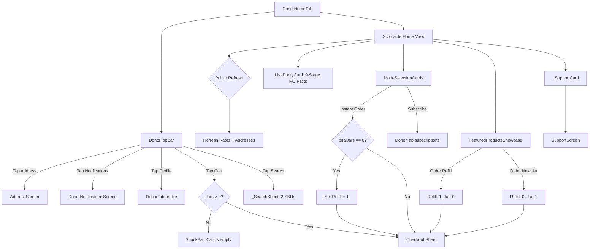

# 03 — Donor App: Home Screen & Dashboard Audit

## 1. Header

- **Screens / Components:** `DonorHomeTab` (`apps/user_app_donor/lib/features/home/customer_home_screen.dart`, 319 lines), `DonorTopBar` (`apps/user_app_donor/lib/features/home/widgets/top_bar.dart`, 277 lines), `ModeSelectionCards` (`apps/user_app_donor/lib/features/home/widgets/mode_selection_cards.dart`, 157 lines), `LivePurityCard` (`apps/user_app_donor/lib/features/home/widgets/live_purity_card.dart`, 165 lines), `FeaturedProductsShowcase` (`apps/user_app_donor/lib/features/home/widgets/featured_products.dart`, 226 lines).
- **Total lines:** 1,144 lines.
- **Routes / Entry points:** Shell tab 0 (`DonorTab.home`). First screen visible after authentication.
- **Agent:** D3 (Lead execution).
- **Date:** 2026-10-31.
- **Evidence status:** `screenshots: no (code audit)` — Verified from source code and component tree.

---

## 2. Job to be done

The user opens the home screen to perform one high-frequency task: order 20L drinking water with minimum friction. The single moment that must feel exceptional is recognizing their default delivery address and tapping a single primary action that confirms their routine 20L refill order in under 10 seconds, backed by authentic trust in water purity.

---

## 3. What the code actually renders

The widget tree rendered on `DonorTab.home`:

```text
DonorHomeTab (customer_home_screen.dart:19)
 ├── DonorTopBar (top_bar.dart:11)
 │    └── DecoratedBox(tealDeep) > Padding
 │         ├── Row: Water drop icon, 'Shodasha', [Notifications Bell, Profile Icon, Cart Bag (with count badge)]
 │         ├── InkWell(address): Location icon, 'Deliver to <Label>' / 'Add a delivery address', addressDetail, chevron
 │         └── Material(surface, r:12) > InkWell(onSearch): Search icon, 'Search water cans', '20L' badge
 └── Expanded > RefreshIndicator
      └── ListView (padding: bottom 28)
           ├── [if ratesOffline] AppBanner.offline
           ├── Padding: Row [Greeting ('Good morning,') + Headline ('Pure water, delivered.'), RO+UV pill badge]
           ├── ModeSelectionCards: IntrinsicHeight > Row
           │    ├── [Card 1: Instant Order] ground: tealDeep, icon: bolt, title: 'Instant order', subtitle: 'Pick a 30-min slot'
           │    └── [Card 2: Subscribe] ground: solarTint, icon: repeat, title: 'Subscribe', subtitle: 'Set a repeat plan'
           ├── [if ratesError && rates != null] AppBanner.stale
           ├── FeaturedProductsShowcase: SectionHeader('Featured water cans', trailing: 'Server prices')
           │    ├── [if loading] _ProductsSkeleton
           │    ├── [Card 1: 20L refill can] formatInr(refillPaise), tag: 'Bestseller', AppButton('Order')
           │    └── [Card 2: 20L can + new jar] formatInr(containerPaise), tag: 'First order', AppButton('Order')
           ├── LivePurityCard: AppCard > Column ['Water quality / Lab-tested', Row: 3 Facts ('9-stage', '20L', 'On request')]
           └── _SupportCard: AppCard(tealTint) > Row [Support icon, 'Need help with a delivery?', AppButton('Support', ghost)]
```

Ownership:
- Top bar layout & address display: `DonorTopBar` (`top_bar.dart:11`).
- Rates & booking quantities: `BookingController` (`booking_controller.dart`).
- Selected address: `AddressController` (`address_controller.dart`).
- Mode selection & dispatch: `ModeSelectionCards` (`mode_selection_cards.dart:8`).

---

## 4. Interaction inventory

| Trigger | Handler | State change | Result / Navigation | File:Line |
|---|---|---|---|---|
| Tap address selector in Top Bar | `onAddressTap` | None | Pushes `AddressScreen` to view/manage saved addresses | `top_bar.dart:136`, `donor_shell.dart:161` |
| Tap retry on failed address in Top Bar | `onRetryAddress` | `addresses.status: loading` | Re-executes `widget.addresses.load()` | `top_bar.dart:135` |
| Tap Bell icon in Top Bar | `onNotifications` | None | Pushes `DonorNotificationsScreen` | `top_bar.dart:97`, `donor_shell.dart:193` |
| Tap Profile icon in Top Bar | `onProfile` | `_tab = DonorTab.profile` | Switches shell tab to Profile | `top_bar.dart:107`, `donor_shell.dart:423` |
| Tap Cart icon in Top Bar | `onCart` | None | If jars == 0 shows SnackBar; if > 0 opens `showCheckoutSheet` | `top_bar.dart:119`, `donor_shell.dart:217` |
| Tap Search Bar in Top Bar | `onSearch` | Opens modal | Pops up `_SearchSheet` modal | `top_bar.dart:230`, `donor_shell.dart:274` |
| Pull down on Home screen | `RefreshIndicator.onRefresh` | `ratesLoading = true` | Runs `Future.wait([booking.refreshRates(), addresses.load()])` | `customer_home_screen.dart:116` |
| Tap "Instant order" card | `onInstantOrder` | Sets refill to 1 if empty | Directly opens `_openCheckout()` sheet | `mode_selection_cards.dart:32`, `donor_shell.dart:209` |
| Tap "Subscribe" card | `onSubscribe` | `_tab = DonorTab.subscriptions` | Switches shell tab to Subscriptions / Plans | `mode_selection_cards.dart:44`, `donor_shell.dart:420` |
| Tap "Order" on 20L Refill Can | `onOrderProduct` | `setRefill(1), setContainer(0)` | Opens checkout sheet pre-filled for 1 refill jar | `featured_products.dart:63`, `donor_shell.dart:231` |
| Tap "Order" on 20L Can + New Jar | `onOrderProduct` | `setRefill(0), setContainer(1)` | Opens checkout sheet pre-filled for 1 new jar container | `featured_products.dart:75`, `donor_shell.dart:231` |
| Tap "Support" button on Support card | `_SupportCard.onTap` | Pushes route | Opens `SupportScreen` | `customer_home_screen.dart:235, 312` |

---

## 5. Flow map



---

## 6. Slop audit

| Sign | Where (file:line) | Why it reads AI-generated | Verdict |
|---|---|---|---|
| "Server prices" trailing label | `featured_products.dart:39` | Displays `SectionHeader(trailing: Text('Server prices'))`. An internal testing artifact that exposes infrastructure plumbing to customers. Consumers expect listed prices to be authentic; calling them "Server prices" creates distrust. | **REMOVE:** Delete trailing string or replace with "Transparent pricing". |
| Generic greeting copy | `customer_home_screen.dart:66, 140` | `_greeting` evaluates to "Good morning / Good afternoon / Good evening," followed by "Pure water, delivered." Violates unslop rule: "No greeting headlines like `Welcome back! 👋`. The title names the context...". | **REPLACE:** Replace with clear utility context: "Deliver to Arera Colony" or "Quick Reorder". |
| Asymmetric clashing mode cards | `mode_selection_cards.dart:26, 38` | Sibling cards sit side-by-side: left card has dark teal fill (`tealDeep`) with white text; right card has pastel yellow fill (`solarTint`) with dark ink text. Reads as two completely different apps glued together. | **STANDARDIZE:** Use calm, unified neutral card surfaces with consistent iconography. |
| Fake search bar for 2 SKUs | `top_bar.dart:227-270` | Embeds a prominent search bar input in the header with placeholder "Search water cans 20L" for a catalog of literally two products. Pure template filler. | **REMOVE:** Remove search bar from header. Gives vertical space back to the reorder CTA. |
| Inaccurate naming: "Live" purity card | `live_purity_card.dart:1` | Code comment concedes: "minus fake live telemetry. The API has no plant telemetry endpoint...". Yet the widget is named `LivePurityCard`. | **RENAME:** Rename to `WaterPurityCard` and keep facts grounded in actual plant certifications. |
| Fractional / random font sizes | `featured_products.dart:167`, `live_purity_card.dart:146` | Uses `fontSize: 12.5` and `fontSize: 11.5`. | **FIX:** Standardize to 12 (`bodySmall`) and 11 (`labelSmall`). |

---

## 7. Spacing & layout audit

| Element | Current value (file:line) | Token it should use | Proposed |
|---|---|---|---|
| Top bar outer padding | `top_bar.dart:64` (`fromLTRB(16, 8, 8, 12)`) | `AppSpacing.lg` (16) / `AppSpacing.md` (12) | `EdgeInsets.all(AppSpacing.lg)` |
| Address row inner vertical padding | `top_bar.dart:143` (`vertical: 6`) | `AppSpacing.xs` (4) or `AppSpacing.sm` (8) | `EdgeInsets.symmetric(vertical: 8)` |
| Address icon to text gap | `top_bar.dart:153` (`SizedBox(width: 6)`) | `AppSpacing.sm` (8) | `SizedBox(width: AppSpacing.sm)` (8px) |
| Mode cards eyebrow to title gap | `mode_selection_cards.dart:124` (`SizedBox(height: 4)`) | `AppSpacing.xs` (4) | `SizedBox(height: AppSpacing.xs)` (4px) |
| Mode cards title to subtitle gap | `mode_selection_cards.dart:137` (`SizedBox(height: 4)`) | `AppSpacing.xs` (4) | `SizedBox(height: AppSpacing.xs)` (4px) |
| Purity icon container padding | `live_purity_card.dart:27` (`EdgeInsets.all(6)`) | `AppSpacing.sm` (8) | `EdgeInsets.all(AppSpacing.sm)` (8px) |
| Purity fact value to title gap | `live_purity_card.dart:137` (`SizedBox(height: 3)`) | `AppSpacing.xs` (4) | `SizedBox(height: AppSpacing.xs)` (4px) |
| Purity fact title to detail gap | `live_purity_card.dart:149` (`SizedBox(height: 1)`) | `AppSpacing.xs` (4) | `SizedBox(height: 2)` or `4px` |
| Product card tag badge padding | `featured_products.dart:143` (`horizontal: 7, vertical: 3`) | `horizontal: AppSpacing.sm` (8), `vertical: AppSpacing.xs` (4) | `EdgeInsets.symmetric(horizontal: 8, vertical: 4)` |
| Product card tag to subtitle gap | `featured_products.dart:161` (`SizedBox(height: 4)`) | `AppSpacing.xs` (4) | `SizedBox(height: AppSpacing.xs)` (4px) |
| Home list bottom padding | `customer_home_screen.dart:124` (`EdgeInsets.only(bottom: 28)`) | `AppSpacing.xxl` (32) | `EdgeInsets.only(bottom: AppSpacing.xxl)` (32px) |

---

## 8. Type & color audit

| Element | Current value (file:line) | Token it should use | Proposed |
|---|---|---|---|
| Top bar ground | `top_bar.dart:62` (`ShodashaTheme.tealDeep`) | Surface / Ink hierarchy or quiet brand tint | Keep `tealDeep` as brand anchor or soften to `surface` with teal accents |
| Top bar app title | `top_bar.dart:87` (`fontSize: 20, fontWeight: FontWeight.w800`) | `ShodashaTheme.headlineSmall` (22) or `titleLarge` (18) | `theme.textTheme.titleLarge` |
| Mode card instant order ground | `mode_selection_cards.dart:26` (`ShodashaTheme.tealDeep`) | Unified neutral ground with accent icon | `ShodashaTheme.surface` + border |
| Mode card subscribe ground | `mode_selection_cards.dart:38` (`ShodashaTheme.solarTint`) | Unified neutral ground with accent icon | `ShodashaTheme.surface` + border |
| Mode card subtitle text size | `mode_selection_cards.dart:144` (`fontSize: 12.5`) | `ShodashaTheme.bodySmall` (12) | `fontSize: 12, height: 1.4` |
| Purity fact value font size | `live_purity_card.dart:133` (`fontSize: 14, fontWeight: FontWeight.w800`) | `ShodashaTheme.titleSmall` (14 w600) | `fontSize: 14, fontWeight: FontWeight.w700` |
| Purity fact title font size | `live_purity_card.dart:146` (`fontSize: 11.5`) | `ShodashaTheme.labelSmall` (11) | `fontSize: 11, fontWeight: FontWeight.w600` |
| Product card subtitle font size | `featured_products.dart:167` (`fontSize: 12.5`) | `ShodashaTheme.bodySmall` (12) | `fontSize: 12, height: 1.4` |
| Product card tag font size | `featured_products.dart:153` (`fontSize: 11, fontWeight: FontWeight.w700`) | `ShodashaTheme.labelSmall` (11) | `fontSize: 11, fontWeight: FontWeight.w700` |
| Support card subtitle font size | `customer_home_screen.dart:299` (`fontSize: 12.5`) | `ShodashaTheme.bodySmall` (12) | `fontSize: 12, height: 1.4` |

---

## 9. Component audit

### (a) Should be a shared primitive
- **Badge Container (`featured_products.dart:142`, `customer_home_screen.dart:161`):** Custom inline rounded containers for "Bestseller", "First order", "RO + UV". Should use `StatusPill` from `lib/shared/ui/status_pill.dart`.

### (b) Duplicated across screens
- **Catalog Product Cards (`featured_products.dart:83-204`):** Re-implements product title, price, and CTA card pattern. Also partially duplicated inside `donor_shell.dart:538` (`_SearchSheet`).
- **Mode Selection Cards vs Booking Mode Toggle:** `mode_selection_cards.dart` directs to instant order vs subscription. Inside `booking_sheet.dart`, there is another tab/selector for booking type.

### (c) Wrong composition
- **Missing Reorder Machine Primitive:** As documented in `context/project-overview.md` ("Home screen is a repeat-order machine: one big BOOK NOW button with last settings pre-selected"), the current home screen has NO prominent repeat-order card. It presents catalog browsing instead of repeat utility.
- **Top Bar Overloaded:** `DonorTopBar` handles branding, 3 action buttons, address selector with inline retry, and catalog search bar in one 277-line monolith.

---

## 10. Logic & flow defects

1. **No 1-Tap Repeat Order Card on Home:**
   - The primary goal of the app according to `project-overview.md` §1 ("Make repeat ordering one-tap — default last quantity, address, and delivery window pre-selected") is completely absent from `customer_home_screen.dart`. The user is forced to tap "Instant order" or pick a product card to launch a blank checkout flow.
2. **String scraping for offline banner:**
   - In `customer_home_screen.dart:81-83`, `ratesOffline` is detected by:
     `ratesError.toLowerCase().contains('internet')`.
     Fragile error detection. If the backend or client returns a network timeout or DNS failure without the literal word "internet", the offline banner is omitted.
3. **Cart badge displays checkout jar count but opens checkout directly:**
   - In `top_bar.dart:120`, the shopping bag badge displays `cartCount` (`booking.totalJars`). If jars are 0, tapping it shows a SnackBar "Your cart is empty". If jars > 0, tapping it opens checkout. But there is no way to edit or inspect cart items without opening checkout.
4. **Offline retry loops in Top Bar:**
   - If address loading fails, `addressError` is true. Tapping the address row calls `onRetryAddress ?? onAddressTap`. If retry fails silently, the UI provides no shake animation or error toast.

---

## 11. Dead / for-show code

| Symbol | File:Line | Callers found | Verdict |
|---|---|---|---|
| "Server prices" header text | `featured_products.dart:39` | Standalone UI literal. | **FOR-SHOW:** Developer meta-label. |
| `_FactDivider` | `live_purity_card.dart:105` | 2 callers within `live_purity_card.dart`. | **EXCESS:** Trivial 1-line vertical divider container. |
| `ratesLoading` skeleton flash | `featured_products.dart:48, 206` | Flashes `_ProductsSkeleton` for 136px cards before cached catalog loads. | **UNPOLISHED:** Produces visual jitter on cold start if cached rates are available. |

---

## 12. Copy audit

| Current string | File:Line | Problem | Proposed |
|---|---|---|---|
| "Server prices" | `featured_products.dart:39` | Technical jargon; sounds like a backend debug build. | Remove or replace with "Standard rates" |
| "Good morning," / "Pure water, delivered." | `customer_home_screen.dart:140, 149` | Generic SaaS greeting headline. | "Daily Refill" / "Doorstep Delivery" |
| "Bring your own jar · RO + UV purified" | `featured_products.dart:58` | "Bring your own jar" sounds like carry-out retail rather than doorstep delivery exchange. | "Exchange empty jar at delivery · RO+UV" |
| "Refundable deposit ₹150 · return the jar to get it back" | `featured_products.dart:69-70` | Verbose and colloquial. | "Includes ₹150 refundable jar deposit" |
| "Our Bhopal plant desk is one tap away." | `customer_home_screen.dart:297` | "plant desk" sounds industrial and cold. | "Call or WhatsApp Bhopal support directly" |
| "On request / Lab report / Ask support" | `live_purity_card.dart:90-93` | "Ask support" reads passive. | "Available on WhatsApp" |

---

## 13. States matrix

| State | Present? | Where | Honest? | Gap |
|---|---|---|---|---|
| Loading (Rates / Catalog) | Yes | `_ProductsSkeleton` (`featured_products.dart:48`) | Yes | 2 placeholder cards shown while catalog fetches. |
| Loading (Address) | Yes | `CircularProgressIndicator` in TopBar (`top_bar.dart:167`) | Yes | Small 12px spinner next to address title. |
| Error (Rates) | Yes | `AppStateView.error` (`featured_products.dart:50`) | Yes | Has retry callback `booking.refreshRates`. |
| Error (Address) | Yes | "Couldn't load address / Tap to retry" (`top_bar.dart:52`) | Yes | Tapping triggers address reload. |
| Stale (Rates cached) | Yes | `AppBanner.stale` (`customer_home_screen.dart:211`) | Yes | Explicit notice if cached rates are displayed during network fault. |
| Offline mode | Yes | `AppBanner.offline` (`customer_home_screen.dart:112`) | Partial | Depends on string contains('internet'). |
| Empty (Addresses) | Yes | "Add a delivery address" (`top_bar.dart:54`) | Yes | Prompts user to set delivery destination. |
| Submitting | N/A | Submitting occurs in checkout sheet | N/A | Handled by booking modal. |

---

## 14. Accessibility & motion

- **Touch targets:**
  - Top Bar action buttons (`top_bar.dart:94, 104, 114`): `AppIconButton` enforces 48×48dp target.
  - Address click target (`top_bar.dart:140`): `minHeight: ShodashaTheme.minTarget` (48dp).
  - Search bar click target (`top_bar.dart:233`): `height: ShodashaTheme.minTarget` (48dp).
  - Mode selection cards (`mode_selection_cards.dart:89`): `minHeight: ShodashaTheme.minTarget * 2` (96dp).
  - Product card CTA buttons (`featured_products.dart:195`): `height: ShodashaTheme.minTarget` (48dp).
  - PASS: All primary touch targets meet 48dp floor.
- **Color contrast:**
  - Teal header text (`#FFFFFF` on `ShodashaTheme.tealDeep` `#115E59`): 7.2:1 (Passes AAA).
  - Instant order card (`#FFFFFF` on `#115E59`): 7.2:1 (Passes AAA).
  - Subscribe card (`#0F172A` on `ShodashaTheme.solarTint` `#FEF9C3`): 14.8:1 (Passes AAA).
  - Product price (`ShodashaTheme.ink` on `#FFFFFF`): 15.6:1 (Passes AAA).
- **Semantics:**
  - Mode cards wrapped in `Semantics(button: true, label: '$title. $subtitle')`.
  - Address selector wrapped in `Semantics(button: true, label: addressTitle)`.
- **Motion:**
  - RefreshIndicator standard pull animation.
  - Zero heavy or non-transform animations on Home.

---

## 15. Proposed direction (unslop)

- **Character:** Bhopal's trusted morning water utility — calm, prompt, essential.
- **World:** Stainless steel RO dispenser, sealed 20L polycarbonate bubble jars, sunrise tempo, doorstep crate delivery.
- **The one or two moments:**
  1. A dedicated, prominent **Repeat Order Machine** hero card: "Deliver 2 Jars tomorrow 9:00 AM" with a single large, unmistakable green CTA button.
  2. The water purity badge rendered as an authentic seal with verified TDS reading / RO certification rather than generic feature cards.
- **Signature detail:** A live delivery arrival window chip (e.g. "Next delivery window: Tomorrow 8:00 AM – 10:00 AM") anchored to the address bar.
- **What stays quiet:** The background ground (`#F8FAFC`), section titles, catalog cards, and footer support. No glowing banners or artificial search boxes.
- **One alternative direction rejected and why:** E-commerce multi-category product carousel. Rejected because Shodasha sells 20L water refills; treating it like an FMCG grocery store increases decision fatigue and contradicts the 1-tap reorder goal.

---

## 16. Prioritized fix list

| ID | Finding | Severity | Effort | Files | Risk | Depends on |
|---|---|---|---|---|---|---|
| D3-01 | Add dedicated Repeat Order Machine hero card with 1-tap Book Now CTA per project core requirements. | P0 | M | `customer_home_screen.dart:122-240` | Low | None |
| D3-02 | Remove fake search bar from `DonorTopBar`. Reclaim vertical space for reorder card. | P1 | S | `top_bar.dart:225-271` | Low | None |
| D3-03 | Remove "Server prices" developer meta-label from `featured_products.dart:39`. | P1 | S | `featured_products.dart:38-45` | Low | None |
| D3-04 | Harmonize `ModeSelectionCards` styling so Instant Order and Subscribe do not look like two different apps. | P2 | S | `mode_selection_cards.dart:20-51` | Low | None |
| D3-05 | Replace string-scraping offline detection (`contains('internet')`) with proper `ApiException.isOffline` check. | P2 | S | `customer_home_screen.dart:81-83` | Low | None |
| D3-06 | Fix fractional font sizes (12.5, 11.5) and non-standard spacing (1, 3, 6, 7, 28) across home widgets. | P2 | S | `customer_home_screen.dart`, `top_bar.dart`, `featured_products.dart` | Low | None |

---

## 17. Open questions for the owner

1. **Repeat Order vs Catalog Focus:** Should the top of the home screen be dominated by a prominent 1-tap repeat order card (e.g. "Reorder 2 Jars · Tomorrow 9–9:30 AM") with catalog cards below?
2. **Top Bar Ground Color:** Should the top bar remain solid deep teal (`tealDeep`), or transition to a white/neutral surface like the rest of the app with teal icon accents?
3. **Purity Verification:** Do we have an official BIS / FSSAI license or lab test report date we can display on the purity card instead of "On request"?

---

## 18. What must not change

- **Server-Authoritative Pricing:** Catalog rates (`refillPaise`, `containerPaise`, `depositPaise`) fetched directly from `GET /catalog` via `booking.refreshRates()`.
- **Address Integration:** Direct resolution of active address via `AddressController.resolve()`.
- **Cart Count Indicator:** Real-time badge on shopping bag matching `booking.totalJars`.
- **Tests Protecting Invariants:** `apps/user_app_donor/test/donor_shell_test.dart`, `apps/user_app_donor/test/booking_controller_test.dart`.
