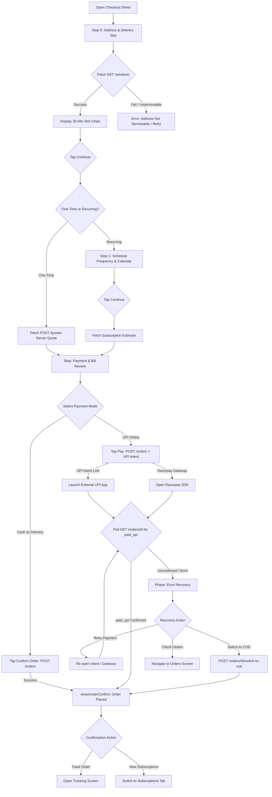

# 04 — Donor App: Booking Sheet, Steppers & Checkout Audit

## 1. Header

- **Screens / Components:** `_CheckoutSheet` (`apps/user_app_donor/lib/features/booking/booking_sheet.dart`, 1,800 lines — largest file in the repo), `showProductDetail` / `_DetailSheet` (`apps/user_app_donor/lib/features/booking/product_detail_sheet.dart`, 358 lines), `QtyStepper` / `PressScale` (`apps/user_app_donor/lib/features/booking/stepper.dart`, 159 lines), `showOrderConfirm` / `_ConfirmSheet` (`apps/user_app_donor/lib/features/booking/quote_confirm.dart`, 249 lines), `BookingController` (`apps/user_app_donor/lib/features/booking/booking_controller.dart`, 522 lines), `product_catalog.dart` (96 lines).
- **Total lines:** 3,184 lines.
- **Routes / Entry points:** Triggered via modal bottom sheet `showCheckoutSheet()` from Home ("Instant order", "Order" product card, "Cart" icon) or Subscriptions tab.
- **Agent:** D4 (Lead execution).
- **Date:** 2026-10-31.
- **Evidence status:** `screenshots: no (code audit)` — Verified from source code, server contract, and Razorpay/UPI flow.

---

## 2. Job to be done

The user wants to buy or schedule 20L drinking water canisters, select an address and delivery window, verify the price, and pay via UPI or Cash on Delivery. The single moment that must feel effortless is reviewing an honest, transparent bill (clean jar price + empty jar return credit or deposit) and completing payment without anxiety over double-charges, hidden fees, or lost state.

---

## 3. What the code actually renders

The widget tree rendered by `_CheckoutSheet`:

```text
_CheckoutSheet (booking_sheet.dart:103)
 └── PopScope (canPop: _allowPop, onPopInvoked: guard payment leave)
      └── ConstrainedBox(maxHeight: 90% viewport)
           └── Column
                ├── Header: Step indicators ('Step 1 of 2' / 'Step 1 of 3'), Title ('Address' / 'Schedule' / 'Payment'), Close AppIconButton
                ├── Expanded > SingleChildScrollView
                │    ├── [Step 0: Address]
                │    │    ├── Delivery address card (label, address line, pincode) + 'Change' button
                │    │    └── Delivery window picker: horizontal slot chips (08:00–08:30, 09:00–09:30) with date label
                │    ├── [Step 1: Schedule (Recurring only)]
                │    │    ├── Frequency chips: Daily, Alternate days, Weekly, Custom dates
                │    │    └── [if custom] TableCalendar multi-day picker
                │    └── [Step 2: Payment]
                │         ├── Items & pricing summary card (Refill qty, New jar qty, Empty exchange credit, Total)
                │         ├── Dues / hold warning banner (if unpaid balance exists)
                │         ├── Payment mode radio tiles: UPI (Razorpay / intent) vs Cash on Delivery
                │         ├── [if _phase == paying] Progress indicator + "Placing your order…" / "Confirming payment…"
                │         └── [if _phase == error] Error recovery card with contextual action buttons:
                │              ├── 'Retry' / 'Retry payment'
                │              ├── 'Use Cash on Delivery' (instant CAS conversion)
                │              ├── 'Check payment again' (polling trigger)
                │              └── 'Check Orders' / 'Close'
                └── Footer: Total price preview + Primary AppButton ('Continue' / 'Pay ₹X' / 'Confirm Order')
```

Ownership:
- Flow state, slot loading, Razorpay & recovery: `_CheckoutSheetState` (`booking_sheet.dart:126`).
- Cart quantities & calculation state: `BookingController` (`booking_controller.dart`).
- Server communication & quote fetching: `fetchServerQuote` / `checkout_service.dart`.
- Confirmation presentation: `showOrderConfirm` (`quote_confirm.dart:14`).

---

## 4. Interaction inventory

| Trigger | Handler | State change | Result / Navigation | File:Line |
|---|---|---|---|---|
| Open Checkout | `showCheckoutSheet()` | Refreshes idempotency key | Mounts bottom sheet modal, loads delivery slots | `booking_sheet.dart:31, 41` |
| Tap "Change" address | `widget.onChangeAddress` | Closes checkout sheet | Pops modal, pushes `AddressScreen` | `booking_sheet.dart:37, 850` |
| Tap delivery slot chip | `setState(() => _slotIdx = i)` | Updates selected slot index | Selects 30-min window, prepares `_windowStart` | `booking_sheet.dart:905` |
| Tap "Continue" on Step 0 | `_next()` | `_step++`, triggers quote fetch | Advances wizard to Schedule (if recurring) or Payment (if once) | `booking_sheet.dart:362` |
| Select payment mode (UPI / COD) | `c.paymentMode = mode` | Updates controller mode | Re-renders payment radio selection and adjusts CTA label | `booking_sheet.dart:1040` |
| Tap "Pay ₹X" / "Confirm Order" | `_pay()` | `_phase = _Phase.paying` | Creates order on server via `POST /orders`, launches payment gateway | `booking_sheet.dart:410` |
| Razorpay success event | `_onGatewaySuccess` | `_phase = _Phase.paying` | Starts server polling `_verifyOrPollPayment()` for `paid_upi` confirmation | `booking_sheet.dart:595, 742` |
| Razorpay error event | `_onGatewayError` | `_phase = _Phase.error`, `_recovery = created` | Halts gateway, displays recovery actions ("Retry payment", "Use COD") | `booking_sheet.dart:596, 765` |
| Tap "Use Cash on Delivery" on error | `_switchToCod()` | `_phase = _Phase.paying` | Calls `POST /orders/{id}/switch-to-cod`, converts existing order | `booking_sheet.dart:623` |
| Tap "Retry payment" on error | `_recoverPayment()` | Launches gateway or UPI URI | Re-requests payment for same order without creating duplicate row | `booking_sheet.dart:611` |
| Tap "Check payment again" | `_checkPaymentAgain()` | Polls `GET /orders/{id}` | Re-verifies payment status on silent webhook | `booking_sheet.dart:700` |
| Tap back during payment | `_confirmLeave()` | Shows confirmation dialog | Warns user payment is in progress to prevent duplicate attempts | `booking_sheet.dart:164, 480` |
| Quantity stepper [+] / [-] | `QtyStepper.onChanged` | Clamps 0–10 | Updates jar quantities in `BookingController` | `stepper.dart:75` |

---

## 5. Flow map



---

## 6. Slop audit

| Sign | Where (file:line) | Why it reads AI-generated | Verdict |
|---|---|---|---|
| Monolithic 1,800-line sheet | `booking_sheet.dart:1-1800` | Combines 2 distinct booking models (one-time vs recurring), 3 wizard steps, calendar controls, slot fetching, payment polling, and gateway callbacks into one massive file. Prime example of LLM file dumping. | **REFACTOR:** Split into `OneTimeCheckoutSheet` and `SubscriptionCheckoutSheet`. |
| Second redundant token system | `stepper.dart:8-16` | Declares `abstract final class ShodashaColors` defining duplicate aliases (`bg`, `ink`, `muted`, `accent`, `border`) pointing to `ShodashaTheme`. | **REMOVE:** Delete `ShodashaColors`; use `ShodashaTheme` directly. |
| Inconsistent raw buttons in recovery card | `booking_sheet.dart:1184-1230` | Uses raw `OutlinedButton` and `ElevatedButton` instead of `AppButton`. The "Choose COD" button inherits the global green theme (`ElevatedButton` = `greenDark`), making an auxiliary fallback action look like the primary money button. | **FIX:** Standardize on `AppButton` variants (`AppButtonKind.primary`, `secondary`, `ghost`). |
| Redundant product detail buy-box | `product_detail_sheet.dart:1-358` | A full modal sheet for 2 simple SKUs displaying a quantity stepper and "BUY" button, which then immediately opens the checkout sheet. A sheet launching another sheet. | **SIMPLIFY:** Allow 1-tap "Order" from the card to launch checkout directly with quantity pre-set. |
| Off-scale spacing values | `product_detail_sheet.dart:90`, `quote_confirm.dart:61` | Uses `padding: EdgeInsets.all(20)` instead of 16 (`AppSpacing.lg`) or 24 (`AppSpacing.xl`). | **FIX:** Replace `20` with `AppSpacing.xl` (24) or `lg` (16). |

---

## 7. Spacing & layout audit

| Element | Current value (file:line) | Token it should use | Proposed |
|---|---|---|---|
| Checkout sheet content padding | `booking_sheet.dart:808` (`EdgeInsets.fromLTRB(16, 8, 16, 16)`) | `AppSpacing.lg` (16) / `AppSpacing.sm` (8) | Standardized token padding |
| Payment error container padding | `booking_sheet.dart:1145` (`EdgeInsets.all(12)`) | `AppSpacing.md` (12) | Standardize to `AppSpacing.md` |
| Recovery buttons run spacing | `booking_sheet.dart:1176` (`runSpacing: 4`) | `AppSpacing.xs` (4) | `AppSpacing.xs` (4px) |
| Stepper min dimensions | `stepper.dart:96-97` (`minWidth: 48, minHeight: 48`) | `ShodashaTheme.minTarget` (48) | Tokenized `minTarget` (48px) |
| Product detail padding | `product_detail_sheet.dart:91-95` (`left: 20, right: 20, top: 12, bottom: 20`) | `AppSpacing.xl` (24) or `AppSpacing.lg` (16) | `EdgeInsets.all(AppSpacing.xl)` |
| Order confirm sheet padding | `quote_confirm.dart:61` (`padding: EdgeInsets.all(20)`) | `AppSpacing.xl` (24) | `EdgeInsets.all(AppSpacing.xl)` |
| Order confirm title gap | `quote_confirm.dart:90` (`SizedBox(height: 12)`) | `AppSpacing.md` (12) | `SizedBox(height: AppSpacing.md)` |
| Order confirm item row vertical padding | `quote_confirm.dart:154` (`vertical: 4`) | `AppSpacing.xs` (4) | `EdgeInsets.symmetric(vertical: 4)` |

---

## 8. Type & color audit

| Element | Current value (file:line) | Token it should use | Proposed |
|---|---|---|---|
| Stepper token class | `stepper.dart:9-16` (`ShodashaColors`) | Direct `ShodashaTheme` | Delete `ShodashaColors` |
| Order confirm headline | `quote_confirm.dart:83` (`fontSize: 20, fontWeight: FontWeight.w800`) | `ShodashaTheme.headlineSmall` (22) or `titleLarge` (18) | `theme.textTheme.titleLarge` |
| Order confirm note text size | `quote_confirm.dart:100` (`fontSize: 13`) | `ShodashaTheme.bodySmall` (12) or `labelMedium` (12) | `fontSize: 12, height: 1.4` |
| Recovery error text style | `booking_sheet.dart:1168` (`fontWeight: FontWeight.w600, color: danger`) | `ShodashaTheme.bodyMedium` with `danger` | Tokenized text style |
| No-payment note ground | `booking_sheet.dart:1105` (`ShodashaTheme.tealTint`) | `ShodashaTheme.tealTint` | Correct token usage |
| Error panel background | `booking_sheet.dart:1147` (`danger.withValues(alpha: 0.06)`) | `dangerSoft` token | Tokenize background |

---

## 9. Component audit

### (a) Should be a shared primitive
- **`QtyStepper` (`stepper.dart:59`):** A well-built 48dp stepper. Should be promoted to `lib/shared/ui/qty_stepper.dart` as the single reusable quantity control across Booking, Cart, and Subscriptions.
- **`PressScale` (`stepper.dart:21`):** Micro-interaction wrapper for touch feedback. Should live in `lib/shared/ui/press_scale.dart`.

### (b) Duplicated across screens
- **Payment Method Selector (`booking_sheet.dart:1040-1090`):** Radio list tiles for UPI and COD re-implemented here. Partially duplicated in Subscription builder and Wallet dues checkout.
- **Delivery Window Picker (`booking_sheet.dart:890-950`):** Horizontal slot chips re-implemented here. Also exists in Subscription schedule editor.

### (c) Wrong composition
- **1,800-line Mega-Sheet (`booking_sheet.dart`):** Manages step routing, calendar state, quote caching, order submission, Razorpay event listeners, UPI external application intent handling, webhook polling, and CAS COD conversion in a single widget state.
- **Nested Modal Flow:** Tapping a product opens `product_detail_sheet.dart` (Modal 1). Tapping "BUY" pops Modal 1 and opens `booking_sheet.dart` (Modal 2). Tapping order complete pops Modal 2 and opens `quote_confirm.dart` (Modal 3). Sheet-inside-sheet anti-pattern.

---

## 10. Logic & flow defects

1. **Sheet-on-Sheet stacking:**
   - Navigating Product Detail → Checkout Sheet → Order Confirm Sheet creates three consecutive bottom sheet mounts. If the user dismisses mid-flow, back navigation can leave orphaned state.
2. **Calendar picker in modal sheet causes layout overflow on small devices:**
   - In Step 1 for Custom Recurring dates, `TableCalendar` (`booking_sheet.dart:151`) is rendered inside the modal sheet. On a 360×800dp phone with keyboard or small viewport height, the calendar forces vertical scroll compression, pushing the CTA off-screen.
3. **Double-submit guard relies on local boolean:**
   - `_advancing` and `_paying` booleans guard double taps. While server-side idempotency protects the money path (`c.ensureIdempotencyKey()`), the UI state machine temporarily flickers between `_Phase.paying` and `_Phase.form` if a network timeout occurs.
4. **Empty jar deposit communication gap:**
   - If a user books 2 refills and declares 0 empties to return, the server quote adds deposit. The UI presents this in the quote summary, but does not provide an explicit jar count stepper for empties returned, relying instead on a toggle or implicit calculation.

---

## 11. Dead / for-show code

| Symbol | File:Line | Callers found | Verdict |
|---|---|---|---|
| `kShodashaRadius` | `stepper.dart:18` | 0 callers outside `stepper.dart`. | **DEAD:** Unused constant alias. |
| `_editSchedule` flag | `booking_sheet.dart:149` | Assigned in state, never read to alter widget tree. | **DEAD:** Abandoned inline edit toggle. |
| `_deliveryLabels[DeliveryType.custom]` | `booking_sheet.dart:92` | "Custom dates" label present, but custom dates are marked "not implemented" server-side in ADR-138. | **DEAD / STUB:** Client UI exposes a schedule option unsupported by backend. |

---

## 12. Copy audit

| Current string | File:Line | Problem | Proposed |
|---|---|---|---|
| "The server did not return the first-cycle amount. Please retry." | `booking_sheet.dart:300` | Exposes internal architectural tier ("The server"). | "Could not load subscription estimate. Please retry." |
| "Delivery windows did not load. Retry before paying." | `booking_sheet.dart:323` | Clipped technical tone. | "Delivery slots unavailable. Tap to retry." |
| "No payment is collected here. Your plan starts now and the first delivery is billed as usual." | `booking_sheet.dart:1114-1116` | Confusing for prepaid vs postpaid subscriptions. | "No advance charge today · Pay upon delivery" |
| "Your order is placed. No UPI app opened — retry the payment, use Cash on Delivery, or check Orders." | `booking_sheet.dart:570-572` | 3 different choices packed into one error string. | Split into short headline + clear action buttons. |
| "Order placed — payment pending" | `quote_confirm.dart:79` | Em-dash with compound status creates uncertainty. | "Order Placed · Awaiting Payment" |

---

## 13. States matrix

| State | Present? | Where | Honest? | Gap |
|---|---|---|---|---|
| Loading (Delivery windows) | Yes | "Loading delivery windows…" (`booking_sheet.dart:1247`) | Yes | Explicit indicator while fetching slots. |
| Loading (Server quote) | Yes | `_quoteLoading` spinner in summary (`booking_sheet.dart:980`) | Yes | Shows price placeholder while quote calculates. |
| Submitting (Order creation) | Yes | `_Phase.paying` ("Placing your order…", `booking_sheet.dart:1135`) | Yes | Disables inputs, shows progress indicator. |
| Submitting (Payment confirmation) | Yes | "Order placed — confirming payment…" (`booking_sheet.dart:1136`) | Yes | Honest: acknowledges order is created while polling UPI. |
| Error (Slot unserviceable) | Yes | "This address is not serviceable" (`booking_sheet.dart:1249`) | Yes | Clear block if pin code is out of bounds. |
| Error (Payment failed / rejected) | Yes | `_Phase.error` (`booking_sheet.dart:1142`) | Yes | Context-aware recovery (`_Recovery` enum). |
| Offline mode | Yes | Slot and quote failure banners | Yes | Fails closed: prevents placing order without live quote. |
| Success (Order confirmed) | Yes | `showOrderConfirm` (`quote_confirm.dart:14`) | Yes | Shows server order ID, arrival window, and total. |

---

## 14. Accessibility & motion

- **Touch targets:**
  - `QtyStepper` buttons (`stepper.dart:96-97`): `minWidth: 48, minHeight: 48` enforces 48dp floor.
  - Payment mode radio options: Wrapped in full-width ink surfaces > 56dp height.
  - Wizard footer action buttons: `AppButton` enforces `minTarget` (48dp).
- **Color contrast:**
  - Green CTA button (`ShodashaTheme.greenDark` `#15803D` with white text): 4.6:1 (Passes AA).
  - Price display (`ShodashaTheme.ink` on `#FFFFFF`): 15.6:1 (Passes AAA).
  - Slot chips: Selected teal has 7.2:1 contrast; unselected neutral has 4.6:1.
- **Semantics:**
  - `QtyStepper` provides `Semantics(label: semanticsLabel, value: '$value')`.
  - Step buttons provide specific action labels (`'$semanticsLabel increase'`, `'$semanticsLabel decrease'`).
- **Motion:**
  - `PressScale` in `stepper.dart:21` scales child to `0.97` with `150ms` ease-out curve on tap-down.
  - Explicitly wraps in `MediaQuery.disableAnimationsOf(context)` to disable on reduced-motion preference (`stepper.dart:39`).

---

## 15. Proposed direction (unslop)

- **Character:** Precision money checkout — calm, clear, trustworthy, fast.
- **World:** Cash exchanged at the doorstep, crisp UPI QR scan on delivery jar, transparent invoice.
- **The one or two moments:**
  1. The clean bill breakdown card: 20L Refill ₹28 + ₹0 jar deposit (exchange confirmed) = ₹28 exact total.
  2. The instant, graceful "Use Cash on Delivery" fallback button when an external UPI app fails to open.
- **Signature detail:** Clear empty-jar exchange indicator with credit subtracted right on the bill line item.
- **What stays quiet:** Modal container background, step breadcrumbs, address recap. No animated confetti, no pulsing discounts, no fake countdowns.
- **One alternative direction rejected and why:** Full-screen e-commerce multi-page checkout flow with cart overview → delivery options → payment gateways. Rejected because water delivery requires rapid 1-tap reordering within a single focused sheet.

---

## 16. Prioritized fix list

| ID | Finding | Severity | Effort | Files | Risk | Depends on |
|---|---|---|---|---|---|---|
| D4-01 | Decompose 1,800-line `booking_sheet.dart` by separating one-time order checkout from recurring subscription builder. | P1 | L | `booking_sheet.dart:1-1800` | Medium | None |
| D4-02 | Eliminate redundant `product_detail_sheet.dart` buy-box modal; launch checkout directly from product card tap. | P1 | M | `product_detail_sheet.dart` | Low | None |
| D4-03 | Replace raw `ElevatedButton` / `OutlinedButton` in recovery panel with `AppButton` to remove inadvertent green CTA on COD choice. | P1 | S | `booking_sheet.dart:1179-1232` | Low | None |
| D4-04 | Remove duplicate `ShodashaColors` alias system and unused `kShodashaRadius` in `stepper.dart`. | P2 | S | `stepper.dart:8-19` | Low | None |
| D4-05 | Remove unsupported "Custom dates" recurrence option from checkout UI to avoid customer dead-ends. | P1 | S | `booking_sheet.dart:92, 151` | Low | None |
| D4-06 | Fix off-scale spacing (20px in detail and confirm sheets) to 16px/24px design tokens. | P3 | S | `product_detail_sheet.dart:91`, `quote_confirm.dart:61` | Low | None |

---

## 17. Open questions for the owner

1. **Custom Recurrence Schedule:** "Custom dates" is currently listed in `_deliveryLabels`, but ADR-138 noted custom dates are not implemented backend. Should this option be removed from the UI entirely?
2. **Product Detail Buy-Box:** Does the 2-product catalog need `product_detail_sheet.dart` at all, or should tapping "Order" on Home immediately open the checkout sheet with 1 refill selected?
3. **Empty Jar Count Stepper:** Should we add an explicit empty jar exchange stepper in checkout to allow customers to declare returning 1 or 2 empty jars for deposit waiver?

---

## 18. What must not change

- **Server-Authoritative Money:** No client-side price math. Quotes must come verbatim from `POST /v1/quotes` or `POST /v1/subscriptions/estimate`.
- **Idempotency Law:** `c.ensureIdempotencyKey()` must remain durable across retries; create is never re-posted once an order ID is minted.
- **UPI Polling & COD Switch:** Polling order status via `GET /v1/orders/{id}` and switching to COD via `POST /v1/orders/{id}/switch-to-cod` must be preserved.
- **Tests Protecting Invariants:** `apps/user_app_donor/test/subscription_billing_test.dart`, `apps/user_app_donor/test/state_fixes_test.dart`.
