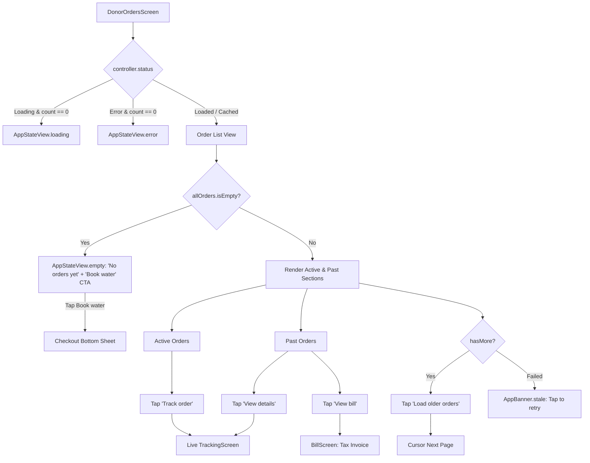

# 05 — Donor App: Orders List & Order Card Audit

## 1. Header

- **Screens / Components:** `DonorOrdersScreen` (`apps/user_app_donor/lib/features/orders/my_orders_screen.dart`, 215 lines), `DonorOrderCard` + `_MetaRow` (`apps/user_app_donor/lib/features/orders/order_card.dart`, 283 lines), `OrdersController` (`apps/user_app_donor/lib/features/orders/orders_controller.dart`, 1,171 lines — list, pagination, and filter mechanisms).
- **Total lines:** 1,669 lines.
- **Routes / Entry points:** Shell tab 1 (`DonorTab.orders`). Also reached via "Track order" shortcut in `showOrderConfirm`.
- **Agent:** D5 (Lead execution).
- **Date:** 2026-10-31.
- **Evidence status:** `screenshots: no (code audit)` — Verified from source code, component styling, and cursor-paged list controller.

---

## 2. Job to be done

The user comes to the Orders tab to check the real-time delivery status of active 20L water cans or look up historical invoices and past order details. The single moment that must feel good is instantly identifying an active delivery with its live status badge, scheduled 30-minute window, and an unmissable "Track order" action that opens live tracking in 1 tap.

---

## 3. What the code actually renders

The widget tree rendered by `DonorOrdersScreen`:

```text
DonorOrdersScreen (my_orders_screen.dart:17)
 └── Scaffold(backgroundColor: ShodashaTheme.bg)
      ├── AppBar(backgroundColor: surface, title: 'My orders', actions: [Refresh])
      └── body: ListenableBuilder(controller)
           └── [if loading && count == 0] AppStateView.loading(lines: 4)
           └── [if error && count == 0] AppStateView.error(isNetwork: isOffline)
           └── [if loaded] RefreshIndicator(color: tealDeep)
                └── ListView (padding: 16 12 16 32)
                     ├── [if isOffline] AppBanner.offline
                     ├── [if errorMessage] AppBanner.stale
                     ├── [if all.isEmpty] AppStateView.empty("No orders yet", action: "Book water")
                     └── [if all.isNotEmpty]
                          ├── SectionHeader('Active')
                          ├── [if active.isEmpty] AppStateView.empty("No active deliveries")
                          ├── for o in active -> DonorOrderCard(o)
                          ├── [if closed.isNotEmpty] SectionHeader('Past orders')
                          ├── for o in closed -> DonorOrderCard(o)
                          ├── [if hasMore] AppButton('Load older orders', secondary)
                          └── [if loadMoreFailed] AppBanner.stale("Could not load more orders", retry)
```

And `DonorOrderCard`:
```text
DonorOrderCard (order_card.dart:16)
 └── Padding(bottom: 12) > AppCard
      └── Column
           ├── Row: Text('#${order.id}', 12 muted) + StatusPill(orderStateLabel, tone, icon)
           ├── Text(_title, 15 w700 ink) [e.g. '2 × 20L refill + 1 × 20L new jar']
           ├── Row: Container(tealTint, r:6) [Text('$_qty × 20L', 12 w700 tealDeep)] + Spacer + Text(formatInr, 17 w800 ink)
           ├── Divider(height: 1, color: border)
           ├── _MetaRow(Icons.schedule, _window)
           ├── _MetaRow(Icons.payments / check_circle, order.paymentLabel)
           ├── [if hasAddress] _MetaRow(Icons.location_on, order.addressLabel)
           └── [Action Buttons Row]
                ├── [if _needsHelp] AppButton('View bill', secondary) + AppButton('Get help', ghost)
                ├── [else if _isClosed] AppButton('View bill') + AppButton('View details', secondary)
                └── [else active] AppButton('Track order', icon: local_shipping)
```

Ownership:
- Screen orchestration & route pushes: `_DonorOrdersScreenState` (`my_orders_screen.dart:30`).
- Card rendering & state-tone mapping: `DonorOrderCard` (`order_card.dart:16`).
- Cursor paging & network caching: `OrdersController` (`orders_controller.dart`).

---

## 4. Interaction inventory

| Trigger | Handler | State change | Result / Navigation | File:Line |
|---|---|---|---|---|
| Mount Orders tab | `initState` | `status: loading` if initial | Triggers `controller.load()` | `my_orders_screen.dart:39` |
| Tap Refresh icon in AppBar | `widget.controller.load()` | Reloads orders from cursor 0 | Refreshes orders list | `my_orders_screen.dart:89` |
| Pull down on orders list | `RefreshIndicator.onRefresh` | `controller.refresh()` | Re-fetches active and recent orders | `my_orders_screen.dart:120` |
| Tap "Book water" in empty state | `widget.onStartOrder` | Triggers shell instant order | Launches checkout sheet for 20L refill | `my_orders_screen.dart:153` |
| Tap "Track order" on active card | `_track(order)` | Pushes route | Opens `TrackingScreen(orderId: order.id)` | `my_orders_screen.dart:58`, `order_card.dart:241` |
| Tap "View bill" on past card | `_bill(order)` | Pushes route | Opens `BillScreen(order: order)` | `my_orders_screen.dart:66`, `order_card.dart:208, 225` |
| Tap "View details" on closed card | `_track(order)` | Pushes route | Opens `TrackingScreen` in read-only terminal state | `order_card.dart:232` |
| Tap "Get help" on rejected card | `widget.onSupport` | Pushes route | Opens `SupportScreen` with order context | `order_card.dart:216` |
| Tap "Load older orders" | `controller.loadMore()` | `loadingMore: true` | Fetches next 20 orders via cursor pagination | `my_orders_screen.dart:183` |
| Tap retry on failed load more | `controller.retryLoadMore()` | Retries pagination | Re-executes failed cursor request | `my_orders_screen.dart:190` |

---

## 5. Flow map



---

## 6. Slop audit

| Sign | Where (file:line) | Why it reads AI-generated | Verdict |
|---|---|---|---|
| Raw 32-character UUID displayed | `order_card.dart:114` | Renders `'#${order.id}'` in the card header. An order ID like `#2236358550c8425abd9a23f1af39839e` is illegible to consumers and forces horizontal ellipsis. | **FIX:** Truncate to 8 characters: `Order #${order.id.substring(0, 8)}`. |
| Green CTA on "View bill" | `order_card.dart:225` | Uses `AppButton(label: 'View bill', onPressed: onBill)` without `kind: AppButtonKind.secondary`. Inherits default filled button, which in this theme is money-green. Directly violates invariant: "Money CTA green only for Book/Pay/Confirm; green is never navigation or tracking or viewing bills". | **FIX:** Change `kind` to `AppButtonKind.secondary` or `outlined`. |
| Card body is not clickable | `order_card.dart:106` | `AppCard` has no `onTap` handler. Tapping anywhere on the order card (the 150px height surface) does nothing; only the small button at the bottom responds. Violates mobile-native affordance. | **FIX:** Make entire active card tap trigger `onTrack`, and past card tap trigger `onBill`. |
| Microscopic fractional font size | `order_card.dart:273` | `_MetaRow` uses `fontSize: 12.5` for schedule, payment, and address. | **FIX:** Standardize to `ShodashaTheme.bodySmall` (12) or `labelMedium` (12). |
| Off-scale font size 17 | `order_card.dart:168` | Price uses `fontSize: 17, fontWeight: FontWeight.w800`. Off the 14/16/18 scale. | **FIX:** Standardize to 16 or 18 (`titleLarge`). |
| Redundant empty state card | `my_orders_screen.dart:163-169` | If a user has 5 past orders and 0 active orders, it renders a full `AppStateView.empty("No active deliveries")` card with icon taking up half the screen. | **SIMPLIFY:** A quiet 1-line label "No active orders" or simply omit the active section. |

---

## 7. Spacing & layout audit

| Element | Current value (file:line) | Token it should use | Proposed |
|---|---|---|---|
| Orders list padding | `my_orders_screen.dart:123-128` (`fromLTRB(16, 12, 16, 32)`) | `AppSpacing.lg` (16), `md` (12), `xxl` (32) | Tokenized `fromLTRB(AppSpacing.lg, AppSpacing.md, AppSpacing.lg, AppSpacing.xxl)` |
| Card order ID to status pill gap | `order_card.dart:124` (`SizedBox(width: AppSpacing.sm)`) | `AppSpacing.sm` (8) | Standard 8px |
| Card title to jar badge gap | `order_card.dart:142` (`SizedBox(height: AppSpacing.sm)`) | `AppSpacing.sm` (8) | Standard 8px |
| Jar badge inner padding | `order_card.dart:146-149` (`horizontal: 8, vertical: 4`) | `AppSpacing.sm` (8) / `AppSpacing.xs` (4) | Standard 8px / 4px |
| Meta row icon to text gap | `order_card.dart:266` (`SizedBox(width: 6)`) | `AppSpacing.sm` (8) | `SizedBox(width: AppSpacing.sm)` (8px) |
| Card bottom margin | `order_card.dart:105` (`padding: EdgeInsets.only(bottom: 12)`) | `AppSpacing.md` (12) | `EdgeInsets.only(bottom: AppSpacing.md)` |
| Action buttons gap | `order_card.dart:211, 227` (`SizedBox(width: AppSpacing.sm)`) | `AppSpacing.sm` (8) | Standard 8px |

---

## 8. Type & color audit

| Element | Current value (file:line) | Token it should use | Proposed |
|---|---|---|---|
| Card price font size | `order_card.dart:168` (`fontSize: 17, fontWeight: FontWeight.w800`) | `ShodashaTheme.titleLarge` (18 w700) | `fontSize: 18, fontWeight: FontWeight.w800` |
| Meta row text size | `order_card.dart:273` (`fontSize: 12.5, fontWeight: FontWeight.w500`) | `ShodashaTheme.bodySmall` (12) | `fontSize: 12, height: 1.4` |
| Order ID text style | `order_card.dart:118` (`fontSize: 12, color: muted, w600`) | `ShodashaTheme.labelMedium` (12) | `theme.textTheme.labelMedium` |
| View bill button variant on closed orders | `order_card.dart:225` (Default filled button) | `AppButtonKind.secondary` | `kind: AppButtonKind.secondary` (neutral border/fill) |
| Status pill tone for dispatched | `order_card.dart:94` (`StatusPillTone.warning`) | `StatusPillTone.info` or `teal` | In-flight active orders should be teal/brand |

---

## 9. Component audit

### (a) Should be a shared primitive
- **`_MetaRow` (`order_card.dart:250`):** Icon + text row pattern. Repeated across `donor_wallet_screen.dart`, `tracking_screen.dart`, and `address_screen.dart`. Should live in `lib/shared/ui/meta_row.dart`.

### (b) Duplicated across screens
- **Order ID and Date Formatting (`order_card.dart:60-84`):** Date formatting logic (`two(start.hour)`, months array) re-implements date formatting found in `notifications_screen.dart:220` and `tracking_screen.dart`.

### (c) Wrong composition
- **Passive Card Container:** `DonorOrderCard` acts as a static layout box holding buttons instead of being a reactive Material surface where tapping the card navigates directly.

---

## 10. Logic & flow defects

1. **Card tap is dead space:**
   - On mobile, users instinctively tap the entire card to view details. Having only the bottom button respond leads to missed taps and frustration.
2. **"No active deliveries" empty card clutter:**
   - When a customer has order history but no active order, `AppStateView.empty` with a large truck icon is injected between the "Active" header and "Past orders" header. It pushes actual past orders down below the fold.
3. **Cursor pagination failure recovery:**
   - If `c.loadMore()` fails (e.g. transient 500), `c.loadMoreFailed` displays an `AppBanner.stale`. Tapping retry calls `c.retryLoadMore()`, but if user pulls to refresh, the cursor resets to 0.

---

## 11. Dead / for-show code

| Symbol | File:Line | Callers found | Verdict |
|---|---|---|---|
| `_qty` getter | `order_card.dart:53` | 1 caller in card (`:155`). | **KEEP:** Helper for jar count. |
| Hardcoded months array | `order_card.dart:65-78` | Local list of 12 month strings. | **DUPLICATE:** Re-implemented across 4 files instead of standard helper. |

---

## 12. Copy audit

| Current string | File:Line | Problem | Proposed |
|---|---|---|---|
| '#2236358550c8425abd9a23f1af39839e' | `order_card.dart:114` | Raw UUID hash. | '#22363585' (first 8 chars) |
| 'Server problem — showing the orders already loaded.' | `my_orders_screen.dart:138` | Internal architecture reference ("Server problem"). | 'Connection issue · Showing saved orders' |
| 'No active deliveries' | `my_orders_screen.dart:166` | Bulky card when past orders exist. | Demote to subtle inline text or hide section |
| 'Water order' | `order_card.dart:50` | Vague fallback title. | '20L Jar Delivery' |

---

## 13. States matrix

| State | Present? | Where | Honest? | Gap |
|---|---|---|---|---|
| Loading (Initial fetch) | Yes | `AppStateView.loading` (`my_orders_screen.dart:103`) | Yes | 4-line placeholder skeleton. |
| Loading (Paging more) | Yes | `AppButton.busy` on "Load older orders" (`my_orders_screen.dart:182`) | Yes | Shows button progress indicator. |
| Empty (Zero orders) | Yes | `AppStateView.empty` with "Book water" CTA (`my_orders_screen.dart:144`) | Yes | Clear path to first purchase. |
| Error (Initial fetch failed) | Yes | `AppStateView.error` (`my_orders_screen.dart:108`) | Yes | Separates network offline vs server error. |
| Stale (Cached orders shown) | Yes | `AppBanner.stale` (`my_orders_screen.dart:136`) | Yes | Explains cached records are displayed. |
| Offline mode | Yes | `AppBanner.offline` (`my_orders_screen.dart:131`) | Yes | Explains new orders will appear when reconnected. |
| Paging Error | Yes | `AppBanner.stale` (`my_orders_screen.dart:188`) | Yes | Dedicated retry for footer page load. |

---

## 14. Accessibility & motion

- **Touch targets:**
  - "Refresh orders" icon button (`my_orders_screen.dart:88`): Default 48×48dp target.
  - "Track order" button (`order_card.dart:238`): Enforces 48dp height minimum via `AppButton`.
  - "View bill" / "View details" buttons (`order_card.dart:225, 230`): 48dp minimum target.
  - "Load older orders" button (`my_orders_screen.dart:179`): 48dp minimum target.
- **Color contrast:**
  - Status pills conform to WCAG AA: success dark green (7.2:1), warning brown (5.1:1), info blue (5.5:1).
  - Price text (`ShodashaTheme.ink` on `#FFFFFF`): 15.6:1 (Passes AAA).
- **Semantics:**
  - `DonorOrderCard` lacks top-level card semantics. Screen readers read loose text fields sequentially.
- **Motion:**
  - Standard `RefreshIndicator` rotation; zero jarring animations.

---

## 15. Proposed direction (unslop)

- **Character:** Crisp, dependable utility ledger — clear delivery status, no confusing noise.
- **World:** Delivery vehicle on route, invoice handed over, empty jars tallied.
- **The one or two moments:**
  1. The clean active delivery card with a prominent live tracking chip and clear ETA window.
  2. The instant 1-tap card click that takes the user directly to tracking or invoice without searching for small buttons.
- **Signature detail:** Clean status pill with arrival window badge matching the rider dispatch protocol.
- **What stays quiet:** Neutral surface cards (`#FFFFFF`), subtle hairline borders (`#E2E8F0`), muted order references.
- **One alternative direction rejected and why:** Complex filter tabs (Pending / Dispatched / Delivered / Cancelled / Refunded). Rejected because consumer water delivery rarely has more than 1 active order at a time; simple Active vs Past separation is optimal.

---

## 16. Prioritized fix list

| ID | Finding | Severity | Effort | Files | Risk | Depends on |
|---|---|---|---|---|---|---|
| D5-01 | Fix illegal green CTA on "View bill" button in `order_card.dart:225`. Set `kind: AppButtonKind.secondary`. | P1 | S | `order_card.dart:224-226` | Low | None |
| D5-02 | Truncate raw 32-character order UUID to 8 characters in `order_card.dart:114`. | P1 | S | `order_card.dart:114` | Low | None |
| D5-03 | Make entire `DonorOrderCard` tappable (`AppCard.onTap`) to open tracking (if active) or bill (if closed). | P1 | S | `order_card.dart:106` | Low | None |
| D5-04 | Remove bulky `AppStateView.empty` for active orders when past orders exist; replace with subtle 1-line notice. | P2 | S | `my_orders_screen.dart:163-170` | Low | None |
| D5-05 | Fix fractional font size (12.5) and off-scale font size (17) in `order_card.dart`. | P3 | S | `order_card.dart:168, 273` | Low | None |
| D5-06 | Promote `_MetaRow` to shared UI primitive and consolidate duplicated month date formatters. | P3 | S | `order_card.dart:64-84, 250-282` | Low | None |

---

## 17. Open questions for the owner

1. **Card Tap Target:** Should tapping anywhere on an active card navigate directly to Tracking, and on a past card directly to Bill?
2. **Order ID Display:** Is 8-character prefix `#22363585` sufficient for customer support reference, or should the server return a short human-readable order number (e.g. `#1042`)?
3. **Active Order Section:** When there are no active orders, should the "Active" section header be hidden entirely, rather than showing "No active deliveries"?

---

## 18. What must not change

- **Cursor-Based Pagination:** `controller.loadMore()` with 20 items per page and `hasMore` pagination protocol.
- **Order State Mapping:** `OrderState` enum mapping (`created`, `assigned`, `dispatched`, `delivered`, `cancelled`, `rejected`, `failed`).
- **Offline / Stale Guarantees:** Preserving loaded orders in memory during offline disconnection.
- **Tests Protecting Invariants:** `apps/user_app_donor/test/state_fixes_test.dart` (covers order list status, offline banners, and order state pills).
