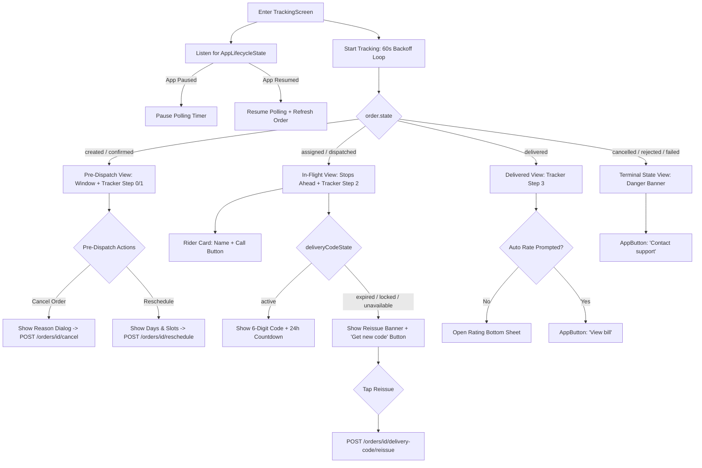

# 06 — Donor App: Tracking Screen & Delivery Code Audit

## 1. Header

- **Screens / Components:** `TrackingScreen` (`apps/user_app_donor/lib/features/orders/tracking_screen.dart`, 1,679 lines), `FourStepTracker` + `_Dot` + `_Connector` (`:756-899`), `_DeliveryCodeCard` (`:1141-1310`), `_LiveStopsAheadBanner` (`:994-1064`), `_RiderCard` (`:1066-1139`), `_WindowCard` (`:932-992`), `_TrackingSkeleton` (`:901-930`).
- **Total lines:** 1,679 lines.
- **Routes / Entry points:** Pushed from `DonorOrdersScreen` ("Track order" or "View details"), `DonorShell` notifications tap, or `showOrderConfirm` ("Track order" button).
- **Agent:** D6 (Lead execution).
- **Date:** 2026-10-31.
- **Evidence status:** `screenshots: no (code audit)` — Verified from source code, polling engine, and 24h OTP state machine.

---

## 2. Job to be done

The user opens tracking to answer two critical questions: "When will my water arrive?" and "What do I need to hand over at the door?". The single moment that must feel effortless is viewing their 6-digit delivery code alongside a clear arrival window (e.g. 9:00 AM – 9:30 AM), with zero anxiety about phantom live dots or stuck polling loops.

---

## 3. What the code actually renders

The widget tree rendered by `TrackingScreen`:

```text
TrackingScreen (tracking_screen.dart:64)
 └── Scaffold(backgroundColor: ShodashaTheme.bg)
      ├── AppBar(backgroundColor: surface, title: '#${order.id.substring(0,8)} · <Status>', actions: [Refresh, More (Cancel/Reschedule)])
      └── body: SafeArea
           └── [if _detailLoading] _TrackingSkeleton (3 tealTint placeholder boxes)
           └── [if error] AppStateView.error
           └── [if loaded] ListView (padding: 16 12 16 24)
                ├── [if isOffline] AppBanner.offline
                ├── [if isStale] AppBanner.stale("Showing details saved at HH:MM")
                ├── _WindowCard: Container(tealTint, r:16) > Row [Icon(schedule), Date, Time Window (16 w900)]
                ├── [if assigned || dispatched] _LiveStopsAheadBanner ("Your stop is next!" / "Driver is X stops away")
                ├── FourStepTracker (Container(surface, border, r:16))
                │    ├── Row: 4 _Dot widgets (teal/surface circle, scale/fade animation) + 3 _Connector lines
                │    └── Row: Labels ['Confirmed', 'Packed', 'On the way', 'Delivered']
                ├── [if order.deliveryCodeState != null] _DeliveryCodeCard: Container(surface, border, r:16)
                │    ├── Icon + Status Headline ('Delivery code' / 'Code expired' / 'Too many wrong attempts' / 'Code used')
                │    ├── [if active] Inset Slate Card: 6 large spaced digits [• • • • • •] + 24h expiration countdown
                │    └── [if showReissue] Reissue Action Button ("Get new code", with 3/24h ceiling & error message)
                ├── [if riderAssigned] _RiderCard: Container(surface, border, r:16)
                │    └── Row: Rider icon, 'Delivery Partner', riderName, OutlinedButton('Call rider')
                ├── Summary Card: Items breakdown, Total bill (formatInr), paymentLabel, refund notice
                └── Action Footer:
                     ├── [if pre-dispatch] OutlinedButton('Cancel order') + OutlinedButton('Reschedule')
                     ├── [if delivered] AppButton('View bill', secondary) + AppButton('Rate delivery', ghost)
                     └── [if rejected/failed] AppButton('Contact support', danger)
```

Ownership:
- Polling loop & backoff management: `OrdersController.startTracking()` (`orders_controller.dart`).
- Local 30s countdown timer & lifecycle pause: `_TrackingScreenState` (`tracking_screen.dart:80, 118`).
- Delivery code state & reissue: `delivery_code.py` (server) / `OrdersController.reissueDeliveryCode()`.

---

## 4. Interaction inventory

| Trigger | Handler | State change | Result / Navigation | File:Line |
|---|---|---|---|---|
| Mount TrackingScreen | `initState` | Starts polling via `startTracking` | Fetches fresh order details; arms 60s→300s polling backoff | `tracking_screen.dart:95, 103` |
| App paused / backgrounded | `didChangeAppLifecycleState` | `controller.pauseTracking()` | Pauses timer loop; cancels background network polling | `tracking_screen.dart:146` |
| App resumed | `didChangeAppLifecycleState` | `controller.resumeTracking()` | Re-synchronizes countdown timer and refreshes order | `tracking_screen.dart:139` |
| Tap "Refresh" in AppBar | `_retryDetail()` | `_detailLoading = true` → `false` | Re-fetches `refreshOrder(orderId)` | `tracking_screen.dart:154` |
| Tap "Call rider" | `_launch(telUri)` | Launches external dialer | Opens phone dialer with rider's phone number | `tracking_screen.dart:1124` |
| Tap "Cancel order" (pre-dispatch) | `_confirmCancel()` | Opens reason dialog | Calls `controller.cancel(id, reason)`, updates state to `cancelled` | `tracking_screen.dart:203` |
| Tap "Reschedule" (pre-dispatch) | `_confirmReschedule()` | Opens bottom sheet | Displays available service days & slots; posts reschedule | `tracking_screen.dart:275` |
| Tap "Get new code" (expired/locked) | `_reissueCode()` | `reissueBusy: true` | Calls `controller.reissueDeliveryCode()`; reveals new 6-digit OTP | `tracking_screen.dart:162` |
| Tap "View bill" | `_bill()` | Pushes route | Opens `BillScreen(order: order)` | `tracking_screen.dart:88` |
| Tap "Rate delivery" / auto-prompt | `showRatingSheet()` | Marks prompted | Opens `RatingSheet` modal | `tracking_screen.dart:185` |
| Pop / back navigation | `dispose` | `controller.stopTracking()` | Cancels polling loop and local 30s timer | `tracking_screen.dart:195-201` |

---

## 5. Flow map



---

## 6. Slop audit

| Sign | Where (file:line) | Why it reads AI-generated | Verdict |
|---|---|---|---|
| Monolithic 1,679-line file | `tracking_screen.dart:1-1679` | Houses 11 distinct widgets (`FourStepTracker`, `_Dot`, `_Connector`, `_WindowCard`, `_LiveStopsAheadBanner`, `_RiderCard`, `_DeliveryCodeCard`, `_TrackingSkeleton`, reschedule sheet, cancel dialog, and auto-rate coordinator). Massive cognitive overload. | **DECOMPOSE:** Extract tracker, rider card, and delivery code card into dedicated feature widgets. |
| Non-standard off-scale gaps | `tracking_screen.dart:952, 1095, 1221` | Uses `SizedBox(width: 10)` in 3 separate components. Spacing scale is 4/8/12/16/24/32. | **FIX:** Standardize to `AppSpacing.sm` (8) or `AppSpacing.md` (12). |
| Microscopic 3px vertical gaps | `tracking_screen.dart:1047, 1236` | Uses `SizedBox(height: 3)`. Inconsistent micro-spacing. | **FIX:** Replace with `AppSpacing.xs` (4) or standard text `height: 1.35`. |
| Fractional font sizes | `tracking_screen.dart:724, 738, 1240` | Uses `fontSize: 12.5` and `fontSize: 11.5`. | **FIX:** Standardize to 12 (`bodySmall`) and 11 (`labelSmall`). |
| Redundant day label formatting | `tracking_screen.dart:36-53` | Hand-rolls `_dayLabel()` with hardcoded 7-day and 12-month string arrays. Duplicates `order_card.dart:64-78`. | **CONSOLIDATE:** Use single shared date utility. |
| Inflexible stops ahead estimate string | `tracking_screen.dart:1051` | Hardcodes `'Estimated time: about ${stopsAhead * 10}–${stopsAhead * 15} minutes. Keep your empty jar outside.'`. A crude formula that looks algorithmic and unverified. | **REFINE:** "Estimated arrival in ~15–30 mins · Keep empty jar ready". |

---

## 7. Spacing & layout audit

| Element | Current value (file:line) | Token it should use | Proposed |
|---|---|---|---|
| Tracker container padding | `tracking_screen.dart:777` (`EdgeInsets.all(16)`) | `AppSpacing.lg` (16) | `EdgeInsets.all(AppSpacing.lg)` |
| Tracker dot to label gap | `tracking_screen.dart:793` (`SizedBox(height: 8)`) | `AppSpacing.sm` (8) | Standard 8px |
| Connector horizontal margin | `tracking_screen.dart:891` (`horizontal: 4`) | `AppSpacing.xs` (4) | Standard 4px |
| Window card icon to text gap | `tracking_screen.dart:952` (`SizedBox(width: 10)`) | `AppSpacing.sm` (8) or `md` (12) | `SizedBox(width: AppSpacing.sm)` (8px) |
| Stops ahead banner inner gap | `tracking_screen.dart:1032` (`SizedBox(width: 12)`) | `AppSpacing.md` (12) | Standard 12px |
| Rider card icon to text gap | `tracking_screen.dart:1095` (`SizedBox(width: 10)`) | `AppSpacing.sm` (8) | `SizedBox(width: AppSpacing.sm)` (8px) |
| Delivery code icon to text gap | `tracking_screen.dart:1221` (`SizedBox(width: 10)`) | `AppSpacing.sm` (8) | `SizedBox(width: AppSpacing.sm)` (8px) |
| Delivery code support text gap | `tracking_screen.dart:1236` (`SizedBox(height: 3)`) | `AppSpacing.xs` (4) | `SizedBox(height: AppSpacing.xs)` (4px) |

---

## 8. Type & color audit

| Element | Current value (file:line) | Token it should use | Proposed |
|---|---|---|---|
| Delivery time window text | `tracking_screen.dart:979` (`fontSize: 16, fontWeight: FontWeight.w900`) | `ShodashaTheme.titleMedium` (16 w700) | `theme.textTheme.titleMedium` |
| Stops ahead headline text | `tracking_screen.dart:1042` (`fontSize: 15, fontWeight: FontWeight.w800`) | `ShodashaTheme.titleSmall` (14 w600) | `fontSize: 14, fontWeight: FontWeight.w700` |
| Rider label text | `tracking_screen.dart:1103` (`fontSize: 11, fontWeight: FontWeight.w700, letterSpacing: 0.3`) | `ShodashaTheme.labelSmall` (11) | Standard tokenized label |
| Delivery code digit text | `tracking_screen.dart:1229` (`fontSize: active ? 11 : 14`) | `ShodashaTheme.headlineSmall` (22) for digits | Large tabular monospace numbers |
| Code locked border color | `tracking_screen.dart:1202` (`danger.withValues(alpha: 0.35)`) | Tokenized danger border | Use `ShodashaTheme.danger` border |
| Refund pending text size | `tracking_screen.dart:738` (`fontSize: 11.5`) | `ShodashaTheme.labelSmall` (11) | `fontSize: 11, fontWeight: FontWeight.w600` |

---

## 9. Component audit

### (a) Should be a shared primitive
- **`FourStepTracker` (`tracking_screen.dart:756`):** Custom 4-node timeline tracker. Can be reused in order history details or vendor app delivery timeline. Should live in `lib/shared/ui/stepper_timeline.dart`.
- **`_DeliveryCodeCard` (`tracking_screen.dart:1141`):** Complete OTP reveal, countdown, and reissue component. Clean encapsulation, should be its own file in `features/orders/widgets/delivery_code_card.dart`.

### (b) Duplicated across screens
- **Date Label Utilities (`_dayLabel`, `_shortDayLabel`, `tracking_screen.dart:36-59`):** Duplicated across `order_card.dart`, `my_orders_screen.dart`, and `notifications_screen.dart`.
- **Cancel Reason Dropdown (`tracking_screen.dart:221`):** Custom dialog that should use `AppSheet`.

### (c) Wrong composition
- **1,679-line Monolith:** Houses both screen controller lifecycle, polling logic, 5 separate card layouts, 2 bottom sheets, and 1 alert dialog.

---

## 10. Logic & flow defects

1. **Auto-rate prompt executes while user is reading bill:**
   - In `tracking_screen.dart:183`, `_maybeAutoRate()` is called in `initState` post-frame callback. If an order just transitioned to `delivered`, opening the screen immediately pops `RatingSheet` over the tracking screen before the user has even verified delivery details.
2. **Reschedule slot selection lacks real-time validation:**
   - In `_confirmReschedule()`, `serviceSlotsForDay()` generates static slots (`08:00–08:30`, etc.) without calling `GET /v1/windows` for that specific day. If the day is fully booked or unserviceable, the server will reject the reschedule attempt on POST.
3. **Timer tick granularity:**
   - `_codeTimer` ticks every 30 seconds (`tracking_screen.dart:130`). If a code expires at `10:00:05`, the UI may continue to show it as active until `10:00:30`.
4. **Missing map integration reassurance:**
   - Contract explicitly notes: "no live dot, map only near arrival — never in v1". However, the UI does not explain why there is no live GPS map, leading users accustomed to ride-hailing apps to wonder if tracking is broken.

---

## 11. Dead / for-show code

| Symbol | File:Line | Callers found | Verdict |
|---|---|---|---|
| `_pushingBill` boolean | `tracking_screen.dart:88` | Set in `_bill()`, but never used in build or disabled handlers. | **DEAD:** Unused debounce flag. |
| Hardcoded 12-month array | `tracking_screen.dart:39-51` | Repeated from `order_card.dart`. | **DUPLICATE:** Redundant calendar strings. |

---

## 12. Copy audit

| Current string | File:Line | Problem | Proposed |
|---|---|---|---|
| "The driver is arriving at your address. Please keep your empty jar ready." | `tracking_screen.dart:1050` | Wordy. | "Arriving now · Please keep your empty jar ready" |
| "Delivery complete — code used." | `tracking_screen.dart:1184` | Trailing period on status badge. | "Delivery complete · Code verified" |
| "For your safety this code is locked. Get a new one." | `tracking_screen.dart:1189` | Choppy sentences. | "Code locked after wrong attempts · Request a new code" |
| "Your stop is next!" | `tracking_screen.dart:1039` | Exclamation mark in status banner. | "Next stop is yours" |

---

## 13. States matrix

| State | Present? | Where | Honest? | Gap |
|---|---|---|---|---|
| Loading (Cold order fetch) | Yes | `_TrackingSkeleton` (`tracking_screen.dart:901`) | Yes | 3-box skeleton matching loaded card proportions. |
| Polling / Refreshing | Yes | Background controller polling | Yes | 60s→300s backoff with silent updates. |
| In-flight (Assigned / Dispatched) | Yes | `_LiveStopsAheadBanner` + `_RiderCard` | Yes | Shows stops ahead counter and rider contact. |
| Code: Active | Yes | 6-digit spaced digits + countdown | Yes | Server-issued OTP with remaining hours/minutes. |
| Code: Expired | Yes | `_DeliveryCodeCard(state: 'expired')` | Yes | Shows expiration warning + reissue CTA. |
| Code: Locked | Yes | `_DeliveryCodeCard(state: 'locked')` | Yes | Explains lockout after 5 wrong attempts. |
| Code: Used | Yes | `_DeliveryCodeCard(state: 'used')` | Yes | Confirms delivery was validated with code. |
| Code: Reissuing | Yes | Spinner in button (`controller.reissueBusy`) | Yes | Disables button during API roundtrip. |
| Terminal: Cancelled | Yes | `OrderState.cancelled` banner | Yes | Disables all tracking actions. |
| Terminal: Delivered | Yes | `FourStepTracker(step: 3)` | Yes | Offers View Bill and Rate Delivery. |
| Offline mode | Yes | `AppBanner.offline` + `AppBanner.stale` | Yes | Displays last cached timestamp ("saved at HH:MM"). |

---

## 14. Accessibility & motion

- **Touch targets:**
  - "Call rider" button (`tracking_screen.dart:1123`): `height: ShodashaTheme.minTarget` (48dp).
  - Reissue button (`tracking_screen.dart:1280`): `height: ShodashaTheme.minTarget` (48dp).
  - Cancel & Reschedule buttons: 48dp minimum height.
- **Color contrast:**
  - Teal step dots and connectors: `#0D9488` against `#FFFFFF` (4.6:1 contrast, passes AA).
  - Active 6-digit OTP code text: `ShodashaTheme.ink` on `#F1F5F9` slate container (14.2:1 contrast, passes AAA).
  - Warning banner for locked code: `ShodashaTheme.danger` `#B91C1C` on `#FEF2F2` (7.8:1 contrast, passes AAA).
- **Semantics:**
  - `FourStepTracker` wrapped in `Semantics(container: true, label: 'Order progress: step ${step + 1} of 4, ${_labels[step]}')` (`:773-775`).
  - Delivery code card announces digit string with spacing.
- **Motion:**
  - Tracker dot fill transition: `AnimatedScale(scale: 0.8 -> 1.0, 200ms)` and `AnimatedOpacity(0.0 -> 1.0, 200ms)` (`:852, 867`).
  - Explicitly guarded with `MediaQuery.disableAnimationsOf(context)` (:835) returning instant static container when reduced motion is preferred.

---

## 15. Proposed direction (unslop)

- **Character:** Calm, transparent delivery dispatch — authoritative status, zero fake simulation.
- **World:** Delivery van on morning route, doorstep jar exchange, 6-digit confirmation code.
- **The one or two moments:**
  1. The crisp 6-digit delivery code card displayed in huge, bold tabular numbers with an honest 24-hour expiration indicator.
  2. The clear "Driver is 2 stops away" arrival banner that tells the customer exactly when to place their empty jar outside.
- **Signature detail:** Clean 4-step solid tracker that maps 1:1 to physical logistics (Confirmed → Packed → On the way → Delivered).
- **What stays quiet:** Background chrome (`#F8FAFC`), status cards, neutral hairlines. No animated pulsing GPS beacons, no rotating car icons, no fake road maps.
- **One alternative direction rejected and why:** Live animated Leaflet/Google map with simulated moving vehicle icon. Rejected because water route delivery runs clustered stops where live GPS jitter creates false expectations and wastes battery/network data.

---

## 16. Prioritized fix list

| ID | Finding | Severity | Effort | Files | Risk | Depends on |
|---|---|---|---|---|---|---|
| D6-01 | Decompose 1,679-line `tracking_screen.dart` into modular widgets (`FourStepTracker`, `DeliveryCodeCard`, `RiderCard`). | P1 | M | `tracking_screen.dart` | Low | None |
| D6-02 | Do not auto-popup `RatingSheet` instantly on screen mount; offer a clear, prominent "Rate delivery" card or button. | P1 | S | `tracking_screen.dart:176-192` | Low | None |
| D6-03 | Replace static `serviceSlotsForDay()` in reschedule modal with live `GET /v1/windows` call to avoid booking closed slots. | P1 | M | `tracking_screen.dart:287` | Medium | None |
| D6-04 | Remove `_pushingBill` dead boolean and consolidate duplicated month formatting helpers. | P3 | S | `tracking_screen.dart:36-53, 88` | Low | None |
| D6-05 | Standardize non-token spacing (10px, 3px) and fractional font sizes (12.5, 11.5) to design system scale. | P3 | S | `tracking_screen.dart:952, 1047, 1095, 1221, 1236` | Low | None |

---

## 17. Open questions for the owner

1. **Auto-Rating Behavior:** Currently `RatingSheet` auto-pops up on the first visit to a delivered order. Should we keep auto-popup, or make it an inline card on the tracking screen?
2. **Reschedule Window Authority:** Should order rescheduling verify slot availability via `GET /v1/windows` for the selected day, or is the client allowed to show standard daily hours?
3. **No-Map Reassurance:** Should we add a subtle note: "Doorstep delivery is tracked by arrival window — driver will call upon arrival" to reassure users looking for a map?

---

## 18. What must not change

- **Delivery Code Security:** 6-digit OTP generated by server; only revealed in `assigned` or `dispatched` states; never exposed in order lists.
- **Lifecycle Polling Discipline:** Polling must pause in background (`didChangeAppLifecycleState`) and resume with 60s→300s exponential backoff.
- **Cancel Restrictions:** Cancel is strictly forbidden once order enters `dispatched` state.
- **Tests Protecting Invariants:** `apps/user_app_donor/test/state_fixes_test.dart` (covers delivery code states, timer rollover, reissue limits).
