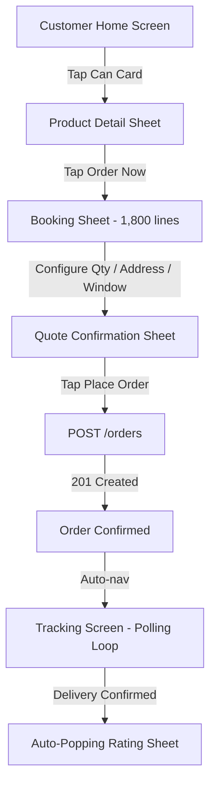
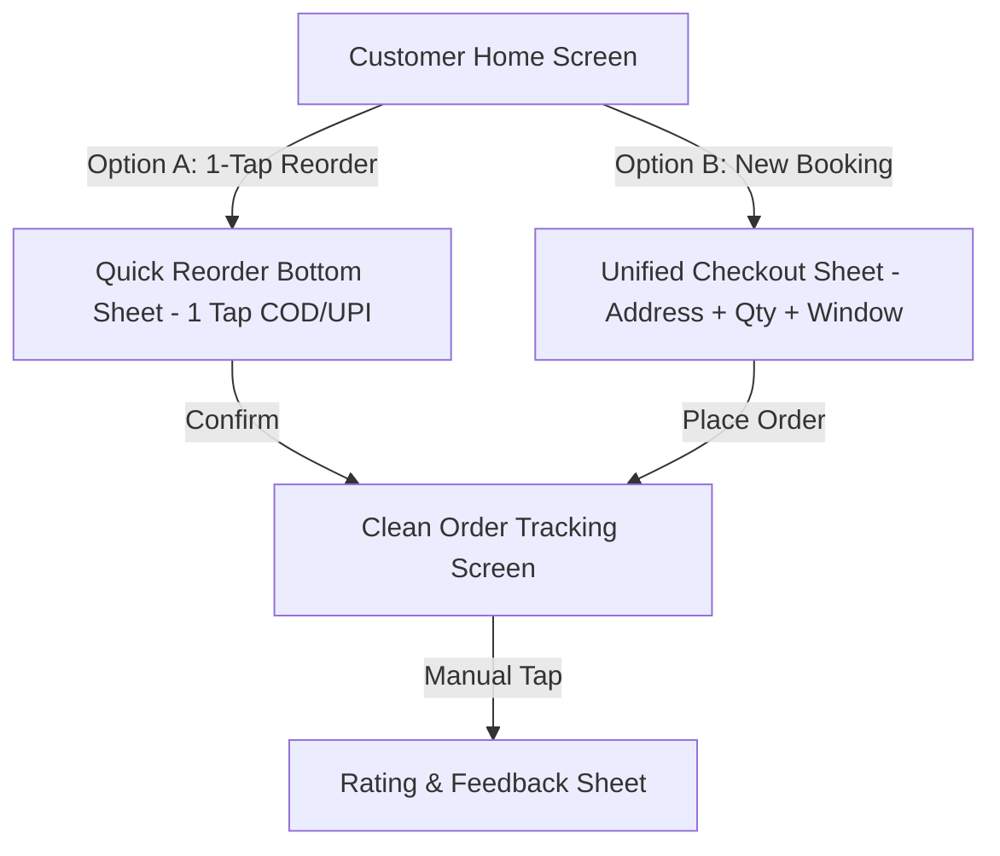
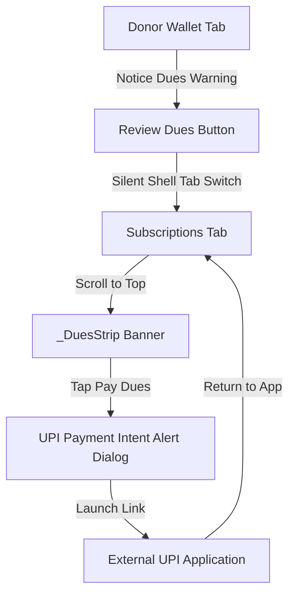
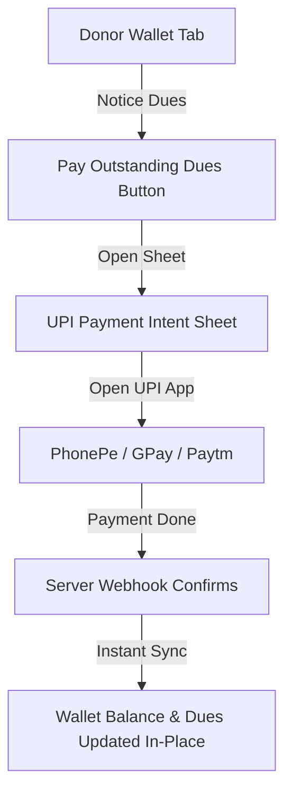
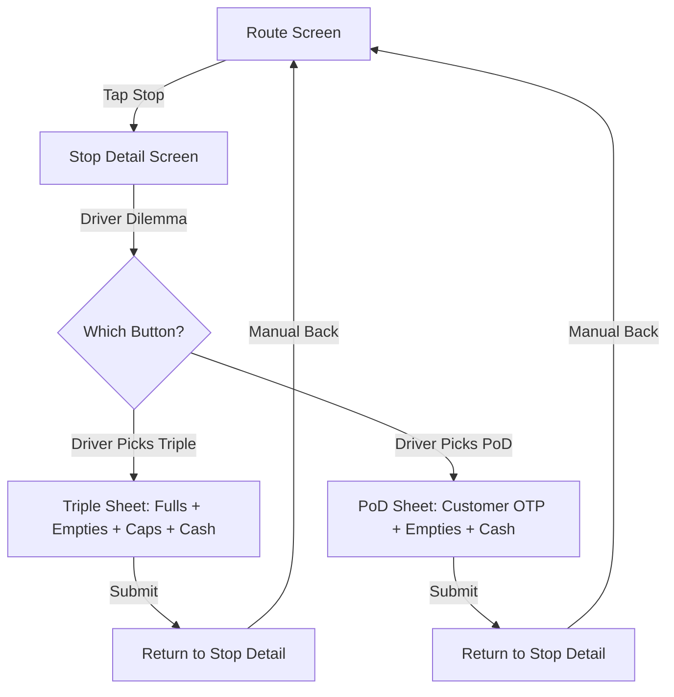
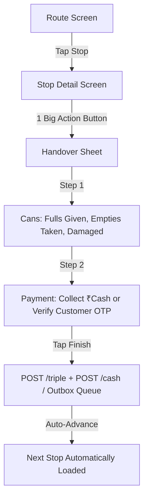
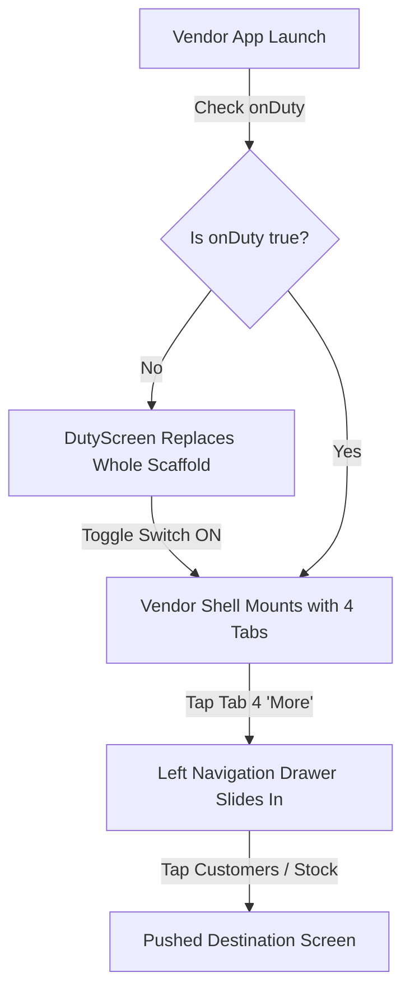
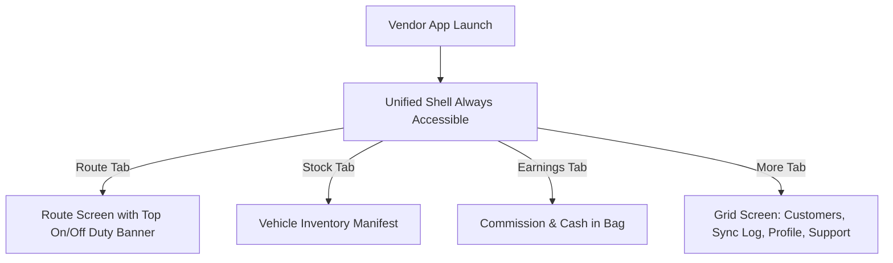

# X3 — Cross-Cutting: User Flows, State Machines & Navigation Audit

**Scope Audited:**
- Cross-screen routing and navigation graphs for Donor App (`apps/user_app_donor`)
- Operational shift and delivery state machines for Vendor App (`apps/vendor_app`)
- End-to-end user journeys: One-time ordering, dues settlement, delivery completion, and duty management.

---

## 1. Executive Summary
This audit maps the end-to-end navigational flows and state machines across both applications. While state transitions at the network layer are strictly idempotent (guarded by UUID idempotency keys and outbox replay queues), the human navigation architecture suffers from several critical friction points:
1. **The 3-Sheet Booking Labyrinth:** To buy a 20L water can, a customer must open a product detail sheet, which pushes a 1,800-line checkout sheet, which opens a quotation confirmation sheet.
2. **The Disorienting Cross-Tab Dues Redirect:** Paying outstanding dues in the Wallet screen abruptly shifts the bottom navigation shell to the Subscriptions tab without explanatory context.
3. **The Ambiguous Dual-Sheet Vendor Delivery Flow:** Delivery drivers must choose between two disconnected sheets ("Triple" vs "PoD") that ask for overlapping information at the customer's doorstep.
4. **The "Bottom Tab Pops Side Drawer" Anti-Pattern:** The 4th tab on the vendor bottom navigation bar triggers a left-side drawer instead of navigating to a destination.

---

## 2. Donor Flow 1: One-Time Order Booking

### Current Navigation Flow (Nested Sheet Labyrinth)

**Defects Identified:**
- 3 nested sheets stacked over the home screen (`Home` -> `ProductDetail` -> `BookingSheet` -> `QuoteConfirm`).
- No 1-tap "Repeat Order" button on Home, despite 20L refill cans being a high-frequency replenishment habit.
- Rating sheet pops up automatically over the tracking screen before the customer has verified their cans.

### Proposed Streamlined Flow

---

## 3. Donor Flow 2: Outstanding Dues & Wallet Settlement

### Current Flow (Disorienting Cross-Tab Redirect)

**Defects Identified:**
- Tapping "Review dues" in Wallet ejects the user to Tab 2 (Subscriptions) without explaining why dues live on the subscription tab.
- UPI intent resolution happens in a clumsy alert dialog instead of an integrated payment sheet.

### Proposed Flow (In-Context Wallet Settlement)

---

## 4. Vendor Flow 1: Doorstep Delivery Completion

### Current Flow (Triple vs PoD Confusion)

**Defects Identified:**
- Overlapping inputs: both sheets prompt for empty cans returned and cash collected.
- Field drivers are confused about whether "Triple" is mandatory before "PoD".
- After completion, driver must manually pop back to the route list.

### Proposed Flow (Unified Doorstep Handover)

---

## 5. Vendor Flow 2: Shift Duty & Navigation

### Current Flow (Duty Hijack & Drawer Anti-Pattern)

**Defects Identified:**
- Off-duty state completely blocks access to Earnings and past Sync logs.
- Bottom navigation tab "More" opens a side drawer instead of displaying a destination screen.

### Proposed Flow (Accessible Shift Command Center)

---

## 6. Concrete Actionable Recommendations
1. **Flatten Donor Booking to 1 Sheet:** Eliminate the nested sheet chain (`ProductDetail` -> `BookingSheet` -> `QuoteConfirm`). Use a single unified bottom sheet.
2. **Consolidate Vendor Delivery Completion:** Replace `TripleSheet` and `PodSheet` with a single 2-step `HandoverSheet`.
3. **Keep Wallet Dues In-Context:** Allow users to pay outstanding dues directly inside the Wallet tab.
4. **Eliminate Vendor Side Drawer:** Convert the "More" bottom navigation destination into an authentic screen displaying a touch-friendly grid.
5. **Auto-Advance Vendor Stops:** Upon delivery confirmation, automatically transition to the next assigned stop on the route.

---

## 7. Acceptance Criteria
- [ ] Donor order placement requires at most 1 modal sheet transition.
- [ ] Dues payment is fully executable without leaving the Wallet screen.
- [ ] Vendor delivery completion is executed through a single unified modal.
- [ ] Vendor bottom navigation bar tabs open screens, never a navigation drawer.
- [ ] All underlying state machines remain 100% idempotent and offline-safe.
