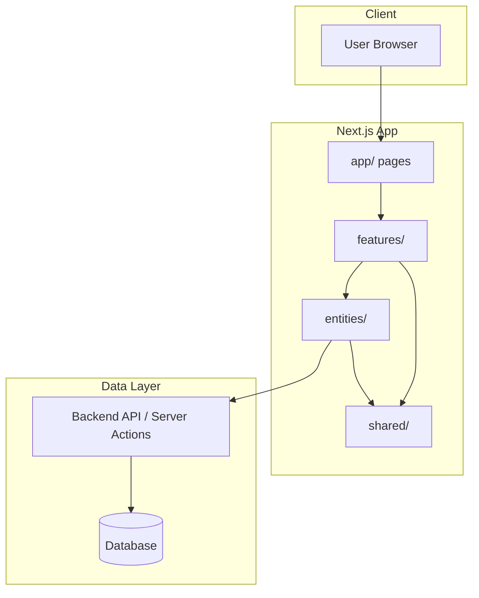
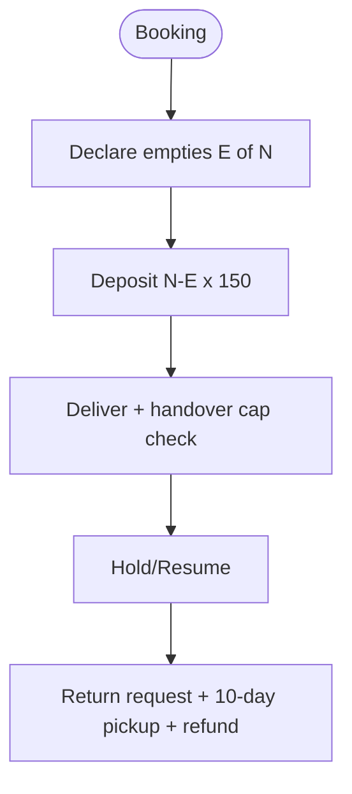
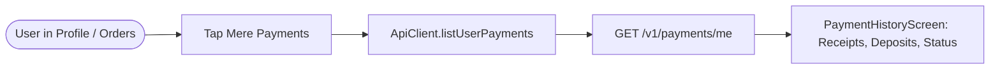
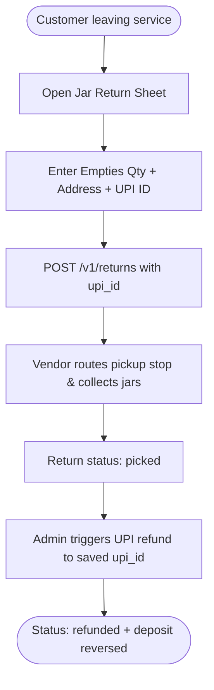
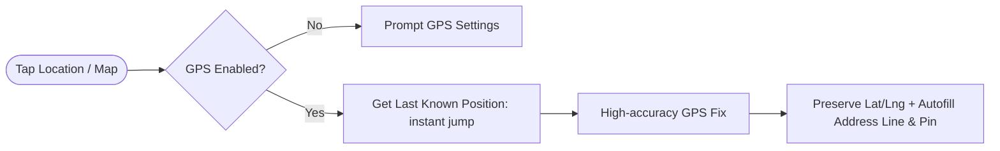
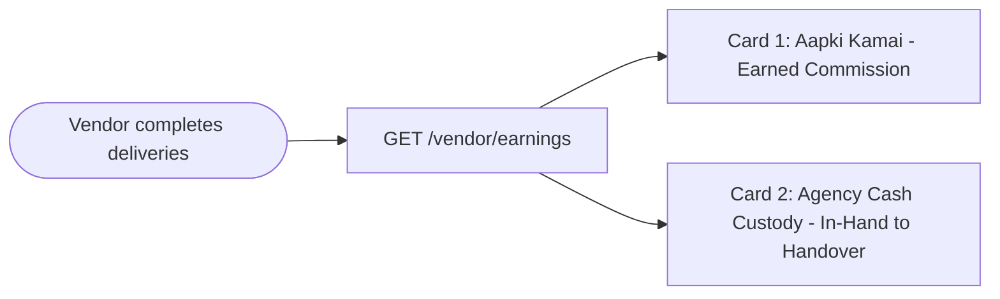
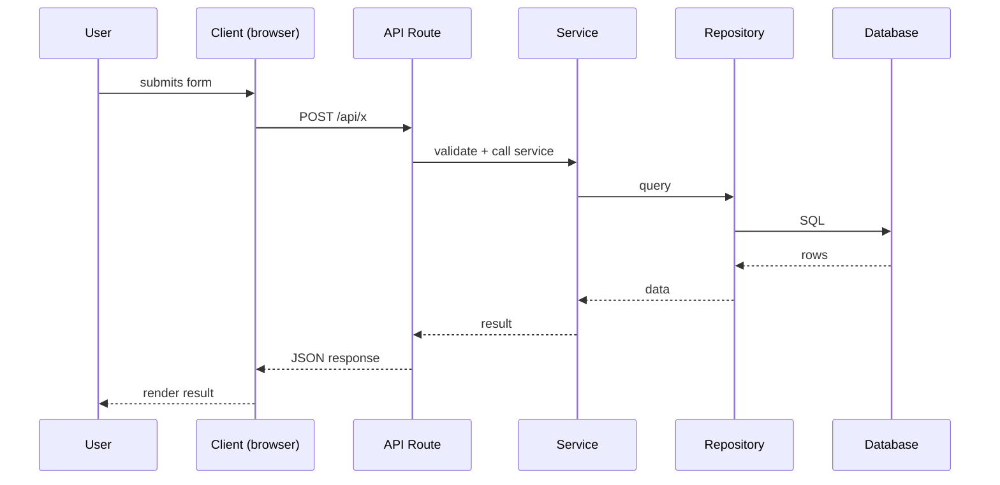
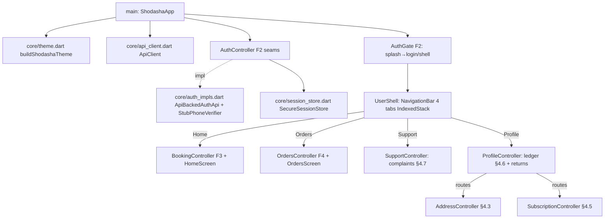

# Flow — Function Call Map & User Flows

> **Purpose**: The "how it works" file. It maps which functions call what, the user
> journeys, request/response sequences, and routes. Reading this file gives you an
> instant mental model of the project structure.
>
> **Update rule (MANDATORY)**: Update this file whenever you add, rename, or remove any
> function, component, hook, route, API endpoint, or user flow. Never let it go stale —
> agents and humans navigate the codebase through this file.

---

## Overview

Shodasha vendor app (007, built 2026-10-02; ADR-055 added Customers + Stock → 7 tabs; ADR-056 consolidated to 4 tabs + More drawer): vendor OTP login → duty (off-guard confirmed) → today route (search→customers, stock header, sync chip) → stop triple (version-fenced) → PoD OTP + GPS soft-flag → offline sync batch (loading branch) → earnings → support queue + verify → drawer (stock log, profile, WhatsApp, logout). See `Feature_docs/vendor-app/spec.md`.
- 016 dashboard (branch 016-vendor-dashboard, ADR-064): Route tab top composes one screen — TodayStrip (`summarizeToday` pure fold over `RouteStop`s: distinct users, jars, UPI/COD collect paid-excluded) + one CTA per state (Sync backlog → Triple first-pending → all-done text) + inline money (`EarningsController` reuse: jama cash/upi + flagged-hold, display-only) + can-ledger rows (`CustomersController`: held/dues nonzero-only). Backend: `placed_pool(vendor_id)` zone-scoped (zones/vendor_zones instr match; unzoned admin-only) + `today_customers` gains `held`/`dues` via `ledger.get`. No new tabs/endpoints/tables/packages.
- Production customer auth/deploy (2026-10-24, ADR-132): Cloudflare Worker `water` at `https://water.adityathakur452007.workers.dev` (version `07e98028-2434-4487-aad1-be52938f97cb`); D1 `shodasha` at schema 027 after backfilling 002-023 bookkeeping and applying 024-027. `POST /v1/auth/user/register` validates name/phone/password/device, hashes with PBKDF2-HMAC-SHA256 at the Cloudflare WebCrypto maximum 100,000 iterations, inserts `users`, then `_issue_session`; `POST /v1/auth/user/login` finds the phone, verifies the stored cost/salt, uses `DUMMY_HASH` for unknown/empty-password timing, and issues the same session pair. Existing users with empty `password_hash` fail closed until admin reset. Live checks: catalog 200, empty login 400 VALIDATION, register/login 200, wrong password 401 UNAUTH; the temporary user was removed and 9 production users remain.
- Audit verification (2026-10-24, read-only, ADR-133): live auth flows and webhook fail-closed behavior match the above. Money/subscription tracing found five P0s that change no routes but invalidate release promises: dues UPI 500s on the `payments.order_id` FK after creating the provider order; canceled `link_sent` orders stay payable, countable as dues, and settleable by webhook; cancellation writes off dues/claims refunds with zero payments; the production cron handler creates no subscription orders; same-key intent retries return a provider ref absent from `payments`. Full call/evidence map: `Feature_docs/platform-audit/2026-10-24-auth-upi-subscriptions-vendor-audit.md`. No code or user flow changed in this audit; destructive live testing stopped after the dues 500 and local SQLite carried the rest.
- Phase 0 measurement layer (2026-10-25, ADR-140, staging/local only): `GET /health` now lives in `app/api/health.py` and runs `SELECT 1` through the normal DB dependency with a 2 s timeout and a 5 s per-isolate cache; success stays exactly `{"status":"ok"}`, failure is 503 + `{"status":"degraded","checks":{"db":"error"}}`, both `Cache-Control: no-store`. `app/core/observability.py` emits one redacted JSON line per sampled request (`route` template, method, status, duration, trace id, `db_queries`/`db_roundtrips`/`db_rows_read`/`db_rows_written`); 4xx/5xx and slow requests always log, healthy fast paths sample deterministically. `app/db_d1.py` counts D1 `meta.rows_read`/`meta.rows_written` (batch = N statements, one roundtrip); `AsyncSqliteConn` counts local rows. Trace ids are sanitized to `^[A-Za-z0-9._-]{1,64}$` before echo/log. Staging is `water-staging` + `shodasha-staging` with cron disabled; `scripts/seed_phase0.py` builds the deterministic dataset and `scripts/bench_phase0.py` runs the guarded GET-only A/B/C profiles. Free-plan 10 ms CPU returns intermittent `1102`/`1101` before the app; see ADR-140. Results and safe commands: `Feature_docs/performance/2026-10-25-phase0-results.md`, `Feature_docs/performance/phase0-runbook.md`.
- Capacity audit (2026-10-25, ADR-139, read-only): the 1,000-user model and evidence table live in `Feature_docs/performance/2026-10-25-1000-user-capacity-audit.md`. Hot paths confirmed: `GET /orders/{id}` = 7 sequential queries + `PRAGMA table_info('stops')` (`order_service.py:329-391`, `order_repo.py:164,439`); `GET /billing/dues` = N+1 paid-sum/dues-posted per open order (`payment_service.py:211-231`); vendor `GET /vendor/routes/today` ≈ 82 queries per 40 stops (`vendor_service.py:302-366`); admin metrics/overview = full-table aggregates on a 60s poll (`admin.py:1229-1243,1259+`, `admin_read_repo.py:50-115`); cron `*/15` processes every due subscription sequentially and advances `next_run` before order creation (`scheduler.py:119-143`, `subscription_service.py:885-894`), so ~70–100 due subs approach/exceed the 1,000 D1 queries/invocation Paid cap. Cancel/webhook/transition paths are multi-statement and non-atomic on D1 (`order_repo.py:456-547`, `payment_repo.py:375-442`, `db_d1.py:111-115`). No route or user flow changed; this note records the audited call chain.
- Agent tooling (2026-10-25, ADR-137): the global OpenCode config registers the remote Cloudflare MCP server (`https://mcp.cloudflare.com/mcp`, OAuth), and 19 official Cloudflare skills are installed under `C:\Users\Hp\.agents\skills`; no app route or runtime flow changed. New OpenCode sessions can call Cloudflare account tools through MCP, while `wrangler` remains the deploy/D1 path used by this project. The OAuth grant is Full access and its token lives at `C:\Users\Hp\.local\share\opencode\mcp-auth.json`, outside the repo. The optional `cf` CLI is not installed.
- Free-tier launch readiness (2026-10-26, ADR-146, docs only): no route, function, schema, or UI change. The operating flow is **deploy gate (G1) → read-only smoke (G2: `/health` + `/v1/catalog` + `/v1/windows`) → alerts/external `/health` monitor (G5) → daily owner checklist → GO/NO-GO**. The approved pilot envelope is 50 registered / 10 DAU / 5 concurrent, COD only, no UPI, no new auto-delivery subscriptions, vendor route ≤20 stops. Production traces stay off; `/health` remains the one-D1-probe endpoint with a 5 s per-isolate cache and `no-store`. Default is **NO-GO for a transactional pilot** until separately approved staging auth (G3) and cron (G4) probes pass; G0/G6 are approved, G1/G2/G5/G7 are not started. Docs: `Feature_docs/performance/2026-10-26-free-tier-launch-readiness-spec.md`, `free-tier-launch-runbook.md`.

```
VendorApp (main.dart: liveApi w/ accessTokenGetter → Bearer tracks session)
 └─ AuthGate (restore → login / shell)
 └─ VendorShell (duty gate → 5 tabs: Route·Sync·Earnings·Support·Profile)
     ├─ DutyController.setDuty → POST /vendor/duty (duty-off repools pending stops to failed + audit, same flow)
     ├─ RouteController.load → GET /vendor/routes/today (stops sorted by seq) + Pull → POST /vendor/placed/{id}/accept
     ├─ StopsController.commitTriple → POST triple + Idempotency-Key + version
     │    └─ 409 STALE_STOP → pull-fresh; NETWORK → SyncController.enqueue
     ├─ StopsController.completePod → POST pod (OTP + GPS soft-flag)
     │    └─ Phase 1: OTP = stop's stored random code (015, minted at dispatch;
     │         NULL rows accept the legacy deterministic code); wrong code reads
     │         as not-found (no oracle), 5 fails lock 429; user tracking shows
     │         the same stored code (order detail delivery_otp).
     ├─ SyncController.syncNow → POST /vendor/sync batch (applied/replayed/rejected per-stop)
     ├─ EarningsController.load → GET /vendor/earnings (flagged_hold display-only)
     └─ SupportController.verifyComplaint/vendorCheckQuality
          └─ Phase 1: vendor agree → vendor_confirmed (+≥10-char note), never
               resolved — only the admin release writes resolved.
Outbox persists in SharedPreferences (vendor.outbox.v1); money display-only via rupees() paise→Rs.
- 017 sync (branch 017-flow-sync, ADR-065): `GET /orders/{id}` gains `delivery_otp` (owner + assigned/dispatched; user tracking code row) → PoD closable; `POST /vendor/stops/{id}/cash` (owned-stop, deterministic stop+amount dedupe, 409=already-jama) → `mark_paid_cash` + `in_hand` bump + sync `cash_amount` ride → user badge flips on poll; one-tap cash button (COD unpaid) + outbox now actually wired to TripleSheet; `hold_blocked` computed on route+stop (ledger>3, lights dead UI); duty persisted on vendor_profile (ensure convergence); quality on table; admin payouts gen/approve, custody confirm, reco close, zones list + UI (capacity PATCH via BFF, zone attach/detach, refunds actions, payouts, day-close, custody); user dues pay-link + reschedule key; returns assign (vendor+date→route)/pickup (owned-stop, held−/caps→dues)/refund (picked-only, settings deposit rate) + vendor pickup card + admin buttons.
- Resilience: GET single-flight + replay-safe retry (3, backoff+jitter, Retry-After) + 60s sync flush; 401/403 → forceLogout → login; logout clears outbox.
- Phase 5 (029-remediation): vendor 401 → tryRefresh once → retry (silent renew; 403 never; refresh opts out — no loop) → else expireSession (honest copy, outbox kept). Duty from GET /vendor/profile.on_duty (+repooled on setDuty-off). RouteController 60s discovery Timer on-duty/foreground only; acceptPlaced → POST /vendor/placed/{id}/accept → route reload. Stops carry paid_sum; predicates isPaid/isPartial/isLinkSent + remaining shared per surface (app + web copies).
- Phase 4 (029-remediation): BOTH apps now share the resilience shape (user ApiClient copied from vendor — no shared abstraction; user ctor also carries the https-or-loopback assert). User `_boot` mirrors vendor (loadOrCreateDeviceId → stable X-Device-Id; onUnauthorized → forceLogout local-only wipe incl. selected-address pref). Catalog: `HttpCatalogApi(ApiClient.catalog)` inside the existing `CachingCatalogApi` (live GET /catalog on home init, hardcoded fallback kept — zero backend change). Help: support Open → launchUrl wa.me primary + unawaited clipboard fallback + snackbar; tanker sheet → tel: Call on the single kSupportPhone constant (placeholders deleted).
- Release: push main → version (shared vX.Y.Z) → matrix(user+vendor APKs) → one Release (shodasha-user/shodasha-vendor + SHA256SUMS + file table); CI matrix verifies both apps per PR.
- Addresses: form (home/office + OSM pin, no Google key) → toApi maps line→`formatted` → POST/PATCH /addresses; 409 when an undispatched order uses it.
- Demo: Demo sheet → POST /v1/auth/demo (config flag + code hash → normal session) → demo customer sees Rs-206 dues order; demo vendor sees today route stop → triple → PoD → earnings. D1 prerequisite (ADR-054): config/audit_log come from 010_config_audit.sql (never existed on D1 — init_schema is local-only); pre-010 DB fails closed (401, not 500).
- Port gaps (ADR-055): address form (house/street/area + Use-current-location via LocationService → POST/PATCH /addresses full format) → SelectedAddressStore id → Home bar + checkout resolve() agree; vendor Customers tab → GET /vendor/customers (stops grouped by customer, search) → detail sheet; Stock tab reads RouteController loading sheet (no new endpoint); Profile tab → GET/PATCH /vendor/profile (synced label); Support tab → GET /vendor/complaints queue (tap fills verify-by-id) → existing verify. D1 prerequisite: 011_port.sql applied once (ALTERs are apply-once; CREATEs idempotent).
- 014 simplify (ADR-059): Home `_ScheduleCards(Ek Baar 8-12 once / Roz ka Plan daily)` → controller.deliveryType → `_WalletStrip(safe message)` → grid (no search) → buy-box (qty only) → `placeCheckout(api.createQuote → api.createOrder[quote_total/rate_version/expires_at] → upiIntent/cod)` → `showOrderConfirm(wallet-safe message)` → track. Backend `compute_quote(deposit_already_paid)` container-only once-only; `OrderService.create` waives + accepts pre-waiver quote. Fixed `Subah 8-12` label, slots only mint window_start ISO. All-days `nextServiceableDay` (no Sunday skip).
- 015 sync (ADR-060): User `Order(+paymentMode/Status)` → tracking badge + bill mode; subs Due/Paid via dues; `UserShell._refreshLedger(api.ledgerMe→applyLedger)`. Vendor `today_route/_owned_stop JOIN orders+addresses` → `RouteStop(+payment/total/status)` → stop badge; `GET /vendor/placed` pool for Pull button (Phase 2: Pull → POST /vendor/placed/{id}/accept); `GET /ledger/me` wallet truth. Android `POST_NOTIFICATIONS` + `backup_rules/data_extraction` (no backup of tokens).
- Phase 2 Split B money rules: cash overpay → 422 OVERPAY (client posts invoice remainder); cancel refunds paid_sum; refunds maker-checker (claimer≠completer) + claim/complete audits; reschedule + sub-create honor Idempotency-Key; COD checkout best-effort cod-confirm (dues visible now, doorstep carry covers).
- Phase 9 (029-remediation, ADR-091): motion inventory — user skeletons (orders list + tracking detail + subs list + support section, blueTint boxes) + tracker `_Dot` 200ms scale-pop/check-fade (transform+opacity, `disableAnimationsOf` static) + vendor hand-rolled `cascade.dart` (once-only, gated; no flutter_animate dep) + admin `reduce` guard in styles.css + dashboard `CountUp` (change-only rAF, instant under reduce/mount/SSR); Toaster + SnackBars carry the confirmation/aria-live leg on all surfaces.
- ADR-101 edge cases (2026-10-06):
  1. Subscription cancellation (`POST /v1/subscriptions/{id}/cancel`): computes prorated unused days refund ($R = \lfloor P \times \frac{D_{\text{remaining}}}{D_{\text{total}}} \rfloor$), updates DB status to paused with canceled_at timestamp (safely respecting SQLite CHECK constraint), and auto-schedules bottle return pickup row in `returns` with customer's `upi_id`.
  2. Incremental empty deficit bottle deposit: `pricing.py` calculates `net_uncovered = max(0, n_container - e_vs_containers - covered_jars)` so existing subscribers ordering ad-hoc extra jars without extra empties are correctly charged ₹150 collateral deposit per extra unbacked bottle.
  3. Vendor planned leaves & route cover: vendor requests leave (`POST /v1/vendor/leaves`), admin reviews (`POST /v1/admin/vendor-leaves/{id}/review`) and assigns `cover_vendor_id`. `dispatch_service.py` (`route_for_vendor`, `least_loaded_vendor`) routes stops to `cover_vendor_id` and excludes on-leave vendors.
  4. Mid-route stockout emergency SOS: vendor reports stockout (`POST /v1/vendor/stockout`), vendor marked off-duty, pending route stops automatically repooled to unassigned pool for other vendors.
  5. Live stops-ahead transparency: `GET /v1/orders/{id}` returns `stops_ahead` + populated rider; user tracking screen displays `_LiveStopsAheadBanner`.
- ADR-102 resilience & snapshots (2026-10-06):
  1. Address Freeze Snapshotting: `OrderService.create` captures immutable JSON address snapshot (`address_snapshot_json`) stored in `orders`. `today_route` and `_owned_stop` overlay snapshot values onto route stops, isolating in-flight deliveries from subsequent profile address mutations.
  2. Doorstep Jar Quality Inspection & Damaged Bottle Accounting: `triple_commit` accepts `damaged_empties` and `empty_condition`. Calculates usable empties (`empties_back - damaged_empties`) so damaged bottles are not credited against customer `held` liabilities (`d_held = fulls_given - usable_empties`), and logs incident into `damaged_containers` table. `TripleSheet` in `vendor_app` provides stepper and reason dropdown.
  3. Delivery Failure / RTO Flow: `POST /v1/vendor/stops/{stop_id}/fail` transitions stop and underlying order to `failed` state with reason codes (`DOOR_LOCKED`, `CUSTOMER_UNREACHABLE`, `CUSTOMER_REFUSED`, `INCORRECT_ADDRESS`, `RESCHEDULE_REQUESTED`) and writes audit log. `stop_detail_screen` adds RTO dialog; `tracking_screen` in `user_app` displays RTO banner and WhatsApp support re-attempt action.
- ADR-106 Pyodide Worker hardening & D1 batching (2026-10-07):
  1. Non-Deadlocking Lock: `_SafeWriteLock` in `app/db.py` replaces blocking `threading.Lock`, preventing concurrent HTTP requests from deadlocking single-threaded Pyodide event loop across `await` points.
  2. Single-Trip Auth JOIN: `SessionRepo.find_session_user_by_access_hash` combines session and user verification into 1 SQL round trip across all Bearer token endpoints.
  3. D1 Batching on Order Creation: `OrderRepo.insert` issues order, event, and deposit ledger records in 1 atomic `batch()` round trip with inline `address_snapshot_json`, slashing D1 calls from 11 to 3.
  4. Async def Routes: `quotes.py:create_quote`, `catalog.py:get_catalog`, and `catalog.py:get_windows` converted from sync `def` to `async def` to bypass `anyio` threadpools.
  5. Post-Response GC: `entry.py` triggers `gc.collect(1)` after each fetch to purge Pyodide `JsProxy` allocations and protect the 128 MB isolate heap limit.
- ADR-107 Frontend Redesign, COD Idempotency & Vendor Onboarding (2026-10-07):
  1. Customer Checkout Idempotency Lifecycle: `showCheckoutSheet` calls `controller.refreshIdempotencyKey()` to mint a fresh key per checkout session. On checkout success (`onDone`), `resetBookingSession()` clears `idempotencyKey = null` and resets booking counters so subsequent orders or mode changes never trigger HTTP 422 `PAYLOAD_MISMATCH`.
  2. Admin Web Vendor Onboarding & Access Code Wizard: Admin navigates to `/dashboard/vendors` -> clicks "+ Add New Vendor" -> enters Name, Phone, Zone, KYC note -> frontend chains `POST /v1/admin/vendors` -> `POST /v1/admin/vendors/{id}/verify` -> `POST /v1/admin/vendors/{id}/access-codes` -> renders Plaintext Access Code with copy & direct WhatsApp onboarding message.
- ADR-108 Operating Zones Management & Inline Vendor Provisioning (2026-10-07):
  1. Operating Zones Endpoints: `POST /v1/admin/zones` creates a new zone with `name` and comma-separated `pincodes`. `PATCH /v1/admin/zones/{zone_id}` updates zone status/name/pincodes. `GET /v1/admin/zones` aggregates `COUNT(vz.vendor_id) AS vendor_count`.
  2. Admin Web Zones Route: `/dashboard/zones` (`ZonesTable`) allows searching by name/pincode, filtering active/inactive status, and inspecting assigned vendor agencies per zone.
  3. Inline Zone Provisioning on Vendor Onboarding: `AddVendorDialog` includes an inline `+ New Zone` trigger that opens `AddZoneDialog`. When created, the newly minted zone is immediately selected in the dropdown without discarding in-progress vendor input.
- ADR-109 Access Code Expiry Flexibility & Vendor Detail D1 Batching (2026-10-07):
  1. Vendor Detail Single Round Trip: `GET /v1/admin/vendors/{vendor_id}/detail` executes 6 queries concurrently via `conn.batch(stmts)` across the Pyodide bridge to Cloudflare D1 with indexed subquery for stops, preventing isolate hangs.
  2. Access Code Issue Dialog UX: `IssueCodeDialog` presents duration presets (30d, 60d, 90d, 180d, Custom Date) and serializes to ISO format automatically; backend `_parse_iso_or_days` accepts numeric days, simple dates, and ISO timestamps.
- ADR-110 Core Flow Fixes: UPI Verification & Polling, COD Idempotency Auto-Refresh, Customer Profile Editing, Trusted Vendor Auto-Routing & Subscription Activation (2026-10-11):
  1. UPI Deep-Link & Polling Verification: In `apps/user_app`, `placeCheckout` captures real UPI intent link (`intent['link']`). In `booking_sheet.dart`, hardcoded dummy string `shodasha@upi` is removed. `_collectUpi` and `_onGatewaySuccess` transition to `_Phase.paying` and invoke `_verifyOrPollPayment` which polls `GET /orders/{id}` up to 5 times (every 2s). Order is ONLY marked completed if server confirms `payment_status == 'paid_upi'`. Unconfirmed payments show honest status with Retry and "COD chunein" fallback buttons.
  2. Automatic Idempotency Key Refresh on Payment Mode Switch: In `BookingController`, `set paymentMode` automatically calls `refreshIdempotencyKey()`. Switching between UPI and COD or clicking Retry immediately mints a fresh key, preventing HTTP 422 `PAYLOAD_MISMATCH`.
  3. Trusted Partner Customer-Vendor Auto-Routing: In `workers/api`, migration `024_user_assigned_vendor.sql` adds `users.assigned_vendor_id`. When admin assigns an order (`dispatch_service.py:assign_order`), customer is permanently bound to that vendor. Subsequent repeat or recurring orders for that customer automatically route to this trusted vendor via `auto_assign_trusted_vendor` in `order_service.py` with capacity, zone, and leave validation.
  4. Customer Profile Editing & Security Deposit Accounting: `ProfileController.updateProfile` calls `PATCH /v1/auth/me` with strict 10-digit phone and `@gmail.com` validation. `ProfileScreen` renders User Identity Card with "Badlein" bottom sheet and displays explicit ₹150 refundable collateral deposit information.
  5. Subscription Plan Activation: `_MonthlyPlanCalculatorState` in `subscription_screen.dart` equips users with a "Ye Subscription Shuru Karein" action button to activate selected plans.
- ADR-111 Doorstep COD Auto-Reconciliation on PoD, Multi-Jar Cart Settlement & Vendor Custody Handover (2026-10-11):
  1. Doorstep COD Auto-Reconciliation on PoD: `completePod` (`POST /vendor/stops/{stop_id}/pod` with `cash`) -> in `vendor_service.py:pod_complete`, under `WRITE_LOCK`, if an order is unpaid and cash is submitted (`cash_paise > 0`), automatically invokes `PaymentRepo.mark_paid_cash_locked(stop["order_id"], cash_paise, vendor_id)` (marks order `paid_cash` or `partial_dues`, inserts payment row, reconciles customer dues in ledger) and increments `vendor_profile.in_hand += cash_paise` in the same atomic transaction.
  2. Vendor App PoD Sheet Cash Prefill: In `apps/vendor_app/lib/features/stops/pod_sheet.dart`, `initState` prefills `_cash.text` with `(widget.collectPaise ~/ 100).toString()` when `collectPaise > 0` and mode is `cod`, reducing doorstep friction for delivery drivers while allowing adjustment for partial amounts.
  3. Multi-Jar Mixed Cart & Subscription Deposit Waiving: Confirmed multi-item SKU quote generation handles arbitrary mixed line items (`n_refill * 28 + n_container * 30`) and computes net uncovered container deposits (`max(0, n_container - empties - covered_jars) * 150`). In `scheduler.py`, fetches `deposit_paid` from `LedgerRepo` and passes `deposit_already_paid_paise=dep_paid` to `pricing.compute_quote`, ensuring active subscriptions never double-bill security deposits on recurring replenishment runs.
  4. Admin Payout & Custody Handover: In `admin.py:payout_generate` and `payout_approve`, attaches `in_hand_custody` to the payout payload and audit log, giving operators immediate visibility into unreturned agency cash before approving payouts.
- ADR-112 Background Query Optimization, Lazy Tab Mounting & Payment History Auth Injection (2026-10-11):
  1. Payment History Authenticated Injection: `ProfileScreen` and `OrdersScreen` pass the authenticated `ApiClient` instance (`api: widget.api ?? _c.api`) to `PaymentHistoryScreen`. `ApiClient` adds `hasToken` public getter. `PaymentHistoryScreen._fetchPayments()` verifies `_api.hasToken` before calling `GET /v1/payments/me?limit=50`, presenting a login prompt if unauthenticated, and shows session-expired copy on 401/403, preventing rapid 401 retry loops.
  2. Lazy Tab Mounting in User Shell: `UserShell` tracks `_visitedTabs` in state. Unvisited tabs inside `IndexedStack` render `const SizedBox.shrink()`, lazily mounting tab trees only when the user explicitly taps their bottom navigation destination. Prevents the 5-6 concurrent query storm on app launch (`/catalog`, `/addresses`, `/ledger/me`, `/orders`, `/auth/me`).
  3. Guest-Safe Orders Loading: In `OrdersScreen.initState`, `controller.load()` is guarded by `isAuthenticated` so guest browsing never triggers an unauthenticated `/orders` request.
  4. Cloudflare D1 Composite Index: Migration `025_payments_user_index.sql` adds `CREATE INDEX IF NOT EXISTS idx_payments_user_created ON payments (user_id, created_at DESC)`, converting payment history lookups from full-table scans to O(log N) index seeks.
- ADR-115 026 Monthly Billing Modes Merge (2026-10-17, ADR-114 workstream):
  1. Monthly billing modes restored from branch 026: `POST /v1/subscriptions` accepts `billing_mode` (`per_delivery` default, `monthly_prepaid`, `monthly_postpaid`) and validates strict `payment_method` (`upi`|`cod`); `subscription_service.py` grafted into main's evolved service (idempotent create, proration cancel, deposit waiving kept); `notifications` of `list`/`get_owned` expose `billing_mode` + `monthly_estimate_paise` (qty x rate x 30); `process_due` descriptors carry `billing_mode` (scheduler run_due log shows it).
  2. PRAGMA Self-Heal Convergence: `_ensure_billing_mode` ALTERs `subscriptions.billing_mode` on legacy DBs (ADR-065 precedent), so 012_monthly.sql is belt-and-suspenders; `payment_service.get_dues` gains provider-honesty fields (`provider`, `razorpay_ready`) per the Razorpay-only truth (ADR-096).
  3. Dormant UI treatment: 026's superseded Flutter booking/checkout/subscription UI injections were dropped in the merge (main's green UI kept); the user-app wiring for monthly modes lands with the 031 UI revamp.
  4. Pre-existing main defect (not from this merge): `tests/test_resilience_snapshots.py::test_address_snapshot_preservation_on_edit` fails with `StaleQuoteError` (`order_service.py:153`) on pre-merge main `a90f814` — owner-owed fix.
- ADR-123 032 Phase A — Session Boundary, Guest Orders Gate & Duplicate-Order Recovery (2026-10-21, supersedes the retry/COD recovery behavior in ADR-110):
  1. Session boundary: `main.dart` listens to `AuthController`; on an authenticated→guest/expiry transition it calls `BookingController.resetUserScoped()` (ledger values, jars/lines, schedule, idempotency key), `AddressController.reset()`, `OrdersController.reset()` and `ProfileController.reset()`. Each controller carries a `_generation` counter bumped by reset; every async completion (list/detail load, save, delete, rating, cancel, reschedule, profile load/update) checks its captured generation and discards a response from the previous account. Guest Home no longer calls `GET /v1/addresses` (no cached 401); the shell reloads addresses after an in-session guest→login. The old shell-level `_refreshLedger` also re-checks auth after the await.
  2. Checkout recovery: `placeCheckout` never throws once the server has minted an order/subscription. A failed `POST /payments/upi-intent` (or missing ref/link) is returned as `CheckoutResult.attention` + `attentionMessage`; the controller keeps the same idempotency key, and `_CheckoutSheet` shows `Retry payment` (re-requests the intent / re-opens the issued payment only) + `Check Orders`. Poll timeout shows `Check payment again` + `Check Orders`. No-UPI-app and missing-Razorpay-key failures keep the created order. An unusable create response (missing id/amount) throws `UnconfirmedCreateException` → close-only message pointing at Orders/Subscriptions, never a re-post. `CheckoutResult.withIntent()` swaps in a refreshed intent without losing the created order.
  3. Key rotation policy: `BookingController` mints/rotates the idempotency key on sheet open and on any payload change (quantity steppers, payment mode, delivery type, custom dates); it never rotates on retry (`Retry`/`Retry payment`/`Check payment again`), so a retried create replays the same row. Orders tab entry triggers `OrdersController.load()` so the recovery/`Track order` path shows the just-placed order.
  4. Guest Orders gate: `UserShell` renders `_GuestBody` for the Orders tab when unauthenticated (copy “Sign in to see your orders.”), matching Subscriptions; `OrdersScreen` is never mounted for guests, so cached rows/empty state cannot leak.
  5. Confirmation: `quote_confirm.dart` renders an attention variant for `attention` results — blue info block, amount only when the server confirmed it, no “UPI pending”/deposit blocks, title “Order placed — payment pending” (or “Plan created”).
  6. Regression tests: `test/session_reset_test.dart` and `test/checkout_recovery_test.dart` lock the reset/discard, single-POST, same-key replay and recovery-UI contracts. Suite 197/197.
- ADR-125 032 Phase B — P1 State Completeness (2026-10-22):
  1. Auth boundary: `MaterialApp` owns a `navigatorKey`; on an authenticated→guest transition (401/expiry/logout) the root listener resets user controllers, then post-frame `popUntil(isFirst)` closes every pushed route/sheet above `AuthGate`. Payment History renders a “Sign in” CTA on 401/403; Wallet and the shell wire the callback.
  2. Orders: a list failure with cached rows keeps `status=loaded` and sets `isOffline` only for network/5xx (`ApiException.isNetwork`), showing the stale banner (4xx keeps the error state). `loadMore()` is single-flight (`_loadingMore`), dedupes by order id across overlapping cursor pages, and sets `loadMoreFailed` on failure; `OrdersScreen` renders an inline footer error + retry, or a spinner while loading. The shell reloads Orders on checkout completion (`_openCheckout.onDone`) as well as on tab entry.
  3. Tracking: detail retry calls `refreshOrder(id)` under a local `_detailLoading` (no whole-list reload); reschedule and cancel surface success/failure-specific snackbars (`rescheduled`/`rescheduleFailed`/`cancelFailed`).
  4. Rating: `OrdersController.rate()` returns `RateResult.success|alreadyRated|failed`; 409/`ALREADY_RATED` and the local “already rated” guard map to `alreadyRated`; any other failure maps to `failed`. The sheet closes only for success/alreadyRated; a failure keeps it open with `rateFailed` copy.
  5. Money display: `core/money.dart` `formatInr(paise)` is the single formatter (₹, 2dp only when paise ≠ 0). Orders `formatRupees` and both `rupeesLabel` helpers (booking, subscriptions) delegate; wallet ledger + payment history call it directly, ending `~/ 100` truncation. Design delta: ₹ everywhere (was mixed `Rs 56` / `₹56`).
  6. Wallet/Subscriptions: Wallet adds pull-to-refresh, reload after a return request, and a shell `refreshTick` on each Wallet tab entry (dues paid in Subscriptions appear). Skip-today confirms first; plan-builder Start requires a loaded, non-erroring estimate.
  7. Inputs: address form tracks a dirty baseline and `PopScope` asks before discarding on close/system back/drag (save + confirmed discard pop on the next frame, because `canPop` is a build-time value); null serviceability shows a “couldn’t verify” warning. Return sheet validates the refund VPA (`name@bank`) before enabling Send.
  8. Regression tests: `test/phase_b_states_test.dart` (11) + 2 subscription widget tests; suite 210/210. Release APK 55.8MB, prod-define verified (prod URL present, localhost absent, Razorpay key present, 3 ABIs).
- ADR-126 032 Phase C — P2 State Completeness (2026-10-22):
  1. Cold start: `AuthController.restoreSession()` returns `Future<bool>` and is bounded by an injectable `restoreTimeout` (default 5s) with a restore generation; `AuthGate` always leaves the splash and shows a login note when restore failed/timed out.
  2. First run: `HomeScreen` triggers `maybeOfferFirstRun` only for authenticated + `AddrStatus.loaded` + zero addresses + unset `firstrun_done_v1`. The sheet's primary action opens the existing Addresses form/map; “Not now” and completion persist the flag, so guests and non-empty accounts never see it.
  3. Checkout: `showCheckoutSheet` uses `enableDrag:false` and drops the decorative handle; while `_Phase.paying`, barrier/back are intercepted by `PopScope` and show “Payment still processing” with Stay/Leave. Leaving pops immediately without awaiting the pending POST; an idle sheet closes normally.
  4. Conflict/bill truth: address delete 409 renders the active-orders/subscriptions copy; `BillScreen` always renders Cap / Previous dues / Payment rows and uses `—` for absent values.
  5. Shell back: `PopScope` selects Home from any sub-tab; on Home the system exit is unchanged.
  6. Transport: `ApiClient.offline` is a `ValueNotifier<bool>` set false on every HTTP response and true only on timeout/socket failure. The shell shows an offline strip with a `/catalog` Retry probe and a 3s “Back online.” confirmation. The map picker surfaces tile failures with Retry (tile-reset stream) while the pin remains usable.
  7. Wide screens: shell body and bottom navigation are centered and capped at 560 logical px; phone-first is the documented target.
  8. List limits: when `/payments/me` returns the full 50-row page, Payment History appends “Showing the latest 50 payments…” with the support number instead of inventing a cursor. Server audit: `/complaints` returns all rows with no cap (Support’s `ListView` builds them all — a future pagination candidate); `/payments/me` defaults to 50 (max 100) with no offset/cursor.
  9. Regression tests: `test/phase_c_states_test.dart` (5) + restore/dismiss/back/width/offline tests (7); suite 222/222. Release APK 55.8MB, SHA256 `5C372AAA754BE895E5FD3B61F756CC881B116BACB6295CDF0A0D7D490643C4A0`, prod-define verified across 3 ABIs.
- ADR-114 P2/P3 UI Revamp Batch (2026-10-17, 031 branch): PRESENTATION-ONLY transplants — no route, controller, service, or endpoint changes; call maps unchanged. (1) ProfileScreen wallet region renders the existing `LedgerSnapshot` (`ProfileController.load()` → `ApiClient.ledgerMe()` → `GET /v1/ledger/me`) as the donor wallet-card grammar; payments entries still open `PaymentHistoryScreen` (same `GET /v1/payments/me` wiring). AddressScreen renders the donor DELIVERY-TO treatment over the same controller data (selection/save/default/pickMapPin logic untouched). (2) BookingSheet reskinned (`_pay/_collectUpi/_verifyOrPollPayment` byte-identical; sticky CTA). (3) Orders/Tracking/Subscription/Support reskinned: status pills map OUR states (placed..dispatched→teal, delivered→slate, failed/rejected→danger), delivery-OTP reveal predicate + strings untouched, subscription actions on the same controller calls, 3 banner strings de-emoji'd (no test asserts). (4) Android packaging: adaptive icon (vector drawable drop on teal bg) + `android:roundIcon`, legacy PNGs kept for API<26. ADR-118 hygiene adds: `SupportScreen(api:)` DI via UserShell's authenticated ApiClient (complaints now carry the real Bearer + persisted X-Device-Id; no `unknown-device` fallback), and wa.me share links derive digits from `kSupportPhone` (orders_controller.openWhatsApp, bill_screen._share).
```


[2–3 sentences: what the app does, the main loop, the key actors.]

> **Research note (2026-09-29, Group D)**: no app code exists yet — flows below are
> still template placeholders. The proposed order lifecycle from dev-guide research
> (placed→accepted→picked→packed→assigned→dispatched→delivered, PoD = OTP+photo+
> empties+cash) is documented in `Feature_docs/research/D-dev-guides/_group-D-summary.md`
> and will populate this file's User Flows / Request-Response sections at Series-3
> synthesis. Payment is a separate field, not an order state.

---

## Architecture Diagram



---

## User Flows

> Each flow = one user journey. Format: goal → steps → outcome.

### Flow: Vendor doorstep triple → ledger → evening reconcile (SYN-2 synthesis, proposed)
**Goal**: driver executes per-stop triple offline-tolerant; ledger + dues + reconciliation close the day (see Feature_docs/synthesis/vendor-requirements.md VR-01/02/03/09)
**Steps**: admin auto route+loading sheet → stop: fulls/empties/cash-UPI (queued offline, synced) → ledger mutates (held/deposit/dues, never-negative) → WhatsApp bill + own-bank UPI QR → dues carry forward → evening per-route collection vs pending vs jars-out

```mermaid
flowchart LR
    A([Morning: auto route + loading sheet]) --> B[Stop: given + empties + cash/UPI]
    B --> C[Ledger: held/deposit/dues update]
    C --> D[WhatsApp bill + UPI QR, dues carry forward]
    D --> E([Evening: route-wise reconcile])]
```

### Flow: Bisleri reference — booking → deposit → hold → return → refund (Group E research)
**Goal**: industry-standard jar loop documented for Shodasha adoption (see Feature_docs/research/E-bisleri/_group-E-summary.md)
**Steps**: booking → empty-with-cap declaration → (N−E)×150 deposit → delivery (8-8, no Sun, gate/2F if no lift, Rs3 cap-missing) → hold range / resume ≥24h → Return Jar request → pickup ≤10 working days → wallet refund; disputes ≤3 days



### Flow: Customer Payment Visibility & Receipts (ADR-100)
**Goal**: User views verified transaction history, split between water bills and jar deposits.
**Steps**: User opens Profile -> taps "Mere Payments / Hisaab" (or taps receipt icon in Orders) -> `GET /v1/payments/me` -> displays card list with status badges (Paid / Refunded), date, order ID, amount, and deposit breakdown -> Pull-to-refresh for real-time verification.



### Flow: Service Exit & Direct UPI Deposit Repay (ADR-100)
**Goal**: Customer terminating service requests jar return and direct deposit return to UPI ID without manual bank IFSC hurdles.
**Steps**: User opens Profile -> taps "Request bhejein" on Jar Return card -> inputs jar return count, pickup address, and UPI ID -> calls `POST /v1/returns` with `upi_id` -> vendor picks up jars -> Admin dashboard views picked return with user's `upi_id` -> Admin triggers `POST /admin/returns/{id}/refund` (method: upi) -> security deposit returned to user's UPI.



### Flow: Robust GPS & Map Pinpoint Resolution (ADR-100)
**Goal**: User adding address acquires instant, meter-accurate location without stuck New Delhi defaults or dropped coordinates.
**Steps**: User clicks "Current Location" or "Map par pin" -> checks GPS enabled (prompts settings if off) -> fetches instant `getLastKnownPosition` (0ms response) to center map on local city -> high-accuracy GPS fix updates pin -> coordinates badge displays live -> even if reverse-geocoding times out, exact `(lat, lng)` is preserved and user text is auto-filled.



### Flow: Vendor Cash Custody vs Commission Split (ADR-100)
**Goal**: Delivery vendor and agency have crystal-clear separation between agency cash custody and vendor earned delivery wages.
**Steps**: Vendor finishes stops (`POST /vendor/stops/{id}/cash` or UPI) -> `GET /vendor/earnings` returns `cash_total`, `in_hand` (agency cash custody), and `earned_payout` (`stops_done × per_stop_fee`) -> Vendor Earnings screen renders Card 1 (Aapki Kamai) and Card 2 (Agency Cash In-Hand Custody to handover to admin).


flowchart LR
    A([User lands on /]) --> B[Browses X]
    B --> C{Has account?}
    C -- no --> D[Sign up]
    C -- yes --> E[Login]
    D --> F[Reaches dashboard]
    E --> F
```

---

## Request / Response Flows

> One sequence diagram per key request. Use the Client → Route → Service → Repository →
> Database chain that matches the actual code.

### [Flow name]


---

## Function Call Map

> Which function calls what, per feature. Keep this accurate — agents use it to navigate
> the code and find where changes are needed.

### Feature: [feature name]
```
app/page.tsx (route composition)
  └─ <FeatureComponent />        (features/<feature>/components/)
       └─ use<Feature>Hook()     (features/<feature>/hooks/)
            └─ <feature>Service() (features/<feature>/service/)
                 └─ apiClient.get("/api/...")
```

### Feature: user-app auth (F2, 2026-09-29, branch 004-user-app-build)
```
AuthGate (auth_gate.dart: splash → restoreSession → home / login)
  ├─ PhoneScreen (phone field +91, focus-loss errors, disabled-until-valid)
  │    └─ AuthController.sendOtp (normalize 91/0 → AuthApi.startOtp 202 → PhoneVerifier.requestCode)
  └─ OtpScreen (6-box + paste, masked +91 •••••, 60s resend, 5-attempt force-resend)
       └─ AuthController.confirm (PhoneVerifier.confirmCode → AuthApi.verifyOtp → SessionStore.save)
            └─ AuthGate re-routes to home (guest-browse safe; OTP enforced at booking commit/profile by F3)
```
- `normalizeIndianPhone` / `isValidIndianPhone` / `maskPhone` (auth_controller.dart) ← covered by `test/auth_validation_test.dart` (14 tests)
- Backend endpoints touched (already live): `POST /v1/auth/otp/start|verify`, `POST /v1/auth/logout` (refresh rotation + FCM-device scoping land with F1 wiring)

### Feature: premium admin dashboard v2 (013, 2026-10-03, ADR-061)
```
Browser (TanStack Start SSR + client components)                    apps/admin_app (:3200) — renamed from admin_app_v2 in round 2; legacy Next.js admin removed, branch 005-super-admin-panel deleted (Cloudflare deploy path unchanged)
  └─ useAdminQuery(path) (hooks/use-admin-api.ts, TanStack Query)
       └─ adminGetServer/adminPostServer (server/server/admin-api.ts)  GET|POST /v1/admin/*
            ├─ API_MODE=mock → data/admin/mock-resolver.ts (fixtures, same shapes)
            └─ API_MODE=live → fetch(API_URL) Bearer sh_session (cookie read server-side)
                 ├─ 401 → refreshSessionServer (/v1/auth/refresh) → retry once → else redirect /auth/v1/login?next=
                 └─ 5xx/transient → workerFetch auto-retries up to 3x with backoff (ADR-104)
                 └─ Workers /v1/admin/* (require_role('admin')) → D1 (user_detail optimized with consolidated scalar subquery)
Login: /auth/v1/login → admin-login-form.tsx → loginCodeServer (028 ADR-076: phone+code → POST /v1/auth/admin/login; OTP/dev/demo doors deleted; ADR-103 verified live with phone +917828442476)
  └─ Workers /v1/auth/admin/login (role=admin gate) → HttpOnly sh_session(30m)+sh_refresh(7d) set in server fn
Guard: dashboard/route.tsx loader → hasSessionServer → redirect /auth/v1/login?next=…
Surfaces (sidebar-items.ts = nav source of truth; 4 nav groups Monitor/Money/People/Operate):
  Monitor: overview /dashboard, analytics (FR-33 KPI matrix, payment-mix, on-time, leaderboards), orders(+/$orderId, CSV export);
  Money: finance (FR-30/31 cards + day-close leak watch + dunning wa.me reminders + audited write-off), payments(+refunds), ledger (per-row POST …/ledger/{id}/adjust, deltas + mandatory reason);
  People: users(+$userId, block/unblock), vendors(+$vendorId, review-hold), trust(quality/strikes/complaints/returns);
  Operate: dispatch (FR-26 funnel/pool/custody/route-board + routes-generate), audit (+CSV export), config.
  Phase 3 Split B: operations/ merged away (fully redundant with finance + dispatch); recon/custody screens
  read the live per-route + identity-joined shapes; trust badges use server counts; orders/users/ledger/audit
  cursor-follow with loaded-row honesty; vendor quality picker replaces the manual-id crutch.
Dunning enrichment: GET /v1/admin/dunning returns bare {customer_id, dues}; names/phones joined client-side from GET /v1/admin/ledger (users LEFT JOIN) for WhatsApp addressing.
Money: integer paise on wire → lib/money.ts rupees() for display; server computes all money.
```

### Feature: 027 vendor RBAC admin-app frontend (2026-10-04, ADR-073, branch 027-vendor-rbac)
```
Browser (same TanStack Start app, separate /vendor/* subtree)        apps/admin_app
  └─ useVendorQuery(path) (hooks/use-vendor-api.ts, key ["vendor", path], 15s stale, retry 1)
       └─ vendorGetServer (GET, path must start /v1/vendor/ else 400) /
           vendorPostServer (method POST|PATCH|PUT, closed write allowlist:
             /v1/vendor/stops/*/triple|pod|cash, /v1/vendor/sync, /v1/vendor/duty,
             /complaints/*/verify, /quality/*/vendor-check, /v1/vendor/profile, /v1/vendor/slots)
           (server/vendor-api.ts) — cookie Bearer server-side, mock via mock-resolver,
           401 → refreshSessionServer once → retry → else VendorApiError (401/403 → /vendor/login link)
           Idempotency-Key forwarded on triple (crypto.randomUUID in client effect, fresh key per submit)
Login: /vendor/login (public, outside guard) → vendor-login-form.tsx → loginVendorVerifyServer
  └─ POST /v1/auth/vendor/login {phone, code, device:{id:"vendor-web"}} → role==="vendor" assert
     → HttpOnly sh_session(30m)+sh_refresh(7d), same flags as admin (server/vendor-session.ts)
Guard: vendor/(guard)/route.tsx loader → hasVendorSessionServer → refresh once via
  refreshVendorSessionServer (device vendor-web, §1.8 — admin-web id 401s here) → redirect /vendor/login
  (pathless group so login never guards itself; vendor header nav, NOT the admin sidebar)
Vendor proxy refresh (server/vendor-api.ts): 401 → refreshVendorSessionServer once → retry
  → else VendorApiError (401/403 → /vendor/login link)
Admin guard: dashboard/route.tsx loader → hasSessionServer → refresh once → adminRoleServer
  (GET /v1/auth/me role probe, server/admin-api.ts) → role!=="admin" bounces to
  /auth/v1/login?reason=denied with access-denied notice, zero admin chrome (§1.4)
Admin logout: account-switcher Log out item → logoutServer (worker revoke + clear cookies)
  → /auth/v1/login. Cookies: COOKIE_FLAGS now httpOnly (§1.3; browser document.cookie
  holders are theme/sidebar prefs only — never sh_session).
Screens (each: index.tsx thin + -components/, skeleton + honest empty + error+retry, no delete affordance):
  /vendor/ overview (today-strip fold + money jama/baaki/hold + ledger held/dues),
  /vendor/route (stop list + SKIP + one CTA per state + placed-pool read-only refresh),
  /vendor/stops/$stopId (triple steppers paise=Rs×100 + COD-unpaid cash + PoD OTP dialog),
  /vendor/collections (dues>0 + wa.me Hindi reminders, no write-off),
  /vendor/payouts (read-only table + in_hand, no approve), /vendor/deposits (held/dues rows only),
  /vendor/support (complaint verify agree/disagree + quality vendor-check), /vendor/profile (PATCH+PUT slots+logout)
Admin: /dashboard/vendors/$vendorId → Outlet layout (index holds VendorDetail + View-as-vendor/Access-codes links);
  /preview (vendor-preview.tsx: preview endpoint + audit?actor_id=, adminGetServer ONLY, read-only);
  /access (access-codes-table masked+revoke two-step + issue-code-dialog plaintext-once + never-again warning).
Config screen unchanged (generic flag list) — vendor_access_enabled rides free; mock fixture row added.
```

### 028 admin access-code auth (2026-10-04, ADR-076, branch 028-access-code-auth)
```
AdminLoginForm (phone + access-code, copyError bundle with `auth: access-code`)
  └─ loginCodeServer (server/admin-session.ts)
       └─ POST /v1/auth/admin/login {phone:+91d, code, device:{id:"admin-web"}}
            ├─ 200 role==admin → HttpOnly sh_session(30m)+sh_refresh(7d) → /dashboard
            ├─ 401 → "Invalid phone or code." (generic, no oracle)
            ├─ 429 → rate-limit line · 409 → device-limit line · fetch-fail → NETWORK line
            └─ role!=admin → 403 FORBIDDEN (second gate; worker enforces per request)
Guard unchanged: dashboard/route.tsx loader → hasSessionServer → refresh once → redirect /auth/v1/login?next=…
Deleted: loginStartServer/loginVerifyServer/loginDemoServer, OTP/Firebase branches, orphan auth/-components/login-form.tsx.
Docs: .env.example + wrangler.jsonc describe the access-code door (`access_code_login_enabled=1`, backend 014 owns final name).
```
- `normalizePhone` (admin-login-form.tsx) — same +91 last-10 [6-9] rule as vendor form.

### 028 user name+number register (2026-10-04, ADR-077, branch 028-access-code-auth)
```
NameNumberScreen (naam + number, demo sheet + guest browse kept)
  └─ AuthController.registerNameNumber → AuthApi.register
       └─ POST /v1/auth/user/register {name, phone:+91d, device:{id}}
            ├─ 200 role==user → SessionStore.save → shell (role!=user → wipe + notUser)
            ├─ 422 → staff-number line (ROLE_RESERVED) · 429 → rate-limit line
            ├─ 400 → server message passthrough · NETWORK/other → network/server lines
            └─ verified:false carried in-memory (flips on first PoD, later slice)
AuthGate: splash → restoreSession → shell / NameNumberScreen (no OTP branch)
First-run: locate → address (notify step deleted); shell FCM register deleted (ApiClient.registerDevice kept unused)
```
- `normalizeIndianPhone` / `isValidIndianPhone` / `isValidUserName` / `maskPhone` (auth_controller.dart) ← `test/auth_validation_test.dart`; register/demo matrix ← `test/auth_validation_test.dart` + `test/demo_login_test.dart`; hero ← `test/wave1_ux_test.dart` (NameNumberScreen)

### 028 vendor access-code auth (2026-10-04, ADR-074, branch 028-access-code-auth)
```
VendorCodeScreen (phone + access-code, demo sheet QA fallback)
  └─ AuthController.codeLogin → AuthApi.vendorCodeLogin
       └─ POST /v1/auth/vendor/login {phone:+91d, code, device:{id}}
            ├─ 200 role==vendor → SessionStore.save → shell (role!=vendor → wipe + notVendor)
            ├─ 401 → "Galat phone ya code" (generic, no oracle)
            ├─ 429 → rate-limit line (10/device/hr) · 409 → device-limit line
            └─ NETWORK/other → network/server lines
AuthGate: splash → restoreSession → shell / VendorCodeScreen (no codeSent branch)
```
- `normalizeIndianPhone` / `isValidIndianPhone` / `isValidAccessCode` / `maskPhone` (auth_controller.dart) ← `test/auth_validation_test.dart`; code+demo matrix ← `test/demo_login_test.dart`

### 032 user-app replacement — boot skeleton (S1, 2026-10-19, ADR-121, branch 032-user-app-replacement)
```
main.dart _boot() (composition root — donor-based app)
  ├─ loadOrCreateDeviceId()               (core/session_store.dart — persisted UUID → X-Device-Id)
  ├─ ApiClient(deviceId, accessTokenGetter: () => _auth.session?.accessToken,
  │            onUnauthorized: () => _auth.forceLogout())
  │    └─ https/loopback ArgumentError guard · single-flight GET · keyed-POST retry (ported verbatim)
  ├─ AuthController(api: ApiBackedAuthApi(_api), store: SecureSessionStore())
  │    └─ restoreSession() — best-effort (valid session → authenticated, else guest)
  └─ UserShell (5 tabs: Home / Orders / Subscriptions / Wallet / Profile)
       └─ lazy mount (ADR-112): a tab mounts on first visit, IndexedStack keeps its state
            └─ tab bodies land per slice: S3 home · S5 orders · S6 subscriptions · S7 wallet · S8 profile
AuthGate + register screen land in S2 (S1 boots straight to the shell; guest browsing everywhere)
```
- `kApiBaseUrl` (SHODASHA_API_BASE, default loopback) + `kSupportPhone` — core/api_client.dart · `kRazorpayKeyId` (RAZORPAY_KEY_ID) — main.dart
- S1 gate: `test/{api_client,api_parity,auth_validation,demo_login,location_service,shell,widget}_test.dart` — 41/41 green, analyze clean; legacy suite lives on at `apps/user_app_legacy_flutter/test/` (reference, never built)

### Feature: [feature name]
- `[Function A]` calls `[Function B]` to [why]
- `[Function B]` calls `[Repository X]` to [why]

---

## Route Map

| Route | Page / Handler | Purpose | Auth Required |
|-------|----------------|---------|---------------|
| `/` | `apps/admin_app/src/app/page.tsx` | Redirect → /admin | Session |
| `/login` | `apps/admin_app/src/app/login/page.tsx` | Admin OTP sign-in (BFF sets HttpOnly cookies) | No |
| `/admin` | `apps/admin_app/src/app/admin/page.tsx` | Overview: KPIs, GMV/orders/on-time/payment-split/state charts, alerts | Admin session (proxy.ts) |
| `/admin/orders` + `/[orderId]` | `apps/admin_app/src/app/admin/orders/**` | All users' orders + detail: tracker, bill, assign/reassign/cancel-override, activity | Admin session |
| `/admin/users` + `/[userId]` | `apps/admin_app/src/app/admin/users/**` | User directory + detail, block/unblock (typed reason) | Admin session |
| `/admin/vendors` + `/[vendorId]` | `apps/admin_app/src/app/admin/vendors/**` | Vendor directory + custody/capacity/strikes/payouts/block/review-hold | Admin session |
| `/admin/payments` | `apps/admin_app/src/app/admin/payments/page.tsx` | Payments + refunds tabs (status/method filters) | Admin session |
| `/admin/ledger` | `apps/admin_app/src/app/admin/ledger/page.tsx` | Jar-ledger page with hold-limit flags | Admin session |
| `/admin/trust` | `apps/admin_app/src/app/admin/trust/page.tsx` | Quality incidents + strikes + complaints with resolve actions | Admin session |
| `/admin/audit` | `apps/admin_app/src/app/admin/audit/page.tsx` | Audit/server-log viewer (actor_id/action filters) | Admin session |
| `/admin/config` | `apps/admin_app/src/app/admin/config/page.tsx` | Runtime config viewer/editor | Admin session |
| `/vendor/login` | `apps/admin_app/src/routes/(main)/vendor/login/**` | Vendor phone + access-code sign-in (public) | No |
| `/vendor/` + `/route` + `/stops/$stopId` + `/collections` + `/payouts` + `/deposits` + `/support` + `/profile` | `apps/admin_app/src/routes/(main)/vendor/(guard)/**` | Vendor subtree (guard loader + header nav): overview, route, stop actions, dues, payouts, deposits, support, profile | Vendor session |
| `/dashboard/vendors/$vendorId/preview` | `.../vendors/$vendorId/preview/**` | Read-only view-as-vendor + audit trail | Admin session |
| `/dashboard/vendors/$vendorId/access` | `.../vendors/$vendorId/access/**` | Masked codes + issue-once + revoke | Admin session |
| `GET /api/proxy` | `apps/admin_app/src/app/api/proxy/route.ts` | BFF read proxy → Workers `/v1/admin/*` (cookie forwarded, admin paths only) | Admin cookie |
| `POST /api/admin-actions` | `apps/admin_app/src/app/api/admin-actions/route.ts` | BFF write proxy → Workers `/v1/admin/*` | Admin cookie |
| `POST /api/auth/otp` | `apps/admin_app/src/app/api/auth/otp/route.ts` | OTP start\|verify (role=admin gate) → sets `sh_session` 30m + `sh_refresh` 7d | No |
| `POST /api/auth/logout` | `apps/admin_app/src/app/api/auth/logout/route.ts` | Clears cookies + revokes worker session | No |

---

## API Endpoints

| Method | Path | Handler | Purpose |
|--------|------|---------|---------|
| POST | `/v1/auth/refresh` | `auth.py:refresh` → `auth_service.refresh` → `session_repo.rotate` | Rotated pair (30m/7d, cap preserved); revoked/capped/device-mismatch → plain 401 (family intact) |
| POST | `/v1/auth/vendor/login` | `auth.py:vendor_login` → `auth_service.code_login(expected_role='vendor')` → `AccessCodeRepo.find_valid` (+legacy 027 fallback) + `_issue_session` | Generalized vendor access-code login (028): flag + valid/unexpired/unrevoked code + role=vendor → 200 session; else generic 401; 10/device/hr; absolute 30d cap |
| POST | `/v1/auth/admin/login` | `auth.py:admin_login` → `auth_service.code_login(expected_role='admin')` | Admin access-code login (028, NEW): same shape, role=admin assert, generic 401 |
| POST | `/v1/auth/user/register` | `auth.py:user_register` → `auth_service.user_register` | Name+email+phone onboarding, no OTP (028 + ADR-097): upsert role=user unverified + capped session + verified:false; email required contact-only (regex ≤254, lowercased, fill-if-blank-once, 020 `users.email`); staff → 422; 5/phone/hr + 20/IP/hr |
| GET/POST | `/v1/admin/users/{id}/access-codes`, `.../{code_id}/revoke` | `admin.py` (Admin + `_audit`) → `AccessCodeRepo` | Generalized codes (028, NEW): masked list / issue plaintext-once (1h–180d, default 90d) / timestamp-revoke; user role → 422, ghost → 404 |
| POST | `/v1/auth/vendor/login` | `auth.py:vendor_login` → `auth_service.vendor_login` → `VendorAccessRepo.find_valid` + `_issue_session` | Vendor access-code login (027): flag + valid/unexpired/unrevoked code + role=vendor → 200 session; else generic 401; 10/device/hr |
| GET | `/v1/vendor/payouts` | `vendor.py` → `VendorService.payouts_for_vendor` | Own payouts + in_hand (read-only; approve stays admin); Phase 8: 200-cap + created_at\|id cursor → `next_cursor` |
| GET/POST | `/v1/admin/vendors/{id}/access-codes`, `.../{code_id}/revoke` | `admin.py` (Admin + `_audit`) → `VendorAccessRepo` | Masked list / issue (plaintext once, 201) / timestamp-revoke; non-vendor → 422, ghost → 404 |
| GET | `/v1/admin/vendors/{id}/preview` | `admin.py` (Admin) → `AdminReadRepo.vendor_detail` + `VendorService.today_route/earnings/today_customers/vendor_complaints` | Read-only view-as-vendor, no writes |
| POST | `/api/auth/login` | `authService.login` | Sign in and issue session |
| GET | `/health` | `app/api/health.py:health` → `get_db_conn` → `D1Conn`/`AsyncSqliteConn` | Real probe: `SELECT 1`, 2 s timeout, 5 s per-isolate cache; 200 exact `{"status":"ok"}` or 503 additive degraded body; `Cache-Control: no-store`; failure logs trace id + duration only |
| GET | `/v1/catalog` | `app/api/v1/catalog.py:get_catalog` → `api/caching.py:cached` | SKUs (2800/3000) + deposit 15000 + cap 300 + hours/holidays from settings; Phase 8: `Cache-Control: public, max-age=300` + ETag + 304 |
| GET | `/v1/windows?date=&pincode=` | `app/api/v1/catalog.py:get_windows` → `cached` | 30-min slots 08:00–20:00 on next serviceable day (ex-Sun); unserviceable pin → lead_capture; Phase 8: cached 300s + ETag + 304 |
| GET | `/v1/serviceability?pincode=` | `app/api/v1/catalog.py:check_serviceability` → `cached` | Pincode regex + prefix allowlist (empty=open); Phase 8: cached 300s + ETag + 304 |
| POST | `/v1/quotes` | `app/api/v1/quotes.py:create_quote` → `services/pricing.py:compute_quote` | Server-computed quote (paise) + sha256 quote_hash + 15-min TTL; N>10 → 422 OVER_LIMIT |
| POST | `/v1/auth/otp/start|verify` | `app/api/v1/auth.py` → `services/auth_service.py` → `adapters/firebase.py` + `user_repo`/`session_repo` | Firebase OTP → D1 session (30m + rotating 7d, family kill on reuse); suspend → restricted session |
| POST | `/v1/orders` | `app/api/v1/orders.py` → `services/order_service.py` → `order_repo`/`ledger_repo` | Idempotent create (scoped key), quote re-check, OVER_LIMIT/HOLD_BLOCKED, placed + deposit event, one txn |
| POST | `/v1/payments/upi-intent` + `/webhooks/upi` | `payments.py` → `payment_service` → `payment_repo` + `adapters/upi.py` | Razorpay-only (ADR-096, no fake): Orders API intent; webhook verifies HMAC + created_at, accepts X-Razorpay-Signature, maps payment.captured→paid / payment.failed→declined / else→ignored-200; payee=agency-by-construction; paid-replay → duplicate 200 no-op; dues reconcile |
| POST | `/v1/vendor/stops/{id}/triple|pod` | `vendor.py` → `vendor_service.py` | Atomic triple (version fence), PoD OTP + GPS soft-flag, offline sync (pod items ride sync with done-check-first replay) |
| GET | `/v1/vendor/placed` | `vendor.py` → `VendorService.placed_pool(vendor_id, limit)` | Zone-scoped placed pool (016: vendor's zones only via zones/vendor_zones pincode match; unzoned admin-only); Phase 8: router `limit` validated 1–50 |
| POST | `/v1/vendor/placed/{order_id}/accept` | `vendor.py` → `dispatch_service.vendor_accept_order` | Pull made real: placed→accepted→picked→packed→assigned + route/stop + OTP mint; zone/capacity pre-checked (fail-cheap); replay returns existing stop |
| POST | `/v1/admin/orders/{id}/accept|reject|pack` | `admin.py` → `OrderRepo.transition` + `_audit` | Dispatcher pipeline: accept (placed→accepted), reject (→rejected terminal), pack (accepted→picked→packed one action) |
| POST | `/v1/admin/routes/{id}/dispatch` | `admin.py` → per-stop `transition` to dispatched + per-stop audit | All pending assigned stops dispatched; non-assigned honestly skipped |
| POST | `/v1/payments/dues-intent` | `payments.py` → `PaymentService.dues_intent` → `PaymentRepo.create_dues_intent` | Full-dues UPI intent (no order row; scoped idem key); signed webhook settles via dues branch (ledger dues cleared, no order flip) |
| GET | `/orders/{id}/tracking` | `orders.py` → `OrderService.tracking` (subset of detail: no bill/ledger) | Owner-scoped status resource: state + tracker + rider + window + code + events |
| PATCH | `/orders/{id}/instructions` | `orders.py` → `OrderService.set_instructions` → `OrderRepo.update_instructions` | Owner delivery note ≤500, pre-dispatch states only, event logged |
| GET | `/v1/vendor/quality` | `vendor.py` → `VendorService.vendor_quality` | Incidents on vendor's route orders (replaces manual-id crutch); Phase 8: 200-cap + cursor → `next_cursor` |
| POST | `/leads` | `catalog.py` (public: phone + pincode validated) | Unserved-pincode lead capture into `leads` (human-triaged) |
| GET | `/v1/admin/audit/export` | `admin.py` (same filters as viewer) | Filtered audit as CSV (header follows live table shape) |
| GET | `/v1/admin/reconciliation?date=` | `admin.py` → per-route rows + footer | Route/vendor/stops/delivered/cash/upi/jars/empties per route; ledger footer kept |
| GET | `/v1/admin/custody` | `admin.py` → users ⋈ profile | All vendors with name/phone/on_duty/in_hand + zero flag (no more invisibility) |
| POST | `/v1/admin/reconciliation/close` | `admin.py` → payments aggregates + triple cross-check | Day-close reads `payments` (paid/partial by method); triple sums kept as non-blocking mismatch flags |
| POST | `/v1/vendor/stops/{id}/cash` | `vendor.py` → `VendorService.cash_post` → `PaymentRepo.mark_paid_cash_locked` | Doorstep cash → payment row + paid_cash/partial_dues + dues reconcile + in_hand (017; deterministic stop+amount dedupe, 409=already-jama); Phase 8: ONE lock+commit for payment writes + in_hand (was two txns) |
| POST | `/v1/returns/{id}/pickup` | `returns.py` (role=vendor, owned-stop join) | Empty-jar pickup: held−, caps×Rs3→dues, stop done, return picked (017) |
| POST | `/v1/subscriptions/estimate` | `subscriptions.py` → `SubscriptionService.estimate_first_cycle` | First-cycle server amount (water + once-only deposit, wallet-aware); pure read for the sheet Pay label (Phase 7) |
| POST | `/v1/admin/returns/{id}/assign` | `admin.py` → `route_for_vendor` | Pickup stop queued on vendor's route (017; dup → 409) |
| POST | `/v1/admin/returns/{id}/refund` | `admin.py` → `LedgerRepo` (settings deposit rate) | picked-only deposit refund + audit (017) |
| GET/POST | `/v1/admin/payouts`, `/generate`, `/{id}/approve` | `admin.py` (per_stop_fee accrual) | Payout lifecycle: pending → approved (017) |
| POST | `/v1/admin/custody/confirm` | `admin.py` (in_hand decrement + audit) | Cash handover receipt (017) |
| POST | `/v1/admin/reconciliation/close` | `admin.py` (snapshot + audit row) | Day-close marker, no new table (017) |
| GET | `/v1/admin/zones` | `admin.py` → `cached` | Zone list for attach UI (017); Phase 8: cached 300s + ETag + 304 (auth still required) |
| PATCH | `/v1/admin/vendors/{id}/capacity` | `admin.py` (BFF PATCH helper) | Capacity + per-stop-fee edit (017 UI wired) |
| GET/PATCH | `/v1/vendor/profile` | `vendor.py` → `VendorService.profile_get/save` → `vendor_profile` (011) | Server vendor profile (partial merge, ≤500/field); blank until first save — NEW (ADR-055) |
| GET/PUT | `/v1/vendor/slots` | `vendor.py` → `VendorService.slots_get/set` → `vendor_slots` (011) | Slot toggles, 50-key cap — NEW (ADR-055) |
| GET | `/v1/vendor/customers` | `vendor.py` → `VendorService.today_customers` (stops ⋈ users) | Today route grouped by customer + totals + held/dues ledger fields (016 additive) — NEW (ADR-055) |
| GET | `/v1/vendor/complaints` | `vendor.py` → `VendorService.vendor_complaints` (complaints ⋈ stops) | Vendor ticket queue (reads; verify writes) — NEW (ADR-055); Phase 8: 200-cap + cursor → `next_cursor` |
| POST | `/v1/vendor/sync` | `vendor.py` → `VendorService.sync_batch` | Offline queue flush (applied/replayed/rejected per-stop); Phase 8: `items` hard-capped at 200 (clients page at 100) |
| POST | `/v1/admin/orders/{id}/assign` | `admin.py` → `dispatch_service.py` | Transactional zone assign, reassign with version fence, routes-generate |
| POST | `/v1/auth/otp/start` | `app/api/v1/auth.py:otp_start` → `services/auth_service.py:otp_start` | +91 validate + phone/IP rate-limit → 202 {sent_to_masked, resend_after_s} (Firebase SMS client-side); Phase 8: L1 + D1 rate_counters truth, 429s carry Retry-After |
| POST | `/v1/auth/otp/verify` | `auth.py:otp_verify` → `auth_service.otp_verify` → `adapters/firebase.py:RealVerifier.verify_id_token` → `repositories/user_repo.py:upsert_firebase_user` + `session_repo.py:create` | 200 {access_token (30m), refresh_token (7d rotating), role, restrictions?, new_device_alert?, details.integrity}; device-cap → 409 DEVICE_CAP |
| POST | `/v1/auth/otp/verify` (DEV_AUTH=1 only) | `auth_service.otp_verify` dev branch → `find_by_phone` → `_issue_session` (shared with Firebase path) | Raw code `dev\|<phone>\|<any>` logs in the EXISTING account for that phone — no Firebase round-trip; never enable in prod; admin panel dev login uses it when `NEXT_PUBLIC_FIREBASE_API_KEY` is unset |
| POST | `/v1/auth/refresh` | `auth.py:refresh` → `auth_service.refresh` → `session_repo.rotate` | 200 new pair; burned-token reuse → revoke family + 401 |
| POST | `/v1/auth/logout` | `auth.py:logout` → `auth_service.logout` | 200 {ok}; revoke_all → family revoke; own-device FCM token delete only |
| GET | `/v1/auth/me` | `auth.py:get_me` → `auth_service.me` (via `api/auth_deps.py:get_current_user`) | 200 {user, addresses_count, ledger_summary}; suspended → + restrictions |
| PATCH | `/v1/auth/me` | `auth.py:patch_me` (via `require_active_user`) → `user_repo.update_profile` | 200 {user}; suspended → 403 FORBIDDEN |
| GET | `/v1/admin/metrics/overview?days=` | `admin.py` → `admin_read_repo.daily_series/on_time_series/money_totals` | Panel KPIs: today + per-day orders/gmv/delivered/on_time_pct + money totals (deposits, dues, jars held) — NEW, additive |
| GET | `/v1/admin/users?query=&role=&suspended=&limit=&cursor=` | `admin.py` → `admin_read_repo.users_page` + role GROUP BY | Directory: search (phone/name/id), role/suspended filters, rowid-cursor paging + full-book `counts{total,user,vendor,admin}` (Phase 6, trust pattern) — NEW |
| GET | `/v1/admin/users/{id}/detail` | `admin.py` → `admin_read_repo.user_detail` | User + recent orders + ledger summary; ghost → 404 — NEW |
| GET | `/v1/admin/vendors/{id}/detail` | `admin.py` → `admin_read_repo.vendor_detail` | Vendor + profile + stops_done/jars_delivered — NEW |
| POST | `/v1/admin/users/{id}/suspend` | `admin.py` (`SuspendIn{reason≥3, level}`) | restrict\|suspend; suspend revokes the user's sessions; admin accounts → 400; audit `user.suspend` — NEW (vendors block via this too) |
| POST | `/v1/admin/users/{id}/unsuspend` | `admin.py` | Clears flag + audit `user.unsuspend`; ghost → 404 — NEW |
| GET | `/v1/admin/payments?status=&method=` | `admin.py` → `admin_read_repo.payments_page` | Payments page + user_phone join + cursor — NEW |
| GET | `/v1/admin/refunds?status=` | `admin.py` → `admin_read_repo.refunds_page` | Refunds page + cursor — NEW |
| GET | `/v1/admin/ledger` | `admin.py` → `admin_read_repo.ledger_page` | Jar ledger page (held/deposit_paid/dues) + cursor — NEW |
| GET | `/v1/admin/orders` | `admin.py` | +additive optional params `payment_status`, `query`, `cursor` — response shape unchanged |
| GET | `/v1/admin/audit` | `admin.py` | +additive optional filters `actor_id`, `action` — shape unchanged |
| auth | `app/api/auth_deps.py:_bearer` | — | Now accepts `sh_session` cookie as Bearer fallback (Bearer still first) for the admin web; mobile Bearer path unchanged |

### 028 access-code auth backend (2026-10-04, ADR-075, branch 028-access-code-auth)
```
POST /v1/auth/vendor/login {phone, code, device} → code_login(expected_role='vendor')
POST /v1/auth/admin/login {phone, code, device} → code_login(expected_role='admin')
  └─ AuthService.code_login: flag access_code_login_enabled==1? (vendor also honors
     legacy vendor_access_enabled + vendor_access_codes read-fallback) → rate-limit
     10/device/hr → normalize → find_by_phone → role==expected? → AccessCodeRepo
     .find_valid + hmac.compare_digest (generic 401, no oracle) → _issue_session
     (30m/7d + absolute session_expires_at=now+30d) → touch_last_used
     → best-effort write_audit access.use (never breaks login)
POST /v1/auth/user/register {name, phone, device} (+IP from request.client.host)
  └─ AuthService.user_register: rate-limit 5/phone/hr + 20/IP/hr → normalize →
     find_by_phone? exists+user → set_name_if_blank (never overwrite) |
     exists+staff → 422 ROLE_RESERVED | new → create role=user kyc=unverified
     → _issue_session + verified:false
POST /v1/auth/refresh → refresh(): burned?→burn family 401; revoked/refresh-exp/device
  mismatch→401; absolute cap expired?→401 SESSION_EXPIRED (family intact, no burn);
  NULL cap→backfill min(refresh_expires_at, created+30d) + persist; else rotate
  (burn old, mint pair, keep original absolute cap — UPDATE never touches it)
Admin codes (all require_role('admin') + _audit access.issue/revoke on access_codes):
  ├─ GET /v1/admin/users/{id}/access-codes → AccessCodeRepo.list_masked (no hashes)
  ├─ POST /v1/admin/users/{id}/access-codes {expires_at?} → secrets.token_urlsafe(12)
  │    → sha256 store, expected_role:=target role (vendor|admin; user→422, ghost→404),
  │    expiry now+1h..now+180d else 400, blank→90d → plaintext ONCE
  └─ POST .../{code_id}/revoke → timestamp (never DELETE); ghost→404
Legacy 027 doors kept read-only for transition: POST /v1/auth/vendor/login legacy
  vendor_login + GET/POST /v1/admin/vendors/{id}/access-codes (VendorAccessRepo).
```
New table: access_codes(id, user_id→users, code_hash, masked_hint, expected_role
default 'vendor', expires_at, revoked_at, last_used_at, created_by, created_at)
+ idx_access_codes_user + config access_code_login_enabled='0' (014) + sessions
.session_expires_at absolute cap (014 ALTER apply-once; repo tolerates absence).

### 027 vendor RBAC backend (2026-10-04, ADR-072, branch 027-vendor-rbac)
```
POST /v1/auth/vendor/login {phone, code, device}
  └─ AuthService.vendor_login: flag==1? → rate-limit → normalize → find_by_phone
       → role=='vendor'? → find_valid + hmac.compare_digest (generic 401, no oracle)
       → _issue_session (30m/7d, family, device-cap 409) → touch_last_used
       → best-effort write_audit vendor.access.use (never breaks login)
GET /v1/vendor/payouts → VendorService.payouts_for_vendor (WHERE vendor_id=? + in_hand)
Admin codes (all require_role('admin') + _audit vendor.access.issue/revoke)
  ├─ GET .../access-codes → VendorAccessRepo.list_for_vendor (masked, no hashes)
  ├─ POST .../access-codes → secrets.token_urlsafe(12) → sha256 store → plaintext ONCE
  └─ POST .../access-codes/{id}/revoke → timestamp (never DELETE)
GET /v1/admin/vendors/{id}/preview → vendor_detail + today_route/earnings/customers/complaints
Vendor writes now audit inside their txns (caller holds WRITE_LOCK, dispatch pattern):
  triple→vendor.triple, pod→vendor.pod, cash→vendor.cash (+in_hand txn),
  verify→vendor.complaint_verify, quality→vendor.quality_check
```

### Phase-B repo conversion (T2, 2026-10-01, ADR-044; completed ADR-047, 163 green)
```
Services/routers (converted — same async shape, ADR-045/046)
   └─ repositories/*.py: every conn-touching method is now `async def` over
      Conn = D1Conn | AsyncSqliteConn (await execute; commit/rollback sync)
        ├─ address_repo: _table_exists async ← _blocked_by_order/_sub ← update/delete_owned
        ├─ order_repo ──await──▶ ledger_repo.apply_event(commit=False) (insert/cancel_settle)
        └─ payment_repo ──await──▶ ledger_repo.get/apply_event + self._order/_dues_posted
      config.all_rates seeds via awaited execute loop (facade has no executemany)
      seed_admin.py: raw sqlite3 only, untouched
```

### Slice-2 auth call map (C1, 2026-09-29)```
POST /v1/auth/otp/start
  └─ get_db_conn (app/api/deps.py: sync selector — _TEST_CONNECTION, else D1Conn over env.DB via request.scope["env"] or worker_env.current_env() (ADR-043 hotfix: accessor was missing at HEAD 027c34b), else AsyncSqliteConn over sqlite)
       └─ services/auth_service.py:otp_start (+91 validate + phone/IP rate-limit → 202)
```
```
Bearer <access_token>
  └─ api/auth_deps.py:get_current_user (sha256 lookup → revoked/expiry → users re-read per request, C2)
       ├─ require_active_user (suspended user writes → 403)
       └─ require_role(*roles) (wrong role or suspended → 403)
POST /v1/auth/otp/verify
   └─ adapters/firebase.py:RealVerifier.verify_id_token (aud+exp+sig; no project → 502 UPSTREAM_FAIL)
        └─ services/auth_service.py:otp_verify (device-cap ≤3/30d, LOG-ONLY integrity, suspend restrictions)
             └─ repositories/user_repo.py:upsert_firebase_user + session_repo.py:create (family_id)
```

### Phase-B services async (2026-10-01, ADR-045)
```
order_service.OrderService: create/detail/list/cancel/reschedule (+_idem_get/_idem_put/_cancelled_outcome) — all async
  └─ order_repo.* + ledger_repo.get (awaited; repos land async via parallel worker)
payment_service.PaymentService: intent/webhook_ingest/cod_confirm/mark_cash/claim_refund/complete_refund/get_dues/get_invoice/_bill — all async
  └─ payment_repo.* + order_repo.find_owned + ledger_repo.* (awaited); provider create_intent/verify_webhook stay sync (adapter, like auth verifier)
dispatch_service: _cols/write_audit/ensure_profile/order_zone/_load/_check_capacity/_check_zone/_route_for/_event/least_loaded_vendor/assign_order/reassign_order/check_stop_fresh/generate_routes/_addr_in_zone/auto_repool — all async (_now/_today/_role/_actor_id sync)
subscription_service.SubscriptionService: create/list/get_owned/pause/resume/skip/process_due (+_advance_past/_skipped/_owned_address) — all async (_parse_* /_advance/_row/_default_next_run sync)
vendor_service.VendorService: today_route/get_stop/triple_commit/pod_complete/sync_batch/earnings/verify_complaint (+_owned_stop/_stop_pin/_idem_get/_idem_put) — async; duty/is_on_duty/vendor_check_quality/_stop_out/seed_quality stay sync (in-memory/pure)
jobs/scheduler.py: run_due_subscriptions/collect_reminders/purge_expired/run_all async; main() sync CLI via asyncio.run over AsyncSqliteConn
address_service.py: unchanged — pure helpers only (serviceability/needs_pin_confirm/lookup_zone/verify_place_id_stub), no repo/conn use
```

### Phase-B routers async (2026-10-01, ADR-046)
```
All 10 routers: conn=Depends(get_db_conn) (orders.py keeps get_settings); every
conn-touching handler async def + await (commit/rollback/WRITE_LOCK sync)
  ├─ addresses (4): await AddressRepo.* (serviceability/lookup/verify/pin-confirm sync pure)
  ├─ admin (42): await assign/reassign/generate/repool + ensure_profile + Order/Ledger/AdminRead repos + _audit(await write_audit) + (await conn.execute).fetchone()/fetchall()
  ├─ complaints (2): await _delivered_at + conn.execute (photos/window logic sync)
  ├─ devices (2): await conn.execute upsert/delete
  ├─ orders (5): await OrderService.create/list/detail/cancel/reschedule (_service/_uid/_require_idem sync)
  ├─ payments (8): await PaymentService.intent/webhook_ingest/cod_confirm/get_dues/get_invoice/claim/complete (+refund_done extra-paren fix)
  ├─ ratings (1): await conn.execute select/insert
  ├─ returns (2): await _owned_address + conn.execute (SLA math sync)
  ├─ subscriptions (5): await SubscriptionService.create/list/pause/resume/skip
  └─ vendor (9): await VendorService.today_route/get_stop/triple/pod/sync/earnings/verify (duty/vendor_check_quality stay sync in-memory — ADR-047 correction)
get_current_user try/except fallbacks untouched; routes/models/codes/params/noqa identical
```

### Phase-B completion (2026-10-01, ADR-047 — 163 green, pushed)
```
All routers/services/repos/scheduler-jobs async over Conn = D1Conn | AsyncSqliteConn.
Prod: every route uses get_db_conn → D1Conn(env.DB); local/pytest: AsyncSqliteConn(sqlite).
Tests: 7 files await-ified (vendor/aftermath/payments/dispatch_admin/admin_panel/scheduler/e2e);
TestClient HTTP tests unchanged; direct calls wrapped + awaited (asyncio_mode=auto).
Cron entry (src/entry.py scheduled): still logged no-op; jobs are async-ready, D1 wiring deferred.
```

### OTP channels (2026-10-01, ADR-048 — firebase default, sms behind OTP_PROVIDER)
```
POST /v1/auth/otp/start → 202 {sent_to_masked, resend_after_s, channel}
  ├─ channel=firebase: app runs Firebase requestCode (SMS client-side; needs Blaze for real SMS)
  └─ channel=sms: AuthService mints 6-digit secrets code → OtpRepo.issue(hash, 5-min TTL)
       → sms provider (Fake log-only | Fast2Sms DLT route | TextBee phone-gateway, ADR-049)
       → app posts typed code
POST /v1/auth/otp/verify {firebase_id_token?, phone?, otp_code?, device:{id}}
  ├─ otp_code: OtpRepo.consume (ok→session via upsert_phone_user; expired→400; 5 strikes→429 locked)
  └─ firebase_id_token: RealVerifier path unchanged (+ DEV_AUTH dev| branch)
App: AuthApi.startOtp returns channel; sms skips Firebase; smsError/serverError/networkError distinct
```

### Slice-1 quote call map (B2, 2026-09-29)
```
POST /v1/quotes
  └─ QuoteIn (schemas/catalog.py: Pydantic boundary — e≤N, N≥1, qty 0..10)
       └─ pricing.compute_quote(items, e, rates, address_id, window, rate_version)
            └─ {water_bill, deposit_due, cap_note, total, quote_hash, n_total}
                 └─ route: n_total>10 → OverLimitError(AppError) → B1 envelope; else QuoteOut + expires_at
```

### Feature: super-admin panel (F-SA, 2026-10-01, branch 005-super-admin-panel, ADR-030/031)
```
Browser (RSC pages + TanStack Query hooks)                       apps/admin_app
  └─ features/*/api.ts hooks → lib/api.ts apiGet(cookie)   GET  /api/proxy?url=/v1/admin/...    (reads only)
  └─ shared/ui/actions.tsx ConfirmAction → lib/api.ts      POST /api/admin-actions {url, body}   (all writes)
       └─ route.ts: session cookie → workerFetch(API_URL + path, {cookie})  (API_URL server-only)
            └─ Workers /v1/admin/*: auth_deps.get_current_user → _bearer() = Bearer header OR sh_session cookie
                 ├─ reads  → repositories/admin_read_repo.py (read-only SQL aggregates, rowid cursor _page())
                 └─ writes → suspend/unsuspend: users.suspended + sessions.revoked_at + audit_log rows
Login: /login → POST /api/auth/otp {action: start|verify, phone, code}
  └─ Workers /v1/auth/otp/* (role=admin gate) → route sets HttpOnly sh_session (30m) + sh_refresh (7d)
proxy.ts (Next 16 gate): matcher /admin/* + /login; missing/expired session → redirect /login
```
- Page → endpoint map: Overview→`/admin/metrics/overview?days=` + orders/audit pages + `/admin/metrics` (sidebar trust badge); Orders list→`/admin/orders`(+filters), Order detail→list `?limit=200` pick + activity from `/admin/audit?entity=orders` + `/admin/vendors` for assign options, actions→`/admin/orders/{id}/assign|reassign|cancel-override`; Users→`/admin/users`(+`/{id}/detail`)+suspend/unsuspend; Vendors→`/admin/vendors`+`/{id}/detail`+`review-hold`/`release`+user-suspend/unsuspend; Payments→`/admin/payments`+`/admin/refunds`; Ledger→`/admin/ledger`; Operations→`/admin/reconciliation`+`/admin/custody`+`/admin/dunning`+`POST /admin/routes/generate`; Trust→`/admin/quality`(+confirm/reject)+`/admin/strikes`(+clear)+`/admin/complaints`(+resolve); Audit→`/admin/audit`(+filters); Config→`GET/POST /admin/config`.
- Money on the wire is integer paise; `lib/format.ts` paise()/num()/pct()/dateTime()/phoneMasked() only format — the server computes all money.
- Dev run: worker first `cd workers/api && SHODASHA_DB_PATH=./data/shodasha.db python -m uvicorn app.main:app --port 8000` (db.py reads SHODASHA_DB_PATH, NOT .env's DATABASE_PATH), then `cd apps/admin_app && npm run dev` (:3100); `NEXT_PUBLIC_API_MODE=mock` renders fixtures with no worker.

---

## State Flow

> How state moves through the app (server → client → store). Describe the data flow,
> not just the components.

1. Server component fetches data in `app/` and passes props down
2. Client components call `<feature>Controller` for mutations
3. `queryClient` caches/invalidates on mutations

---

## User app — F5 wiring (branch 004-user-app-build)

### Local run (Android 36 emulator, 2026-09-30, ADR-028)
```
dev machine → emulator shodasha_api36 (pixel_7, google_apis x86_64, API 36 / Android 16)
  └─ flutter build apk --debug (compileSdk 36, targetSdk 36, minSdk 24)
       └─ adb -s emulator-5554 install -r build/app/outputs/flutter-apk/app-debug.apk
            └─ monkey -p com.shodasha.shodasha_app → MainActivity (resumed, foreground)
```
- Re-run after edits: rebuild debug APK + `adb install -r` (no AVD/SDK reinstall needed). Platform-37 coexists harmlessly.

### CI/CD — GitHub Actions (ADR-035, `.github/workflows/`, live on main)```
push to PR / non-main branch ──▶ ci.yml ──▶ analyze + test + debug APK (artifact, no release)
push to main ──▶ release.yml ──▶ analyze + test ──▶ next patch from latest v* tag (none → v1.0.1)
  ──▶ flutter build apk --release --build-name=X.Y.Z --build-number=run_number
  ──▶ tag vX.Y.Z + GitHub Release (auto changelog via generate_release_notes)
       + assets: shodasha-vX.Y.Z.apk + SHA256SUMS.txt
```
- Pins mirror the release-verified local machine: Flutter 3.44.9 (flutter-action v2), JDK 17 Temurin (AGP 9.0.1's documented JDK; bytecode target is 17 so the APK matches local JBR-25 builds), Gradle 9.1.0 wrapper + SDK/build-tools 36.0.0 from the repo.
- No push-loop: version passed via --build-name/--build-number (pubspec untouched); tag pushes can't retrigger (branches:main filter); release writes via API. Signing is debug keys (direct-install OK; real keystore = pre-Play TODO).

### Backend deploy — Cloudflare Python Worker (ADR-036, `workers/api/`, project `water`)
```
dashboard (root workers/api, deploy `npm run deploy`) or `uv run pywrangler deploy`
  └─ src/entry.py:Default.fetch → asgi.fetch(app, request, env.DB/vars/secrets)
  └─ scheduled (cron */15) → logged no-op until async-D1 conversion (T2)
local/pytest: app.main:create_app() + sqlite unchanged (153 green)
```
- T1 only: D1 id placeholder + secrets + async repo conversion + pure-Python Firebase RS256 still open (T2).

### Checkout call map (005-home-ux, 2026-10-01, ADR-029)
```
HomeScreen (address bar + search + chips + photo cards)
  └─ showProductDetail (buy-box: qty + deliveryType + related SKU)
       └─ _UserShellState._openCheckout → showCheckoutSheet
            ├─ api.windows(date, pincode) → slot chips (capacity-aware)
            ├─ placeCheckout: once → createQuote → createOrder(+Idempotency-Key)
            │    └─ STALE_QUOTE → one re-quote retry; UPI → upiIntent
            │         ├─ provider_ref order_* → Razorpay gateway → getOrder verify
            │         └─ provider_ref FAKE-* → upi:// external link
            ├─ recurring → createSubscription(schedule_type daily|alternate|weekly)
            └─ showOrderConfirm (server id + Track → Orders tab / subs shortcut)
MapPicker (flutter_map OSM, drag-under-pin + geolocator) → lat/lng → address form

### Auth-first-run + stepper checkout (006-auth-flow, 2026-10-01, ADR-032)
```
SplashScreen (logo + trust, animate entry) → AuthGate → PhoneScreen / guest
  └─ OtpScreen (MaterialPinField 6-digit, autofill, paste, error-shake)
       └─ UserShell init → maybeOfferFirstRun (0 addresses + flag unset)
            └─ location (geolocator) → notify (FCM requestPermission) → address-pin
Checkout sheet steps: 0 Address → 1 Schedule → 2 Pay (state preserved, Back kept)
  └─ Schedule: once → windows slots; daily/alternate/weekly → rhythm note;
       custom → table_calendar multi-dates (≤6) → recurrence ISO list
OrdersScreen: Bulk badge (N≥6) + First/Repeat tags (timestamps else untagged)
  └─ Order again → booking qtys refilled → home tab → _openCheckout
```
```

Composition root `apps/user_app/lib/main.dart` — one of each, shared:



- Authed calls: `ApiClient.send()` adds `Authorization: Bearer` (live via `accessTokenGetter`) + `X-Device-Id`; `Idempotency-Key` on orders create/cancel/reschedule. Errors throw `ApiException{code}` — screens show offline banner on `NETWORK` (States.md).
- Tab gates: guest browse keeps Home prices visible (flow 1); Profile shows login CTA when un-authed; OTP enforced at booking commit + profile data only.
- Dev OTP: StubPhoneVerifier accepts `123456` until F1's Firebase verifier swap (one file, seams unchanged).

## UI lift — ADR-057 (010-grocery-ui, layout shapes only, zero logic change)
```
HomeScreen (home_screen.dart: greeting header → address bar → pill search + clear
  → chips → section header (filter-aware title + honest count) → GridView 2-col
  (_GridCard: photo + name + price + corner 48dp add; tap opens buy-box;
   flutter_animate fade+slideY stagger, reduced-motion static)
  └─ showProductDetail (_DetailSheet: close-over-photo + fade/scale photo,
       title+price row, Kitne-jar↔stepper single row, bordered fact rows,
       delivery chips, related link, BUY → checkout — controller API unchanged)
PhoneScreen (phone_screen.dart: 48px top space → _rise stagger hero/chips/CTA;
  inputs un-animated; first_run sheet flow untouched)
RouteScreen (route_screen.dart: bordered loading-sheet header row + SKIP header
  row with counts; bordered stop cards, 48dp seq avatars)
  └─ CascadeScope(itemCount) + CascadeItem(index) (core/cascade.dart: one
     AnimationController, per-item Intervals, fade+rise, zero Timers,
     reduced-motion static) — also wraps customers tiles + support queue tiles
StopDetailScreen: ledger block → bordered icon-lead fact rows (values read-only)
CustomersScreen: leading-mark + facts + chevron tile rows + detail sheet unchanged
SupportScreen: 'Vivaad queue (n)' header + bordered queue tiles (tap fills
  verify-by-id); verify form untouched
EarningsScreen / InventoryScreen: section-header rows (label + live count),
  bordered summaries (Card shadows removed)
```

## Address entry fix — ADR-058 (012-address-auth, root cause + dead-ends)

```
main.dart: ApiClient(deviceId, accessTokenGetter: () => _auth.session?.accessToken)
  └─ every authed call (addresses/orders/profile/subs) now carries the live
     Bearer; pre-fix all went bearer-less → server 401 → list/save dead
_ShellPage._openAddresses → openAddressesGated (main.dart: authed → push
  AddressScreen; guest → _LoginGatePage (PhoneScreen, no guest hatch) →
  OTP success self-pops to first → re-check isAuthenticated → AddressScreen;
  demo path closes via isCurrent listener rule; back cancels)
_MapPickerState.initState → post-frame _locate() (pin-first, Delhi fallback)
AddressController.load() → re-adopts store.selectedId when still unresolved
```

## Admin & Vendor Web Auth and Session Flow — ADR-105

```
Admin Web (/auth/v1/login):
  AdminLoginForm: 10-digit Indian number + admin access code
    └─ loginCodeServer (admin-session.ts)
         └─ callWorkerPublic → POST /v1/auth/admin/login
              └─ Assert role == "admin"
              └─ setCookie("sh_admin_session", access_token, { maxAge: 24h, httpOnly: true, secure: true, sameSite: "lax" })
              └─ setCookie("sh_admin_refresh", refresh_token, { maxAge: 30d, httpOnly: true, secure: true, sameSite: "lax" })
  Dashboard Guard (dashboard/route.tsx):
    └─ hasSessionServer()
         ├─ false → refreshSessionServer() (deduplicated in-flight via activeRefreshPromise)
         │           ├─ success → auto-set sh_admin_session + sh_admin_refresh → proceed
         │           └─ fail → redirect /auth/v1/login?next=/dashboard
         └─ true → adminMeServer() → GET /v1/auth/me (real user: id, phone, name, role)
                     ├─ non-admin → redirect /auth/v1/login?reason=denied
                     └─ admin → DashboardLayout (passes user to AppSidebar & Header)
                          ├─ AppSidebar: NavUser (shows real user name, phone, role, WhatsApp link, working logoutServer)
                          ├─ SupportCard: Official WhatsApp Admin Support (+91 7828442476)
                          ├─ Header WhatsAppAdminButton: Direct link to WhatsApp Admin
                          └─ Header AccountSwitcher: Live user profile dropdown with logout

Vendor Web (/vendor/login):
  VendorLoginForm: 10-digit Indian number + vendor access code
    └─ loginVendorVerifyServer (vendor-session.ts)
         └─ callWorkerPublic → POST /v1/auth/vendor/login
              └─ Assert role == "vendor"
              └─ setCookie("sh_vendor_session", access_token, { maxAge: 24h, httpOnly: true, secure: true, sameSite: "lax" })
              └─ setCookie("sh_vendor_refresh", refresh_token, { maxAge: 30d, httpOnly: true, secure: true, sameSite: "lax" })
  Vendor Guard (vendor/(guard)/route.tsx):
    └─ hasVendorSessionServer()
         ├─ false → refreshVendorSessionServer() (deduplicated in-flight via activeVendorRefreshPromise)
         │           ├─ success → auto-set sh_vendor_session + sh_vendor_refresh → proceed
         │           └─ fail → redirect /vendor/login
         └─ true → VendorLayout (Header WhatsApp CTA, Logout CTA, sub-routes: overview, route, collections, etc.)
```

## 032 — Customer app replacement (branch 032-user-app-replacement, ADR-119…126)

Donor-based Flutter app at `apps/user_app`; legacy parked read-only at `apps/user_app_legacy_flutter`. One `ApiClient` (Bearer + X-Device-Id, https/loopback guard) is shared by every controller.

```
ShodashaApp (main.dart)
 ├─ deviceId (loadOrCreateDeviceId) → ApiClient → AuthController(store: SecureSessionStore)
 ├─ BookingController()        ← HttpCatalogApi attaches on Home mount (GET /catalog; no fallback)
 ├─ AddressController(api)     ←bindSelection→ SelectedAddressStore (shared_preferences id)
 ├─ OrdersController(repo: ApiBackedOrdersRepository(api))
 └─ ProfileController(api)
      └─ AuthGate(controller: auth, home: UserShell(...))   ← restoreSession owns cold start
           ├─ Home (S3): address bar → addresses gate; mode/qty/empties → quote estimate
           │    └─ shell onBuy → showCheckoutSheet(quote → order → cod | upiIntent)
           │         ├─ UPI: gateway → GET /orders/{id} poll ≤5×2s until payment_status == paid_upi
           │         └─ onDone → showOrderConfirm → Orders tab | Subscriptions tab
           ├─ Orders (S5): GET /orders (paging/search), detail/tracking, cancel/reschedule/rating/COD-confirm, bill
           │    └─ onReorder → setRefill/setContainer → Home → shell checkout
           ├─ Subscriptions (S6): guest-gated in shell; GET /subscriptions → pause/resume/skip/cancel + estimate/build
           │    └─ dues strip → POST /payments/dues-intent via api.send (stable key per amount; link never auto-launched)
           ├─ Wallet (S7): GET /ledger/me + GET /payments/me; returns via ReturnSheet(pickAddress: shell maps AddressEntry → ReturnAddress)
           └─ Profile (S8): GET/PATCH /auth/me, addresses, payment history, support; logout → auth.logout
```

- Shell composition law: `UserShell` is the only multi-feature importer. Props: `api`, `bookingController`, `addresses`, `ordersController`, `profileController`, `isAuthenticated()`, `onLoginRequested(BuildContext) → Future<bool>`, `onLogout`, optional `authListenable`, `razorpayKeyId`. It owns cross-tab pushes (payment history, support, addresses) and the checkout flow, so Home BUY and Orders reorder share one money path. `openAddressesGated` re-checks live auth after register; `openRegister` returns whether the user ended up authenticated.
- Ledger: shell post-frame + auth-change listener → `GET /ledger/me` → `BookingController.applyLedger(dues, held, depositPaid)`; the server remains the COD authority at commit.
- Lazy mount: each tab first mounts on visit, then `IndexedStack` retains state (ADR-112). Subscriptions is account-scoped and guest-gated at the shell, so guest mode fires zero authed requests.
- Money/idempotency: no client-computed payable amounts; one idempotency key per payload until input changes; delivery OTP server-owned (never minted client-side); COD and UPI first-class; UPI settlement only after the order itself reports `paid_upi`.
- Copy: English v1 (ADR-120). `authStringsHi` / `ordersStringsHi` map keys are stable, values English — a later l10n pass can swap values without touching screens.
- First run: after an authenticated Home sees `AddrStatus.loaded` + zero addresses, `maybeOfferFirstRun` → `first_run_sheet.dart` (flag `firstrun_done_v1`). Add address opens the normal Addresses screen (three-step form + OSM pin); Not now/completion persist the flag.
- Shell guards: `PopScope` returns to Home from sub-tabs; body + nav are centered at max 560px; `ApiClient.offline` drives the offline/back-online strips (Retry probes `GET /catalog`).
- Checkout dismissal: drag disabled; barrier/back while paying ask Stay/Leave; leaving never waits for the pending POST.
- List limits: Payment History shows the newest 50 and appends an honest cap note (no cursor exists server-side); complaints are unbounded server-side and the Support list builds every returned row (future pagination candidate, no v1 cap).
- Packaging/release: `flutter build apk --release --dart-define=SHODASHA_API_BASE=https://water.adityathakur452007.workers.dev/v1 --dart-define=RAZORPAY_KEY_ID=rzp_test_Thq4I47cEMIjbF` → `build/app/outputs/flutter-apk/app-release.apk`; per-ABI `libapp.so` scan confirms prod URL present and `http://localhost:8787` absent (Phase C: 55.8MB, SHA256 `5C372AAA754BE895E5FD3B61F756CC881B116BACB6295CDF0A0D7D490643C4A0`).

## 033 — Donor-parity customer clone (branch 033-donor-parity, ADR-127)

New customer-only app at `apps/user_app_donor`; `apps/user_app` stays in place as
the fallback. The donor customer screens/flows sit on the proven 032 core and
controllers; one `ApiClient` (Bearer + X-Device-Id) serves every call.

```
ShodashaDonorApp (main.dart)
 ├─ loadOrCreateDeviceId → ApiClient → AuthController(SecureSessionStore)
 ├─ BookingController / AddressController / OrdersController / ProfileController
 └─ AuthGate(login-first; bounded restore)
      └─ DonorShell (5 tabs: Home · My Orders · Subscriptions · Wallet · Profile)
           ├─ Home: donor top bar → mode cards → featured SKUs → quality card
           │    ├─ onOrder/instantOrder → shell _openCheckout → 032 quote → order → COD|UPI
           │    ├─ addresses gate → 032 AddressScreen (server CRUD + OSM pin)
           │    └─ notifications → real orders + subscriptions
           ├─ My Orders: 032 OrdersController + donor order card
           │    └─ Track / Bill only (no customer “deliver”, no fake PIN)
           ├─ Subscriptions: 032 real plan list/actions (donor title/cards/pills)
           ├─ Wallet: real GET /ledger/me + receipts/returns (no fake balance/top-up)
           └─ Profile: real GET/PATCH /auth/me, addresses, support, wallet, logout
```

- Auth: `AuthController.startOtp` → `POST /auth/otp/start` (`{phone}` → `{resend_after_s, channel}`); `verifyOtp` → `POST /auth/otp/verify` (`{phone, otp_code, device}`); 6 digits. A `channel=firebase` response is an honest configuration error (no Firebase SDK/config). QA path is the server-gated `/auth/demo` sheet; there is no guest path. `AuthGate` restores the stored session with a timeout and falls back to login.
- Shell: `DonorShell` is the only multi-feature importer. It owns cross-tab pushes (addresses, support, notifications), the shared checkout, the offline strip (Retry probes `GET /catalog`) and the 560px width cap. Tabs lazy-mount; Orders/Profile entry reloads orders; Wallet entry refreshes the ledger.
- Data law: unchanged from 032 — server quote/total, one idempotency key per payload, UPI settles only when the order reports `paid_upi`, COD is server-confirmed, delivery OTP/PIN server-owned, no client money math.
- Accepted reuse deviations: Subscriptions, saved addresses and support reuse the real 032 screens with donor copy/cards/pills; the donor's local `Rs 65` plan modal, hardcoded addresses and fake ticket dialogs are not cloned. Notifications derive from real order/subscription state; the donor's third “pump” product is omitted (no backend SKU).
- Verification: `flutter analyze` clean · `flutter test` **10/10** (6 OTP controller, donor order mapping, login smoke 360dp, five-tab shell smoke 390dp) · `flutter build apk --debug` succeeded. Release signing, physical-device smoke and live-backend smoke remain open.

## 034 — Password auth + 24h delivery code (branch 034-auth-password-delivery-otp, ADR-128)

Customer identity is mobile + password; customer OTP is retired. Delivery codes are
24h handoff secrets owned by the backend and surfaced only on tracking.

```
AuthGate (login-first, bounded restore)
 ├─ DonorLoginScreen
 │   ├─ Sign in: normalizePhone(raw) → POST /auth/user/login {phone,password,device}
 │   ├─ Create: name + optional email + mobile + password/confirm
 │   │    → POST /auth/user/register {name,email,phone,password,device}
 │   │    ├─ 409 ACCOUNT_EXISTS → sign-in mode, prefill mobile, no claim
 │   │    ├─ 422 ROLE_RESERVED → staff-number copy
 │   │    └─ 429 → retry_after_s countdown
 │   ├─ Forgot password → support reset dialog (no self-service endpoint)
 │   └─ Demo access → POST /auth/demo (server-gated QA only)
 ├─ 401/403 on any authed call → ApiClient.onUnauthorized
 │    → AuthController.forceLogout(sessionExpired:true)
 │    → one-shot sessionNotice shown on login; no authed retry loop
 └─ restoreSession failure/timeout → login + notice, never an infinite splash
```

### Backend auth

```
POST /v1/auth/user/register   validate → normalize phone/email → PBKDF2 hash
                              → insert user (never claims an existing row)
POST /v1/auth/user/login      rate limit → find by phone → verify password
                              → generic 401 INVALID_CREDENTIALS
POST /v1/admin/users/{id}/password-reset
                              require admin → set password → revoke sessions
                              → audit user.password_reset (no hash/password)
POST /v1/auth/otp/start|verify → 410 OTP_RETIRED (no body validation)
```

Passwords: PBKDF2-HMAC-SHA256, 100,000 iterations (Cloudflare WebCrypto maximum;
the original 600k target cannot run there), 16-byte salt, 32-byte key,
constant-time compare; unknown phones still verify a dummy hash. Local Python uses
`hashlib`; Cloudflare uses WebCrypto. Parameters are server constants.

### Delivery-code lifecycle

```
assign/reassign → mint 6-digit code, expiry NULL (state active)
dispatch        → code (mint if missing) + expiry = now + 24h in same transaction
read            → _delivery_view(order_state, stop)
                  active | expired | locked | unavailable | used | none
                  detail returns delivery_otp only when active
reissue         → POST /orders/{id}/delivery-code/reissue
                  owner + dispatched + pending stop + state in
                  {expired,locked,unavailable}; max 3/order/24h; audit
                  errors CODE_ACTIVE | RATE_LIMITED | NOT_FOUND | STATE_CONFLICT
vendor PoD      → compare code constant-time; wrong ×5 → locked (secret cleared)
                  expired/unavailable → explicit error; success → stop done,
                  code/expiry/attempts cleared, order delivered
PoD replay      → completed stop returns replay:true without a code
scheduler       → purge expired/terminal secrets, keep expiry tombstone
```

```
OrdersController.refreshOrder(id)
 ├─ success → update row, clear detailFailed/detailOffline/detailServerError
 └─ failure → keep last row, set detail flags, back off poll
TrackingScreen
 ├─ active + expiry → code + “Expires in Xh Ym”; local rollover at timestamp
 ├─ active, no expiry (assigned) → code + “Rider will ask at delivery.”
 ├─ expired/locked/unavailable → state copy + Get new code when owner/dispatched
 ├─ used → “Delivery complete — code used.”
 ├─ detailFailed → stale banner + Retry (offline/server/normal split)
 └─ app resume → refresh detail + recompute countdown
```

The secret is never rendered on order-list cards, never returned in list responses,
never logged, never put in a URL, and other users get 404 like a missing order.
`ApiException.isOffline == (code == 'NETWORK')`; 5xx is `isServerError` and must
not drive the offline strip. Demo login remains server-gated QA, not customer proof.

## 035 — Premium UI states and release foundation (branch 035-premium-ui-states-release, ADR-129)

WS1 added the shared foundation under `apps/user_app_donor`. WS2–WS5 have since
migrated every donor screen to it; the final wiring is in the last 035 section below.
Existing screens still import the donor constants facade only where compatibility
names remain.

```
core/theme.dart (ONE token source)
 ├─ ShodashaTheme: palette + radius + minTarget + text/button/input themes
 │    ├─ money CTA fill = greenDark; structure teal; white-on-teal = tealDeep
 │    └─ semantic: successDark · warning · link · skeleton · danger
 ├─ AppSpacing: xs 4 · sm 8 · md 12 · lg 16 · xl 24 · xxl 32
 ├─ kMaxContentWidth = 560
 └─ AppMotion: fast 150ms · normal 180ms · slow 220ms
      └─ AppMotion.reduce(context) → MediaQuery.disableAnimationsOf(context)

core/constants/app_constants.dart (compatibility facade)
 ├─ AppColors.*      → ShodashaTheme.* (error→danger, primaryDark→tealDeep)
 └─ AppConstants.*   → AppSpacing / kMaxContentWidth / minTarget / radius
```

```
shared/ui/shared_ui.dart (barrel)
 ├─ AppButton        kind: money|primary|secondary|danger|ghost; busy/disabled; ≥48dp
 │    └─ money = greenDark, primary = tealDeep, busy blocks taps + keeps full fill
 ├─ AppIconButton    48dp target, tooltip, selected/badge
 ├─ AppCard          surface + border + radiusLg + AppSpacing.lg padding; optional onTap
 ├─ AppSheet         safe-area sheet, title/close, scroll controller, sticky footer
 │    └─ showAppSheet<T>() → showModalBottomSheet (dismissible/drag policy explicit)
 ├─ AppStateView     loading | empty | error(isNetwork) | stale | content
 │    └─ error/stale expose one retry action; no raw status codes cross this boundary
 ├─ AppBanner        offline | stale | success (icon + text + optional retry)
 ├─ StatusPill       label + tone neutral|info|success|warning|danger|solar + icon
 ├─ SectionHeader    title + optional trailing, consistent vertical rhythm
 └─ AppTextField     label/helper/error/counter, autofill, keyboard/action, focus
```

- Contract: later workstreams import `core/theme.dart` and `shared/ui/shared_ui.dart`;
  they do not add screen-local hex, gradients, fonts, pill colours or one-off state
  widgets. The donor `AppColors`/`AppConstants` names stay only as a temporary facade.
- Money/state law: green remains money-CTA-only; `AppStateView.error(isNetwork:true)` is
  the offline branch and `isNetwork:false` is the server branch, matching
  `ApiException.isOffline == code == 'NETWORK'`; stale content must render `AppBanner`/
  `AppStateView.stale`, never silently pass as fresh.
- Motion: use `AppMotion` durations; callers pass reduced-motion-aware values through
  `AppMotion.reduce(context)`. No new animation package.
- Verification: `flutter test test/shared_ui_test.dart` **11/11** (buttons disabled/busy/
  48dp, state variants + retry, banners, pill semantics, token contrast). WS1 did not run
  the full suite or edit screens/workflows/Android; WS2 starts the migration.

## 035 — WS6–WS8 engineering (branch 035-premium-ui-states-release, ADR-130)

These are behavior/packaging changes under `apps/user_app_donor`; WS2-WS5 screen
wiring landed after this engineering slice, so see the final 035 section for the
current screen-level flow.

### Request path and session recovery

```
send(method, path, authed: true)
 └─ GET single-flight key = "GET <uri>|" + tokenFingerprint
      fingerprint = "<length>-<FNV-1a 32-bit hex>"   (raw bearer never in key/log)
      clearInflight() on login/logout/auth-boundary
 └─ _sendWithRetry (network/408/429/5xx rules unchanged)
      └─ HTTP response 401/403
           ├─ authed && notifyUnauthorized && !refreshed
           │    └─ await onUnauthorized()            // AuthController.recoverSession
           │         ├─ one shared in-flight POST /auth/refresh
           │         │    {refresh_token, device:{id}}     (unauthed, no auto-retry)
           │         ├─ true  → persist rotated pair, retry original request ONCE
           │         └─ false → forceLogout(sessionExpired:true); rethrow original
           └─ refreshed already / hook null / unauthed → rethrow (no loop)
```

- `refreshSession()` is the only `/auth/refresh` caller. A failed or malformed refresh
  (including transient network failure) forces logout with the expiry notice: the app
  never keeps a session it cannot prove.
- Cold restore: expired access + stored refresh → one `recoverSession()`; success
  authenticates, failure lands on login with the one-shot expiry notice.
- `logout()`: increment generation → wipe local store/prefs/state (`isLoggingOut`
  single-run) → fire-and-forget `POST /auth/logout` with the captured bearer and
  `notifyUnauthorized:false`, capped at 3s. A slow or failed revoke never blocks exit.
- Auth-management calls (logout) must not recurse into the refresh hook; everything else
  authed is eligible for exactly one transparent retry.

### Read cache

```
catalog({allowStale}) / windows({date,pincode,allowStale})
 └─ key = "GET <full uri>"          (date + pincode are part of the key)
      fresh ≤45s       → return cached
      else fetch       → store on success
      fetch fails (NETWORK/5xx) && allowStale && cached ≤5min
                       → return stale value (screen MUST label it)
      otherwise        → rethrow
```

No cache for wallet, orders, ledger, delivery code, session, complaints or money calls.
Default `allowStale: false`, so a failed refresh is never silently masked.

### Packaging and release

- Android: `Shodasha` label; INTERNET + fine/coarse location; optional location/GPS
  features; `<queries>` for `tel`/`mailto`/`https`/`upi`; debug-only cleartext; no
  notification/background-location/alarm/contacts/SMS/phone-state permissions.
- `ci.yml` matrix adds `app: donor` / `apps/user_app_donor` / `Shodasha (customer
  parity)`; user + vendor legs unchanged.
- `release.yml` builds user, vendor and donor into one tag with `fail-fast: true`.
  Donor uses the production Worker URL + Razorpay publishable test key, 2 ABIs
  (`android-arm,android-arm64`), and fails if the APK exceeds 40,000,000 bytes.
  Download, existence check, rename, SHA256SUMS, release body and `files:` all include
  the donor APK. Without owner keystore secrets the published APKs are debug-signed;
  the workflow says so explicitly.
- Release base URL guard: `kReleaseMode` + loopback host → `ArgumentError`.

## 035 — WS2–WS5 screen migration + final verification (branch 035-premium-ui-states-release, ADR-131)

All donor screens now import `core/theme.dart` and `shared/ui/shared_ui.dart`; the
runtime map below is the current shipped flow.

```
DonorShell (5 tabs: Home / Orders / Plans / Wallet / Profile)
 ├─ Home (CustomerHomeScreen)
 │   ├─ shell load: catalog + addresses + ledger (auth only; guest stays zero-network)
 │   ├─ mode cards: Instant order -> checkout sheet; Subscribe -> Plans tab
 │   ├─ address bar -> AddressScreen; search -> product detail sheet
 │   ├─ first-run/no-address states -> Add address CTA
 │   └─ featured products -> server catalog rates only
 ├─ Orders (MyOrdersScreen)
 │   ├─ active / past sections; server status labels in sentence case
 │   ├─ active: Track order; delivered: View bill + View details
 │   ├─ rejected/failed: View bill + Get help
 │   └─ pagination: next_cursor + single-flight loadMore + stale/offline banner
 ├─ Plans (SubscriptionScreen + plan builder)
 │   ├─ server-only slots/quote; no fabricated 08:00 fallback
 │   ├─ plan create is not an online payment: “Plan created / no charge collected”
 │   └─ dues: launch returned UPI deep link; Copy link + Wallet fallback
 ├─ Wallet (DonorWalletScreen)
 │   ├─ dues above hero; real ledger snapshot only (no fake ₹0 flash)
 │   ├─ stale ledger retained with label; pull-to-refresh
 │   ├─ receipts + payment history; return action hidden when held = 0
 │   └─ zero-held / zero-dues / empty states
 └─ Profile (DonorProfileScreen + support)
     ├─ identity load skeleton/error/stale; dirty baseline + save guard
     ├─ support complaint picker, validation, deadline, stale retention
     └─ expired-window recovery offers Call + WhatsApp
```

### Auth and session flow

```
LoginScreen (mobile + password; no customer OTP)
 ├─ register -> AuthGate; demo door remains server-gated QA
 ├─ login 401 -> generic wrong-credentials copy (no account oracle)
 ├─ 429 -> server retry window; offline vs 5xx split
 └─ AuthGate -> DonorShell

authed 401/403 -> ApiClient once -> AuthController.recoverSession()
 ├─ POST /auth/refresh (single-flight) -> persist rotated pair -> retry original once
 └─ failure -> forceLogout(sessionExpired) -> Login + one-shot notice

Logout -> wipe local store/prefs/state first -> fire-and-forget revoke (3s cap)
```

### Orders / tracking / returns

- `OrdersController.load()` / `loadMore()` keep cached rows on NETWORK/5xx with
  `isOffline` + stale banner; 4xx shows the error state. Money/ledger/order reads are
  never cached by `ApiClient`.
- `TrackingScreen` reads `GET /orders/{id}`: delivery code only when server returns
  `active`; expired/locked/unavailable/used states have their own copy; reissue is
  server-authorized; reschedule starts with no slot selected; cancel/reschedule failures
  get specific snackbars; polling pauses when the app is backgrounded and resumes on
  foreground.
- Rating maps `ALREADY_RATED`/409 to already-rated; failures keep the sheet open.
- Returns validate the refund VPA and map 401/403 to a sign-in recovery action.

### Booking / addresses / subscriptions

- Checkout windows come only from `GET /windows`; a failed/empty response shows
  retry/empty state, never a fabricated slot. Quote invalidation is explicit; 401/403
  shows “Sign in again”; no-address shows an Add-address CTA.
- Map pin fixes keep coordinates on geocode timeout; address serviceability unknown is
  labelled, not guessed; unsaved edits trigger a dirty guard.
- Plan builder is capped at 10 jars, submit locks while in flight, and requires a
  loaded non-error estimate. Creating a plan does not collect money.
- Dues payment launches the server-returned UPI link; if unavailable, Copy link and
  Wallet fallback remain.

### Wallet / profile / support

- Wallet renders only `GET /ledger/me`; loading is a skeleton, all-zero is the honest
  empty state, and a failed refresh keeps stale data labelled.
- Profile load/edit is generation-guarded; save errors stay inline; sign-out wipes
  identity.
- Support uses delivered orders for the complaint picker, validates the deadline,
  and offers Call + WhatsApp when the response window has expired.

### Verification / release flow

- `dart format --output=none --set-exit-if-changed lib test` → 67 files, 0 changed.
- `flutter analyze` → No issues found.
- `flutter test` → **59/59**.
- `flutter build web --release` → success; Playwright mocked `/v1/**` smoke at
  **360×800** and **390×844** → login, home, orders, tracking without overflow.
  (The 360 `Subscriptions` wrap is fixed by the `Plans` nav label.)
- `flutter build apk --release --target-platform android-arm,android-arm64` with the
  production Worker URL + Razorpay test key → **38,405,077 bytes**; under the
  40,000,000-byte gate. Package `com.shodasha.shodasha_donor`, label `Shodasha`;
  only arm/arm64 engines; manifest has no NFC/phone-state/`POST_NOTIFICATIONS`.
- Production blocker: `/v1/catalog` is 200 but `/v1/auth/user/login` is 404 until the
  owner deploys the 034+ Worker. The artifact is debug-signed until owner keystore
  secrets are wired; no push/merge/deploy happened.

## 036 — P0 money fixes + monthly billing (2026-10-24, ADR-134)

### Billing modes

| Mode | Money at activation | Per delivery | Cancel |
|---|---|---|---|
| `per_delivery` | none (COD or UPI) | normal order payment | no prepaid balance |
| `monthly_prepaid` | `qty × rate × 30` by UPI (water only) | debit `water_bill` from credit; `paid_upi` or `partial_dues` | refund remaining credit to `refund_upi` |
| `monthly_postpaid` | none | order stays unpaid; dues post on delivery | delivered dues stay owed |

Monthly modes are UPI-only (server rejects COD). The jar deposit is never part of
the prepaid top-up: it is charged on the first delivery and refunded on pickup.

### Create → top-up → activation

```
plan_builder_sheet
 └─ POST /subscriptions {address_id, qty, sku_mix, schedule_type,
                         billing_mode, payment_method} + Idempotency-Key
     └─ SubscriptionService.create
         ├─ validate address/schedule/mode; monthly => payment_method=upi
         ├─ insert subscriptions (billing_status='pending_payment' for prepaid)
         └─ return first_cycle_estimate + monthly_topup_paise (qty×rate×30)

POST /payments/subscription-intent {subscription_id} + Idempotency-Key
 └─ PaymentService.subscription_intent
     ├─ SubscriptionService.begin_charge
     │   ├─ same key => replay stored charge (no provider call)
     │   └─ else reserve subscription_charges row (status pending)
     ├─ provider.create_intent (first attempt only)
     └─ attach_charge -> store provider_ref + provider_link

provider webhook -> PaymentService.webhook_ingest
 └─ find_charge_by_ref -> settle_charge
     ├─ append subscription_credit_entries(+amount) once per charge
     └─ billing_status='active' (idempotent; providers may retry)
```

The app polls `GET /subscriptions` and only treats `billing_status='active'` as
confirmed. `pending_payment` is rendered as `Awaiting payment`; no delivery is
generated in that state.

### Dues payment

```
GET /billing/dues -> PaymentService.get_dues (ledger dues, real value)
POST /payments/dues-intent + Idempotency-Key
 └─ reserve_dues_intent (dues_intents row, amount frozen)
    -> provider.create_intent -> attach_dues_intent(provider_ref, link)
    -> same key replay returns the stored intent/link, provider not called

webhook -> settle_dues_intent(provider_ref, amount)
 └─ allocate to open orders: payment row, order paid_upi/partial_dues;
    orders whose rupees already sit in ledger.dues reduce the ledger once
 └─ then clear any remaining ledger dues (canceled-order dues included);
    any over-capture is queued as a refund, never kept
```

### Subscription scheduler

```
entry.py scheduled() -> self.env (runtime passes env=None) -> cron_tick(D1Conn(env.DB))
 └─ run_due_subscriptions
     ├─ resume holds whose hold_to passed
     ├─ billing_status='pending_payment' -> low_balance[{reason: payment_pending}]
     ├─ monthly_prepaid balance < qty×rate -> low_balance[{reason: low_balance}]
     ├─ otherwise create the delivery order (idempotent per sub/date key)
     │   ├─ prepaid: append -water_bill credit entry, record synthetic
     │   │   subcredit:<sub_id>:<order_id> payment, paid_upi/partial_dues
     │   └─ postpaid: order stays unpaid; dues post when delivery completes
     └─ return {date, generated, resumed, low_balance}
```

```
POD / admin transition -> delivered
 └─ OrderRepo.transition
     ├─ read orders.idempotency_key = POST /v1/orders:sub:<sub_id>:<date>
     ├─ plan must be monthly_postpaid for the same user
     ├─ post total - paid as ledger dues (event ref order:<id>), once
     └─ dues then cleared by POST /payments/dues-intent
```

The rider door is `POST /v1/vendor/stops/{stop_id}/pod` (vendor session +
delivery code). Regression `tests/test_p0_money.py::test_real_pod_route_posts_postpaid_dues_once`
drives that real FastAPI route with a seeded vendor, route/stop and delivery code,
then replays the close: the order reaches `delivered`, dues post once, and the
replay does not post again.

### Cancel and late capture

```
POST /subscriptions/{id}/cancel {reason, upi_id}
 └─ SubscriptionService.cancel
     ├─ stop future runs; status='paused' + canceled_at (DB CHECK allows only active|paused)
     ├─ remaining = SUM(subscription_credit_entries.delta)
     ├─ refunds row (order_id NULL, subscription_id, upi_id) iff remaining > 0
     ├─ billing_status='canceled', credit_balance_paise=0
     └─ never clears ledger dues; deposit refund stays tied to pickup
```

```
POST /orders/{id}/cancel
 └─ order_repo.cancel
     ├─ void open payment links; canceled order is unpayable
     └─ refund only collected payments (never uncollected dues)

webhook for an already-canceled order
 └─ mark payment captured + queue pending refund
     └─ order stays un-paid (never paid_upi/paid_cash)
```

### New/changed API surface

- `POST /v1/payments/subscription-intent` — `{subscription_id}` + `Idempotency-Key`; returns `{charge, link, provider_ref}`.
- `POST /v1/payments/dues-intent` — no body; Idempotency-Key required; backed by `dues_intents`.
- `POST /v1/subscriptions/{sub_id}/cancel` — accepts `{reason, upi_id}`; returns refund fields for the confirmation sheet.
- `GET /v1/subscriptions` rows now include `billing_mode`, `payment_method`, `billing_status`, `credit_balance_paise`, `low_balance`, `monthly_estimate_paise`.
- `POST /v1/subscriptions/estimate` now also returns `monthly_topup_paise` (water × 30, deposit excluded).
- `GET /v1/admin/refunds` now returns `upi_id` and `subscription_id`.

### Closeout — QA cleanup + demo-door shutdown (owner-run, 2026-10-24)

Two reviewed SQL scripts closed the production-only leftovers on 2026-10-24
after `wrangler login`. The pre-flight caught a one-character allowlist typo
(`1f28f492…` vs the real `1f28b492…`); the corrected script was dry-run against
the fresh 18-user production backup before remote execution.

```
workers/api/scripts/cleanup_qa_20261024.sql
  └─ explicit 9-id allowlist (never a name/phone pattern)
     ├─ pre-flight: every id must have role='user'
     ├─ delete subscription/order children, then orders/subscriptions
     ├─ delete ledger/address/session/phone-keyed rows
     ├─ delete the users only when role='user'
     └─ verify remaining_qa=0, users_total=9, demo_user=1

workers/api/scripts/disable_demo_login.sql
  ├─ config.demo_login_enabled='0'
  ├─ DELETE FROM demo_codes
  └─ verify flag=0, demo_codes=0
```

Executed runbook (in `workers/api`):

```
npx wrangler d1 export shodasha --remote --output qa-backup-20261024.sql
npx wrangler d1 execute shodasha --remote --file scripts/cleanup_qa_20261024.sql
npx wrangler d1 execute shodasha --remote --file scripts/disable_demo_login.sql
```

Result: users **18 → 9**, QA ids **0**, `demo-user-1`/`demo-vendor-1`/admin
intact, the postpaid QA order deleted, `demo_login_enabled=0`, `demo_codes=0`,
`foreign_key_check` **0 violations**, live demo login **401**, catalog **200**.
Backup: `%TEMP%\opencode\shodasha_pre_closeout_20261024.sql`, SHA256
`A7C99F21C52C4CD3228A608C7A8E5C78E57E01FF7F4AFEB9871A632BE50A120D`.

Both scripts are idempotent. The cleanup script keeps `demo-user-1`,
`demo-vendor-1`, the admin, and every pre-existing customer; the demo accounts
remain available for local QA after the production door is closed.

### Donor app flow

- Plan builder: schedule chips → billing chips (`Pay for each delivery` / `Monthly prepaid` / `Monthly bill`) → payment chips (COD disabled for monthly) → server estimate. Prepaid shows the monthly top-up plus first-delivery deposit; the CTA says the top-up is paid by UPI now.
- After create, a prepaid plan immediately opens the top-up dialog: creates/replays the intent, launches/copies the UPI link, polls up to 5×3s, and never claims success while the server says `pending_payment`.
- Plan card: `Awaiting payment` pill, prepaid balance row, low-balance warning, `Add monthly top-up`. Skip is hidden while awaiting payment.
- Cancel sheet: reason + UPI (helper says "only if a refund is due after pickup"); result shows real refund amounts and `No refund is due because no deliveries were prepaid.` when zero.

### Customer-flow hardening — session, replay, COD fallback, money guards (2026-10-25, ADR-138)

```
Cold start / 401 recovery
  AuthGate._boot
    └─ AuthController.restoreSession  (20s bound, > ApiClient 12s refresh)
         └─ _restoreSession → read stored access/refresh
              ├─ no refresh token → forceLogout(sessionExpired) → login
              └─ refresh needed → ApiClient.refreshSession
                   ├─ success → persist rotated pair → authenticated
                   ├─ ApiException 401/403 → forceLogout(sessionExpired) → login
                   └─ NETWORK / timeout / 429 / 5xx / storage
                        └─ keep BOTH stored tokens, not authenticated
                           (next 401 or cold start may rotate; no forced login)
```

```
Checkout create/pay (once)
  _CheckoutSheet._pay
    ├─ guard: _placed != null → no-op (never create twice)
    ├─ guard: c.holdBlocked → Pay disabled (server blocks all new orders)
    └─ placeCheckout
         ├─ createOrder(+Idempotency-Key)
         │    └─ 409 IDEMPOTENT_REPLAY → reuse error.details.order
         │         (same key; never surface the 409 as a retry loop)
         ├─ UPI → upiIntent(same key)
         │    ├─ success → gateway/server link → poll GET /orders/{id}
         │    └─ failure → CheckoutResult.attention (order stays placed)
         │         └─ _Recovery.created
         │              ├─ Retry payment  → intent only, same key
         │              ├─ Use Cash on Delivery
         │              │    └─ POST /orders/{id}/switch-to-cod
         │              │         └─ asCod() → onDone (cash due at door)
         │              └─ Check Orders  → pending confirmation sheet
         └─ slot change → c.refreshIdempotencyKey()
              (window_start is part of the create payload)
```

```
Server COD switch (in place, no cancel/re-order)
  POST /v1/orders/{id}/switch-to-cod  (owner/user role)
    └─ PaymentService.switch_to_cod
         ├─ owned order? no → 404
         ├─ already COD → cod_confirm (replay)
         ├─ total > 200000 or ledger dues > 200000 → COD_NOT_ALLOWED 422
         └─ PaymentRepo.switch_to_cod  [WRITE_LOCK]
              ├─ cancelled/rejected → STATE_CONFLICT
              ├─ order paid_upi/paid_cash/partial_dues → STATE_CONFLICT
              ├─ any payments.status paid/partial → STATE_CONFLICT
              ├─ open link_sent payments → failed
              ├─ orders.payment_mode='cod', payment_status='unpaid'
              └─ cod_confirm → ledger dues posted once (idempotent ref)
```

```
Create-time money guards (server, ADR-138)
  OrderService.create
    ├─ payment_mode ∈ {upi, cod} (normalized; else VALIDATION)
    ├─ e <= ledger.held (else VALIDATION: no waived deposit for jars not held)
    ├─ held > 3 → HOLD_BLOCKED 422 (all modes)
    ├─ COD total > Rs 2,000 → COD_NOT_ALLOWED 422
    └─ COD carried dues > Rs 2,000 → COD_NOT_ALLOWED 422
  SubscriptionService.create / SubCreateIn / SubEstimateIn
    └─ qty <= 10 (else VALIDATION / 422)
```

New/changed API surface:
- `POST /v1/orders/{order_id}/switch-to-cod` — no body, owner from session; converts an unpaid UPI order to COD in place, voids open links, posts dues once, refuses captured money.
- `POST /v1/orders` now rejects non-`upi`/`cod` modes, `e > held`, COD totals/dues over Rs 2,000.
- `POST /v1/subscriptions` and `/v1/subscriptions/estimate` now cap `qty` at 10.
- `ApiClient.switchOrderToCod(id)`; `CheckoutResult.asCod()` / `payOnDelivery`; create `IDEMPOTENT_REPLAY` is consumed as the original order.

## Phase 1A - P0 correctness changes (staging verified 2026-10-26)

Spec: `Feature_docs/performance/2026-10-25-phase1-p0-correctness-spec.md`; results: `Feature_docs/performance/2026-10-25-phase1-results.md`. The call shapes below are the implemented behavior. Migration 029 is applied to `shodasha-staging` (28 migrations); the Worker is deployed with cron disabled, and the synthetic atomicity smoke passed (§5.1/§10 of the results doc). Production remains untouched.

```
Money mutations — one D1 batch() each, first statement is a SQL CAS
  OrderRepo.cancel_settle
    ├─ UPDATE orders ... WHERE id=? AND state=?        (mutation_token)
    ├─ claim payments (refund_id IS NULL) + fail open links
    ├─ stop-code clear + cancel event + deposit reversal (token-guarded)
    ├─ restore prepaid credit rows, then recompute balance (token-guarded)
    └─ insert cancel refund from SUM(payments.amount WHERE refund_id=token)
  PaymentRepo.apply_webhook
    ├─ UPDATE payments ... WHERE id=? AND status!='paid'  (settlement_token)
    ├─ claim refund path (refund_id) + INSERT refund (UNIQUE payment_id)
    └─ mark order paid OR refund if cancelled/rejected/COD/already paid
  PaymentRepo.settle_dues_intent
    ├─ UPDATE dues_intents ... WHERE id=? AND status!='paid'
    ├─ allocate per open order (guarded) + update order + fail old link
    ├─ clear posted dues
    └─ refund remainder derived in SQL (intent - allocated - ledger)
  OrderRepo.transition
    └─ UPDATE orders WHERE state=? + event + postpaid dues (token-guarded)
  SubscriptionService.cancel
    ├─ UPDATE subscriptions WHERE canceled_at IS NULL
    ├─ returns/credit/refund rows first
    └─ zero credit_balance_paise last
  PaymentRepo.switch_to_cod
    └─ CAS to COD only when no paid/partial payment; fail open links
```

```
Cron (scheduler.run_due_subscriptions)
  process_due(limit=60, ORDER BY next_run,id, retry filter)
    ├─ per descriptor: OrderService.create(key='sub:<id>:<date>')
    ├─ prepaid: settle_prepaid_order (idempotent debit)
    ├─ success → advance_due CAS (next_run=expected)
    └─ failure → record_due_failure (attempts++, retry_at 15m→24h)
  purge chunks = 90 bound params
```

New schema (migration 029, additive): `orders.mutation_token`, `payments.settlement_token`, `payments.refund_id`, `dues_intents.settlement_token`, `subscriptions.due_attempts/due_last_error/due_retry_at`, `delivery_code_reissues(order_id, seq, created_at)`, unique open dues intent per user, seven hot-path indexes plus the reissue and unique-open-intent indexes.

Webhook response shape: `POST /v1/webhooks/upi` strips `settlement_token`, `mutation_token`, and `refund_id` from payment/dues payloads; a dues duplicate is returned as top-level `duplicate` (not nested in `dues_intent`); `_refund_queued` is preserved. A cancel response keeps the cancel refund (`payment_id=order_id`); a late-capture refund is a separate row in the admin refunds list.

## Phase 1B - read-path N+1 batching (staging verified, ADR-142/143)

```
VendorService.today_route
  ├─ route + stop rows (schema probes cached after the first call)
  ├─ LedgerRepo.held_for_customers(stop customer_ids)   → 1 SELECT ... IN (chunk 90)
  ├─ PaymentRepo.paid_sums_for_orders(stop order_ids)   → 1 GROUP BY ... IN (chunk 90)
  └─ per-stop overlay reads the two maps (hold_blocked, paid_sum)

PaymentService.get_dues
  ├─ ledger.get(user) + open-orders SELECT (unchanged)
  ├─ PaymentRepo.paid_sums_for_orders(order_ids)        → 1 GROUP BY ... IN (chunk 90)
  ├─ PaymentRepo.dues_posted_for_orders(order_ids)      → 1 DISTINCT ... IN (chunk 90)
  └─ lines / order_due / dues computed from the maps
```

Helpers dedupe and drop empty ids; an empty list issues no query. Chunk = 90 (D1's 100-parameter cap). Single-order `paid_sum_for_order`/`_dues_posted` stay for `get_invoice` and `cod_confirm`. No migration, no `batch()` for reads, no write-path change. Measured on seeded SQLite: route **6 queries / 6 roundtrips** for 40 stops (was 85 statements at the endpoint), dues **4 / 4** for 40 open orders (was 15). Staging deployment and the atomicity smoke are verified (ADR-143); read-path latency is not staging-measured because the Free-plan 10 ms CPU ceiling kills the A/B/C harness.

## Phase 2 - P1 hot paths (implemented locally 2026-10-26, ADR-144)

```
GET /v1/orders/{id}  (OrderService.detail)
  ├─ OrderRepo.find_owned(order_id, user_id)          → owner-scoped row (404 if none)
  ├─ OrderRepo.events(order_id)                       → event list
  ├─ OrderRepo.stop_delivery_state(order_id)          → stop_columns() cached probe
  └─ assigned/dispatched only: ONE join
       stops s JOIN routes r JOIN users u LEFT JOIN vendor_profile p
       + COUNT(*) subquery for stops_ahead            → rider + stops_ahead
  Worst case 4 statements / 4 round trips (was 8). Endpoint adds the 1 auth
  statement: staging 5 warm / 6 cold.

Schema cache (app/db_schema.py)
  stop_columns(conn) / order_columns(conn)
    ├─ first call: SELECT name FROM pragma_table_info('<literal>')
    ├─ success → frozenset cached for the isolate lifetime
    └─ failure → empty set returned, retried on the next call
  Consumers: OrderRepo.stop_delivery_state, VendorService._has_pod_cols /
  _pod_lifecycle / _stop_field_cols / pod_complete.
  SubscriptionService._ensure_billing_mode: probe → ALTER missing 026/028
  columns → re-probe once → `_billing_ready` (0 queries after that).

GET /v1/admin/metrics, /v1/admin/metrics/overview
  ├─ key "metrics" or "overview:<days>" (days 1-90)
  ├─ hit within 60 s → return the cached dict (0 aggregate statements; the
  │   endpoint still runs the 1 auth statement — staging 1/1/2 rows)
  └─ miss → build aggregates, prune expired keys, store
  Response: Cache-Control: private, no-store (no ETag/CDN header).

GET /v1/admin/config, /v1/admin/zones
  └─ cached(..., private=True) → private, no-store

GET /v1/windows?date=
  ├─ past date → clamp to today
  ├─ date > today+30 → 400 VALIDATION
  └─ _next_serviceable_day → public 300 s cache

POST /v1/auth/user/login
  ├─ client_ip(request): CF-Connecting-IP, else socket peer
  ├─ _limit_checks([phone 5/900, ip 100/3600])
  │    ├─ L1 per-isolate check (instant deny)
  │    └─ one D1 batch: multi-row UPSERT + SELECT ... IN   (1 round trip)
  └─ user lookup + PBKDF2 verify (unchanged)
  Anon throttle: same client_ip key; map bounded at 2,048 keys.

Flutter public reads (ApiClient)
  catalog()/windows()
    ├─ fresh hit (≤300 s) → return cached map
    ├─ miss → send(maxAttempts: 1)
    ├─ success → store (prune >20 min)
    └─ 429/5xx/transport + allowStale + entry ≤20 min → return stale
  GET 429 never retries (cacheable or not).
  Auth boundary: clearInflight() + clearReadCache().
  TrackingScreen: after await refreshOrder, if (!mounted) return before
  startTracking.
```

No migration, no money-path change, no `batch()` for authed reads. Order detail keeps its response shape. Admin metrics may be up to 60 s stale; no money decision reads them. Staging verification (2026-10-26): `water-staging` `70e86bc9-4caf-4bdd-ae2a-ffacf6830895`; detail 5 warm / 6 cold, route 5 warm / 7 cold, metrics 5 first / 1 per cache hit; `/windows` far 400 `VALIDATION`; admin reads `private, no-store`; A/B/C still blocked by the Free-plan CPU ceiling. Production release is cumulative: back up `shodasha`, apply Phase 1A migration `029`, deploy Phase 1A/1B/2 code, then smoke — pending a separate explicit owner gate. Evidence: `Feature_docs/performance/2026-10-26-phase2-results.md` §3.2.

## Phase 3 - A/B validation (Phase 3F harness + local evidence; Phase 3P skipped on Free, ADR-148)

```
Phase 3F (Free, current)
  bench_phase0.py -> local uvicorn (127.0.0.1:8787) -> seeded SQLite
  phase3-a / phase3-b: 15% public / 70% authed / 5% session / 5% vendor / 5% admin
  compressed timeline (0.02): warmup -> steady -> burst -> recovery -> rampdown
  write probe -> local disposable DB (127.0.0.1:8788), COD only:
    quote -> create -> cancel/reschedule, probe-owned orders
  guards: loopback/staging only; --allow-writes; --allow-stress; provider paths refused
  results: JSON schema v2 + Markdown, counted vs all phases, expected 4xx separated

Phase 3P (Paid) - SKIPPED 2026-10-26 (ADR-148)
  owner rejected Workers Paid; no A/B/write/cron/soak/cost estimate
  login probe attempt (2026-10-26):
    prep_phase3_logins.py -> 90 synthetic users -> shodasha-staging
    bench_phase0.py --profile login -> 20 requests -> abort at 50% 5xx
    3x200, 7x409 (shared-device bug; fixed to per-credential IDs),
    3x503 exceededCpu at 10 ms, 7x500 ErrnoError, p99 3,381.81 ms
    single fresh-device login -> 200 (route works, CPU does not fit)
  staging restored: 6242eebe, OBS_LOG_SAMPLE_RATE=0.1, crons [], /health 200
  retained: 90 synthetic users (no credentials), pre-run backup outside repo

  The original Paid timeline, retained for a future paid decision only:
  harness -> water-staging -> shodasha-staging
  timeline: 2m warm-up 25% -> 10m steady avg -> 5m burst 2.5x
            -> 10m recovery avg -> 3m ramp-down
  A: 2.78 avg / 6.94 peak rps (50 concurrent)
  B: 5.56 avg / 13.89 peak rps (100 concurrent)

Separate probes (Paid only):
  login: 90 requests / 10 min (100/hr IP ceiling)
  writes: 1.11/s split 0.37 create / 0.37 cancel / 0.37 reschedule,
          COD only, probe-owned pool, no provider path
  cron: 60/tick; 500/1,000 drain; zero missed; next_run only after create
  soak: B average, 30 min

Evidence:
  harness JSON/MD -> p50/p95/p99, 5xx, bytes
  wrangler tail JSON -> db_queries/db_roundtrips/rows (sanitized, raw deleted)
  Cloudflare dashboard -> CPU p50/p95/p99 for the run window
  GO/NO-GO: SLO gate with 20% headroom; 5xx < 0.5%; cron zero missed
```

Phase 3F local results (2026-10-26): `phase3-a` 108 counted / 115 all, 0 errors/5xx, p99 64.5 ms; `phase3-b` 217 / 230, 0 errors/5xx, p99 24.2 ms; write probe 2 quotes / 2 creates / 2 cancels / 1 reschedule, all expected 2xx, p99 41.1 ms. The write probe must run on a fresh DB seeded at the current migrations; the stale migration-028 DB fails cancel with `no such column: mutation_token`. These are local SQLite numbers, not Workers CPU or 1,000-user certification. The staging correctness smoke passed (7 routes, 0 5xx); all Paid probes are **skipped** (ADR-148). Production is never a target.

Phase 3P stop (2026-10-26, ADR-148): the owner rejected Workers Paid. The login probe aborted at 20 requests with 50% 5xx (3×200, 7×409, 3×503 `exceededCpu` at 10 ms, 7×500 `ErrnoError`, p99 3,381.81 ms). The 409s were a shared-device harness bug, fixed to one device per credential; the 503/500s are the Free CPU ceiling. G3 independently measured auth CPU p99 1,269.746 ms vs ≤8 ms. No A/B, write, cron, or soak ran. 1,000-user A/B certification is out of scope on Free. Record: `Feature_docs/performance/results/phase3p-skipped-2026-10-26.md`.

## Free-tier gate execution (2026-10-26, ADR-146/147)

```
Owner approval G0/G6 + "start all" authorization
  |
  +-- G1 production (write boundary crossed after backup)
  |     backup shodasha -> SHA256 + Time Travel bookmark
  |     migration 029 (additive, 19 statements, 28 records)
  |     deploy Phase 1A/1B/2 -> f3778132
  |
  +-- G2 read-only smoke (production)
  |     20 x GET /health over ~10.5 min -> 18x200, 1x503/1102, 1x500
  |     GET /v1/catalog 200; GET /v1/windows 200
  |     -> FAIL -> rollback to 511879dc (code only, no D1 restore)
  |     -> /health + catalog + windows re-verified 200
  |
  +-- G3 auth probe (staging, cron off)
  |     1 registration + 5 logins -> 6x200, no 1102
  |     CPU p99 1,269.746 ms vs <=8 ms -> FAIL
  |     synthetic user + credentials deleted
  |
  +-- G4 cron probe (staging, temporary 1-min cron)
  |     0-due tick: backlog 0, processed 0, db_roundtrips=19, 5,896 ms
  |     3-due tick: backlog 3, processed 3, created 3, failed 0,
  |                 db_roundtrips=46 (gate <=45), 11,497 ms
  |     next tick: 0 due; orders 10,006 -> 10,009; zero missed; no 1102
  |     -> FAIL (46 > 45)
  |     temporary cron removed; staging 47dd50cc, 0 schedules, /health 200
  |
  +-- G5 not started (no pilot possible; owner email unnamed)
  |
  +-- G7 rollback exercised -> PASS

Decision: NO-GO on Free
  read-only canary: blocked by G2
  transactional pilot: blocked by G3 + G4
  next: Free-only workstream; Phase 3P skipped (ADR-148); C remains stress-only
```

Measured limits: Free CPU is 10 ms/request and per cron; the login path needs ~1.27 s p99. The cron pilot threshold is 45 `db_roundtrips`; the 3-due tick needs 46. `db_queries` (49) is a statement diagnostic, not the cap metric. GraphQL CPU values are microseconds; `wrangler tail` `cpuTime` is milliseconds.

## 035 — Merge to main, three side-by-side APKs (2026-10-26, ADR-149)

`main` now carries the 035 branch. The CI matrix verifies user + vendor + donor on every
branch/PR. A push to `main` runs `release.yml`, which builds three release APKs under one
tag — user (all ABIs), vendor (all ABIs), donor (arm + arm64 with a 40,000,000-byte gate) —
and publishes `shodasha-user`, `shodasha-vendor`, `shodasha-donor`, and `SHA256SUMS.txt`.
The donor calls `POST /v1/orders/{id}/switch-to-cod` (ADR-138). The backend is now live
at `c93ec134` (ADR-152), so the UPI-failure→COD route exists; `GET` on it returns 405,
as expected for a POST-only route. Merging locally does not trigger the release workflow;
only a push to `main` does.

## v1.0.65 — three-APK release published (2026-10-26, ADR-150)

`main` was pushed `a836fe8..9ba3a75`, which triggered `release.yml` run **40321611850**.
The pipeline computed the next tag once, built all three apps, and published one release:

```
push main (9ba3a75)
  |
  +-- compute next tag (once) -> v1.0.65
  |
  +-- build user   (prod defines, all ABIs) -> shodasha-user-v1.0.65.apk   58,552,926 B
  +-- build vendor (prod defines, all ABIs) -> shodasha-vendor-v1.0.65.apk 53,915,149 B
  +-- build donor  (prod defines, arm+arm64, <=40,000,000 B)
  |                                         -> shodasha-donor-v1.0.65.apk  38,454,185 B
  |
  +-- stage SHA256SUMS.txt (279 B)
  |
  +-- publish GitHub Release v1.0.65 (non-draft, non-prerelease)
        assets: user + vendor + donor + SHA256SUMS.txt
```

Verified after download: all three hashes match `SHA256SUMS.txt`; aapt2 reports
`com.shodasha.shodasha_app`, `com.shodasha.vendor_app`, `com.shodasha.shodasha_donor`,
versionCode **73**, versionName **1.0.65**; the production Worker URL is present and
`localhost:8787` is absent in every `libapp.so`; the donor engine is arm/arm64 only.
All three are debug-signed with the CI runner's ephemeral certs (user `843dc592…`,
vendor `5655e917…`, donor `a42dbfb9…`), so they are not production-signed.

The release workflow itself does not deploy the backend. An out-of-band deploy went live
at 2026-10-26T12:19:48Z as `4fd380e2`; the agent then deployed `c93ec134` on 2026-10-27
(ADR-152). The donor `switch-to-cod` route is live. The release-notes/docs commit uses
`[skip ci]`, because any `main` push without it would mint v1.0.66 and publish a second
release.

**Wiring verification (2026-10-27, ADR-151):** the donor APK embeds
`https://water.adityathakur452007.workers.dev/v1` (production URL present,
`localhost:8787` absent); live `/health`, `/v1/catalog`, and `/v1/windows` return 200.
The Worker is app-agnostic — no root route, no redirect, no per-app env var — so there
is nothing server-side to "switch" from the old app to the donor. The live Worker is
`c93ec134` (ADR-152); the donor already points at it.

## Backend deploy — c93ec134 (2026-10-27, ADR-152)

The production Worker was deployed from `main` (`d586bd5`; backend tree identical to
`9ba3a75`) after a D1 export backup (97,960 bytes, SHA256 `C9E281D1…D06A2`).

```
main (d586bd5)
  |
  +-- uv run pywrangler deploy
  |     tag: donor-backend-20261027
  |     message: donor backend parity: merged 035 code (ADR-152)
  |
  +-- version c93ec134-18ef-41f3-a8cb-0183eb283398 (100%)
  |     handlers: fetch + scheduled
  |     cron: */15 * * * *
  |     D1: shodasha
  |     secrets: AGENCY_UPI_VPA, UPI_KEY_ID, UPI_KEY_SECRET, UPI_WEBHOOK_SECRET
  |
  +-- live checks after warm-up
        GET /health                       -> 200 {"status":"ok"}
        GET /v1/catalog                   -> 200, public max-age=300 + ETag
        GET /v1/windows?date=2027-12-31   -> 400 VALIDATION (30-day horizon)
        GET /v1/orders/{id}/switch-to-cod -> 405 (POST-only route exists)
```

No migration was applied; migration 029 was already live. The first post-deploy requests
hit transient Free-tier 503/500 (cold start), then all checks passed. Production is no
longer on `511879dc`; the earlier out-of-band version was `4fd380e2`.

## Demo cleanup + one admin code (2026-10-31, ADR-154)

### D1 topology (both kept)

```
Cloudflare account
  +-- D1 shodasha (da762aad-1d5c-46eb-992e-acc79505cc95)
  |     bound to Worker water (production)
  |     696,320 B after cleanup; 8 users / 4 orders / 0 stops / 0 routes
  |
  +-- D1 shodasha-staging (05772775-a957-4852-8ec3-6b14082d4a62)
        bound to Worker water-staging (performance/test bench)
        ~14.5 MB seeded dataset; not used by any live app
```

Neither database is a dummy: `shodasha` is production, `shodasha-staging` is the
Phase 0/3 test bench. No database was deleted.

### Demo data removal

```
workers/api/scripts/cleanup_demo_20261031.sql
  +-- allowlist: demo-user-1, demo-vendor-1, demo-order-1,
  |              demo-route-1, demo-stop-1 and their phone-keyed rows
  +-- delete owned rows in FK-safe order (42 queries, 74 rows written)
  +-- verify demo users/orders/stops/routes = 0
```

Production result: demo users / orders / stops / routes **0**; the real admin,
six real customers and the real Bhopal vendor remain. Audit log retained.

### Admin access code

```
old live row c1743f07… -> revoked_at set (kept for audit)
old revoked row 921bae… -> untouched
new row                -> expected_role=admin
                          user_id=1a276f3033644bc496e31f115c5950f2
                          code=452007 (owner-approved)
                          masked_hint=..07
                          expires_at=2027-04-29 (180 days)
```

Verification: `POST /v1/auth/admin/login` with phone `+917828442476` and code
`452007` returns 200 / `role=admin`; exactly one live admin code remains.

### App flows after removal

```
Donor (apps/user_app_donor)
  LoginScreen -> AuthController.login(rawPhone, password)
              -> AuthApi.login -> POST /v1/auth/user/login
  Register    -> AuthController.register -> POST /v1/auth/user/register
  (no demo CTA, no UserDemoSheet, no AuthApi.demoLogin)

Vendor (apps/vendor_app)
  VendorCodeScreen -> AuthController.codeLogin(phone, code)
                   -> AuthApi.vendorCodeLogin -> POST /v1/auth/vendor/login
  (no demo CTA, no DemoSheet, no AuthApi.demoLogin)
```

The backend `POST /v1/auth/demo` route was **not** changed and remains
fail-closed (`demo_login_enabled=0`, no `demo_codes`). Files deleted:
`apps/user_app_donor/lib/features/auth/demo_sheet.dart`,
`apps/vendor_app/lib/features/auth/demo_sheet.dart`. The vendor test file was
renamed `demo_login_test.dart` → `vendor_code_login_test.dart`; it now covers
only the real access-code path.

### Verification

```
flutter analyze                 donor clean / vendor clean
flutter test                    donor 75 / vendor 68
flutter build apk --release     donor 38,437,749 B  SHA256 AA47D124…CBF3
  + production defines          vendor 53,899,221 B SHA256 40392F0F…F0F0
binary scan                     demo strings + seeded phones absent
                                prod Worker URL present
GET /health                     200 {"status":"ok"}
GET /v1/catalog                 200
```

Nothing was pushed; no GitHub release was created; both APKs are debug-signed
and live only under each app's `build/app/outputs/flutter-apk/`.

## Update Protocol (MANDATORY)

Update this file when any of the following change:

- [ ] New, renamed, or removed function / component / hook / route
- [ ] Call chain between functions changed
- [ ] New user flow or a change to an existing flow
- [ ] New or removed API endpoint
- [ ] New dependency in a call chain (library, service)
- [ ] State management approach changed

When you update, keep the diagrams in sync with the code — a stale diagram is worse than no diagram.
